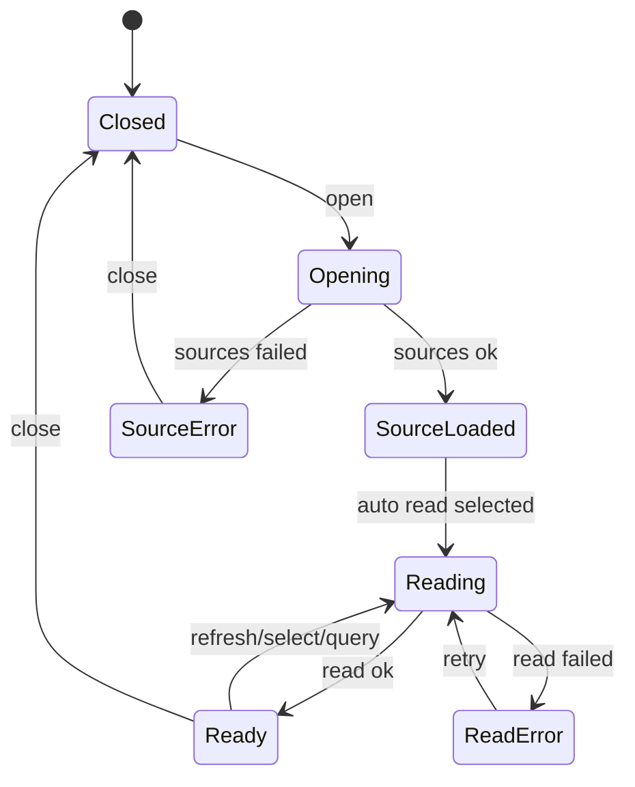

# 数据与状态

## 后端 DTO

```python
LogFormat = Literal["jsonl", "plain", "mixed"]

class LogSourceDTO(BaseModel):
    type: str
    label: str
    format: LogFormat
    description: str
    path: str
    exists: bool
    size_bytes: int | None = None
    updated_at_ms: int | None = None

class LogLineDTO(BaseModel):
    line_no: int | None
    raw: str
    parsed: dict[str, Any] | None = None
    parse_error: str | None = None

class LogReadResponseDTO(BaseModel):
    source: LogSourceDTO
    lines: list[LogLineDTO]
    truncated: bool
    read_bytes: int
    total_bytes: int | None
```

`parsed` 是辅助字段，前端仍以 `raw` 为事实源，避免后端 formatter 与前端展示强耦合。

## 前端类型

```ts
export type LogFormat = "jsonl" | "plain" | "mixed";

export interface LogSource {
  type: string;
  label: string;
  format: LogFormat;
  description: string;
  path: string;
  exists: boolean;
  size_bytes: number | null;
  updated_at_ms: number | null;
}

export interface LogLine {
  line_no: number | null;
  raw: string;
  parsed: Record<string, unknown> | null;
  parse_error: string | null;
}

export interface LogLineViewModel {
  key: string;
  kind: "json" | "plain" | "traceback" | "parse_error";
  time?: string;
  level?: "debug" | "info" | "warn" | "error" | "unknown";
  summary: string;
  badges: string[];
  raw: string;
  prettyJson?: string;
}
```

## 前端状态

```ts
interface LogViewerState {
  open: boolean;
  sources: LogSource[];
  selectedType: string | null;
  lines: LogLine[];
  loadingSources: boolean;
  loadingContent: boolean;
  error: string | null;
  tailLines: number;
  query: string;
  truncated: boolean;
  readBytes: number;
  totalBytes: number | null;
  lastLoadedAt: number | null;
}
```

状态流转：



## 日志 source registry

```python
@dataclass(frozen=True)
class LogSourceSpec:
    type: str
    label: str
    format: Literal["jsonl", "plain", "mixed"]
    description: str
    resolve_path: Callable[[Config, Path], Path]
```

registry 示例：

```python
SOURCES = (
    LogSourceSpec(
        type="web_server",
        label="Web Server",
        format="plain",
        description="Web 服务 stdout/stderr 日志",
        resolve_path=lambda cfg, home: home / "web" / "server.log",
    ),
    LogSourceSpec(
        type="trace",
        label="Trace",
        format="jsonl",
        description="Runner / tool / llm 事件 trace",
        resolve_path=lambda cfg, home: resolve_config_path(cfg.trace.output_path),
    ),
)
```

## 游标与读取策略

首版使用“尾部快照”：

- 请求参数 `tail_lines` 控制最终返回行数。
- 服务端先按 `max_bytes` 从文件尾部读取，再切最后 `tail_lines` 行。
- 返回 `line_no` 可为空；首版可以用尾部窗口内相对行号。
- v0.3 引入 `cursor` 后再支持增量 tail。

## 格式化颜色

| level | 视觉 |
|---|---|
| `error` | destructive text/border |
| `warn` | amber text/border |
| `info` | muted foreground |
| `debug` | muted + low emphasis |
| `unknown` | default |

日志内容区以信息密度优先，使用小字号、等宽数字、稳定行高、可折叠 JSON。不要把每行日志做成大卡片。
