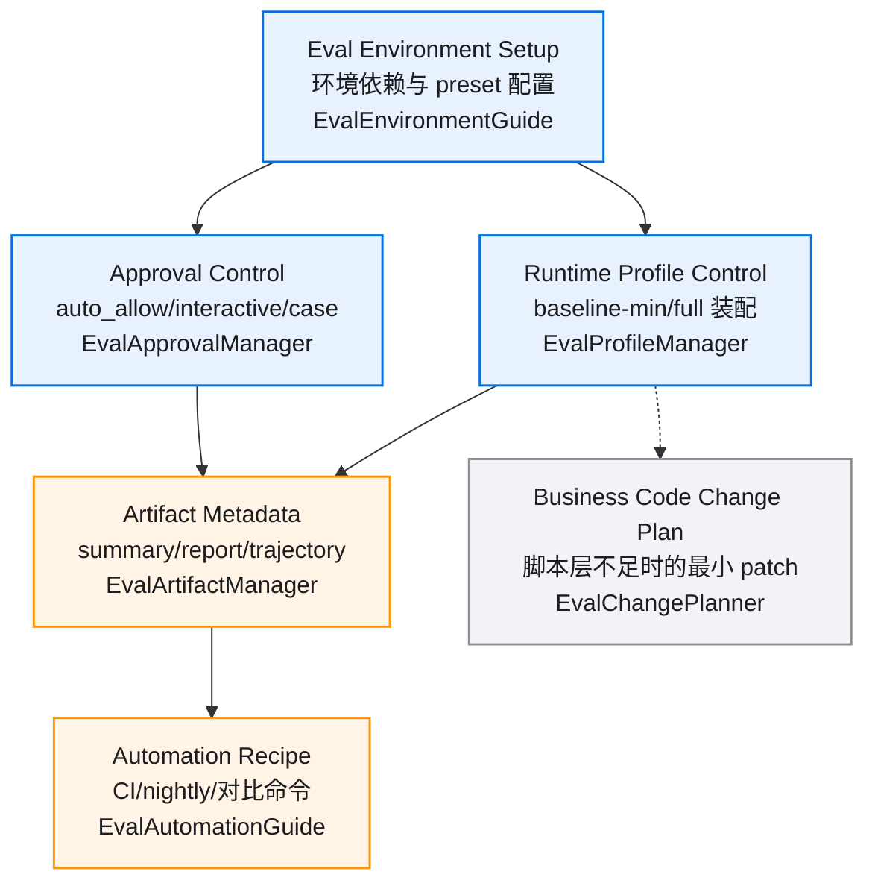
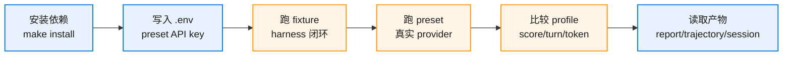
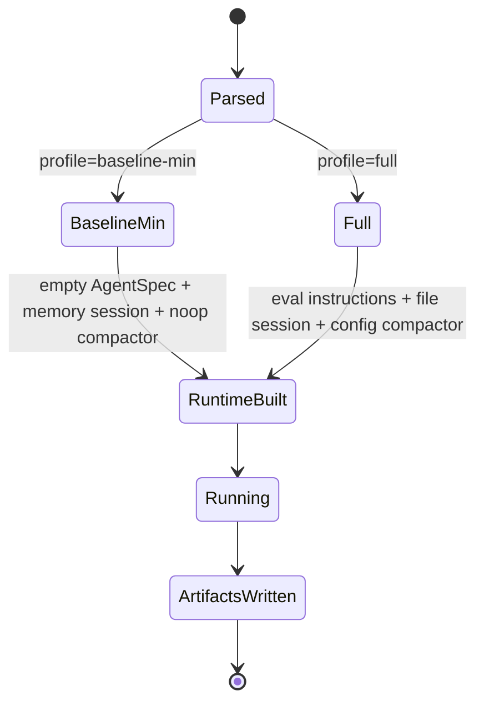
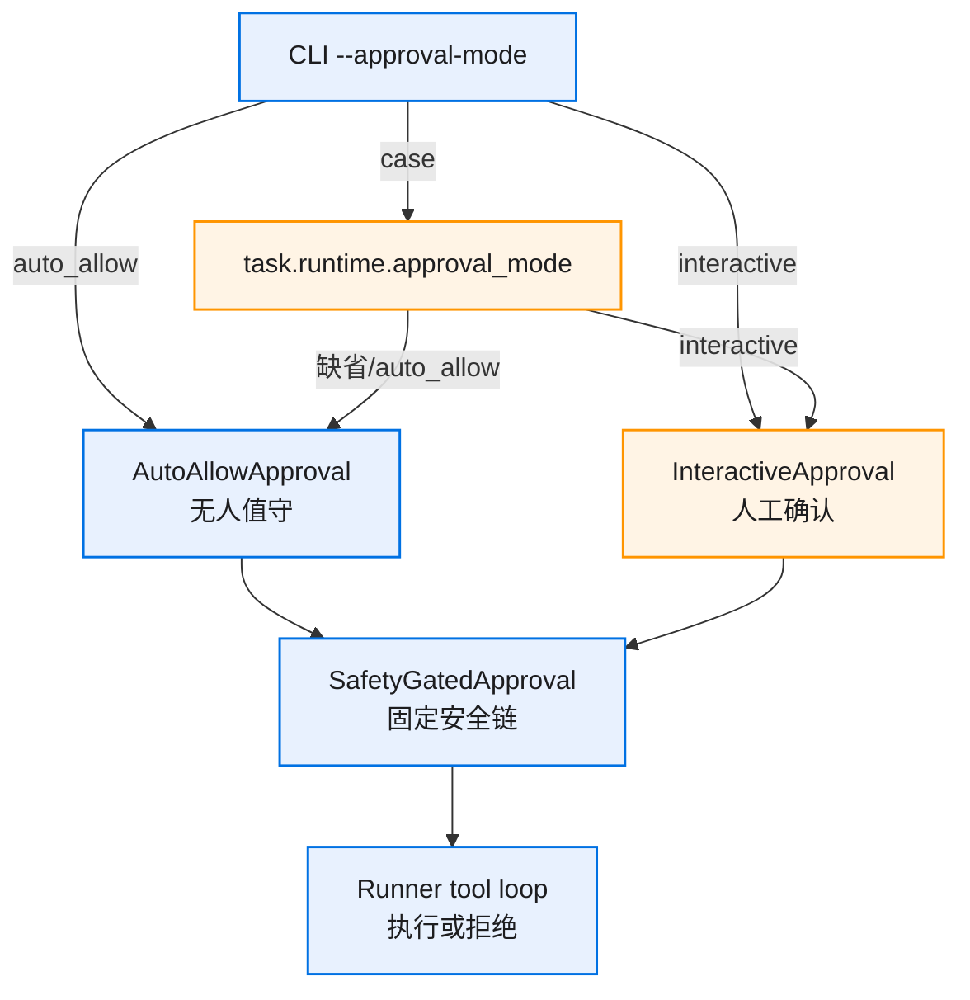
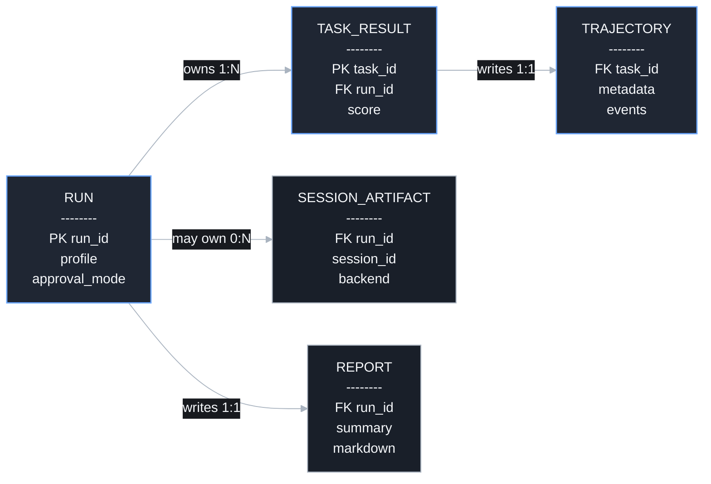

# harness-eval-environment-v0.1 图集

> Mermaid 查看建议：用 GitHub Markdown 预览，或 VS Code Mermaid Chart / Markdown Preview Enhanced。单图控制在约 12 个节点内，必要时拆图查看。

## 目录

- [总览](./diagrams.md#总览)
- [E2E 验证链路](./diagrams.md#e2e-验证链路)
- [Runtime Profile 状态流转](./diagrams.md#runtime-profile-状态流转)
- [Approval 模式解析](./diagrams.md#approval-模式解析)
- [产物数据关系](./diagrams.md#产物数据关系)

## 总览

## E2E 验证链路

## Runtime Profile 状态流转

## Approval 模式解析

## 产物数据关系

