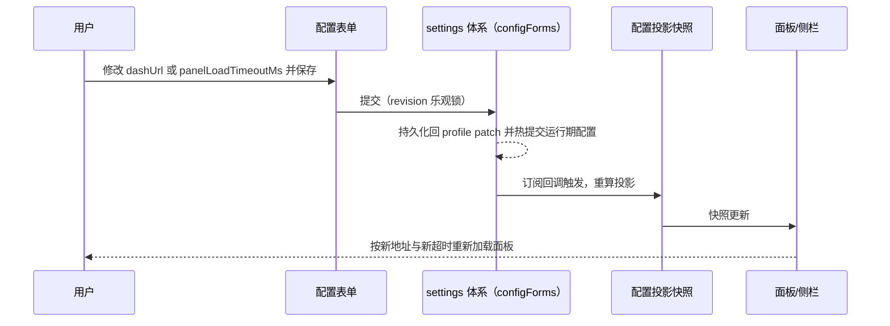

# kmh-infra 服务插件 v0.1 · 技术设计

> spec: docs/spec/kmh-infra-plugin-v0.1/spec.md
> spec 基线: 174 行，sha256 `2ef962776e2675a3c947a332be5b098c347f8aa12b1b5da07e091be5277b5bd3`（含 C1–C12 与"前置依赖（已解除）"一节）
> spec 确认依据: 用户 2026-10-16 逐项拍板——"同意 c4、c5"；"超时 8 秒要走配置，插件内所有功能性数值都要走配置，不要用魔法数值写死"；"暗号不对或者没配置，那就提示'身份校验错误'"；"其他同意默认"（侧栏名 Infra、8 秒默认值、切回重载、暗号缺失时助手能力仍在、四个配置默认值、面板登录页可接受）；"配置项要放插件详情页里，并且必须使用规定的 UI"（升格 C7）；"现在都确定了吧"（提议 A–E 整体采纳，升格 C8–C12）；MCP 接入路线由用户决定"先修 x-infra-mcp"，该修复已完成并经本轮复核通过
> 设计状态: 已确认（用户 2026-10-16"现在都确定了吧。开始 req dev、verify 吧"，含对 C7–C12 补设计与"数值字段先按原生实现、失败再退回"建议的接受；本轮已验证的实施偏差需回到本设计更新）
> 设计版本: 2026-10-16 第二版（feat03 解除阻塞；补 C7–C12 的机制与反例用例 T12–T17）
> 既有设计/规范: [MadeMe 服务插件 v0.1](../mademe-plugin-v0.1/spec.md)（现行、已验证的服务插件形态）；[新增 Kongming 自有包](../../kmh/adding-a-plugin-package.md)；[客户端 UI/UX 规范](../../../.agents/skills/dsh-client-ui-ux/SKILL.md)（C7 的权威来源，样式细则见其指向的 web-styling 与 ui-primitives 目录）；[协议不合规报告](../../../reports/x-infra-mcp-protocol-compliance.md)
> 本轮范围: feat01–feat05 全部五个 feat 的完整设计。未变部分沿用 MadeMe 出处

## 本轮设计差异

kmh-infra 不是从零设计：它照 MadeMe 已经跑通的服务插件形态做第二个实例。MadeMe 的四件套已被实际验证——**一个包同时是插件与分发单元**（`dsh.bundle.patch` 声明组合包 patch）、**宿主半 + 浏览器半双入口**（`package.json` 的 `exports` 双路径加 `dsh.client` 元数据）、**侧栏入口与中心面板各注册一次**、**配置项收在插件详情页**（settings 体系，revision 乐观锁，volatile 热提交）。本设计沿用这四件套，不新造机制。

相对 MadeMe 的实质差异只有四处：

| 差异 | MadeMe | kmh-infra | 原因 |
|---|---|---|---|
| 外部服务的接入方式 | streamable-http（一个 URL） | stdio（可执行文件 + 参数 + 工作目录 + 环境变量） | x-infra-mcp 是本地 Python 进程，不是 HTTP 服务 |
| 暗号的传递 | 无需（URL 即接入点） | 只存**环境变量名**，暗号本身从 KMH 进程环境读 | C1：暗号不得落进被跟踪的文件 |
| 地址的语义 | 服务地址与接入地址分开两项 | 面板地址**一项**同时是内嵌目标与查询目标 | C5：填一处，不设两处 |
| 数值的处理 | 超时是代码里的常量 | 三个数值全部是配置项，带单位与默认值 | C6：插件内所有功能性数值都要走配置 |

差异之外的模块划分、注册顺序、构建方式、测试组织全部沿用 MadeMe，对应关系见[附录](#appendix-trace)的 D 条目。

## 侧边栏出现 Infra 入口（feat01）

回指 spec feat01 场景1–4，以及 C4（停用即一起消失）。

<a id="feature-entry-plan"></a>

### 方案与理由

浏览器半向现有侧栏的 `sidebar.panellist` 槽注册一行，向中心 `main` 槽注册一个 keyed 面板，两个槽共用同一个面板 id。这是 MadeMe 已验证的注册方式（[MadeMe 浏览器半](../../../packages/kmh-mademe/src/client/index.ts)），侧栏的按钮、标签、悬停提示、选中态样式都由侧栏 shell 拥有，插件只提供图标字形与名字文案，因此**不改动侧栏的任何现有行为**。

面板 id 用 `brandString<MainPanelId>("infra")` 构造。它是 ui-layout 的品牌化字符串类型，侧栏条目与中心面板必须引用同一个值才能联动（点侧栏切主区、主区显示时侧栏条目高亮）。

**图标**选 `IconGaugeOutlineRegular`（ui-primitives 现成图标）。理由：x-dash 面板是服务运行状态的监控台，仪表盘语义最贴近；Outline 线性变体与侧栏其余条目（如"上下文洞察"）风格一致。MadeMe 用的是填充式 `IconSparkleRegular`，两者并排不会冲突。这是可替换的实现细节，改图标只需换一处导入。

**位置**用 `order: 11`。MadeMe 用 `order: 10`，取 11 让它落在 MadeMe 紧后面。顺序的最终观感在实现后按实际界面核对，不合适时调这一个数字。

**选中态记忆**沿用 MadeMe 的做法：面板被选中时往 `localStorage` 写标记，切走清除；插件卸载时一并清除残留标记，避免把上一次的选中强加给刷新恢复；刷新时在微任务里恢复选中，恢复失败只告警不阻断启动。

### 职责、数据流与失败处理

| 模块 | 职责 | 允许依赖 |
|---|---|---|
| `src/client/index.ts` | 注册侧栏条目、中心面板、配置表单；维护选中态与刷新恢复 | 只依赖 DSH 公开的 client 服务：`slots`、`locale`、`layout`、`configForms` |
| `src/client/InfraIcon.tsx` | 按侧栏请求的边长渲染图标 | ui-primitives |
| `src/client/locales.ts` | 中英文案（面板名与全部界面文案） | 无 |

侧栏条目与面板注册在插件加载时各执行一次，退出时由 Cordis 的 effect 统一回收：**停用插件即条目消失**（C4）。注册没完成时刷新恢复只打一条告警，不影响 Web 启动。

### 测试场景与预期

<a id="feature-entry-test"></a>

<a id="case-sidebar-entry"></a>

#### 侧栏出现 Infra 入口并可恢复选中

- 依据：[feat01 场景1–4](../kmh-infra-plugin-v0.1/spec.md)，设计[侧边栏出现 Infra 入口](#feature-entry-plan)（D03）
- 前提与触发：插件已启用，打开 KMH Web；点击 Infra 入口使主区切到面板；刷新页面
- 预期结果：展开态显示图标与名字"Infra"；收起态悬停显示"Infra"提示；点击后主区显示面板且入口高亮；刷新后入口仍在且主区回到面板
- 禁止结果：出现与现有侧栏样式不一致的条目；刷新后回到会话而丢失选中；侧栏其余条目的行为被改变
- 验证方式与证据：真实浏览器操作 KMH Web（`pnpm web` 后访问 `http://127.0.0.1:60000`），观察侧栏与主区并截图；计划在实现后执行
- 局限：截图只能证明当前主题下的观感，另需在收起态单独核对悬停提示

<a id="case-disable"></a>

#### 停用后入口与助手能力一起消失

- 依据：[feat05 场景2](../kmh-infra-plugin-v0.1/spec.md)，C4；设计 D03 与 [助手查询本机服务](#feature-mcp-plan)（D02）
- 前提与触发：插件已启用并已填好配置；在插件页停用该插件；再重新启用
- 预期结果：停用后侧栏没有 Infra 入口、助手没有查询能力；重新启用后两者回来，配置项显示的还是停用前填的内容
- 禁止结果：停用后入口或能力残留；重新启用后配置被重置为默认值
- 验证方式与证据：真实浏览器在插件页停用/启用，观察侧栏变化与插件详情里的配置值；计划在实现后执行
- 局限：需要 DSH 插件页提供停用入口，若该入口不可用则改为修改 profile patch 后重启核对

## 点击内嵌打开 x-dash 面板（feat02）

回指 spec feat02 场景1–5，以及 C5（一处地址）、C6（超时要走配置）。

<a id="feature-panel-plan"></a>

### 方案与理由

在一个内嵌网页视口里打开 x-dash 面板，配一条工具栏（当前地址、刷新、在系统浏览器打开）和一条超时提示。这与 MadeMe 的面板同构（[MadeMe 面板](../../../packages/kmh-mademe/src/client/MadeMePanel.tsx)），沿用其已验证的两个细节：`iframe` 的 sandbox 取值与其浏览器标签页一致，以及加载超时后提示"可能无法打开"并给出系统浏览器兜底。

**地址只有一处**（C5）：面板打开的目标与助手查询的目标都是配置里的 `dashUrl`。用户改一次，两边同时换过去，不需要分别设置、不需要重启。

**超时来自配置**（C6）：`panelLoadTimeoutMs`，默认 8000 毫秒。地址或超时值一改，面板按新值重新加载——面板读的是配置投影出来的快照，不是常量。

**已知的浏览器行为**（写进 spec 场景2、不是缺陷）：切走再切回会重新加载内嵌页面，页面内状态不保留。这是 WebKit/Safari 系浏览器搬移 `iframe` 必然重载的实测结论，Chrome 保留。面板的登录态由浏览器按域保留，不受影响。

### 职责、数据流与失败处理

面板组件只做渲染与本地交互（刷新计数、超时标记），不自己读配置——配置值由注册侧投影成快照注入，避免组件直接依赖 settings 服务。

配置到界面的路径：



失败处理：地址为空或配置尚未就绪时，面板区显示"正在读取面板地址"而不是空白或报错；超过配置的超时仍未触发加载完成时，显示提示并提供"在系统浏览器打开"；被 `X-Frame-Options` 或 CSP 拒绝内嵌时，表现与不可达一致（只能是超时提示加兜底按钮，无法精确区分）。

### 关键新增/变化数据结构与配置（按需）

面板侧的投影快照：

```typescript
// 仅为设计示意；正式实现位置为 src/client/InfraPanel.tsx 的导出类型。
interface DashTargetState {
  /** 配置读取状态；ready 才表示 URL 可用。 */
  status: "loading" | "ready" | "unavailable";
  /** 规范化后的面板地址；未就绪时为 undefined。 */
  url: string | undefined;
  /** 当前生效的加载超时（毫秒），来自配置。 */
  loadTimeoutMs: number;
}
```

`status` 与 `url` 沿用 MadeMe 的同名语义（[ServiceUrlState](../../../packages/kmh-mademe/src/client/MadeMePanel.tsx)）；`loadTimeoutMs` 是本插件新增的一项，让超时也随配置热生效。

### 测试场景与预期

<a id="feature-panel-test"></a>

<a id="case-panel-load"></a>

#### 面板按配置地址加载，超时提示按配置值出现

- 依据：[feat02 场景1、场景3、场景4](../kmh-infra-plugin-v0.1/spec.md)，C5、C6；设计 D04
- 前提与触发：x-dash 在 `http://127.0.0.1:60010` 运行；插件已启用；点击侧栏 Infra 入口。随后把面板地址改成一个不可达地址并保存，再次点开；再把 `panelLoadTimeoutMs` 改成明显不同于默认的值，重复不可达观察
- 预期结果：可达时面板正常显示 x-dash 界面；不可达时按**当前配置的**超时才出现"面板可能无法打开"提示；提示出现前后"在系统浏览器打开"按钮都可点
- 禁止结果：超时是写死的 8 秒而与配置无关；改地址后仍按旧地址加载；不可达时不出现任何提示也不出现兜底按钮
- 验证方式与证据：真实浏览器操作；不可达用改成一个未监听端口模拟。改超时值后的生效需要观察提示出现的时间点相对配置值一致，计划在实现后执行并记录两次不同超时值的观察
- 局限：人眼计时精度有限，只验证"随配置变化"这一事实，不做毫秒级断言

<a id="case-single-address"></a>

#### 改地址后助手查询也换过去

- 依据：[feat04 场景5](../kmh-infra-plugin-v0.1/spec.md)，C5；设计 D01 与 D04
- 前提与触发：插件已启用；在插件详情里把面板地址改成另一个 x-dash 实例（或同一实例的等价写法如 `127.0.0.1` 换成 `localhost`）并保存；再让助手查询本机服务
- 预期结果：面板与助手查询都按新地址工作，不需要重启 KMH
- 禁止结果：只改了一边；或需要重启 KMH 才生效
- 验证方式与证据：浏览器改配置 + 会话里发起查询，核对工具结果里的数据来源；**依赖 feat03，当前阻塞**
- 局限：在 feat03 阻塞解除前，这条只能验证到"面板换过去了"；查询侧的证据待接入可用后补

## 在插件详情中填写配置（feat04）

回指 spec feat04 场景1–5，以及 C1（暗号只存变量名）、C6（数值走配置）。

<a id="feature-config-plan"></a>

### 方案与理由

八个配置项，全部 `.volatile()`，全部用原生 `Schema.string()` / `Schema.boolean()` / `Schema.number()`——**不用 transform 节点**。这是 MadeMe 实测留下的硬约束：transform 的序列化产物会被 settings 的 client 链路丢弃，导致配置页里看不到该命名空间。表单侧对地址做格式校验与规范化（无 scheme 补 `https`），宿主 schema 只收原始字符串，两边职责不重叠。

| 配置项 | 类型 | 默认值 | 单位 | 用途与使用者 |
|---|---|---|---|---|
| `dashUrl` | string | `http://127.0.0.1:60010` | — | 面板内嵌目标，同时作为查询目标传给子进程（C5） |
| `tokenEnvVar` | string | `X_INFRA_MCP_TOKEN` | — | 暗号所在的**环境变量名**，不是暗号本身（C1） |
| `pythonCommand` | string | `python3` | — | 启动查询服务进程的可执行文件 |
| `mcpModuleDir` | string | `/Volumes/machub_app/proj/x-infra/x-infra-mcp` | — | 查询服务进程的工作目录（Python 模块所在检出目录） |
| `panelLoadTimeoutMs` | number | `8000` | 毫秒 | 面板加载多久算失败（feat02 场景3） |
| `probeTimeoutMs` | number | `5000` | 毫秒 | "测试连接"探测多久算不可达（feat04 场景3） |
| `toolCallTimeoutMs` | number | `60000` | 毫秒 | 助手单次查询最多等多久（feat03） |
| `mcpEnabled` | boolean | `true` | — | 是否把查询能力接入助手 |

`dashUrl` 的默认值取自 x-infra 侧对面板监听地址的默认（x-infra-mcp 的 `X_DASH_BASE_URL` 默认 `http://127.0.0.1:60010`）；`probeTimeoutMs` 沿用 MadeMe 已验证的 5 秒；`toolCallTimeoutMs` 沿用 DSH mcp-client 的默认 60 秒，显式写在配置里以便用户可调；`mcpModuleDir` 是本机实际检出路径，换机器的人需要自己改。

**不暴露为配置的数字，及理由**（C6 要求"插件自己决定的功能性数值"走配置，下列不是这一类）：地址长度上限 2048 是输入校验的安全边界，不是用户可调的策略；侧栏 `order: 11` 是界面排序；MCP 连接的重连节奏与指令字节上限用 DSH mcp-client 自己的默认值，本插件不写死也不覆盖。

**"测试连接"探什么**：只探 `dashUrl` 的可达性（no-cors 请求，超时取 `probeTimeoutMs`）。查询服务是本地子进程，浏览器侧无法探测，因此不假装能测——表单在对应字段旁说明这一点。

**`tokenEnvVar` 的呈现**：这是一个文本字段，标签写明"暗号所在的环境变量名"，提示写明暗号本身要设在启动 KMH 之前的环境里、不会写进任何配置文件（C1）。留空或填了环境里不存在的名字都**不阻塞保存**，插件照常可用，只是助手查询时会得到身份校验错误（C1、feat04 场景4）。

**界面按规定的客户端 UI 规范实现**（C7）：配置项全部落在插件详情页内，用户不需要改配置文件。组件一律复用 ui-primitives 的现成件（表单壳、字段、开关、状态点、按钮），图标取自现有图标库（不自造图标，新增图标需设计师审批），颜色、圆角与间距取主题 token 而非字面量，功能样式字重不超过 500，浅色与深色两种主题都要可读。反馈位置的归属按规范判断：字段格式错误留在字段旁原位提示，面板整体加载与失败在面板内居中呈现，短暂的操作结果才用全局提示。规范本身声明它不是完整检查清单，因此可机械核对的条目进 T12，其余属于设计判断。

### 职责、数据流与失败处理

| 模块 | 职责 | 说明 |
|---|---|---|
| `src/config.ts` | 配置 schema 与地址规范化函数 | 宿主半与浏览器半共用；地址规范化是纯函数，两端引用同一份，不各自实现（R2/R5） |
| `src/client/config-controller.ts` | 把共享配置表单桥接成页面暂存表单 | 字段规格：地址字段走规范化校验，数值与开关字段按类型解析 |
| `src/client/ConfigForm.tsx` | 渲染配置表单与"测试连接" | 同时挂在插件详情页与组件行详情两处，共用一个 controller |

配置的权威存储是当前 profile 的 Cordis patch 文件（经 settings 体系写入），运行期读取路径只有一条：`apply` 收到的活引用加 `configForms` 的投影快照。数值字段的解析失败（非数字、超范围）在表单层拦截，保存失败（revision 冲突）由共享表单模型报"保存未成功，请重试"。

**"身份校验错误"在配置页的体现**：`tokenEnvVar` 字段的提示文案给出该填什么（feat04 场景4）。注意这一条与 feat03 的措辞要求是两件事——配置页只是文案提示，助手侧回答"身份校验错误"的机制见 [助手查询本机服务](#feature-mcp-plan)。

### 测试场景与预期

<a id="feature-config-test"></a>

<a id="case-config-defaults"></a>

#### 配置默认值、类型与地址规范化

- 依据：[feat04 场景1、场景2](../kmh-infra-plugin-v0.1/spec.md)，C6；设计 D01
- 前提与触发：以空输入解析配置 schema；再以若干非法与合法地址调用 `normalizeHttpUrl`
- 预期结果：八个字段读出上表默认值，三个数值字段是数字而不是字符串；无 scheme 的地址补 `https`；非法地址（空串、超长、非 http/https、带内嵌凭据）返回 undefined
- 禁止结果：数值字段读出字符串导致表单显示异常；非法地址被放行保存
- 验证方式与证据：包内单测（`test/infra-config.test.mjs`，node:test），断言实际解析输出；计划随实现执行
- 局限：只覆盖 schema 层。**数值字段能否在插件详情页正常显示与保存是另一回事**（MadeMe 踩过 transform 字段被丢的坑），由下一条覆盖

<a id="case-numeric-fields"></a>

#### 数值配置项在插件详情里可见可改

- 依据：[feat04 场景1](../kmh-infra-plugin-v0.1/spec.md)，C6；设计 D05
- 前提与触发：打开插件详情页，查看并修改 `panelLoadTimeoutMs` 与 `toolCallTimeoutMs`，保存
- 预期结果：两个数值字段正常显示当前值与默认值，可编辑、可保存；保存后重新打开详情页读到的仍是新值
- 禁止结果：字段不可见（namespace 被 settings 链路丢弃）；保存后读回旧值或默认值
- 验证方式与证据：真实浏览器在插件详情页操作并刷新核对；计划在实现后执行
- 局限：这是 MadeMe 实测出问题的同类风险点。若发现数值字段不可见，退回方案是把数值以字符串存配置、在宿主半解析（需要在实现前确认，见[待确认](#pending)）

<a id="case-token-not-committed"></a>

#### 暗号不以明文进入任何被跟踪文件

- 依据：C1；[feat04 场景4](../kmh-infra-plugin-v0.1/spec.md)；设计 D01
- 前提与触发：实现完成后，在被跟踪文件里检索暗号明文；并在插件详情页查看 `tokenEnvVar` 字段的呈现
- 预期结果：配置里只有环境变量名；被跟踪文件里检索不到暗号明文；把该字段留空也不阻塞保存
- 禁止结果：暗号明文出现在 `cordis.patch.yml`、README 或任何被提交的文件里
- 验证方式与证据：`git grep` 覆盖被跟踪文件 + 人工核对插件详情页；计划在实现后执行。**真实的暗号值不在本设计文档与本报告的任何位置，也不在实现过程中被读取或记录**
- 局限：静态检索只能证明"当前提交里没有"，不能防止后续有人手填进去；因此配置项标签与提示必须写明这一点

<a id="case-probe-timeout"></a>

#### 测试连接按配置的超时给出可达/不可达

- 依据：[feat04 场景3](../kmh-infra-plugin-v0.1/spec.md)，C6；设计 D05
- 前提与触发：分别用可达地址（本机 60010）与不可达地址点击"测试连接"；再把 `probeTimeoutMs` 调小后重复不可达
- 预期结果：可达显示可达与耗时；不可达显示不可达/超时；不可达的等待时长随配置的超时值变化
- 禁止结果：探测使用与配置无关的固定超时；地址非法时仍发起探测
- 验证方式与证据：真实浏览器操作；计划在实现后执行
- 局限：no-cors 探测无法区分"拒绝连接"与"被策略拦截"，只报可达性

<a id="case-ui-conformance"></a>

#### 界面按规定的客户端 UI 规范实现

- 依据：[feat04 场景1](../kmh-infra-plugin-v0.1/spec.md)，C7；设计 D05、D11
- 前提与触发：打开插件详情页与面板，逐项对照[客户端 UI/UX 规范](../../../.agents/skills/dsh-client-ui-ux/SKILL.md)检查：组件来源、图标来源、颜色与间距取值、字重、反馈位置、加载状态、深浅两色
- 预期结果：表单复用 ui-primitives 的现成组件；图标取自现有图标库；颜色、圆角、间距取自主题 token 而非字面量；功能样式字重不超过 500；面板的加载中与失败提示按规范归属（表单字段校验留在原位，面板整体加载居中）；浅色与深色两种主题下文字都可读
- 禁止结果：自造平行组件；使用规范外的图标；引入字面量颜色；用 600 及以上字重做强调；提示破坏现有布局或让相邻元素位移
- 验证方式与证据：人工对照规范逐项核对，切换深浅主题各看一次并截图；计划在实现后执行
- 局限：规范本身说明它不是完整检查清单，本用例覆盖的是其中可机械核对的条目；"是否该有更合适的设计"这类判断需要设计评审，不在本用例范围

## 助手查询本机服务（feat03）

回指 spec feat03 场景1–7，以及 C1（身份校验错误措辞）、C2（面板不可达不得报成没有服务）、C3（只读）、C8–C12。

<a id="feature-mcp-plan"></a>

**本节状态：已解除阻塞。** 原先阻塞在 `x-infra-mcp` 的 stdio 实现不合规（见[协议不合规报告](../../../reports/x-infra-mcp-protocol-compliance.md)），该问题已由 x-infra 侧修复。2026-10-16 用报告里的客户端层命令复核，结果：连接成功、`tools/list` 列出 `service_list` 与 `service_info`、`tools/call` 的 `content[0].type` 为 `text` 且 `isError` 正确、业务 JSON 原样在文本里。协议层验收通过，本节可作为可交接设计。

未复核的部分：带真实暗号的完整数据链路（本轮没有暗号值）。它由 T6 在实现后覆盖。

### 方案与理由

依赖修好后的 `x-infra-mcp`，宿主半用 DSH 现成的 `@deepseek-ai/dsh-mcp-client`（**不复用 MadeMe 的 streamable-http 写法，改用它的 stdio 形态**），工具名会落在 `mcp__infra__service_list` 与 `mcp__infra__service_info`。装配方式沿用 MadeMe 的 `McpMount`：配置变化时按新参数重挂、开关关闭即卸载、连接失败只告警不阻塞插件、恢复后自动重连。C3 的只读边界不需要本插件额外设防——上游服务本身只暴露两个查询工具。

**一个必须在插件侧处理的细节**：DSH 给子进程的是一份"洗过的"父进程环境，凡名字匹配 `KEY|PASSWORD|SECRET|TOKEN` 的一律不转发，因此 `X_INFRA_MCP_TOKEN` **不会被自动带进去**，必须由插件把从 KMH 进程环境里读到的值显式放进子进程环境。这同时也是 C1 成立的原因：暗号只存在于 KMH 进程环境与子进程环境里，不落盘。

**"身份校验错误"与"面板不在运行"的措辞怎么保证**：MCP 工具的输出文本由上游服务生成，插件不能改写它，所以措辞引导放在系统提示词里——宿主半向提示词注册一段**仅在本插件启用时存在**的说明，内容是：查询结果里出现身份校验失败时，回答"身份校验错误"；出现面板不可达时，明确说明面板不在运行且这不代表没有服务；服务名查不到时明确说明该名字没有登记。这段说明挂在 DSH 已分配的 `MCP_SERVERS` 段落位上（mcp-client 自己也是这么注册服务指令的，见其 `server-context.ts`）。

措辞引导是**模型遵从**，不是硬保证：因此 C1 与 C2 的验收要靠多条不同的问法与结果组合来观察，不能只问一次看到期望回答就算过。这一点在下面的测试场景里写明。

**另外五条约束落在同一段引导与同一处装配上**（C8–C12）：

- **C8（未知与重名不得说成确定结论）**：同一段引导还要交代——状态是"暂未知"时说成"还没查过该服务"，不得说成在线或离线；结果里带重名标记时，回答里点出存在重名，不得把第一个当成唯一一台。上游返回的 `unknown` 状态与重名标记都是既有语义，插件不改写结果，只引导措辞。
- **C9（故障不拖垮 Web）**：装配用 mcp-client 的 `failOnStartupError: false`，初始连接失败只记一条告警；子进程起不来、半途挂掉、单次调用卡住，都只表现为"工具不可用"或该次调用超时，不阻塞插件加载、不影响 Web 启动与其他插件。`toolCallTimeoutMs` 给单次调用兜底。
- **C10（凭证不进输出）**：本插件不做地址加工，也不在引导文案或日志里复述地址；输出里的地址原样来自上游，而脱敏由上游保证（x-infra-mcp 的 C2）。本条的落实点是**不引入第二条输出路径**——插件不额外把地址写进提示词、日志或错误消息。
- **C11（停用后引导一起消失）**：引导段落经 `ctx.effect` 注册，随插件的 fiber 回收；停用后提示词里不残留对本插件能力的描述。
- **C12（重挂不留孤儿进程）**：`McpMount` 在重挂与卸载时都先 `dispose()` 旧实例并按完成回收，再挂新实例；装配键未变时不重挂，避免无谓的进程抖动。

### 职责、数据流与失败处理

| 模块 | 职责 | 说明 |
|---|---|---|
| `src/mcp.ts` | 按配置装配/重挂/卸载 mcp-client 实例 | 装配键是"启用且关键参数非空"的组合；键不变则不重挂 |
| `src/prompt.ts` | 注册措辞引导段落 | 随插件启停；不启用时不占提示词 |

关键参数：`command = pythonCommand`、`args = ["-m", "x_infra_mcp.mcp_server"]`、`cwd = mcpModuleDir`、`env = { X_DASH_BASE_URL: dashUrl, X_INFRA_MCP_TOKEN: <从 tokenEnvVar 指定的环境变量读到的值，缺失则不传该键> }`、`toolCallTimeoutMs`。

失败处理：`tokenEnvVar` 为空或该环境变量不存在时，仍然挂载（工具会出现），只是每次调用会得到身份校验失败——这与 C1 一致；mcp-client 初始连接失败只记一条告警，工具暂不可用，恢复后自动重连，插件其余部分不受影响；`pythonCommand` 或 `mcpModuleDir` 配错时表现为工具缺失，同样不阻塞插件。

### 测试场景与预期

<a id="feature-mcp-test"></a>

<a id="case-assistant-wording"></a>

#### 助手按状态码给出正确措辞

- 依据：[feat03 场景1–6](../kmh-infra-plugin-v0.1/spec.md)，C1、C2、C3；设计 D02、D07
- 前提与触发：分别构造四种状态后各问一轮（每轮换一种问法）：x-dash 正常运行且暗号正确；x-dash 停止运行；暗号缺失或错误；问一个没有登记过的服务名
- 预期结果：分别得到服务清单（含状态与上次检查时间）、"面板不在运行"的明确说明、"身份校验错误"、以及"查不到这个名字"
- 禁止结果：**面板不可达被回答成"没有服务"或空清单**；身份校验失败被回答成"没有服务"；四种状态被混为一谈
- 验证方式与证据：真实浏览器会话里提问并逐条核对回答，同时核对工具调用记录里的返回码；计划在实现后执行
- 局限：措辞依赖模型遵从提示词，属于行为引导而非硬校验；因此四种状态四种问法都要各观察一次，禁止用"问到过一次期望回答"代表全部覆盖。x-dash 停止运行的构造需要临时停掉面板进程，须与用户确认时机

<a id="case-unknown-duplicate"></a>

#### 未知状态与重名不被说成确定结论

- 依据：[feat03 场景1、场景2](../kmh-infra-plugin-v0.1/spec.md)，C8；设计 D07、D08
- 前提与触发：x-dash 刚启动、周期检查尚未完成时问某个服务的状态；再问一个在登记表里重名的服务
- 预期结果：前者的回答里明确是"还没查过/暂未知"，不判断在线或离线；后者的回答里点出存在重名，不说成唯一一台
- 禁止结果：把"暂未知"说成在线或离线；把重名里的第一个当成唯一结果
- 验证方式与证据：真实浏览器会话观察，配合工具调用记录里确实出现 `unknown` 状态与重名标记；计划在实现后执行
- 局限：构造"周期检查未完成"的窗口较短，可能要在重启面板进程后立即提问；若窗口抓不到，改为先断言工具返回里出现过 `unknown`，并如实说明措辞部分未观察到

<a id="case-fault-isolation"></a>

#### 查询服务故障不拖垮 Web

- 依据：[feat03 场景1](../kmh-infra-plugin-v0.1/spec.md)，C9；设计 D02、D09
- 前提与触发：三种构造各做一次——把 Python 位置改成不存在的路径；把 x-dash 停掉；把单次查询等待上限调到极小值让调用超时。每种构造后让配置生效，再正常使用 KMH Web 并发起一轮会话
- 预期结果：Web 正常启动且页面可用；会话正常对话；其他插件不受影响；助手侧只表现为没有这些能力，或该次调用明确报错
- 禁止结果：Web 启动失败；会话卡住或无法使用；插件加载报错影响 profile 里的其余条目
- 验证方式与证据：改配置后观察 Web 启动日志、会话可用性与插件运行日志（应为告警而非中断）；计划在实现后执行
- 局限：第三种构造需要先有一个可用配置再调小超时，因此不能作为第一条执行

<a id="case-credential-redaction"></a>

#### 地址里的会话凭证不进入助手可见输出

- 依据：[feat03 场景1](../kmh-infra-plugin-v0.1/spec.md)，C10；设计 D10
- 前提与触发：在 x-dash 里登记一个带查询串（形如 `?token=…`）的服务地址，然后让助手列出服务
- 预期结果：回答里出现的地址到问号为止；插件自己的提示词、日志与错误消息里同样不出现该查询串
- 禁止结果：助手可见的任何位置出现问号之后的内容
- 验证方式与证据：浏览器会话观察，并检索插件运行日志；计划在实现后执行
- 局限：脱敏本身由上游保证，本条验证的是"本插件没有引入第二条泄露路径"；上游若回退，本条会失败——这正是它作为反例用例的价值

## 把插件交给别人用（feat05）

回指 spec feat05 场景1–3，以及 C4（停用即整体消失）。

<a id="feature-dist-plan"></a>

### 方案与理由

交付形态与 MadeMe 完全一致：**一个包就是一个插件，整体交付、整体启停**——`package.json` 里 `dsh.bundle.patch` 指向包内 `cordis.patch.yml`，安装方在插件页安装启停即可。MCP 工具接入、侧栏入口、面板、配置表单都是这同一个插件的组成部分，不是四个独立插件；停用即四者一起消失（C4），已填配置保留。这条分发方式由 MadeMe 验证过，本设计不新增机制，也不重复维护其说明。

为了"别人装上就能用"，默认值必须对一台陌生机器诚实：`pythonCommand` 与 `mcpModuleDir` 是本机路径，别人装完必须改；`dashUrl` 与 `tokenEnvVar` 有通用默认值，多数情况不用改。这些"装完要改什么"写进包 README，不写进代码。

### 职责、数据流与失败处理

包的构成（与 MadeMe 逐项对应）：

| 文件 | 作用 |
|---|---|
| `package.json` | 双入口 `exports`（宿主半 `lib/src/index.js`、浏览器半 `lib/client.js`）；`dsh.client` 声明 web 平台与需注入的 client 包；`dsh.bundle.patch` 指向组合包 patch |
| `cordis.patch.yml` | 一行 `insert`，id 与模块名都是 `@kmh/kmh-infra`；settings 的配置命名空间即这个行 id |
| `build.mjs` | 用 esbuild 打包浏览器半为 `__ModuleLoader__` 工厂，并编译宿主半 |
| `tsconfig*.json` | 宿主半与浏览器半双 references |
| `src/`、`test/`、`README.md` | 源码、包内测试、使用者文档 |

接入到 KMH 自己的 Web：在 [profiles/kmh-web/package.json](../../../profiles/kmh-web/package.json) 的 `dependencies` 登记 `link:../../packages/kmh-infra`，在 [profiles/kmh-web/cordis.patch.yml](../../../profiles/kmh-web/cordis.patch.yml) 以实例 id `kmh-infra` 挂载。另需同步登记的清单（漏一项就会有检查或运行失败，逐条都有依据）：

| 位置 | 登记内容 | 依据 |
|---|---|---|
| 根 `package.json` | `build:kmh`、`typecheck:kmh`、`lint`、`format:check` 各加 `--filter @kmh/kmh-infra`；`lint` 里加 `node --check packages/kmh-infra/build.mjs`；`test` 里加 `packages/kmh-infra/test/*.test.mjs` | 与 MadeMe 在根脚本中的登记方式一致（[新增自有包](../../kmh/adding-a-plugin-package.md)） |
| `tests/runtime/web-plugin-hmr.test.mjs` | 把 `kmh-infra` 加进它符号链接的包列表（同时补 `kmh-mademe`） | 该测试把 profile 清单与 patch 原样复制到临时目录，但只链接一份**固定名单**的包；`prepareProfiles` 对不存在的链接目标会 `realpathSync` 失败而抛错，所以不加这一项，该测试会因 kmh-infra 而失败。实现时核实发现：HEAD 的名单就已经漏了 `kmh-mademe`，该测试在本轮改动之前即为红色，因此这一项同时修两处 |
| `docs/kmh/plugin-index.md` | 新增一行指向包 README | 自有包清单的单一归属 |
| `docs/spec/README.md` | 新增一行指向本次 spec | spec 索引的单一归属 |

### 测试场景与预期

<a id="feature-dist-test"></a>

<a id="case-build-artifacts"></a>

#### 构建产物与分发声明完整

- 依据：[feat05 场景1](../kmh-infra-plugin-v0.1/spec.md)，C4；设计 D06
- 前提与触发：执行 `pnpm --filter @kmh/kmh-infra build` 后，读取包声明与产物
- 预期结果：`exports` 双入口指向实际存在的产物；`dsh.client.platform` 为 `web` 且 `inject` 列出四个 client 包；组合包 patch 声明指向包内文件并含正确的模块名；宿主半可导入并暴露插件名与 `apply`；浏览器半产物是 `__ModuleLoader__` 工厂且声明了四个注入服务
- 禁止结果：声明指向不存在的产物；浏览器半漏声明注入导致加载即报错
- 验证方式与证据：包内冒烟测试（`test/infra-smoke.test.mjs`，node:test），按 MadeMe 冒烟测试的同型断言；计划随实现执行
- 局限：产物形态正确不等于运行时可用，运行时由下面的场景与 feat01/02 的浏览器场景覆盖

<a id="case-web-load"></a>

#### KMH Web 整体加载且根检查通过

- 依据：[feat05 场景1、场景3](../kmh-infra-plugin-v0.1/spec.md)，C4；设计 D06
- 前提与触发：把包登记进 kmh-web profile 后运行 `pnpm install`、`pnpm build:kmh`、`pnpm test`、`pnpm lint`、`pnpm typecheck:kmh`，再启动 `pnpm web`
- 预期结果：根命令全绿；Web 启动后插件已挂载，侧栏出现 Infra 入口，插件详情页能看到全部配置项
- 禁止结果：`web-plugin-hmr` 因 profile 链接悬空而失败；Web 启动日志出现该插件加载错误
- 验证方式与证据：在仓库根实际执行上述命令并记录输出，配合浏览器核对；计划在实现后执行
- 局限：`pnpm test` 会先跑 `pretest`（`pnpm build:kmh`），耗时较长；真机验证需要重启 Web 才能发现新包

<a id="case-prompt-lifecycle"></a>

#### 停用后措辞引导一起消失

- 依据：[feat03 场景7、feat05 场景2](../kmh-infra-plugin-v0.1/spec.md)，C11（C4 的加严）；设计 D07
- 前提与触发：插件启用时先确认助手知道本插件的能力；停用插件后再问本机服务
- 预期结果：停用后的回答里不出现本插件引导过的措辞（"身份校验错误""面板不在运行""暂未知"），助手表现为没有这类能力
- 禁止结果：停用后仍出现上述措辞模式；或助手声称自己可以查本机服务
- 验证方式与证据：浏览器在插件页停用后发起会话提问；计划在实现后执行
- 局限：措辞是行为引导，停用后模型仍可能凭上下文猜测；判定以"不出现引导措辞、不声称有能力"为准，不以单次措辞缺失为唯一依据

<a id="case-no-orphan-process"></a>

#### 反复改配置不残留孤儿进程

- 依据：[feat05 场景2、场景3](../kmh-infra-plugin-v0.1/spec.md)，C12；设计 D02
- 前提与触发：连续修改 `dashUrl`（或切换接入开关开与关）五次，每次都让配置生效
- 预期结果：稳定后系统里该查询服务的进程数不超过一个；停用插件后为零
- 禁止结果：进程数随修改次数累积；停用后仍有残留进程
- 验证方式与证据：每次修改后用系统进程列表统计该服务进程数并记录序列；计划在实现后执行
- 局限：进程统计口径按命令行关键字匹配，可能与名称相近的其他进程混淆；需要人工确认匹配到的确实是本插件拉起的进程

## 待确认与交接

<a id="pending"></a>

### 待确认

1. **数值配置项的可见性**（设计 [D05](#feature-config-plan)）：`panelLoadTimeoutMs` / `probeTimeoutMs` / `toolCallTimeoutMs` 用原生数值字段直接暴露。MadeMe 的实测结论是 transform 节点会被 settings 的 client 链路丢弃，原生数值字段**未在本仓验证过**（kmh-team 有数值配置但没接配置表单）。若实现后发现插件详情里看不到数值字段，退回方案是把它们以字符串存配置、由宿主半解析为数字——代价是字段语义变弱（表单无法约束范围）。建议先按原生数值实现并立即验证，失败再退回。
2. **feat03 已解除阻塞**：x-infra 侧的协议修复已完成，本轮用报告里的客户端层命令复核通过（见 [feat03 节](#feature-mcp-plan)）。feat03 现在与其余四项一样可拆任务。仍未复核的是带真实暗号的完整数据链路，由 [T6](#case-assistant-wording) 在实现后覆盖。
3. **x-dash 面板需要登录**（feat02 场景5，spec 已按"可接受"确认）：内嵌打开时可能先看到登录页。这一条不需要额外设计，但会影响 feat02 的浏览器验收观感——若你希望面板内嵌时静默处理登录，需要 x-dash 侧配合，不在本插件范围内。
4. **C7–C12 的机制与反例用例已按整体采纳补入本设计**（[D08–D11](#feature-mcp-plan)、[T12–T17](#case-ui-conformance)）：依据是你 2026-10-16 的"配置项要放插件详情页里，并且必须使用规定的 UI"（升格 C7）与"现在都确定了吧"（提议 A–E 升格 C8–C12）。若某条的机制或判据你想改，请在拆任务前说，改完再拆。

### 交接条件

feat01–feat05 五个 feat 的关键设计（D01–D11）与测试安排（T1–T17）已完成；feat03 原有的上游阻塞已解除并经协议层复核。用户确认后可交 x-req 拆任务。

## 附录：追溯与验证依据

<a id="appendix-trace"></a>

| 稳定 ID | 中文名称与唯一主定义位置 | spec 场景/已确认约束来源 | 适用 feat 与各自验证结果定位 | 验证方式、证据位置与状态 |
|---|---|---|---|---|
| D01 | [配置项与地址规范化](#feature-config-plan) | feat04 场景1–5；C1、C5、C6 | feat04（主）、feat02/feat03/feat05 引用 | 代码审查 + [T1](#case-config-defaults)、[T8](#case-token-not-committed)；待实现验证 |
| D02 | [查询服务的装配与重挂](#feature-mcp-plan) | feat03 场景1–7；C3、C9、C12 | feat03（主）、feat05 场景2 引用 | 代码审查 + [T6](#case-assistant-wording)、[T14](#case-fault-isolation)、[T17](#case-no-orphan-process)；待实现验证 |
| D03 | [侧栏入口注册与选中态](#feature-entry-plan) | feat01 场景1–4；C4 | feat01（主）、feat05 场景2/3 引用 | [T4](#case-sidebar-entry)、[T7](#case-disable)；待实现验证 |
| D04 | [面板地址投影与超时](#feature-panel-plan) | feat02 场景1–5；C5、C6 | feat02（主）、feat04 场景5 引用 | [T5](#case-panel-load)、[T9](#case-probe-timeout)；待实现验证 |
| D05 | [配置表单与连通性测试](#feature-config-plan) | feat04 场景1–4；C6 | feat04（主） | [T3](#case-numeric-fields)、[T8](#case-token-not-committed)、[T9](#case-probe-timeout)；待实现验证 |
| D06 | [包构成与分发登记](#feature-dist-plan) | feat05 场景1–3；C4 | feat05（主） | [T2](#case-build-artifacts)、[T7](#case-disable)；待实现验证 |
| D07 | [措辞引导段落](#feature-mcp-plan) | feat03 场景3–4；C1、C2、C11 | feat03（主）、feat05 场景2 引用 | [T6](#case-assistant-wording)、[T16](#case-prompt-lifecycle)；待实现验证 |
| D08 | [未知与重名状态的表述引导](#feature-mcp-plan) | feat03 场景1、场景2；C8 | feat03（主） | [T13](#case-unknown-duplicate)；待实现验证 |
| D09 | [故障隔离（失败不阻塞加载与超时兜底）](#feature-mcp-plan) | feat03 场景1；C9 | feat03（主）、feat02/feat04/feat05 引用 | [T14](#case-fault-isolation)；待实现验证 |
| D10 | [不引入第二条输出路径](#feature-mcp-plan) | feat03 场景1；C10 | feat03（主） | [T15](#case-credential-redaction)；待实现验证 |
| D11 | [界面规范落实（组件、图标、token、主题）](#feature-config-plan) | feat04 场景1；C7 | feat04（主）、feat01/feat02/feat03 引用 | [T12](#case-ui-conformance)；待实现验证 |
| 用例 T1 | [配置默认值、类型与地址规范化](#feature-config-test) | feat04 场景1、场景2；C6 | feat04：默认值与规范化断言；feat03/feat02 引用其解析结果 | 包内单测，未执行 |
| 用例 T2 | [构建产物与分发声明完整](#case-build-artifacts) | feat05 场景1；C4 | feat05：产物与声明断言 | 包内冒烟测试，未执行 |
| 用例 T3 | [数值配置项在插件详情里可见可改](#case-numeric-fields) | feat04 场景1；C6 | feat04：字段可见与读回 | 浏览器人工观察，未执行；风险点见待确认 1 |
| 用例 T4 | [侧栏出现 Infra 入口并可恢复选中](#case-sidebar-entry) | feat01 场景1–4；C4 | feat01：入口可见、悬停、选中、刷新恢复 | 浏览器人工观察，未执行 |
| 用例 T5 | [面板按配置地址加载，超时提示按配置值出现](#case-panel-load) | feat02 场景1、3、4；C5、C6 | feat02：加载、超时随配置、兜底按钮 | 浏览器人工观察，未执行 |
| 用例 T6 | [助手按状态码给出正确措辞](#case-assistant-wording) | feat03 场景1–6；C1、C2、C3 | feat03：四种状态四种措辞 | 浏览器会话观察 + 工具调用记录，未执行 |
| 用例 T7 | [停用后入口与助手能力一起消失](#case-disable) | feat05 场景2、3；C4 | feat01/feat03/feat05：停用与重新启用 | 浏览器插件页操作，未执行；其中能力部分依赖 feat03 |
| 用例 T8 | [暗号不以明文进入任何被跟踪文件](#case-token-not-committed) | C1；feat04 场景4 | feat04：字段呈现与检索；feat03 引用其传递约定 | `git grep` + 人工核对，未执行 |
| 用例 T9 | [测试连接按配置的超时给出可达/不可达](#case-probe-timeout) | feat04 场景3；C6 | feat04：可达/不可达与超时随配置 | 浏览器人工观察，未执行 |
| 用例 T10 | [改地址后助手查询也换过去](#case-single-address) | feat04 场景5；C5 | feat02/feat04：一处修改两边生效 | 浏览器改配置 + 会话查询，未执行 |
| 用例 T11 | [KMH Web 整体加载且根检查通过](#case-web-load) | feat05 场景1、场景3；C4 | feat05：根命令全绿 + Web 加载 | 仓库根命令 + 浏览器，未执行 |
| 用例 T12 | [界面按规定的客户端 UI 规范实现](#case-ui-conformance) | feat04 场景1；C7 | feat04：组件、图标、token、字重、反馈位置、深浅主题 | 人工对照规范 + 双主题截图，未执行 |
| 用例 T13 | [未知状态与重名不被说成确定结论](#case-unknown-duplicate) | feat03 场景1、场景2；C8 | feat03：`unknown` 与重名的措辞 | 浏览器会话观察 + 工具记录，未执行 |
| 用例 T14 | [查询服务故障不拖垮 Web](#case-fault-isolation) | feat03 场景1；C9 | feat03，跨 feat02/feat04/feat05：三种故障构造下 Web 与会话可用 | 配置构造 + 启动日志 + 会话可用性，未执行 |
| 用例 T15 | [地址里的会话凭证不进入助手可见输出](#case-credential-redaction) | feat03 场景1；C10 | feat03：回答与插件日志都不含问号之后的内容 | 会话观察 + 日志检索，未执行 |
| 用例 T16 | [停用后措辞引导一起消失](#case-prompt-lifecycle) | feat03 场景7、feat05 场景2；C11 | feat03/feat05：停用后不出现引导措辞、不声称有能力 | 浏览器插件页停用后提问，未执行 |
| 用例 T17 | [反复改配置不残留孤儿进程](#case-no-orphan-process) | feat05 场景2、场景3；C12 | feat03/feat05：进程数序列与停用后归零 | 进程列表统计序列，未执行 |

### 规范落实索引

| 规则/来源 | 适用性与原因 | 功能/设计落实位置 | 检查、测试或审查依据 | 结果/执行状态 |
|---|---|---|---|---|
| R1 模块边界 | 适用。包内宿主半与浏览器半职责分开；浏览器半只经 DSH 公开 client 服务取数据，不读宿主内部 | [D06](#feature-dist-plan)、D03/D04/D05 的模块表 | 目录与导入审查：浏览器半不得 import `src/mcp.ts`/`src/index.ts`；构建后 `lib/client.js` 不含 Node 模块引用 | 待实现验证 |
| R2 协议优先 | 适用（配置边界）。配置 schema 是唯一权威定义，地址规范化是两端共用的同一个纯函数，表单层不另写一份校验 | [D01](#feature-config-plan)、D05 | [T1](#case-config-defaults) 覆盖有效/无效输入；审查 `src/config.ts` 是否被宿主与浏览器两半同时引用 | 待实现验证 |
| R3 跨语言协议 | 适用（TS 插件 ↔ Python 子进程）。契约是 argv、工作目录与两个环境变量；权威定义在 x-infra 侧（其 README 与 tech-design 的配置表），本插件只引用，不复制语义、不定义第二份 | [D02](#feature-mcp-plan) | 审查插件内是否出现对这两个变量的语义重述（应只有用户可见的文案提示）；默认值是否与 x-infra 侧一致 | 待实现验证 |
| R4 数据唯一来源 | 适用。配置值的权威存储是 profile 的 Cordis patch，运行期唯一读取路径是活引用与 `configForms` 投影；面板地址只存一处（C5），界面快照是派生投影 | [D01](#feature-config-plan)、[D04](#feature-panel-plan) | 审查是否存在第二条配置读取路径；投影是否在配置订阅回调里重算；[T5](#case-panel-load)/[T9](#case-probe-timeout) 覆盖生效性 | 待实现验证 |
| R5 概念命名 | 适用。一个概念一个名字：`dashUrl` 同时是面板目标与查询目标，不设 `serviceUrl`/`mcpUrl` 两套；`tokenEnvVar` 明确是变量名而非暗号 | [D01](#feature-config-plan) | 审查配置项、文案与内部标识是否一致；[T8](#case-token-not-committed) 核对字段呈现是否会被误读为暗号输入框 | 待实现验证 |
| R6 具名配置 | 适用，本需求的核心约束之一。三个数值全部具名、带单位与默认值；不暴露的数字逐条给了理由 | [D01](#feature-config-plan) 配置表与"不暴露为配置的数字"段 | 代码审查定位数值字面量；[T1](#case-config-defaults)、[T3](#case-numeric-fields)、[T9](#case-probe-timeout) 验证默认值与生效性 | 待实现验证 |
| R7 数据流与状态 | 适用。配置改动到界面生效的完整链路见 D04 时序图；MCP 重挂的失败与恢复见 D02 | [D04](#feature-panel-plan)、[D02](#feature-mcp-plan) | [T5](#case-panel-load) 覆盖地址/超时热生效；D02 的重挂与自愈在 [T6](#case-assistant-wording) 的四种状态构造中间接覆盖 | 待实现验证 |
| [客户端 UI/UX 规范](../../../.agents/skills/dsh-client-ui-ux/SKILL.md)（C7） | 适用。新增界面必须复用现成组件与图标库、取主题 token、按规范归属反馈与加载状态，并在深浅两色下验证 | [D11](#feature-config-plan)、D04、D05 | 审查表单是否用 `SettingsForm`/`SettingsValueField`/`Switch`/`StateDot`/`Button`；样式是否走 `--dsw-*` token 且类名带前缀；字重是否不超过 500；[T12](#case-ui-conformance) 逐项核对 | 待实现验证 |
