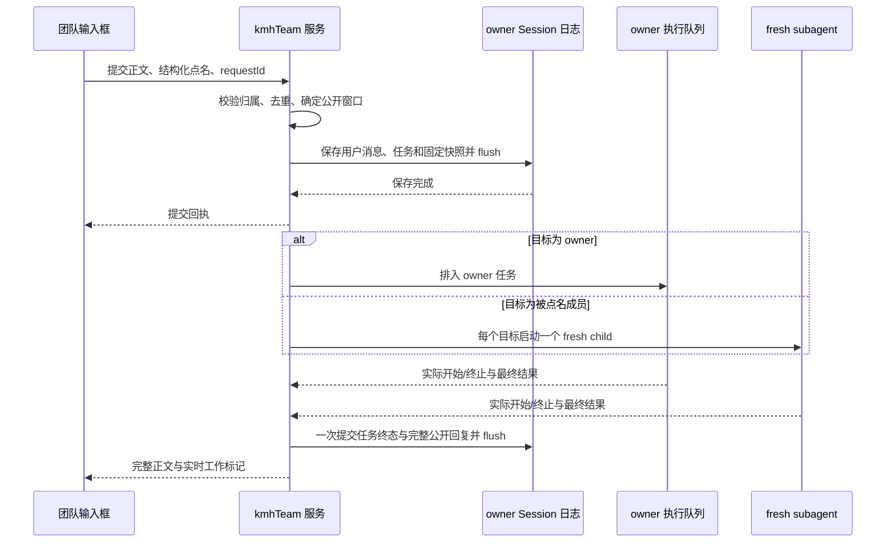

# kmh-team 第一版技术设计

本轮建议新增一个 KMH 插件包 `@kmh/kmh-team`，插件名称为 `kmh-team`，内部划分六个职责模块。成员执行使用现有 fresh subagent；固定角色、团队身份、路由与群聊呈现由 KMH 管理。用户已要求“走x-req dev verify-spec”，本版关键选择据此确认；本轮进入任务拆解、实现与交付对账。

| 基线项 | 内容 |
| --- | --- |
| 功能规格 | [spec.md](spec.md)，8 个 feat、59 个场景 |
| spec SHA-256 | `da9d0e50c2428ff12e33bd9db8406342465cc0ce500a656a96984dda4c50c6ac` |
| 确认依据 | 本会话用户确认“主agent默认会加入，只能选择模型”“头像下方 新增一个 ‘工作中’”“其他都同意默认”；随后要求走 x-tech-design |
| 实现限制 | [constraints.md](constraints.md)，SHA-256 `70a3c64f65972febd47737a0a9f4839f33ab2982e9f1296892f7867c0c7f19e0` |
| 源码调查基线 | KMH `private-main`，`8d467025fdb244ec5ee89f960e5518c0f2adad66`；DSH 子模块 `9de374a8f3ea3564c71eb8c9cd007c8ac563b452` |
| 设计版本与状态 | v0.1-1，已确认（2026-10-12） |
| 本轮范围 | 全部已确认功能的技术设计；约束内的复用调查；界面扩展建议；验证计划 |
| 当前功能歧义 | 无；下文列出的待确认项均为架构、协议或数据归属选择 |

## 1. 现状与复用结论

以下结论来自本轮源码阅读。设计建议在后续章节使用 D 编号标识，当前接口与计划新增接口分别说明。

| 当前能力及源码证据 | 复用方式与适用限制 |
| --- | --- |
| [KMH 运行架构](../../architecture/kongming-runtime.md)、[插件接入清单](../../kmh/adding-a-plugin-package.md)与 [Web 配置](../../../profiles/kmh-web/cordis.patch.yml) | KMH 管理自有包与 profile；本轮沿用 Node、Cordis、现有 Web 客户端和独立 KMH 工作区 |
| [SubagentRuntime.start](../../../third_party/dsh/packages/subagent/subagent/src/index.ts)、[SubagentStartRequest / SubagentRun](../../../third_party/dsh/packages/subagent/subagent/src/types.ts) | Host 直接启动一次性执行，持有 `result` 与 `dispose()`；团队点名路由拥有每次执行的生命周期 |
| [SpawnInProcessProvider](../../../third_party/dsh/packages/subagent/subagent-spawn-in-process/src/index.ts) | 当前 `spawn` 提供方声明 `inheritsParentContext = false`，支持 persona 与 agentOptions；每次调用产生新的 child |
| [startInProcessRun](../../../third_party/dsh/packages/subagent/subagent-in-process-driver/src/index.ts)、[applyChildComposition / captureDelegatedPolicyOverrides](../../../third_party/dsh/packages/subagent/subagent/src/child-agent.ts) | 继承 parent 的 preset、工作目录和模型选项，persona 在 child 作用域覆盖；权限在启动时捕获，子执行的审批策略固定为 `never` |
| [Agent 的 followup / inject / status / whenIdle](../../../third_party/dsh/packages/core/agent/src/runtime-types.ts)、[ApiSessionController](../../../third_party/dsh/packages/api/session-controller/src/index.ts) | 每个团队拥有一个普通根 Agent 作为 owner；复用模型目录、创建、恢复和队列；`whenIdle()` 表示整个 Agent 空闲，任务关联由 KMH 自行管理 |
| [SessionCommands.selectModel](../../../third_party/dsh/packages/api/session-controller/src/commands.ts)、[SubagentRuntime.Config / resolveMaxDepth / start](../../../third_party/dsh/packages/subagent/subagent/src/index.ts) | 当前 selectModel 同时保存全局默认；D10 建议增加会话内选择选项。现有 maxActiveSubagents 限制 continuable child，fresh start 由调用者管理并行；深度可直接通过 resolveMaxDepth 读取 |
| [Session.append 与 SessionStore.flush](../../../third_party/dsh/packages/core/session/src/index.ts)、[ProjectionDefinition](../../../third_party/dsh/packages/session/session-projection/src/index.ts) | 团队记录使用已有 Session 日志与投影设施；通过真实 flush 确认持久化。投影缓存用作读取加速 |
| [defineDomain](../../../third_party/dsh/packages/storage/storage-domain/src/spec.ts)、[KvTable.update](../../../third_party/dsh/packages/storage/storage-domain/src/domain.ts) | 固定角色库使用 schema 校验的持久 domain；写入链在存储成功后更新内存 |
| [InputTriggerSource](../../../third_party/dsh/packages/client/ui-input-trigger/src/types.ts)、[输入提交入口](../../../third_party/dsh/packages/client/ui-conversation/src/client/input/facade.ts) | 复用候选菜单与原子引用。当前默认发送先把引用转成文本，需要新增结构化提交扩展，保留点名身份 |
| [侧栏渲染顺序](../../../third_party/dsh/packages/client/ui-sidebar/src/client/SidebarRoot.tsx)、[plugins.detail.section](../../../third_party/dsh/packages/client/ui-plugin-manager/src/client/index.ts) | `sidebar.panellist` 位于新建会话下方；插件详情可以通过现有 slot 增加角色配置与上下文数量页面 |
| [Conversation 主体注册](../../../third_party/dsh/packages/client/ui-conversation/src/client/apply.ts)、[会话可见性](../../../third_party/dsh/packages/client/ui-workspace/src/client/tree.ts) | 当前主体为 single slot，空白会话通常只显示当前一条；D08 提议三个通用扩展点，支持团队视图、结构化提交和空团队保留 |

用户指定的 DSH Agent Teams 中文说明与 KMH 子模块中的[同名说明](../../../third_party/dsh/packages/experimental/agent-team/README.zh.md)内容一致，本轮核对两份文件的 SHA-256 均为 `c534018bcef973a7ea79468d1db419d52e7256759bc064e8b761a56f77c8262e`。参考范围为身份校验、先持久化再执行、去重和取消清理；`kmh-team` 的依赖、profile 与运行调用禁止包含 DSH Agent Teams 的运行时、工具和客户端包。

## 2. 功能与场景设计映射

各行场景共同使用所列设计。特殊失败和竞态另行映射，全部场景由本表覆盖；验收判定以功能规格为准。

| 场景回指 | 设计与参与模块 | 结构或协议 | 流程及验证判定 |
| --- | --- | --- | --- |
| feat01 场景1、feat01 场景2、feat01 场景6 | D02 角色库、Host 工具、详情页 | RoleConfigSchema、角色创建协议 | 配置创建与 owner 工具调用落到同一保存入口；保存与重启测试 |
| feat01 场景3 | D02、D06 | RoleId、成员身份、TaskId | 同一角色分团队执行；检查两个 child 的输入与日志 |
| feat01 场景4、feat01 场景5 | D02、D03 | 输入 schema、持久错误 | 空值拒绝；写入失败后旧数据可读、草稿可重试 |
| feat02 场景1、feat02 场景2、feat02 场景3、feat02 场景9 | D01、D08 创建弹窗 | CreateTeamRequestSchema、模型目录 | owner 固定；模型可选；额外角色只出现一次；真实 UI 验证 |
| feat02 场景4、feat02 场景6、feat02 场景8 | D03、D08、D10 | TeamCreatedSchema、RequestId | 一次创建对应一个 team；空成员集合有效；重复请求返回原结果 |
| feat02 场景5、feat02 场景7 | D03、D08 | 创建响应与错误 | 取消保留原会话；模型失效或保存失败保留草稿 |
| feat03 场景1、feat03 场景2、feat03 场景3、feat03 场景5 | D04 路由、D05 owner 执行 | SubmissionSchema、ActorRef | 普通消息进入 owner；成员 start 与收件调用计数保持原值 |
| feat03 场景4、feat03 场景6 | D05、D07 | owner 输入与公开消息 | owner 模型失败独立处理；公开成员结果进入 owner 后续上下文 |
| feat04 场景1、feat04 场景2 | D04、D06 | ContextSnapshotSchema、SubagentRun | 每次点名使用 fresh child；核对实际模型输入和署名 |
| feat04 场景3、feat04 场景5、feat04 场景6 | D04、D08 | TeamMentionSchema、结构化草稿 | 候选限制为本团队；纯文本 @ 走普通路由；仅 @owner 时 owner 回应 |
| feat04 场景4 | D04、D07 | 单次提交快照、成员去重键 | 多成员共享同一窗口；重复成员去重；按结果提交顺序展示 |
| feat04 场景7、feat04 场景8 | D04、D06、D08 | 目标校验、错误响应 | 失效成员和空任务在入口拒绝；启动失败仅影响对应收件人 |
| feat05 场景1、feat05 场景2、feat05 场景4、feat05 场景7 | D03、D04 | PublicMessage、ContextSnapshot | 按当前团队公开序号取窗口；包括本次消息；校验第 6 至第 25 条及隔离 |
| feat05 场景3、feat05 场景5 | D03、D08 | Config.contextMessageCount | 设置保存、失败保持旧值与重启验证；采用已有设置 revision 校验 |
| feat05 场景6、feat05 场景8 | D04、D06 | snapshotId、固定内容、执行结果 | 后续变更保持本次快照；过长内容返回失败；禁止静默缩减窗口 |
| feat06 场景1、feat06 场景2、feat06 场景3、feat06 场景4、feat06 场景5 | D03、D06、D07、D08 | TaskEndedSchema、PublicReply、LiveView | 完整结果发布一次；工具过程留在执行日志；最终署名和格式回放 |
| feat06 场景6、feat06 场景7 | D07 | LiveTaskLedger、Agent.status | 实际开始才亮；步骤或模型请求结束保持当前任务工作标记 |
| feat06 场景8、feat06 场景9、feat06 场景10 | D07 | TeamId + ActorRef + TaskId + epoch | 延迟/重复结束只影响原任务；并发任务独立；跨团队状态隔离 |
| feat06 场景11、feat06 场景12 | D07、D09 | LiveViewSchema、停止回执 | 切换、刷新和取消竞态验证；清除条件为实际停止 |
| feat07 场景1、feat07 场景2 | D06 | child preset、persona、模型路由 | 检查工具与 skill 组合继承；真实任务使用相应能力 |
| feat07 场景3、feat07 场景4 | D06、D09 | 既有权限机制、终态分类 | 子执行遵循固定权限；错误/部分成果按规格提交简明说明 |
| feat08 场景1、feat08 场景2、feat08 场景6 | D07、D09 | StopRequest、TaskId 集合 | 停止当前批次；重新发送采用新任务；重复停止保持结果 |
| feat08 场景3、feat08 场景4、feat08 场景5 | D03、D07、D09 | Session 日志、epoch、恢复流程 | 同进程恢复真实状态；跨进程未完成任务标为中断；读取失败保留可读记录 |

## 3. D01 · 插件模块与依赖

六个模块共用一个发布包、一个 Host 服务和一个客户端入口。协议文件归插件所有，使用者从公开 `./protocol` 入口引用；职责相邻的文件在模块内部组织，后续按真实独立复用需求决定拆包。

| 模块与计划目录 | 职责 | 公开接口、调用方与允许依赖 |
| --- | --- | --- |
| 协议 `packages/kmh-team/src/protocol/` | Zod 输入、响应、事件、身份与配置字段定义 | `@kmh/kmh-team/protocol`；Host、Client、测试共同引用；仅依赖 browser-safe 的 Zod、品牌与 DSH 类型 |
| 角色库 `src/roles/` | 固定角色保存与列出，统一 UI 和 owner 工具入口 | Host `kmhTeam.listRoles/createRole`；依赖协议、storage.domain；工具只调用此接口 |
| 团队记录 `src/team/` | team 初始化、公开消息、提交快照、事件折叠与恢复 | Host `kmhTeam.create/read/submit/stop`；依赖协议、角色库、Session、执行模块；Host 网关与工具作为消费者 |
| 执行 `src/execution/` | owner 串行处理、fresh child、运行句柄与权限继承 | 内部 `runOwner/runMember/cancelTasks`；依赖公开 DSH Agent、subagent、LLM、Session 接口；回调提交团队结果 |
| 投影 `src/projection/` | 持久事实折叠、运行台账读取、最小公开视图 | `kmhTeam.readPublic/watch`、`kmhTeam` Session 分类投影；依赖协议与 Session 事件，运行状态读取接口由 Host 装配时注入 |
| 客户端 `src/client/` | 入口、弹窗、详情页、点名引用、群聊与头像 | 包 `./client` 自动发现；依赖 `./protocol`、已有客户端 services/slots/primitives；Host 调用经鉴权通道 |

Host 入口 `src/index.ts` 装配上述模块，并声明 Context 中的 `kmhTeam` 服务；Web 路由集中于 `src/web.ts`。角色工具集中于 `src/roles/tool.ts`，只为普通主 Agent 和 team-owner 提供创建授权。成员继承的工具目录继续按 DSH 机制组成，涉及角色保存的执行入口校验实际调用者身份。

依赖方向为 Client → 协议与既有客户端 API，Host 网关/工具 → kmhTeam 服务 → 角色库/团队记录/执行，执行 → 公开 DSH 服务。每个职责目录通过自己的 index.ts 导出模块接口，相邻模块只引用该入口。投影 fold 为纯函数，实时台账由执行模块持有并提供只读接口；执行与团队记录的相互动作使用注入回调，导入图保持单向。跨包源码内部路径及 Agent Teams 包作为禁止依赖项纳入检查。

## 4. D02、D03 · 数据、协议与配置

### 固定角色与团队归属

角色配置作为长期身份保存；实际任务身份与 child SessionId 按本次执行记录。首版成员配置在建群时保存快照，当前规格涵盖创建与选入，后续角色编辑策略由对应的新规格承接。

| 数据与关键字段 | 含义与约束 | 数据所有者及权威来源 |
| --- | --- | --- |
| RoleConfig：roleId、name、instructions、createRequestId | roleId 为品牌化 UUID；名称与职责为非空文本；名称用于显示，roleId 用于寻址；createRequestId 保存创建请求身份 | D02 角色库；`storage.domain` 的 `kmh-team-roles`，version 1，roles 表；schema 位于 `protocol/roles.ts` |
| TeamCreated：teamId、ownerSessionId、ownerPreset、modelRoute、members、createRequestId | teamId 与 ownerSessionId 对应同一个团队根 Session；owner 身份固定为 `team-owner`；members 只包含额外 RoleId 及职责快照；createRequestId 支持创建去重 | D03 owner Session 的 `kmh-team/created`；schema 位于 `protocol/events.ts` |
| ActorRef | 判别联合：`team-owner`，或 `member` + roleId；所有校验包含 teamId | schema 位于 `protocol/identity.ts`；展示名从 TeamCreated 中解析 |
| PublicMessage：messageId、publicSeq、sender、body | publicSeq 按公开消息提交递增；正文保留完整文本、格式与成果引用；用户消息与完整 Agent 回复进入窗口，错误/停止提示另行记录 | D03 Session 事件；正式 schema 位于 `protocol/messages.ts`；body 使用已接纳的内容，DSH 内容与附件转换在 `team/public-content.ts` 集中实现 |
| Submission：requestId、userMessage、targets、snapshot、tasks | 一次提交对应一条用户消息；targets 去重；tasks 共享同一 snapshot；全部字段在一个 Session 事件中保存 | `kmh-team/submission`；schema 位于 `protocol/events.ts` |
| ContextSnapshot：snapshotId、contextMessageCount、cutPublicSeq、messages | 提交时保存的完整公开消息窗口，包含当前用户消息、发言者与确定顺序；每个目标使用同一值 | Submission 内的权威快照；保存副本用于执行可复现性，引用 public message id 核对内容 |
| Task：taskId、triggerMessageId、actor、snapshotId、executionSessionId | taskId 每次执行唯一；executionSessionId 在启动后建立；owner 任务指向 owner Session，成员任务指向 fresh child | `kmh-team/task-linked` 与 `kmh-team/task-ended`；使用子执行日志核对真实结果 |
| TaskEnded：taskId、outcome、reply或notice | outcome 为 completed / failed / stopped / interrupted；reply 是当前任务的最终完整公开回复；同一任务终态只提交一次 | 单条 `kmh-team/task-ended` 事件同时提交任务终态和对应回复，保证回放一致 |
| 公开工作标记 | 当前进程实际执行的任务集合按 teamId、actor 聚合得到 | D07 LiveTaskLedger；作为实时派生值提供，持久 phase 和浏览器缓存只供恢复核对 |

运行日志保留工具、调用参数、模型输入与完整结果。公开消息是群聊内容的权威来源；owner 与 child 的私有日志记录各自实际执行。相同文本在输入快照和执行日志中分别承担提交事实与模型请求事实，通过 snapshotId、taskId 和 messageId 关联。

插件事件使用 `kmh-team/*` 命名并声明合并 SessionEventMap。根据 DSH 的[外部事件读取规则](../../../third_party/dsh/packages/core/session/src/known-event-types.ts)，这些附加事件使用 `ignorable: true`，DSH 读取器可以保留它们并理解既有模型执行记录；KMH 的团队读取器按事件 schema/version 严格校验，错误时显示读取失败并保留最后有效记录。所有模型可见输入继续通过既有 `user/message` 等标准事件记录，禁止依赖附加事件的隐式模型解释。

团队列表与 transcript 投影、请求去重映射、公开序号和结束任务集合由日志折叠得到。缓存写明 stateVersion 与日志水位；失配时从日志重建。首版使用既有 Session 写者锁与单 Host 归属机制。

Host 要求实际挂载 Session 持久提供方；flush 返回 false 视为配置失败。公开视图、成功回执和执行派发只消费已确认保存的事件水位。append 后 flush 失败时保留该事件身份并暂停对应团队的后续提交，重试保存同一事件；确认保存后推进公开水位。重启依据持久文件中实际存在的事件重建水位，已经保存而回执丢失的请求按 requestId 去重。

角色创建在 domain 更新链内按 createRequestId 查重并保存；团队创建在 Host 创建链内查找同一身份的已保存 TeamCreated。请求身份重复且内容相同返回原回执，内容冲突返回 request-conflict。建群先验证模型、角色和 Workspace，再创建空 owner、安装会话内模型选择、保存 TeamCreated 并 flush；只有完成保存的团队进入团队列表。失败时释放本次创建的运行句柄，保留原弹窗草稿和已有团队记录。

### 公开调用协议

新 HTTP/事件包络采用 Zod 定义，TypeScript 类型通过 `z.infer` 派生。Host 入口、持久记录读取、客户端响应与 watch 帧分别校验。已有 DSH 模型目录和接纳内容沿用其权威类型与入口校验，转换出的群聊呈现类型在本插件集中定义。

| 调用与生产者 → 消费者 | 输入 → 输出 | 错误与校验归属 |
| --- | --- | --- |
| 角色列表、创建：详情页/owner 工具 → D02 | 请求身份、名称、职责 → 已保存 RoleConfig | 空值为 invalid-input；保存失败为 storage-failed；同请求重试返回原保存结果 |
| 建群：弹窗 → D03 | requestId、模型路由、memberRoleIds、已有 Workspace 定位 → teamId | role-not-found、model-unavailable、owner-unavailable、storage-failed；模型目录复用 ApiSessionController.modelCatalog |
| 提交：团队输入框 → D04 | teamId、requestId、接纳内容、结构化 mentions → messageId、taskIds | invalid-input、target-unavailable、team-unavailable；服务端校验角色归属、空任务与请求去重 |
| 停止：停止按钮 → D09 | teamId、requestId → 被接受停止的 taskIds | 停止回执代表请求已接纳；结束确认由实时视图给出；重复请求返回同一任务集合 |
| 读取/订阅：D03/D07 → 群聊 | teamId、可选 epoch/revision 游标 → PublicTeamView、LiveView 帧 | record-invalid、read-failed、cursor-reset；每帧校验 teamId、epoch、revision 与 payload |
| 配置：插件详情 → 既有设置服务 | 现有 settings namespace、revision、contextMessageCount → 已保存配置 | 按既有设置协议处理 invalid-input、revision 冲突和保存失败 |

正式协议计划位于 `protocol/requests.ts`、`protocol/views.ts` 与 `protocol/events.ts`，消费者从包公开入口加载同一份 schema。Host 路由使用已有 `connection.fetch.register` 鉴权通道，路径统一置于 `/api/kmh-team/*`；实时订阅通过同一通道的 streaming Response 传递经 schema 校验的帧。具体路由集合与帧格式以这些正式 schema 为唯一维护源。

错误响应只包含稳定分类、可操作的简短说明和对应 taskId；执行错误的详细内容留在日志。失败成员的结果独立提交，其余目标继续处理。

### 具名配置

| 配置 | 默认值与单位 | 保存及生效规则 |
| --- | --- | --- |
| `contextMessageCount` | 20，条；正安全整数 | `kmh-team` Config 与现有 settings/profile patch 保存；每次提交解析一个 Spec 并固定本次值 |
| `subagentProvider` | `spawn`，提供方名称 | Host 加载/最早可解析时验证 fresh、persona、agentOptions 和 depthLimit；启动返回后要求 localAgent 可用，否则收集 result、dispose 并返回启动失败 |
| `memberMaxParallel` | 建议 8，个任务；正安全整数，属于本轮执行容量建议 | `kmh-team` Config 拥有；限制同一插件实例跨团队的 fresh 成员任务，等待队列按提交顺序分配；运行中降低值先让已有执行自然结束 |
| 成员委派深度 | 复用 `subagents.resolveMaxDepth()`，当前 Host 默认 1 层 | 每次启动显式传递已解析 maxDepth；权威值归既有 subagent 设置，kmh-team 保存本次解析值用于核对 |
| schema/event/stateVersion | 首版为 1，无单位 | 协议与缓存兼容版本；属于固定格式常量，后续变更按持久格式规则处理 |

配置使用 Cordis 现有 Schemastery Config 与设置机制；新传输/存储数据使用 Zod。这一分工沿用 storage-domain 和 KMH 现有插件。并行容量由执行模块在 resolve 时读取，槽位从开始创建 child 保留至实际收敛和清理完成。模型/工具自身重试继续归既有机制；本插件把保存失败交给明确的保存重试入口，保持原事件身份。D10 记录容量建议与深度复用的影响。

## 5. 主要数据流与任务状态

### D04 · 点名校验与固定上下文

回指 feat03 场景1、feat04 场景1、feat04 场景4、feat04 场景6、feat04 场景8、feat05 场景1、feat05 场景6、feat05 场景7。

客户端通过候选选择生成带 source 和 RoleId 的原子引用；提交 handler 在引用变成模型文本之前读取结构化 occurrences。正文、粘贴文本与代码中的 @ 名称仅作为文字。服务端以本团队成员表校验 mention，目标集合为空时解析为 team-owner；有效集合只投递给所选目标。

同一团队的提交、结果和停止操作经过一条短的提交链。链内先查 requestId，校验内容，再追加当前用户消息，选取至该 publicSeq 的最近 N 条已提交用户消息和完整回复，保存唯一 Submission。正文内置的 @ 文本、成员回复及工具产出均使用结果入口，入口类型没有点名派发动作。

保存并 flush 成功后投递 tasks；同一请求重试采用已保存回执。后续群聊消息与配置修改使用后续 cut，本次窗口保持提交时的完整值。模型需要的 persona 与继承环境使用既有系统机制，群聊对话只来自 snapshot。快照内容按发言者标记，作为待处理材料传入；角色职责由 persona 单独提供。

此图表示调用顺序，箭头包含返回与状态通知；代码导入方向由 D01 规定。

### D05 · owner 的普通消息与公开结果读取

回指 feat03 场景1、feat03 场景4、feat03 场景6、feat04 场景5、feat07 场景1。

创建时 owner 使用当前 KMH 主 Agent 的 preset 和所选模型，作为该团队的普通根 Agent 持续存在。建群通过现有 Session 创建服务完成，再使用 D10 的会话内模型选择选项；主 Agent persona 与工具组合继续由 preset 管理。TeamCreated 保存解析后的 preset 与模型，恢复时先校验记录和应用该选择，再接纳新的任务。team-owner 属于团队身份，用户保存的角色库只保存额外角色。

普通消息按 owner 队列串行执行。团队层记录每个 task 对应的标准 UserMessage.id；同一时刻队列只驱动当前任务，后续输入留在团队任务队列。执行提交采用 `followup()`，覆盖普通输入、取消后的新输入和悬挂队列恢复的差异。

owner 启动本次任务前，读取至本次提交 cut 的公开消息，把尚未接纳的成员请求与回复作为署名的群聊上下文交给 owner。接纳身份与 public message id 在标准模型输入及 durable inbox 中可核对，重试复用原身份。上下文使用非唤醒的 `inject()` 与当前任务的 followup 配对；成员结果的公开提交只更新群聊记录。后续普通追问才触发 owner 的新处理。

owner 的私有模型/工具历史保持该 owner Session 的归属。任务执行区间从对应输入的 durable inbox 接纳记录开始，到随后整个 Agent 达到 idle 收敛结束；记录起止日志序号和实际处理的 message id。自动续轮、同区间的 steering 与注入工作一并归入该执行区间，最终正文采用此区间内最后完整的 assistant 结果。whenIdle 只提供收敛条件，区间和 TaskId 提供结果关联；输入在开始前被取消时返回停止结果。团队浏览器普通提交统一由本队列接纳，后续任务在当前区间结束并保存结果后启动。计划测试覆盖多 turn 自动续轮、输入未进入模型、外部 steering、停止丢弃 inject 后重新传递，以及多个排队 owner 请求。

### D06 · fresh 成员执行与完整回复

回指 feat01 场景3、feat04 场景1、feat04 场景2、feat04 场景7、feat05 场景8、feat06 场景1、feat06 场景2、feat06 场景4、feat07 场景1、feat07 场景2、feat07 场景3、feat07 场景4。

被点名 task 通过容量控制后调用 `ctx.subagents.start(subagentProvider, request)`。parent 为本团队 owner，prompt 为已经保存的本次快照与任务，persona 为成员的职责快照，agentOptions 显式使用 TeamCreated 的模型路由；其余模型参数与工具/skill/preset 依照既有继承机制解析。启动前再次核对角色、模型、提供方与权限可用性。

尚未被点名的角色只保存配置与团队成员身份。执行模块在 admission 后建立独立 AbortController 和 run 句柄；同一角色被多次点名时分别创建 child，每次 prompt 只含当前快照。成员模型路由明确取自本团队配置，避免父 Agent 旧 request/header 中的模型覆盖创建时已选择的新模型。

每个 run 始终收集 `result`，并在成功、失败、取消路径执行 `dispose()`。输出使用 DSH 的最终 assistant 选择规则；completed 且有完整正文时提交 PublicReply，空结果与失败提交简短说明，明确的部分成果按规格保留。成员正文作为内容处理，发布入口只能接收 task 的结果。

结果进入群聊前先 flush child 日志；最终公开结果与任务终态在一条事件中提交并 flush owner 日志。执行已停而结果保存失败时，实时工作标记按实际终止清除，结果记录保留失败说明或待保存结果，重试只重试保存。禁止把保存重试变为第二次模型执行。过长上下文按当前模型的容量校验或明确的提供方错误分类为 context-too-large，并提示精简内容或调小 N。

### D07 · 实际执行状态与头像标记

回指 feat06 场景6、feat06 场景7、feat06 场景8、feat06 场景9、feat06 场景10、feat06 场景11、feat06 场景12。

LiveTaskLedger 归执行模块所有，键为 `(teamId, actor, taskId, hostEpoch)`。任务 admission、实际执行和结果保存分别记录；公开“工作中”由实际执行集合派生。持久终态用于结果恢复，当前进程的 Agent/句柄事实决定是否仍在执行。

| 内部状态 | 进入事实 | 头像与转移规则 |
| --- | --- | --- |
| accepted / waiting | 用户提交已经保存，等待排队或容量 | 头像普通；任务尚未启动 |
| starting | 正在创建或恢复执行资源 | 以实际 Agent.status 为准；创建回执本身不能充当工作开始 |
| executing | 关联的准确 Agent 实际进入 running | 对应任务加入工作集合；模型请求、单次工具与 step 的结束保持集合 |
| stop-requested | 停止请求已接纳，实际 Agent 仍执行 | 保留工作标记，等待原任务终止 |
| execution-ended | 当前执行已收敛到 idle/确认释放，或启动明确失败 | 移除对应任务；同一成员还有其他任务时保持标记 |
| result-committed | 当前任务的完整结果或错误已成功提交 | 公共回复出现一次；这是持久结果事实 |

状态模型使用判别联合。result-committed 与 execution-ended 的处理顺序允许保存失败分支，公开标记始终依据执行集合。成员创建期间已经产生的状态事件按 exact Agent/session 身份保留，拿到 localAgent 后读取当前 status 并对账；超快完成的执行按真实当前状态呈现，防止迟到的“开始”反转终态。

旧结束通知只删除其 taskId；记录终结任务后，重复结束为幂等操作。每个 actor 的 `working = activeTaskIds.size > 0`，禁止用一个跨任务 boolean 直接置为 false。owner 使用相同集合模型；成员可并行，owner 的任务按 D05 排队。

客户端实时视图携带 teamId、hostEpoch、revision。同 epoch 的旧 revision 丢弃；新连接先接纳完整 baseline，再应用后续帧；epoch 改变时丢弃旧执行状态并读取新 baseline。切换团队时取消原订阅并核对目标 teamId；原请求的迟到响应只能更新其所属缓存。公开 UI 仅在对应头像下展示“工作中”。

### D08 · 客户端复用与公开消息接入

回指 feat02 场景1、feat02 场景4、feat02 场景6、feat02 场景9、feat04 场景3、feat04 场景6、feat06 场景1、feat06 场景2、feat06 场景11。

侧栏通过现有 `sidebar.panellist` 注册“团队会话”，order 在现有插件/任务入口之前。该入口选择创建用 main panel，panel 打开 modal，记录进入前的 panel/session；取消恢复原位置，成功创建后用现有 `uiWorkspace.openSession` 打开 ownerSessionId。弹窗上方 owner 固定，仅复用模型目录选择模型；两个角色列表均使用 RoleId。

插件详情使用现有 `plugins.detail.section` 注册角色列表/创建配置与上下文数量，组件复用既有表单、Dialog、Markdown 与头像基础组件，所有文案由 typed locale 字典提供。当前主 Agent 配置继续由已有 preset 管理。

团队会话沿用现有 Conversation 主体、Chat 列表、消息 renderer、composer 和导航。`kmh-team` 通过 `uiConversation.events` 把 `kmh-team/submission` 的公开用户消息投影为原生 `user` 节点，把成员 `kmh-team/task-ended` 的最终正文投影为成员消息节点。公开用户输入在提交时显示一次，owner 的内部上下文输入省略重复行；owner 的回复保持原有流式 Assistant 来源。成员 renderer 添加署名并调用已注册的原生 Assistant renderer，工具和思考留在 child 执行会话。新来源由宿主列表统一负责排序、滚动和分页。

成员头像与工作标记通过 `conversation.session.header.actions` 贡献，参考 DSH Teams 客户端的头部接入方式。运行状态继续使用本插件 Host 台账与完整视图订阅，订阅按当前 session 取消；原列表中的历史消息来自持久 Session 事件。`conversation.presentation` 保持普通会话的默认呈现。

结构化草稿继续在引用序列化之前经 `conversation/structured-submit` waterfall 接纳；团队 handler 发送结构化 targets，普通输入委派给既有 sink。会话分类投影和 `keepBlankVisible` 保留已创建空团队的列表行。上述团队消息与头部贡献使用已有公开插件接口，由 KMH 层维护。

owner 的既有人机交互继续使用标准审批/提问能力与对应 session；成员沿用 DSH 固定委派权限。实现验证必须覆盖 owner 的交互卡片能被用户处理、成员权限拒绝能够结束并返回说明。群聊工作标记在等待这些实际任务结束期间保持。

团队产品逻辑与消息来源转换由 `kmh-team` 提供。DSH Agent Teams 的客户端接入和安全机制作为实现参考。

### D09 · 停止、保存失败与恢复

回指 feat06 场景12、feat08 场景1、feat08 场景2、feat08 场景3、feat08 场景4、feat08 场景5、feat08 场景6。

停止在团队提交链内截取当前未结束 taskId 集合，关闭这一批任务的后续 admission，逐个发出取消。owner 使用既有 cancel；成员使用各自 controller 与 run.dispose 收敛。新请求采用新 taskId；原停止请求只拥有其截取的集合。UI 在确认实际终止前保留对应工作标记。

同进程页面刷新与切换会话直接读取持久公开记录和 LiveTaskLedger baseline。Host 重启后先解析团队日志，再把尚无终态且属于旧 epoch 的任务提交为 interrupted；读取页面本身保持执行静默，后续用户消息才创建新的工作。恢复任务记录与已有完整回复分别处理，记录损坏按最后有效前缀和具体失败返回，禁止把损坏文件清空并当作新团队。

若 child 结束与公开结果提交之间发生崩溃，按持久 TaskEnded 判断结果是否已公开；缺少终态时遵循规格提交中断说明。禁止从 orphan child 的未提交片段自动生成成功回复或恢复执行。已提交终态的重复回调采用 taskId 去重；持久保存失败的重试只重复原事件的保存检查。

插件卸载按 effect 生命周期关闭 admission、取消和 drain 活跃执行、flush 可保存记录、释放 Session/订阅/domain 句柄；所有分支完成清理后汇报清理错误。重新启用先执行恢复核对，保留已保存角色和团队。

## 6. D10 · 装配、影响与关键选择

新增包沿用[KMH 插件接入清单](../../kmh/adding-a-plugin-package.md)与 [Codex Host/Client 构建分离](../../../packages/codex-cli/package.json)。Host、Client、browser-safe protocol 使用明确编译入口，包声明 `.`、`./client`、`./protocol`；通过 dsh.client 元数据加载客户端。profile 在 Host 挂载一个 kmh-team 实例，owner 的角色工具以作用域校验识别主 Agent，团队成员从 owner preset 继承。

预计影响为 `packages/kmh-team/`、KMH 根 build/typecheck/lint/format filters、Web profile 清单与解析依赖、测试与插件说明；D08 涉及 DSH Fork 的两个客户端插件，下述模型选择选项涉及 `api/session-controller`。现有团队数据为空，首版新增自己的 role domain 和团队事件版本；已有普通会话与模型配置继续使用原格式。后续修改事件、缓存或 role domain 版本时安排相应迁移与兼容校验。

建议在公开 SessionSelectModelRequest 增加 `persistDefault?: boolean`，由 SessionCommands 显式解析为默认 true；团队创建和恢复传 false。内部继续复用目录校验、llm.resolveCallConfig、model/selection 记录和既有 selectionFor，只有解析为 true 的请求保存全局默认。现有调用保持当前行为，团队模型配置分别归其 owner Session。公开请求类型、所有生成客户端、相关文档和选择行为测试随这项扩展同步。

SubagentRuntime 的 maxActiveSubagents 当前限制 continuable child，fresh start 使用独立的调用者生命周期。D06 直接复用公开 resolveMaxDepth；fresh 成员的并行由本插件执行模块统一控制，memberMaxParallel 建议默认 8。该限制覆盖同一 kmh-team 实例的全部团队，其他插件的 subagent 继续由其拥有者管理；提高容量只改变排队时机。这个技术容量建议与 D08、会话内模型选择扩展一起交由用户审查。

| 已确认条目 | 推荐方案与理由 | 备选及影响 | 状态 |
| --- | --- | --- | --- |
| D01 插件拆分 | 一个新增 kmh-team 包，内部六模块；协议、Host、Client 三个公开入口，既有执行与存储插件直接复用 | 角色库独立为第二插件会增加配置与生命周期耦合；独立复用消费者出现后再拆 | 已确认 |
| D03 数据归属 | 角色配置归 storage.domain；团队配置、公开对话和提交快照归 owner Session；运行事实归执行 Session/实时 ledger | 独立团队数据库需要额外会话关联、持久恢复和日志对账；增加一套存储维护 | 已确认 |
| D05、D06 执行方式 | 每团队持久 owner；每次点名 fresh spawn；主 Agent 所选模型明确传给成员 | continuable child 需要额外上下文清理和广播防护；DSH Agent Teams 的接入受到已确认限制 | 已确认；fresh 与静默行为已由用户确认 |
| D07 状态权威 | 实际运行句柄与 TaskId 集合生成工作标记；持久结果独立提交；epoch/revision 防止旧通知污染 | 仅持久 task phase 推导工作状态会在保存失败和重启时产生过期标记 | 已确认 |
| D08 现有界面扩展 | 在 DSH Fork 的两个客户端插件补三处通用接口，kmh-team 消费；普通会话沿用默认路径 | KMH 自建完整聊天编辑器、列表和导航会扩大重复代码；优先保留现有交互实现 | 已确认，影响子模块 |
| D10 模型选择范围 | selectModel 增加 persistDefault 选项，默认 true；团队传 false，复用现有会话选择实现 | KMH 独立实现模型选择会复制既有路由和日志规则；公开通用选项维护量较小 | 已确认，影响子模块 API 及生成消费者 |
| D10 执行限制 | 深度直接复用 resolveMaxDepth；kmh-team 管理 fresh 成员容量，建议默认 8，跨团队共用队列 | 统一全部 one-shot/continuable 的容量需要改动现有 subagent 生命周期和消费者；本轮选择本插件负责其执行 | 已确认，新增一项技术配置 |

## 7. 规范落实与验证

设计规范来自 x-tech-design 的 R1–R7、[KMH AGENTS](../../../AGENTS.md)、[TypeScript 规范](../../../../skill-hub/dev-ts/SKILL.md)及 DSH 的[架构](../../../third_party/dsh/docs/architecture.md)、[生命周期与并发规范](../../../third_party/dsh/docs/defensive-patterns.md)。规范各自维护权威正文，以下记录本轮适用性与具体落实。

| 规则 | 适用性及落实位置 | 检查依据与状态 |
| --- | --- | --- |
| R1 模块边界 | 适用；D01 六模块、公开包入口、callback 注入、Host/Client 分离 | 实现阶段检查导入图与 package exports；静态拒绝跨包 src 和 Agent Teams 导入；当前为设计审查 |
| R2 协议优先 | 适用；D02–D04 的新请求、事件、domain、views 由共享 Zod schema 推导 | 边界有效/无效输入、同一 schema 消费者及重复 DTO 检查；Cordis Config 沿用 Schemastery；待实现验证 |
| R3 跨语言协议 | 当前业务实现为 TS，纯单语言；DSH Python SDK 属于消费日志的外部表层 | 团队外部附加事件保持 ignorable，模型标准事件保持已有协议；若 D08/D10 改动公共 SDK/生命周期类型，按 DSH 规则同步；待实现验证 |
| R4 数据唯一来源 | 适用；D03 区分角色库、公开日志、模型执行日志、快照与实时工作集合 | 回放、过期缓存、写入失败、任务重复终态与恢复测试；待实现验证 |
| R5 概念命名 | 适用；D03 的 RoleId、TeamId、ActorRef、TaskId、SessionId、snapshotId | 字段与 UI 身份语义审查；task 与固定角色分别寻址；待实现验证 |
| R6 具名配置 | 适用；D03 contextMessageCount、memberMaxParallel 与既有深度设置，Config 校验和提交 resolve | N=1、N=20、无效 N、保存失败、运行中变更、提供方错误、并行 1/8 和停止排队任务；待实现验证 |
| R7 数据流与状态 | 适用；D04–D09 的接纳、开始、结束、保存、停止和恢复 | deferred promise 控制竞态、超快结束、重复/迟到事件、停止后新任务、多群同角色；待实现验证 |
| KMH 插件扩展与维护归属 | 适用；D01、D08、D10；新增行为经服务、事件、effect，DSH Fork 改动独立审查 | 本轮只新增设计文档；实现时执行 KMH 检查和受影响 DSH 包检查 |
| 严格 TS 与状态联合 | 适用；protocol z.infer、D07 判别联合、品牌 id、异步清理 | 新包继承现有 strict、typed lint 与 Host/Browser 入口；禁止新增 any 和 unknown 断言；待实现验证 |
| DSH 模型可见与日志一致 | 适用；D04–D06 的快照和 persona 经现有模型输入/系统事件保存 | 捕获实际模型请求，对比提交快照、来源与日志回放；待实现验证 |
| DSH 持久格式与 SDK | 适用；D03 外部 ignorable 事件、stateVersion、role domain version | 检查未知事件读回、升级兼容和类型声明承认；涉及标准事件/SDK 变化时同步消费者；待实现验证 |
| DSH 生命周期、取消与防竞态 | 适用；D06、D07、D09；每个 run 有唯一 holder，实际停止后清除标记 | 启动前取消、已发布取消、dispose 失败、HMR/unload、旧回调与 drain 检查；待实现验证 |
| DSH 工具呈现与 locale | 适用；D02 role 工具、D08 专属群聊与详情页 | 工具日志与公开群聊分开检查，typed 中英文文案，录制会话 snapshot；待实现验证 |
| 文档归属与提交规则 | 适用；本目录保存技术决策，正式实现后 README/schema 维护实际接口 | [kmh-doc](../../../.agents/skills/kmh-doc/SKILL.md)、[kmh-prose-standard](../../../.agents/skills/kmh-prose-standard/SKILL.md)；本轮结构、场景回指、链接、基线、空白检查 |

实现验证分三层：单元测试覆盖路由、窗口、状态与重试；不联网的记录会话覆盖工具/公开正文和日志回放；真实 Web 流程覆盖入口、弹窗、点名、完整回复、头像标记、停止、刷新和两群隔离。模型/skill/工具继承另以真实任务核对。通过静态文档检查表示草案可读且可追溯，运行行为验收由实现阶段执行。

本轮已执行定向文档检查：8 个 feat、59 个场景全部映射，34 个本地链接目标存在，D01–D10 和 R1–R7 齐备，功能规格与约束的 SHA-256 保持基线，草案状态及空白格式通过；`git diff --check -- docs/spec/README.md docs/spec/kmh-team-v0.1` 通过。业务代码与运行行为验收列为待实现验证。

## 8. 交付与交接条件

设计覆盖全部 8 个 feat、59 个场景，功能规格与实现约束保持原基线。当前新增文件为本技术草案，同时在 spec 索引登记设计链接与待评审状态；任务尚未拆解，业务与子模块源码保持当前工作状态。

用户已确认 D01、D03、D05–D08 与 D10 的关键选择，包含 D08 的三个 DSH 客户端扩展、D10 的会话内模型选择选项及成员并行默认 8。确认来源为本会话用户在草案交付后要求“走x-req dev verify-spec”。x-req 接收 spec 基线、设计基线和接口接入约束，实施与验证记录归 tasks。

## 9. 实施对齐 v0.1-2

以上 v0.1-1 正文作为用户确认的设计基线保留，SHA-256 为 `29166ae488ecbff34c4a0b4591d43c6b050ab24e23bb58913473504ff03dcbf0`；实施状态和场景结果见 [tasks](tasks/README.md)。本节记录实施时根据实际接口作出的技术落实，功能规格和场景编号保持原基线。

- D01–D03：六个职责模块收敛在一个 `@kmh/kmh-team` 插件；共享请求、事件、视图和 bootstrap 的 Zod schema 集中在 `src/protocol/index.ts`。角色 domain 使用符合现有命名校验的 `kmh_team_roles`，版本为 1。
- D03、D09：团队配置、公开提交、执行地址和完整结果分别写入四种附加会话事件，均带 `ignorable: true`。Session.append 增加可选 ignorable 元数据，原 surface 元数据要求保持；持久化历史检查确认 62 个类型根与 8 份既有记录一致。
- D08：实际详情入口为 `plugins.item`；公开消息通过 `uiConversation.events` 接入原 Chat 列表，原生用户与 Assistant renderer 承接正文，`conversation.session.header.actions` 贡献成员与工作标记。结构化草稿在 codec 前经 waterfall 接纳，拒绝时恢复原文与引用身份。空团队由 `keepBlankVisible` 留在会话树中。
- D06、D07、D09：每次成员点名使用 spawn fresh child；开始标记由实际 input claim/子执行开始事件触发，结束使用任务集合收敛。群聊停止与 owner 输入框停止均记录 stopped，执行器关闭会取消并等待各群活动任务实际结束。读取流失效时保留已读取正文并提供重试。
- D10：SessionSelectModelRequest 的 `persistDefault: false` 只选择本会话模型，创建其他团队时沿用既有默认模型。新选项的默认行为由既有消费者继续使用。
- 文档接入：同步 Host/Client 编译配置、消费者清单、类型等价段落、生成目录和英中 README。生成检查发现的既有 suspension API 文档遗漏已随文档同步补齐；源码行为保持其既有实现。

高风险实现验证采用实际 AgentLoop、spawn、JSONL 持久化、工具、skill、权限继承和 Web 鉴权路由，模型响应来自确定性夹具；真实外部模型服务的联网质量属于提供方验证范围。源码或 DSH 构建输出升级后重启支持 profile；本轮冷启动、正在回应时突然重启、持久化故障及恢复均在隔离 KMH_HOME 中验证。执行记录、已处理检查问题及逐场景结果归 [开发证据](tasks/evidence.md)。
