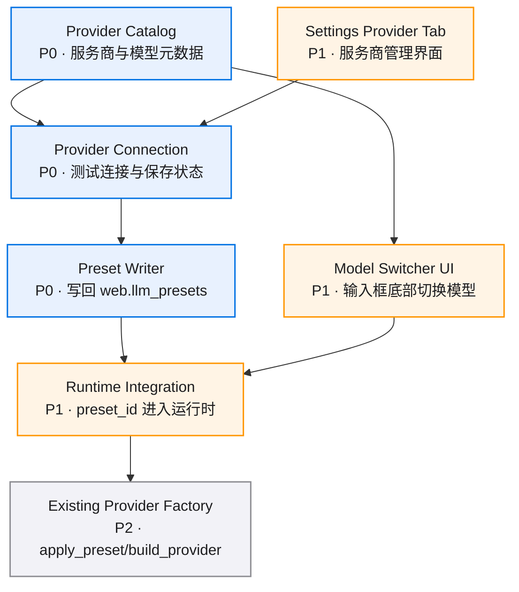

# 模块拆分

## 模块总览

| 模块 | 职责 | 依赖 | 状态 | 备注 |
|------|------|------|------|------|
| Provider Catalog | 定义服务商元数据、模型清单、默认端点、连接表单 schema | 无 | 可进入 x-req | 当前覆盖 MiniMax M3、GLM、DeepSeek |
| Provider Connection | 连接测试、保存、断开、连接状态读取 | Provider Catalog + Preset Writer | 可进入 x-req | 需要处理密钥脱敏、低成本探测和错误映射 |
| Preset Writer | 将连接结果写入 `web.llm_presets` 并返回刷新后的 preset | ConfigWriteManager | 可进入 x-req | 复用全局 YAML 原子写回能力 |
| Model Switcher UI | 输入框底部模型选择、搜索、分组、选中态 | presets store + provider API | 可进入 x-req | 需要保持发送按钮和思考按钮可用空间 |
| Settings Provider Tab | 管理页服务商 Tab、已连接列表、添加列表、MiniMax 弹窗 | Web provider API | 可进入 x-req | 独立于现有 schema 字段编辑页 |
| Runtime Integration | 新建/当前会话 preset 选择传入 Generic Chat 运行时 | threads manager + provider_factory | 方案确认 | 大部分复用既有链路 |

## 模块依赖图



## 模块详情

### 模块 1：Provider Catalog

**职责**：提供服务商目录和默认模型清单，定义 MiniMax 连接表单、默认 endpoint、默认 provider 协议和推荐模型。

**包含范围**：
- `ProviderDefinition`、`ProviderModelDefinition`、`ProviderConnectFormSchema`。
- MiniMax 元数据：显示名 `MiniMax (CN)`、默认 base URL、默认模型 `MiniMax-M3`、认证方式 `Authorization: Bearer ...`。
- 模型分组信息，用于输入框下拉展示。

**暂缓范围**：
- 远端动态模型目录。
- provider 价格、上下文窗口和计费规则。

**依赖**：无。

**复用/新建**：新建 `src/model_providers/catalog.py`；前端新增对应 TypeScript DTO。

**数据结构/接口**：

```python
class ProviderDefinition(BaseModel):
    id: str
    display_name: str
    region_label: str
    auth_scheme: Literal["bearer"]
    default_base_url: str
    default_protocol: Literal["anthropic", "openai_compatible"]
    models: list[ProviderModelDefinition]
```

**风险等级**：低

**task 建议**：
- 建议 task 名：`model-provider-backend`
- 对应 DoD：DoD#1、DoD#6
- 是否进入 x-req：是
- 原因：catalog 是后端和前端共同依赖的最小事实源。

### 模块 2：Provider Connection

**职责**：处理连接弹窗提交、测试连接、保存连接、断开连接、连接状态脱敏返回。

**包含范围**：
- 全局 manager 方法：`list_catalog()`、`list_connections()`、`test_connection()`、`connect()`、`disconnect()`。
- Web 适配路由：`GET /api/model-providers/catalog`、`GET /api/model-providers/connections`、`POST /api/model-providers/{provider_id}/test`、`POST /api/model-providers/{provider_id}/connect`、`DELETE /api/model-providers/{provider_id}`。
- 错误映射：认证失败、网络失败、模型不可用、JSON 配置非法。
- 低成本连接探测：`content="ping"`、`max_tokens=1`、`timeout=15s`；HTTP 2xx 视为成功，响应体直接丢弃。

**暂缓范围**：
- 多 provider 并发 OAuth 流程。
- API Key 回显。

**依赖**：Provider Catalog、Preset Writer、provider 认证 / payload helper。

**复用/新建**：新建 `src/model_providers/model_provider_manager.py`、`models.py`、`preset_writer.py`、`http_probe.py`，Web 新增 `src/hosts/web/routers/model_providers.py`。连接测试走 `http_probe.py` 的 raw HTTP 探测，复用 provider 的 header / payload 构造 helper，只读取 HTTP status。

**数据结构/接口**：

```python
class ConnectProviderRequest(BaseModel):
    api_key: str
    model: str = "MiniMax-M3"
    base_url: str = "https://api.minimaxi.com/anthropic"
    extra_env: dict[str, str] = {}

class ProviderConnectionDTO(BaseModel):
    provider_id: str
    display_name: str
    status: Literal["connected", "disconnected", "error"]
    auth_label: str
    preset_id: str | None
    model: str | None
    base_url_summary: str | None
```

**风险等级**：中
**风险说明**：连接测试受网络和认证状态影响。首版固定使用 `content="ping"`、`max_tokens=1`、`15s` 超时和 2xx 成功判定，把探测成本压到最低。

**task 建议**：
- 建议 task 名：`model-provider-backend`
- 对应 DoD：DoD#2、DoD#6
- 是否进入 x-req：是
- 原因：后端连接语义稳定后，前端弹窗才能定契约。

### 模块 3：Preset Writer

**职责**：把服务商连接结果转换为 `LLMPresetConfig`，写入 `config/setting.yaml` 的 `web.llm_presets`。

**包含范围**：
- 生成稳定 preset id，例如 `minimax-m3`。
- upsert 同 id preset，更新 display_name、provider、base_url、model、api_key_env、auth_header、reasoning_effort。
- API Key 固定写入 `.env` 的 provider 默认变量名，例如 `MINIMAX_API_KEY`、`GLM_API_KEY`、`DEEPSEEK_API_KEY`；preset 只保存该变量名。
- 连接成功后同步更新 `app.state.config.web.llm_presets`，前端刷新 `/api/presets` 立即可见。
- 高级环境变量 JSON 写入 `.env`，变量名必须匹配 `^[A-Z_][A-Z0-9_]*$`，值按字符串保存。

**暂缓范围**：
- API Key 加密存储。
- 多配置文件选择。

**依赖**：`src/infrastructure/config/ConfigWriteManager`、`LLMPresetConfig`。

**复用/新建**：新增 `src/infrastructure/config/config_write_manager.py`，将 YAML 原子写回、mtime 冲突、pydantic 校验作为全局门户。Web dashboard config 与 `ModelProviderManager` 共同依赖该门户。

**数据结构/接口**：

```python
class PresetUpsertResult(BaseModel):
    preset_id: str
    display_name: str
    presets_refresh_required: bool
    new_mtime: float
```

**风险等级**：中
**风险说明**：当前 `web.llm_presets` 在 schema 中为只读 list，writer 需要支持 manager 内部写入 list 字段，并同步更新 app state。任务中应补配置写回和 `/api/presets` 刷新测试。

**task 建议**：
- 建议 task 名：`model-provider-backend`
- 对应 DoD：DoD#3
- 是否进入 x-req：是
- 原因：preset 写回是本功能的运行时闭环。

### 模块 4：Model Switcher UI

**职责**：在输入框底部展示当前模型，并提供搜索、分组、选中和跳转管理页能力。

**包含范围**：
- `Composer` 底部新增模型切换按钮，放在思考模式附近。
- 下拉支持搜索模型名。
- 分组展示，例如 `MiniMax (CN)`、后续 `GLM (CN)`。
- 当前 preset 选中态用 check 图标。
- “管理服务商”菜单项跳转 `/manage/model-providers`。

**暂缓范围**：
- 多选、多模型路由和自动 fallback。
- 每条消息级别切模型。

**依赖**：`useThreadsStore.presets`、provider catalog API、当前 thread metadata。

**复用/新建**：复用 `DropdownMenu`、`Button`、lucide 图标、`useThreadsStore.fetchPresets()`；新增 `ModelSwitcher` 子组件，让 `Composer.tsx` 保持输入编排职责。

**数据结构/接口**：

```typescript
interface ModelSwitcherOption {
  presetId: string;
  providerId: string;
  providerLabel: string;
  model: string;
  displayName: string;
  connected: boolean;
}
```

**风险等级**：中
**风险说明**：输入框底部空间有限，移动端容易挤压发送按钮。前端任务需要加桌面和窄屏截图验证。

**task 建议**：
- 建议 task 名：`composer-model-switcher`
- 对应 DoD：DoD#4、DoD#5
- 是否进入 x-req：是
- 原因：UI 独立成组件后可单独测试和迭代。

### 模块 5：Settings Provider Tab

**职责**：在管理页新增服务商管理入口，显示连接诊断、默认模型、已连接服务商和可添加服务商。

**包含范围**：
- `ManagePage` 左侧新增“服务商”Tab。
- 页面包含连接诊断、默认模型、已连接服务商、添加服务商区域。
- MiniMax 连接弹窗包含 API Key、高级选项 JSON、测试连接、连接按钮。
- 已连接项支持断开连接和跳转配置详情。

**暂缓范围**：
- 复杂字段编辑器和 provider 自定义模型增删。
- 服务商 logo 资产库。

**依赖**：Web provider API、Preset Writer API、前端 config/store。

**复用/新建**：复用 shadcn `Dialog`、`Input`、`Textarea`、`Button`、`Tabs`；新增 `web/src/modules/model-providers/`。

**数据结构/接口**：

```typescript
interface ProviderConnectForm {
  apiKey: string;
  model: string;
  baseUrl: string;
  extraEnvJson: string;
}
```

**风险等级**：低

**task 建议**：
- 建议 task 名：`model-provider-settings-ui`
- 对应 DoD：DoD#1、DoD#2
- 是否进入 x-req：是
- 原因：页面能直接按后端契约实现。

### 模块 6：Runtime Integration

**职责**：把模型选择结果映射到 Generic Chat 的 `preset_id`，让运行时沿既有链路使用选中的模型。

**包含范围**：
- 新建 Generic Chat thread 时使用当前选择的 `preset_id`。
- 当前 thread 已存在时，选择器更新 thread metadata 的 preset，后续发送使用新 preset。
- 新增 `PATCH /api/threads/{thread_id}/preset`，请求体为 `UpdateThreadPresetRequest`，只允许 `backend_kind="generic_chat"`。
- 运行中 run 收到 preset 更新时返回 202，响应声明“下一次发送生效，当前 run 保持原 provider”。
- `threads.manager` 保持 `preset_id required for generic_chat` 规则。
- `provider_factory.apply_preset()` 继续负责 config 覆盖。

**暂缓范围**：
- 正在运行中的 run 热切换。
- 历史消息按模型分段重算 token。

**依赖**：Preset Writer、threads store、`src/hosts/web/threads/manager.py`、`src/hosts/web/run.py`。

**复用/新建**：复用现有 `LLMPresetConfig`、`apply_preset()`、`build_provider()`、thread metadata 的 `preset_id` 字段。

**数据结构/接口**：

```typescript
interface UpdateThreadPresetRequest {
  preset_id: string;
}

interface UpdateThreadPresetResponse {
  thread_id: string;
  preset_id: string;
  effective_from: "next_send";
  current_run_unchanged: boolean;
}
```

**风险等级**：中
**风险说明**：已有 thread 的 preset 更新需要清楚地定义生效时机。建议首版设定为“下一次发送生效”，运行中任务保持当前 provider。

**task 建议**：
- 建议 task 名：`composer-model-switcher`
- 对应 DoD：DoD#5
- 是否进入 x-req：是
- 原因：现有 preset 链路成熟，只需补 UI 到 metadata 的更新入口。
