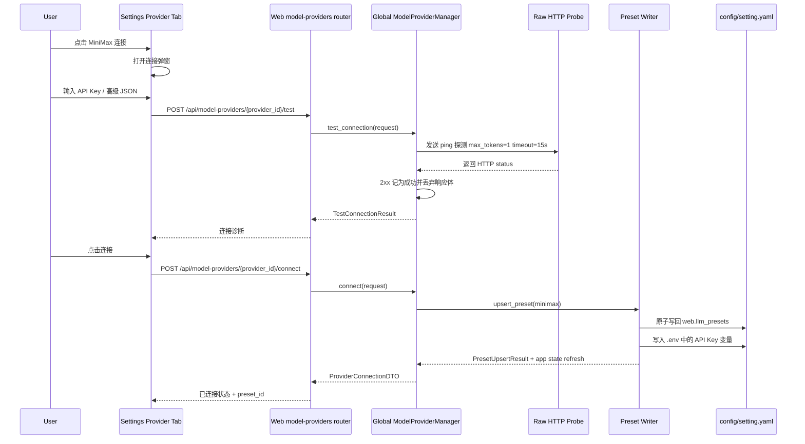
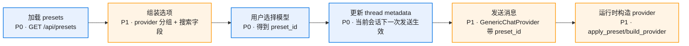
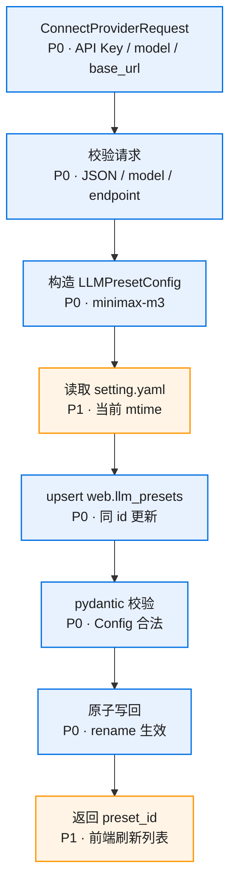

# 核心流程

## 1. MiniMax 连接流程

## 2. 输入框模型切换流程

## 3. Preset 写回流程

## 生效时机

| 操作 | 生效范围 | 说明 |
|------|----------|------|
| 连接 MiniMax | preset 列表刷新后可见 | 后端写 YAML + `.env`，同步更新 app state，前端立即刷新 `/api/presets` |
| 新建 Generic Chat | 首条消息起生效 | 创建 thread 时使用当前选中的 `preset_id` |
| 已有 Generic Chat 切换 | 下一次发送生效 | `PATCH /api/threads/{thread_id}/preset` 更新 metadata，正在运行的 run 继续使用启动时 provider |
| 断开服务商 | 新建/切换时不可选 | 历史 thread 保留原 `preset_id`，发送前校验 preset 可用性 |
