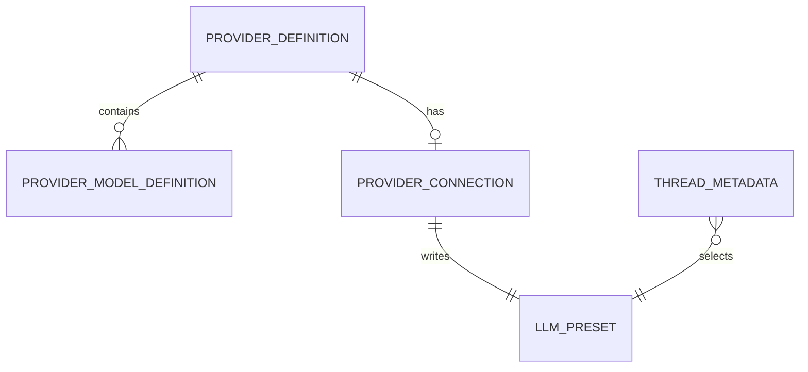
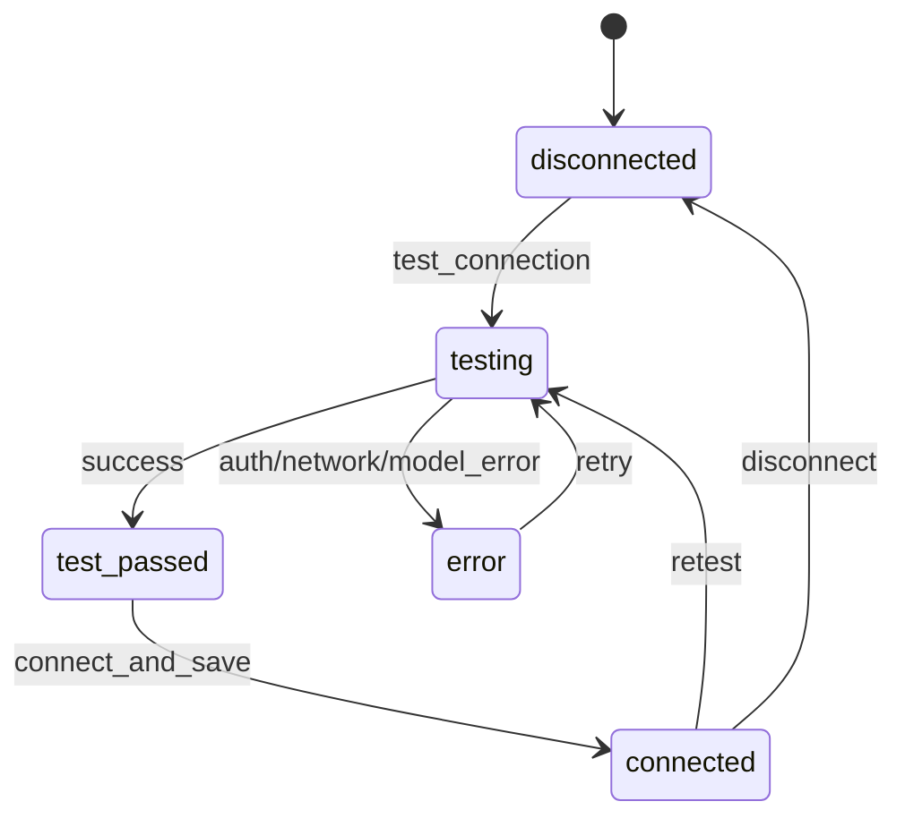
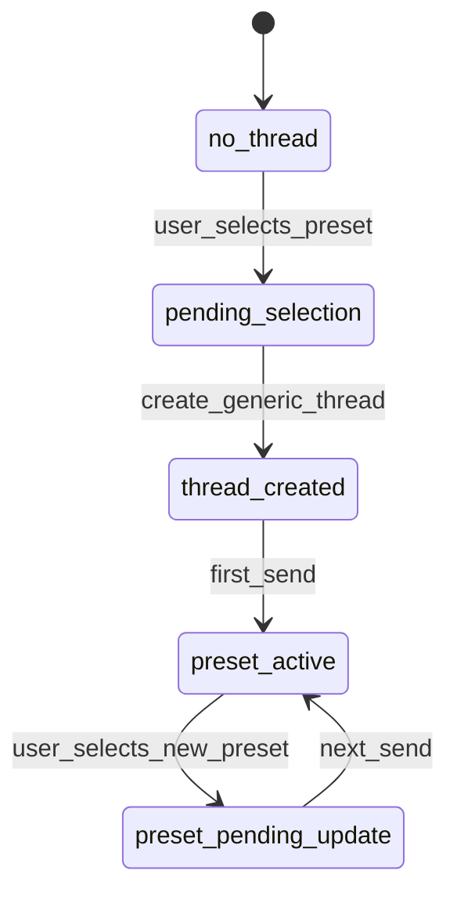

# 数据模型与状态

## 核心实体

```python
class ProviderModelDefinition(BaseModel):
    id: str
    display_name: str
    protocol: Literal["anthropic", "openai_compatible"]
    default_reasoning_effort: Literal["low", "medium", "high"] | None = None

class ProviderDefinition(BaseModel):
    id: str
    display_name: str
    region_label: str
    default_base_url: str
    auth_scheme: Literal["bearer"]
    models: list[ProviderModelDefinition]

class ProviderConnectionDTO(BaseModel):
    provider_id: str
    display_name: str
    status: Literal["connected", "disconnected", "error"]
    preset_id: str | None = None
    model: str | None = None
    base_url_summary: str | None = None
    auth_label: str | None = None
    last_error: str | None = None

class ConnectProviderRequest(BaseModel):
    api_key: str
    model: str
    base_url: str
    extra_env: dict[str, str] = {}

class ProviderAuthConfig(BaseModel):
    header_name: Literal["x-api-key", "Authorization"]
    value_template: str
```

```typescript
interface ProviderCatalogItem {
  id: string;
  displayName: string;
  regionLabel: string;
  defaultBaseUrl: string;
  models: ProviderModelOption[];
}

interface ProviderConnection {
  providerId: string;
  displayName: string;
  status: "connected" | "disconnected" | "error";
  presetId?: string;
  model?: string;
  baseUrlSummary?: string;
  authLabel?: string;
  lastError?: string;
}

interface ModelSwitcherOption {
  presetId: string;
  providerId: string;
  providerLabel: string;
  model: string;
  displayName: string;
  connected: boolean;
}
```

## 实体关系



## 状态流转

### Provider Connection



### Thread Preset Selection



## 持久化方案

| 数据 | 存储方式 | 位置 | 备注 |
|------|---------|------|------|
| Provider catalog | 代码常量 | `src/model_providers/catalog.py` | 当前覆盖 MiniMax M3、GLM、DeepSeek |
| Provider connection | YAML 派生 | `config/setting.yaml` 的 `web.llm_presets` | 通过 preset 判断连接状态 |
| API Key | provider-specific 环境变量引用 | `.env` | 列表接口只脱敏返回；保存连接固定写 provider 默认 env |
| 当前 thread preset | Thread metadata | session/thread metadata store | 现有 `preset_id` 字段 |
| 前端选项缓存 | Zustand store | 浏览器运行态 | 可从 API 重建 |

## 共享数据结构

```python
ProviderProtocol = Literal["anthropic", "openai_compatible"]
ProviderStatus = Literal["connected", "disconnected", "error"]
ProviderId = Literal["minimax", "glm", "deepseek"]
```

## Provider-specific key 映射

当前实现从早期 MiniMax 首版扩展为 MiniMax M3、GLM、DeepSeek 三个 provider-specific key。保存连接统一写 provider 默认 env；fallback env 只作为历史配置和外部注入配置的读取入口。

| Provider | 默认写入 env | fallback 读取 env | 说明 |
|----------|--------------|-------------------|------|
| MiniMax M3 | `MINIMAX_API_KEY` | `KONGMING_PROVIDER_MINIMAX_API_KEY` | Anthropic 兼容接口，Bearer 认证 |
| GLM | `GLM_API_KEY` | `BIGMODEL_API_KEY` / `ZHIPU_API_KEY` / `ZAI_API_KEY` | OpenAI 兼容接口，`bigmodel-glm5.api_key_env` 固定为 `GLM_API_KEY` |
| DeepSeek | `DEEPSEEK_API_KEY` | 无 | Anthropic 兼容接口 |

`KONGMING_MODEL_API_KEY` 属于 CLI / 底层默认模型配置，由 `KONGMING_MODEL_BASE_URL`、`KONGMING_MODEL_NAME` 等默认模型配置链路消费。Web provider 连接状态、保存连接和 Generic Chat preset runtime 读取 provider-specific `api_key_env`。

## MiniMax M3 配置映射

| 字段 | 值 |
|------|----|
| provider_id | `minimax` |
| preset_id | `minimax-m3` |
| display_name | `MiniMax M3` |
| provider | `anthropic` |
| base_url | `https://api.minimaxi.com/anthropic` |
| model | `MiniMax-M3` |
| api_key_env | `MINIMAX_API_KEY` |
| auth_header | `Authorization` |
| auth_value_template | `Bearer {api_key}` |
| auth | `Authorization: Bearer <api_key>` |
| reasoning_effort | `high` 或用户选择 |

## GLM 配置映射

| 字段 | 值 |
|------|----|
| provider_id | `glm` |
| preset_id | `bigmodel-glm5` |
| display_name | `GLM` |
| provider | `openai_compatible` |
| base_url | `https://open.bigmodel.cn/api/coding/paas/v4` |
| model | `glm-5.1` 或当前配置中的 GLM 模型 |
| api_key_env | `GLM_API_KEY` |
| auth_header | `Authorization` |
| auth_value_template | `Bearer {api_key}` |
| auth | `Authorization: Bearer <api_key>` |

## DeepSeek 配置映射

| 字段 | 值 |
|------|----|
| provider_id | `deepseek` |
| preset_id | `deepseek` |
| display_name | `DeepSeek` |
| provider | `anthropic` |
| base_url | `https://api.deepseek.com/anthropic` 或当前配置中的 DeepSeek 端点 |
| model | 当前配置中的 DeepSeek 模型 |
| api_key_env | `DEEPSEEK_API_KEY` |
| auth_header | `Authorization` |
| auth_value_template | `Bearer {api_key}` |
| auth | `Authorization: Bearer <api_key>` |

## 连接探测请求

| 字段 | 值 | 说明 |
|------|----|------|
| content | `ping` | 纯连通性探测 prompt |
| max_tokens | `1` | 最大输出 1 个 token |
| timeout | `15s` | 单次探测超时 |
| success | HTTP 2xx | 成功判定只看状态码 |
| response_body | 丢弃 | 探测结果不消费模型正文 |

## 固定决策

| 项 | 默认方案 | 影响 |
|----|----------|------|
| API Key 存储 | 写入 `.env` 的 provider 默认 env，preset 只保存 `api_key_env` | 重启后仍可用，YAML 不落明文 key |
| 连接后默认模型 | provider 连接成功后设为当前选中 preset | 影响用户下一条 Generic Chat 消息 |
| 已有会话切换 | 下一次发送生效 | 运行中 provider 保持当前实例 |
