# MCP Client v0.1 · 图集

> 本 spec 的唯一图源：所有 mermaid 图集中于此，按模块分节。02/03/04 是文字事实源，本文件是只读视图，增减模块/组件时同步更新对应节。
>
> **查看与缩放**：GitHub 渲染 mermaid 自带缩放/平移控件；VS Code 建议安装 Mermaid Chart（官方）或 Markdown Preview Enhanced 插件以支持缩放。

## 目录

- [总览](#总览)
- [MCP 配置模块](#mcp-配置模块)
- [MCP 基础设施模块](#mcp-基础设施模块)
- [MCP Tool 适配模块](#mcp-tool-适配模块)
- [Runtime 装配模块](#runtime-装配模块)
- [通用 Web Search 集成模块](#通用-web-search-集成模块)
- [安全与观测模块](#安全与观测模块)
- [数据模型](#数据模型)

图例：🔵 P0 核心/阻塞 · 🟠 P1 主要/必须 · ⚪ P2 辅助/可选

## 总览

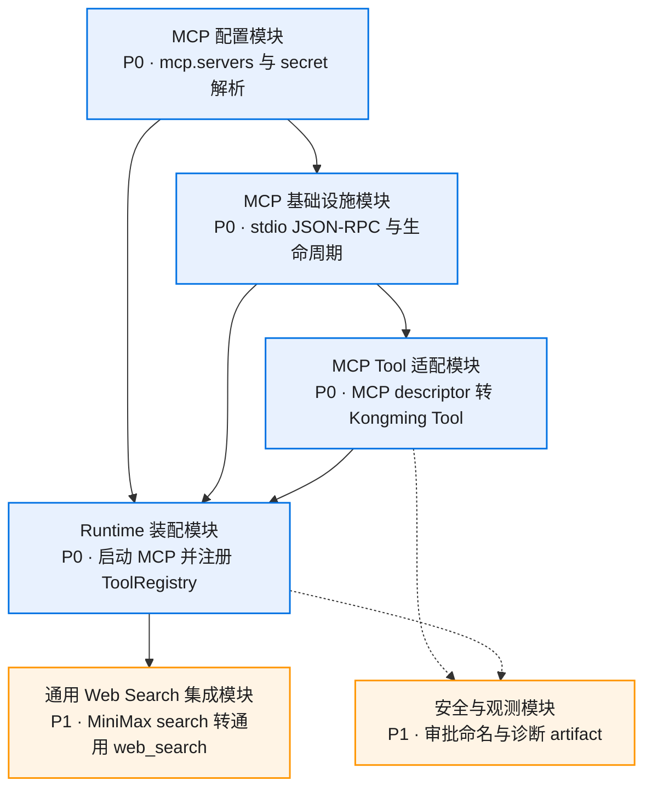

## MCP 配置模块

### 组件依赖

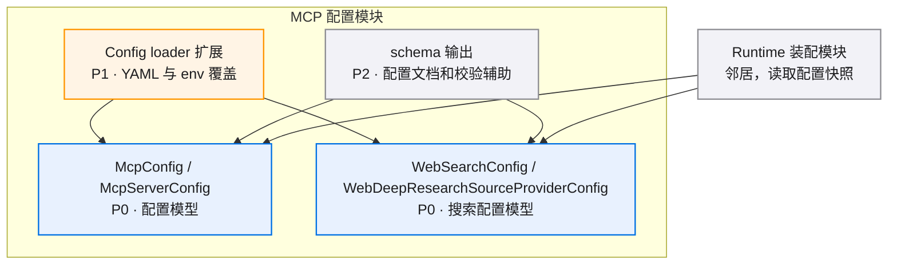

## MCP 基础设施模块

### 组件依赖

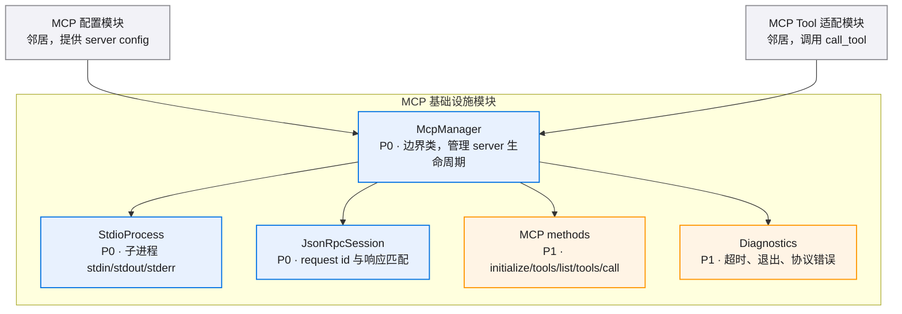

### Server 生命周期

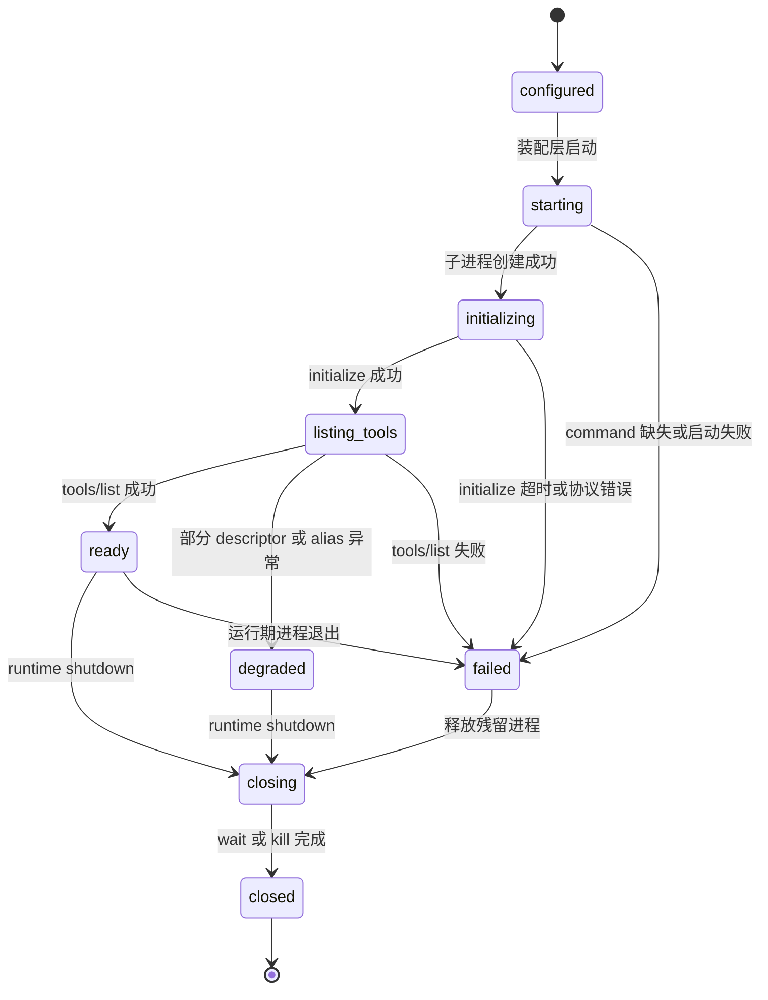

### Shutdown 流程

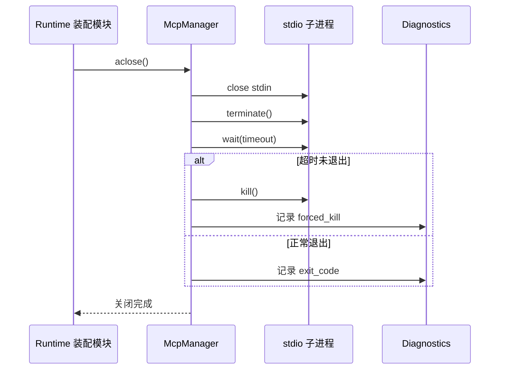

## MCP Tool 适配模块

### 组件依赖

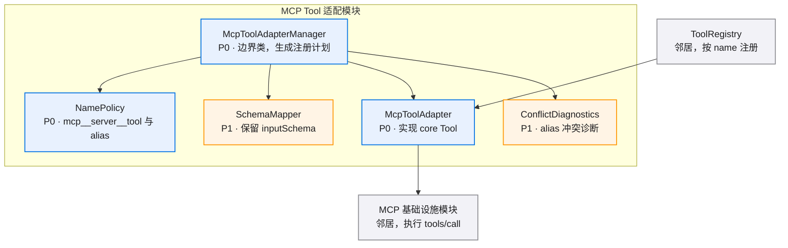

### Tool 注册生命周期

```mermaid
stateDiagram-v2
  [*] --> descriptor_discovered
  descriptor_discovered --> canonical_planned: 生成 canonical name
  canonical_planned --> canonical_registered: ToolRegistry.register 成功
  canonical_planned --> registration_failed: canonical 冲突
  canonical_registered --> alias_planned: 配置声明 alias
  alias_planned --> alias_registered: alias 无冲突
  alias_planned --> alias_skipped: alias 已存在或关闭
  alias_registered --> [*]
  alias_skipped --> [*]
  registration_failed --> [*]
```

### Tool 调用流程

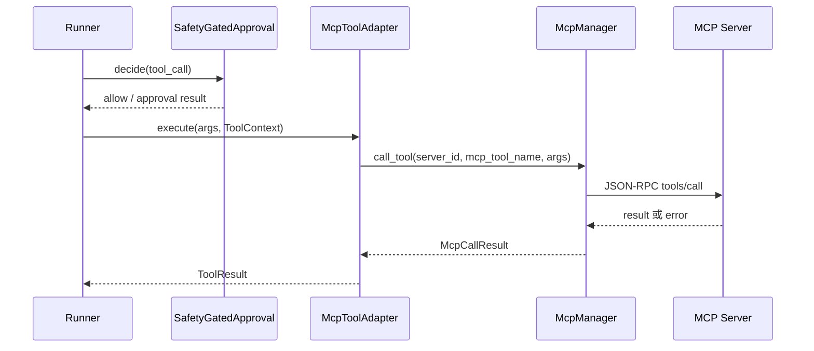

## Runtime 装配模块

### 启动注册流程

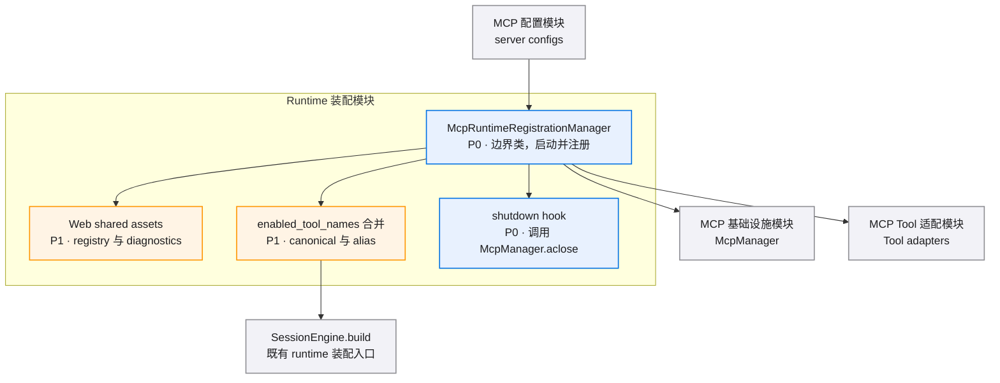

## 通用 Web Search 集成模块

### 组件依赖

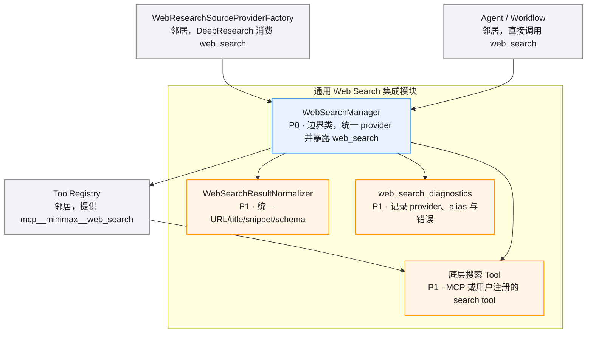

### MiniMax Web Search MCP 到通用 web_search 链路

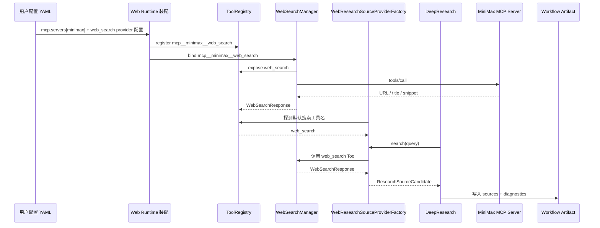

## 安全与观测模块

### 审批与诊断边界

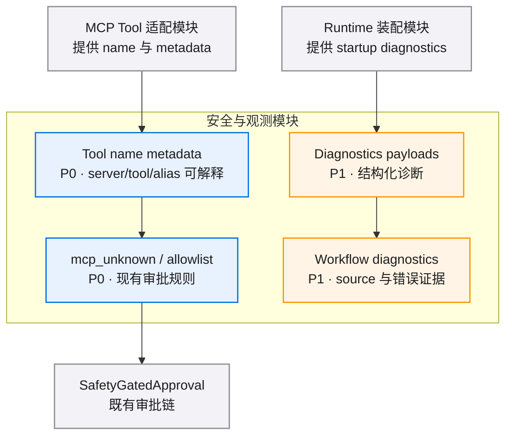

## 数据模型

### 实体关系

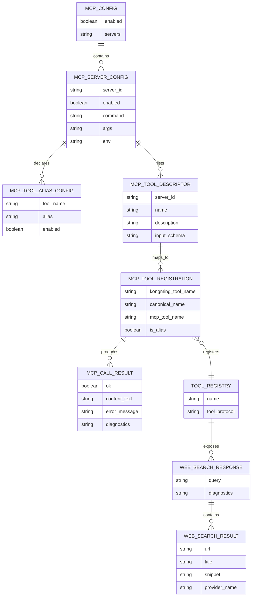
