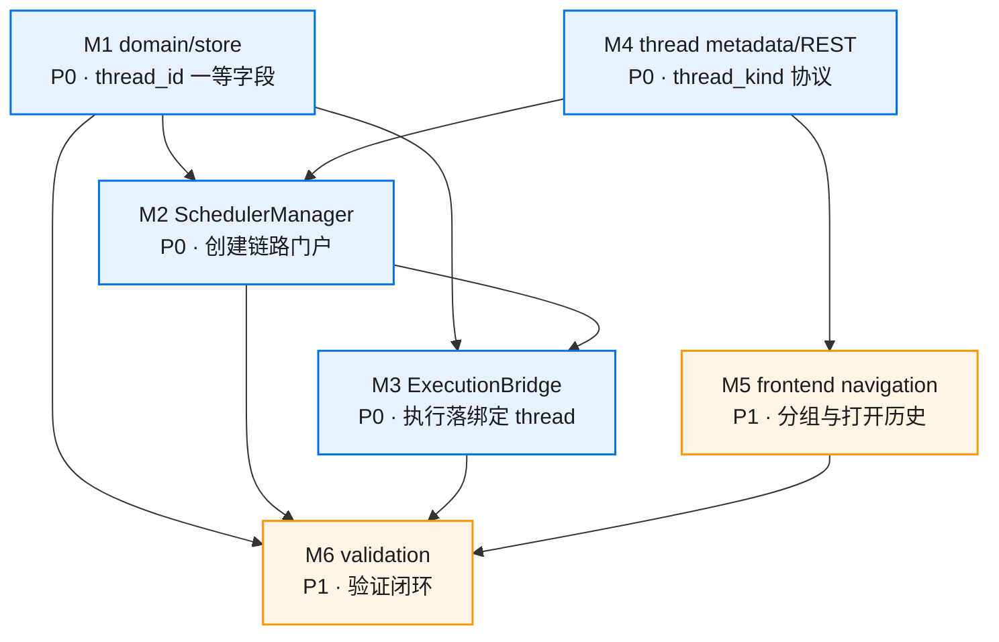
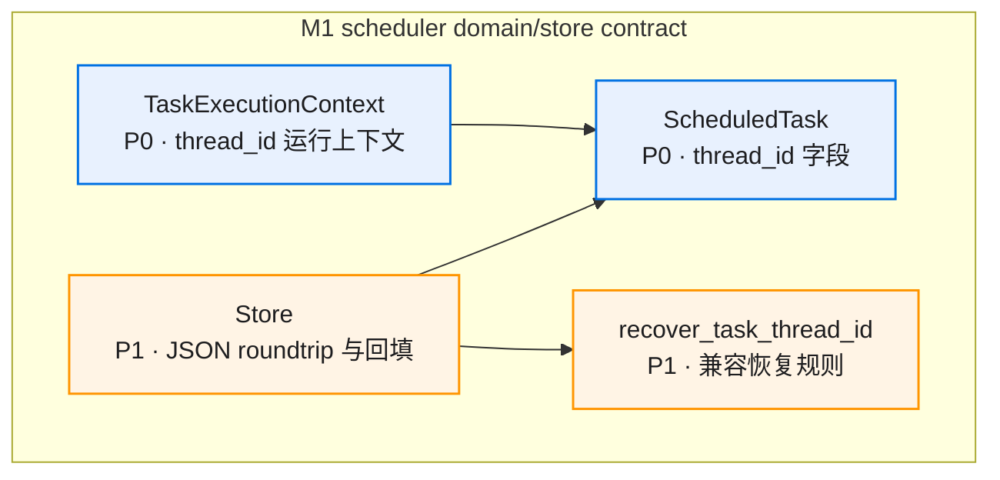
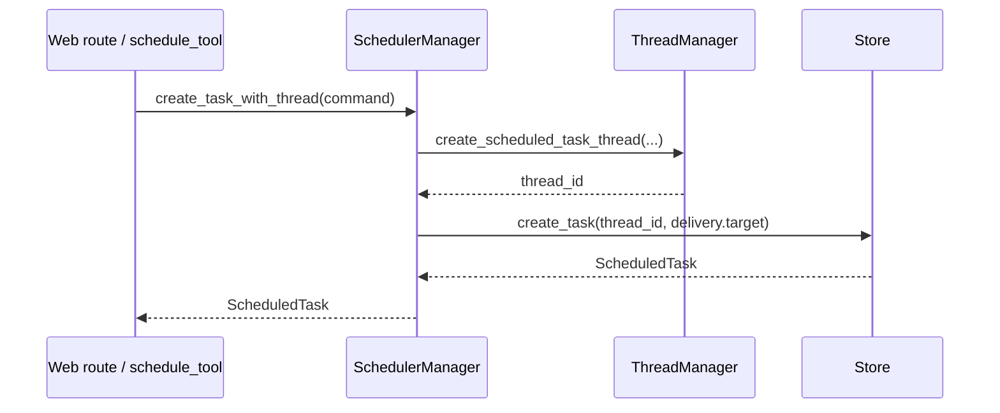
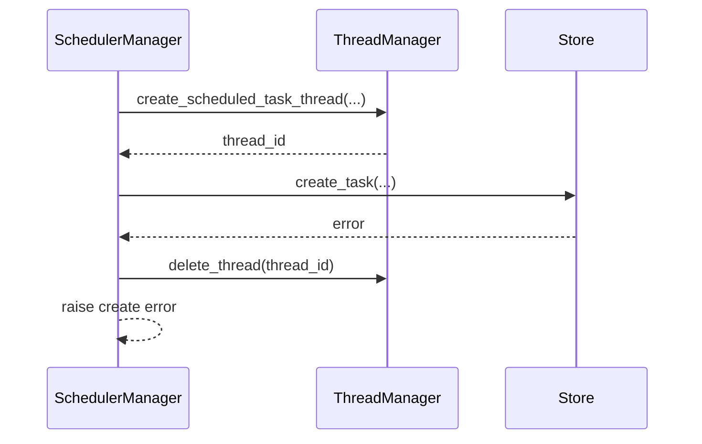
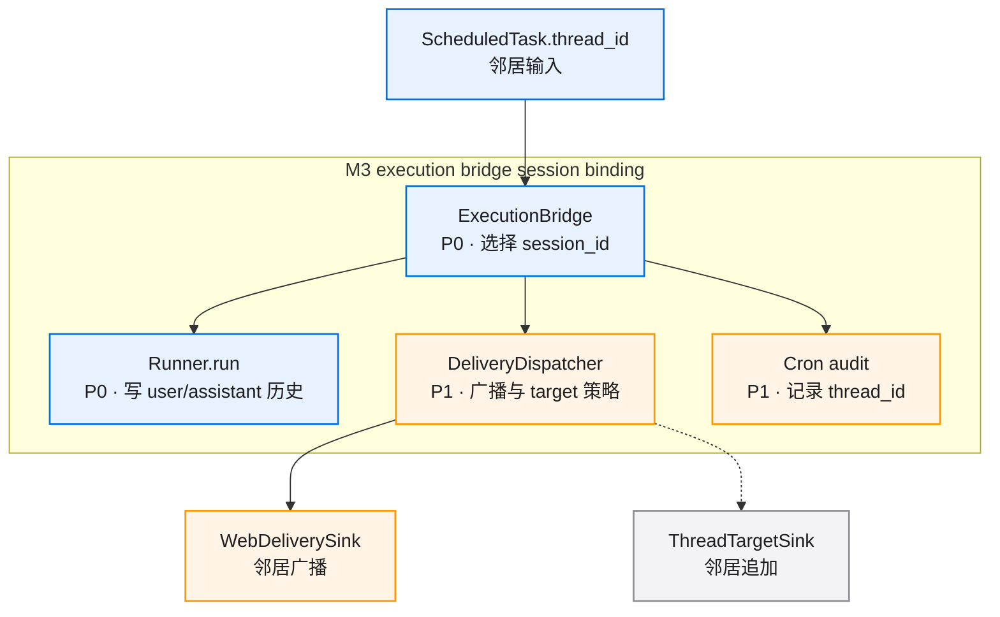
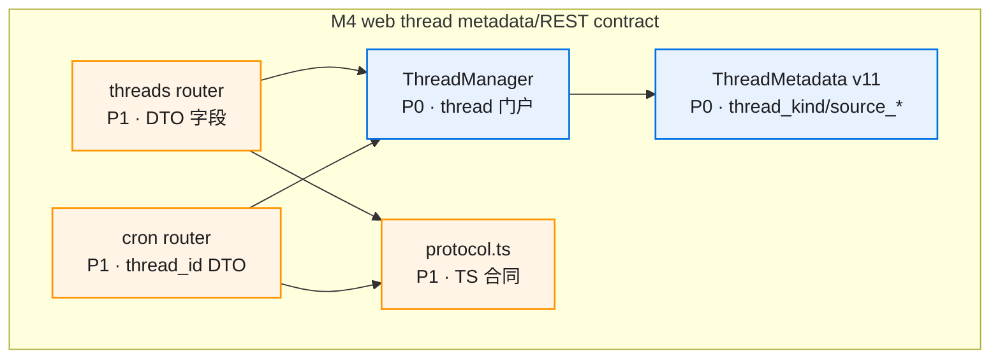
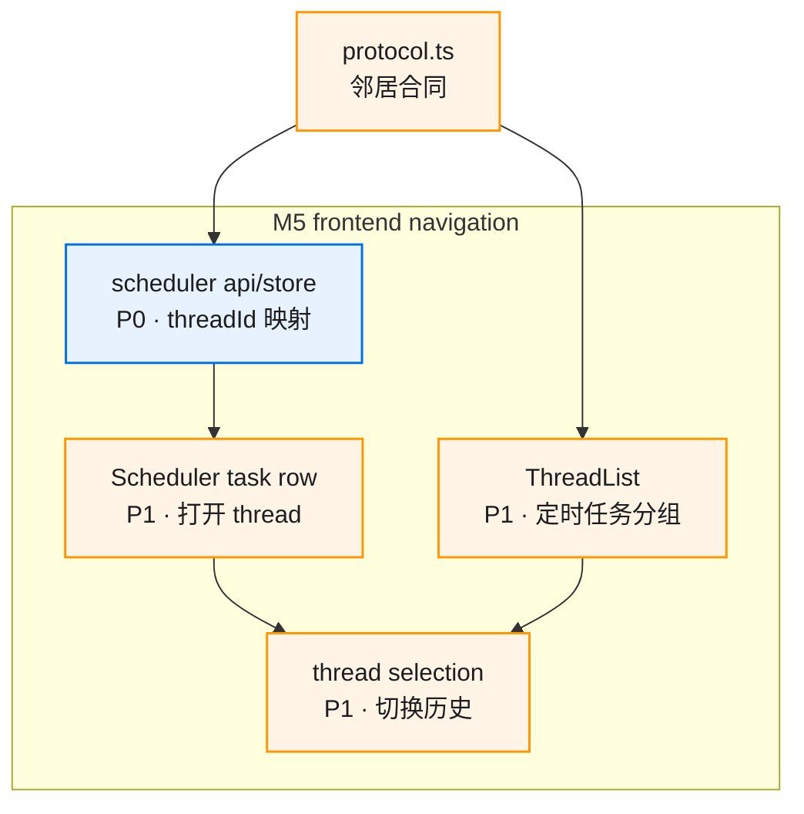
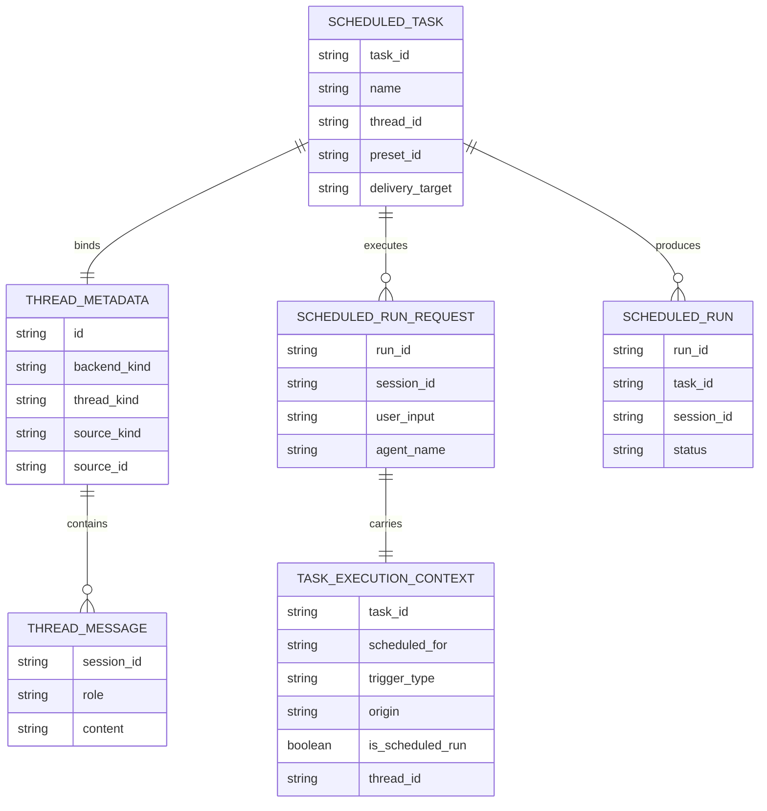
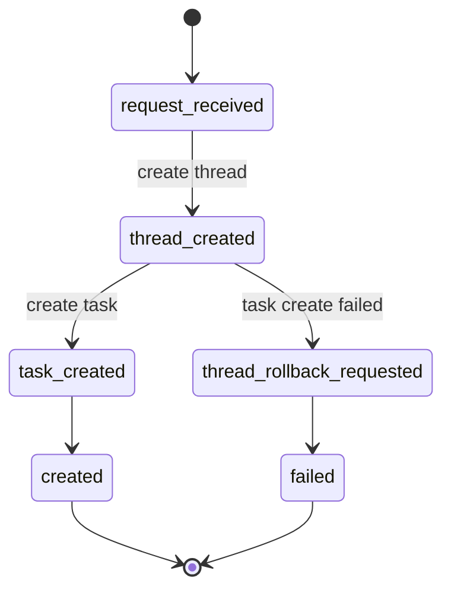
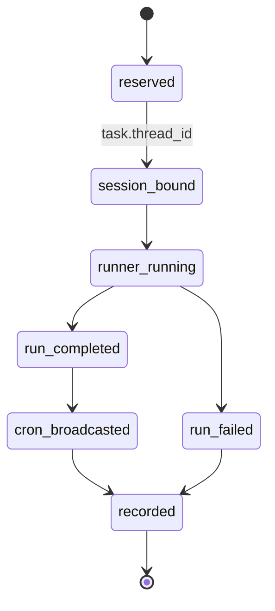

# Scheduled Task Thread Spec · 图集

> 本 spec 的唯一图源：所有 mermaid 图集中于此，按模块分节。02/03/04 是文字事实源，本文件是只读视图——增减模块/组件时同步更新对应节。
>
> **查看与缩放**：GitHub 渲染 mermaid 自带缩放/平移控件；VS Code 建议安装 Mermaid Chart（官方）或 Markdown Preview Enhanced 插件以支持缩放。

## 目录

- [总览](#总览)
- [M1 scheduler domain/store contract](#m1-scheduler-domainstore-contract)
- [M2 scheduler manager/provisioning](#m2-scheduler-managerprovisioning)
- [M3 execution bridge session binding](#m3-execution-bridge-session-binding)
- [M4 web thread metadata/REST contract](#m4-web-thread-metadatarest-contract)
- [M5 frontend navigation](#m5-frontend-navigation)
- [数据关系](#数据关系)
- [状态流转](#状态流转)

图例：P0 核心/阻塞 · P1 主要/必须 · P2 辅助/可选

## 总览

## M1 scheduler domain/store contract

### 组件依赖

## M2 scheduler manager/provisioning

### 创建链路

### 补偿路径

## M3 execution bridge session binding

### 执行链路

## M4 web thread metadata/REST contract

### 组件依赖

## M5 frontend navigation

### 组件依赖

## 数据关系

## 状态流转

### 创建状态

### 执行状态

