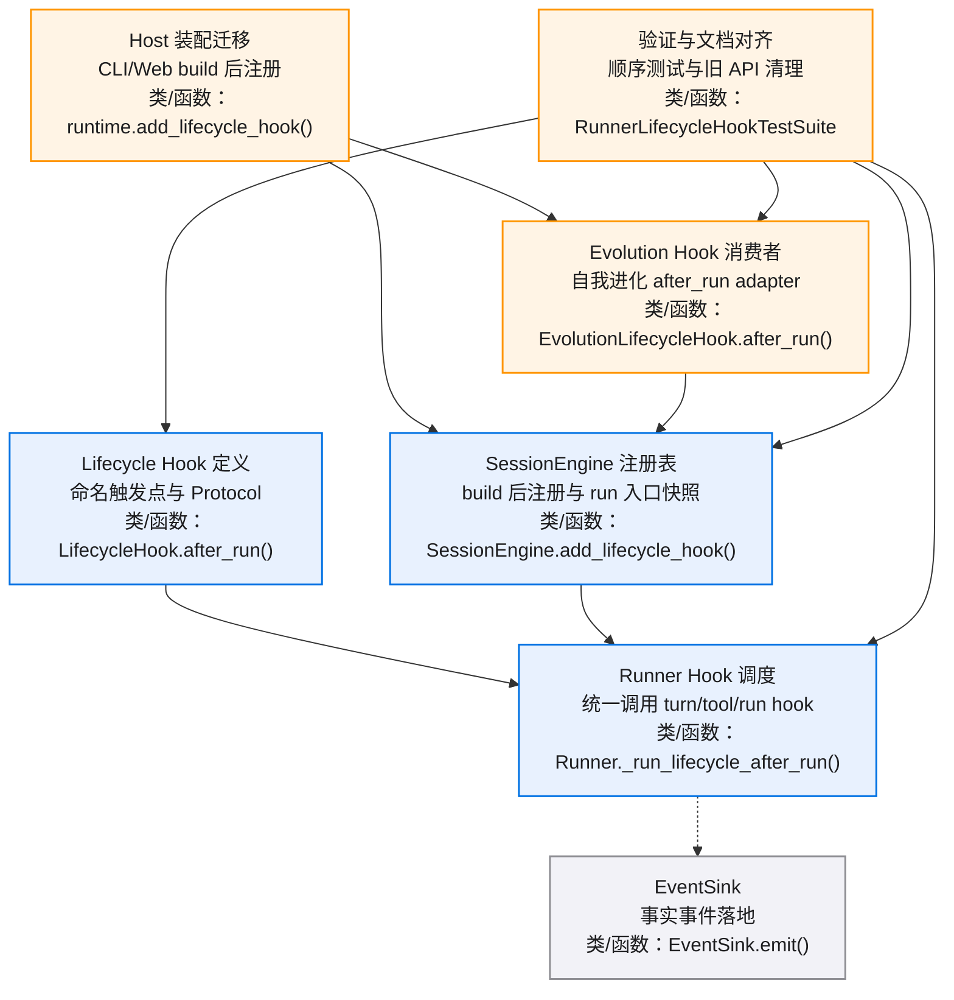
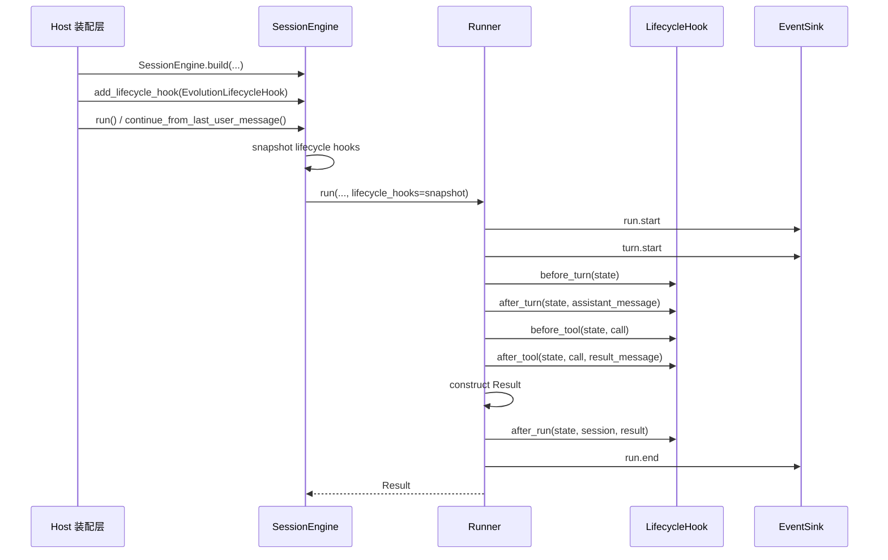
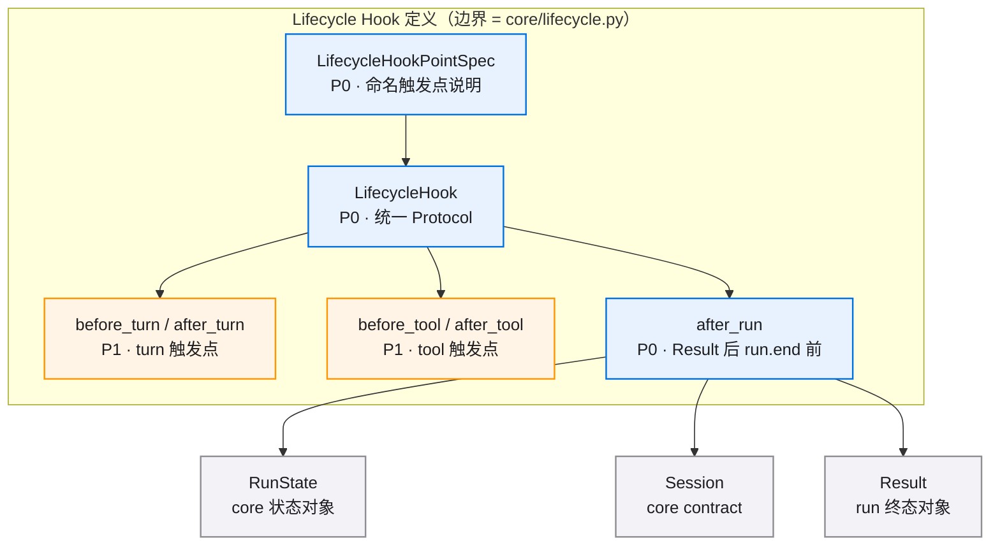
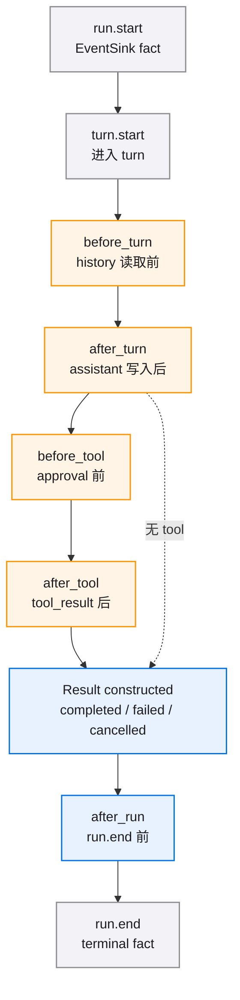
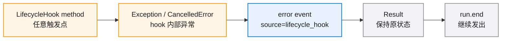
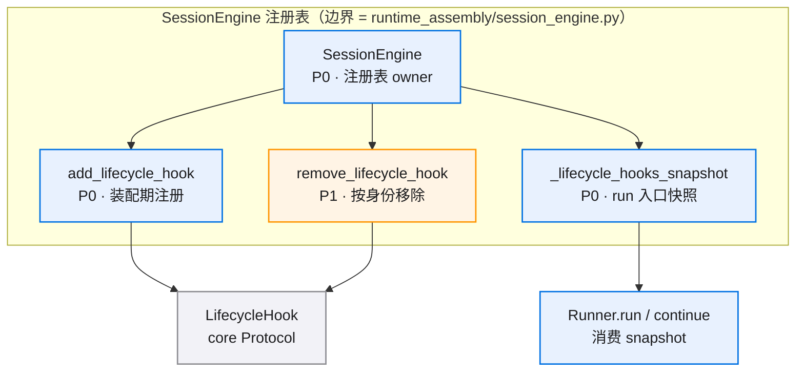
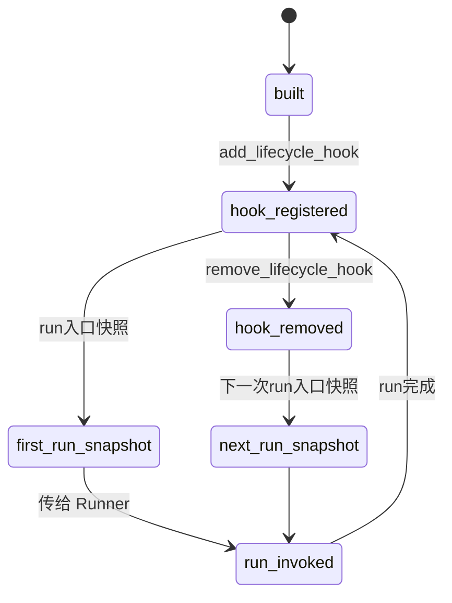
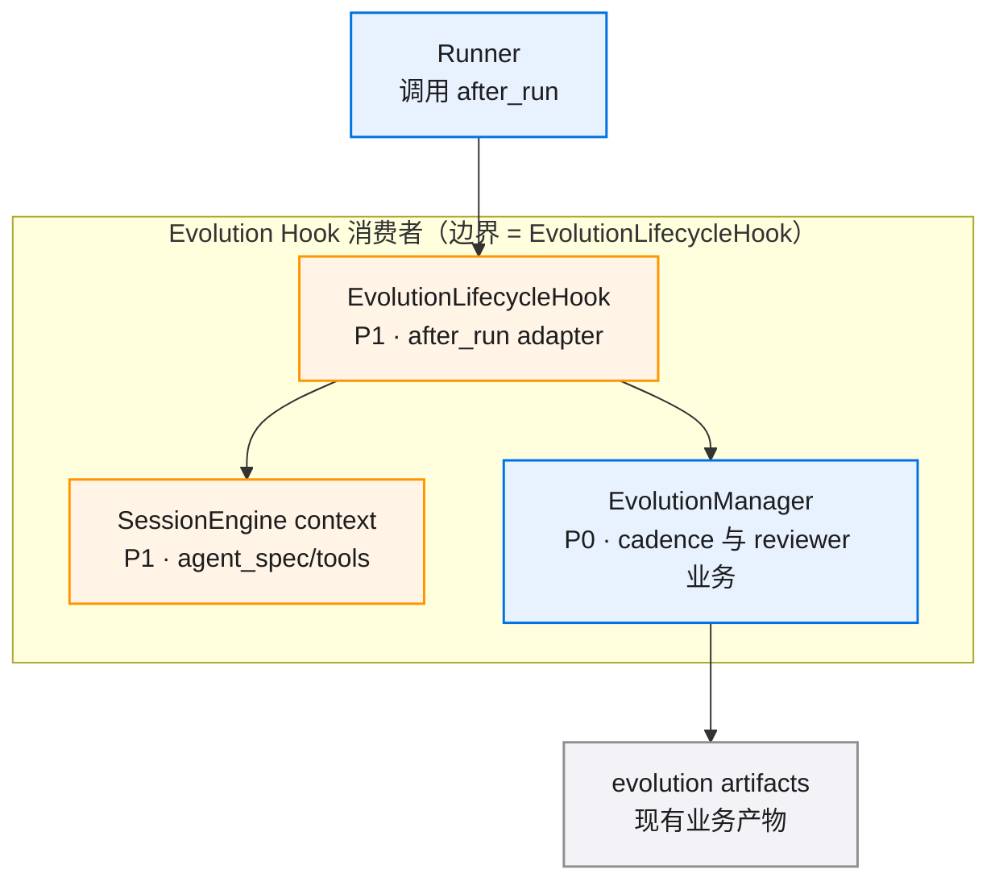
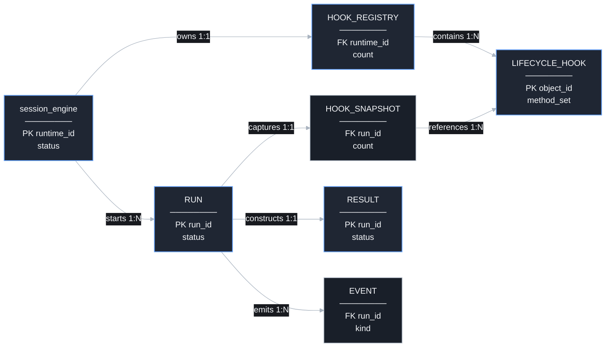

# runner-lifecycle-hooks-v0.1 · 图集

> 本 spec 的唯一图源：所有 mermaid 图集中于此，按模块分节。02/04 是文字事实源，本文件是只读视图，增减模块/组件时同步更新对应节。
>
> **查看与缩放**：GitHub 渲染 mermaid 自带缩放/平移控件；VS Code 建议安装 Mermaid Chart（官方）或 Markdown Preview Enhanced 插件以支持缩放。

## 目录

- [总览](./diagrams.md#总览)
- [E2E 测试链路](./diagrams.md#e2e-测试链路)
- [Runner Hook 主流程](./diagrams.md#runner-hook-主流程)
- [Lifecycle Hook 定义](./diagrams.md#lifecycle-hook-定义)
- [Runner Hook 调度](./diagrams.md#runner-hook-调度)
- [SessionEngine 注册表](./diagrams.md#SessionEngine-注册表)
- [Evolution Hook 消费者](./diagrams.md#evolution-hook-消费者)
- [生命周期数据关系](./diagrams.md#生命周期数据关系)

图例：P0 蓝色表示核心/阻塞性，P1 橙色表示主要/必须完成，P2 灰色表示辅助/可选。

## 总览

## E2E 测试链路

```mermaid
flowchart LR
  classDef setup fill:#E8F1FE,stroke:#0071E3,color:#1D1D1F,stroke-width:1.5px
  classDef action fill:#FFF4E5,stroke:#FF9500,color:#1D1D1F,stroke-width:1.5px
  classDef assert fill:#F2F2F7,stroke:#8E8E93,color:#1D1D1F,stroke-width:1.5px

  Build["准备 runtime<br/>SessionEngine.build(fake deps)"]:::setup
  Register["注册 hook<br/>runtime.add_lifecycle_hook(fake hook)"]:::action
  Run["执行首个 run<br/>runtime.run() 或 continue"]:::action
  Result["构造 Result<br/>completed/failed/cancelled"]:::action
  Hook["触发 after_run<br/>fake hook 记录 marker"]:::action
  End["发出 run.end<br/>EventSink 记录 terminal event"]:::assert
  Assert["断言<br/>after_run 早于 run.end<br/>旧 after_run_hooks 清零"]:::assert

  Build --> Register --> Run --> Result --> Hook --> End --> Assert
```

## Runner Hook 主流程

## Lifecycle Hook 定义

### 组件依赖

## Runner Hook 调度

### Runner hook 时序

### Hook 异常隔离

## SessionEngine 注册表

### 组件依赖

### SessionEngine 注册状态

## Evolution Hook 消费者

## 生命周期数据关系

