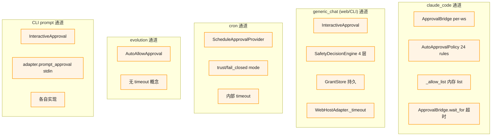
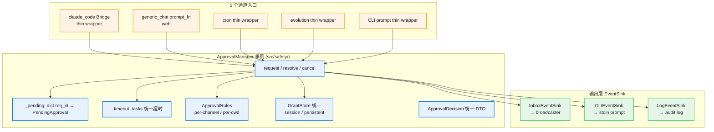
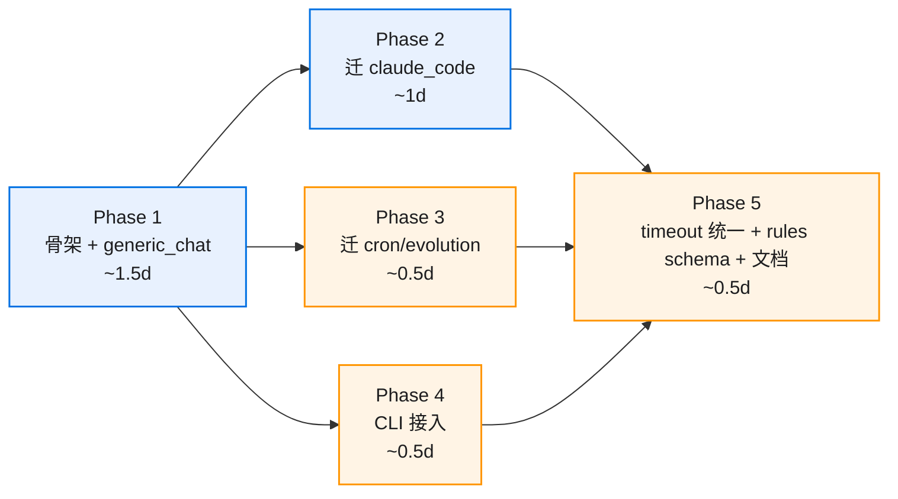

# 00 · 系统总图

> 本文档给出"散落现状"和"manager 统一目标"两个视图的对比，让任何阅读者一眼看清重构的必要性和方向。
> 配套可交互流程图：[architecture.html](architecture.html)（苹果风 mermaid）。

---

## 现状：12 处散落（架构债）

### 5 通道各有一套审批栈

### 12 处散落清单（grep 验证）

| # | 散落点 | 当前位置 | 职责 |
|---|---|---|---|
| 1 | `ApprovalBridge` per-ws | `src/web/integrations/claude_code/approval.py` | claude_code 持 Future + allow_list |
| 2 | `InteractiveApproval` per-process | `src/tools/approval.py:125` | generic_chat 持 prompt_fn + Future |
| 3 | `ScheduleApprovalProvider` | `src/scheduler/runtime_factory.py` | cron 走 trust/fail_closed |
| 4 | `AutoAllowApproval` | `src/tools/approval.py:213` | evolution 全 allow |
| 5 | `ApprovalInboxBroadcaster` | `src/web/approvals/global_inbox/broadcaster.py` | fan-out + bridge_registry |
| 6 | `SafetyGatedApproval` + `ConsentResolver` | `src/safety/chain.py` + `guards/consent.py` | generic_chat 策略链 |
| 7 | `AutoApprovalPolicy` + `rules.yaml` | `src/web/approvals/auto/policy.py` | claude_code 专用 24 规则 + 倒计时 |
| 8 | `SafetyDecisionEngine` | `src/safety/decision_engine.py` | generic_chat 4 层链 |
| 9 | `WebHostAdapter.prompt_approval` | `src/web/app_support/host_adapter.py` | generic_chat web 旧模态 prompt_fn |
| 10 | `GrantStore` | `src/safety/grant_store.py` | generic_chat 持久 grant |
| 11 | `_allow_list: list[str]` | `ApprovalBridge` 内存 | claude_code 内存 grant（重启丢） |
| 12 | 超时逻辑 | 散在 4 处：`ApprovalBridge.wait_for` / `ScheduleApprovalProvider` / `WebHostAdapter._timeout` / 各自实现 | 多处管超时 |

### 痛点

1. **改一个能力要动多处**：例如想加 "5min 内同一工具自动同意"，要改 4 个 Provider
2. **新通道接入门槛高**：未来加 codex 通道要重写 ApprovalBridge 类似桥接
3. **bug 定位需要 grep 5 处路径**
4. **测试矩阵爆炸**：每通道独立测试 + 双 grant 存储 + 多套超时
5. **协议帧字段冗余**：`autoApproveAtMs / blockedByRule` claude_code 专有，generic_chat 永远 null（v2-inbox 实测）

---

## 目标：ApprovalManager 单例统一

### 架构总图

### 关键收益

| 维度 | 现状 | 目标 |
|---|---|---|
| 改"5min 内同工具自动同意"功能 | 改 4 个 Provider 各自的 wait_for 逻辑 | manager._timeout_tasks 加 1 个分支 |
| 新通道接入工作量 | 100+ 行（新 Provider + 装配 + 测试） | ~50 行 thin wrapper + 已有 EventSink 复用 |
| Bug 定位路径数量 | 5 套（per-channel 各一） | 1 套（manager 是中心） |
| Grant 存储 | 2 套（allow_list 内存 + GrantStore 持久） | 1 套（GrantStore；in-memory backend 是退化）|
| 超时管理 | 4 处 | 1 处（manager._handle_timeout） |
| 协议帧字段冗余 | claude_code 字段在 generic_chat 全 null | v0.5 帧字段通道通用化 |
| 测试矩阵 | 5 通道 × 多 Provider | manager 主测 + 通道 adapter 薄薄一层 |

---

## 改造路径（5 阶段渐进，每阶段独立可发布）

**重点**：Phase 2 / 3 / 4 都依赖 Phase 1（骨架）；它们之间**互相不阻塞**可并行做。

详见 [50-migration-plan.md](50-migration-plan.md)。

---

## 双轨期契约（阶段 1-4 临时双写）

阶段 1 完成到阶段 2/3/4 完成之间，**老路径**（ApprovalBridge / InteractiveApproval / ScheduleApprovalProvider / AutoAllowApproval）**和新路径**（manager + EventSink）**并存**。

为了让双轨期可控：

1. **底层基础设施 100% 共享**（broadcaster / 协议帧 / 前端 / 审计 / GrantStore），不复制
2. **共享 helper**（`inbox_helpers.py`）由 manager 和老 ApprovalBridge 同时调用，避免 payload 构造逻辑双写
3. **集成测验证两路径等价**：双轨期 stage 2 完成前要有"等价性测试"对比同输入下两路径的输出

详见 [50-migration-plan.md#双轨期契约](50-migration-plan.md#双轨期契约)。

---

## 与 v2-inbox 的关系

| 项 | v2-inbox（已上线） | 本 spec（v0.5）|
|---|---|---|
| 范围 | 只服务 claude_code 通道的浮窗 UI | 5 通道全收拢 + 统一 manager |
| 重构方向 | 改 UI（per-thread 模态 → 全局浮窗）| 改架构（散落 Provider → manager 单例）|
| 协议帧 | 新增 `approval.inbox.*` 4 帧 | 字段演进（通道通用化）；不破坏 v2-inbox 客户端 |
| GrantStore | 未触及 | 阶段 2 把 claude_code allow_list 迁过来 |
| 阶段关系 | 是本 spec 阶段 2 的前置（claude_code 必须先 inbox 化） | 阶段 2 在 v2-inbox 基础上迁 manager |

v2-inbox 是本 spec 阶段 2 的**必要前置**——它把 claude_code 通道的 UI 准备好，本 spec 把它的**审批逻辑**也收进 manager。

---

## 下一步

读完本文档后建议按顺序阅读：

1. [10-architecture.md](10-architecture.md) — manager 内部细节
2. [50-migration-plan.md](50-migration-plan.md) — 5 阶段路径
3. [90-task-map.md](90-task-map.md) — 5 task 名称 + 状态
