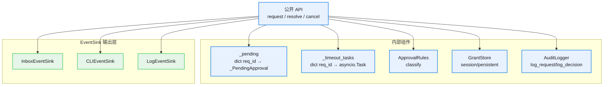
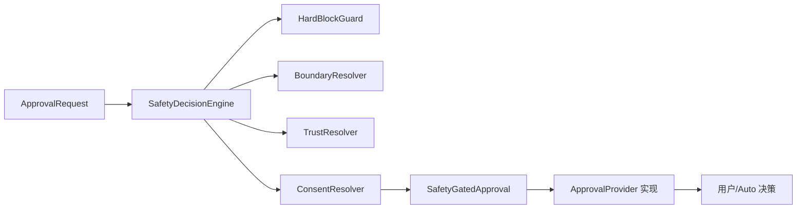
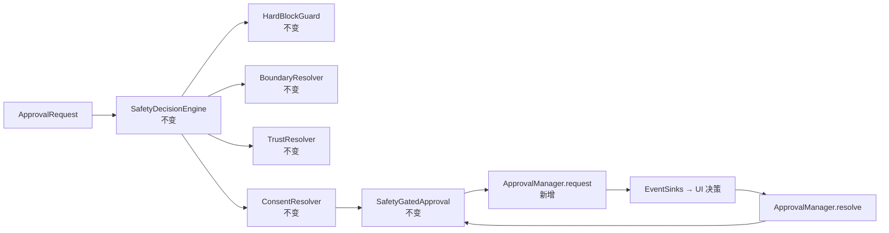

# 10 · ApprovalManager 架构

> 本文档描述 ApprovalManager 单例的内部组件、公开接口、EventSink Protocol 以及与现有 safety chain 的关系。
>
> ⚠️ 本文档示例代码**全部 illustrative**，不是最终实现；x-req → x-dev 阶段才落地代码。
> **中文 docstring 强制**：所有示例 / 最终代码的函数和类都必须有中文 docstring（用户硬约束）。

---

## 1. 模块位置

| 项 | 决策 |
|---|---|
| 物理位置 | `src/safety/`（与 SafetyDecisionEngine 同层）|
| 单例方式 | per-process module-level（`get_approval_manager()` 工厂 + `reset_for_testing()` 重置）|
| 装配点 | `SessionEngine.build` / `src/web/run.py` / `src/cli/main.py` / `src/scheduler/runtime_factory.py` / `src/evolution/evolution_manager.py` 装配时注入 EventSinks + Rules + GrantStore |
| 跨层依赖 | **safety 包 0 import web**；通过 dependency injection 拿 broadcaster / event sinks |

**为什么放 safety/**：

- 与 SafetyDecisionEngine / ConsentResolver / GrantStore 同层，方便共享内部类型
- 不污染 core.contracts（manager 内部 Protocol 阶段 1 足够）
- 装配工厂（`build_default_approval` 等）按 `executors.agent_runtime.session_engine → safety` 现有白名单合规

---

## 2. 公开接口

```python
# src/safety/approval_manager.py
"""审批层统一入口。所有通道（claude_code / generic_chat / cron / evolution / CLI）的审批请求
都进这个 manager。manager 负责：
- 创建 pending future
- 统一 timeout（一个事件循环管所有通道）
- 委托 ApprovalRules 做策略决策
- 命中 explicit_consent 时 fan-out 到 EventSink（Inbox / CLI / Log）
- 收到 resolve 后 set_result future + 写 GrantStore / 审计
"""


class ApprovalManager:
    """审批统一入口单例。
    
    生命周期：per-process 单例；装配点（SessionEngine.build / web/run.py 等）注入
    rules / event_sinks / grant_store / audit 后由各通道 adapter 共用。
    
    线程安全：所有 mutating 操作都在 asyncio.Lock 下；resolve / cancel 失败不抛
    （审批主流程绝不能因 manager 内部异常而断）。
    """
    
    def __init__(
        self,
        *,
        rules: ApprovalRules,
        event_sinks: list[ApprovalEventSink],
        grant_store: GrantStore,
        audit: AuditLogger,
        default_timeout_ms: int = 60_000,
    ) -> None:
        """构造 manager 单例。
        
        Args:
            rules: per-channel + per-cwd 规则容器（策略层委托）
            event_sinks: 输出层 fan-out 目标（阶段 1 只 InboxEventSink；阶段 4 加 CLIEventSink）
            grant_store: 统一持久 grant（allow_list 是它的 in-memory backend 退化）
            audit: 审计日志器（每个 request / resolve / cancel / timeout 都写 audit）
            default_timeout_ms: 未指定超时时的默认值（与 v0.1 老 WebHostAdapter._timeout=60s 一致）
        """
        ...
    
    async def request(
        self,
        *,
        channel: str,
        thread_id: str,
        cwd: str,
        tool_name: str,
        tool_input: dict[str, Any],
        metadata: dict[str, Any] | None = None,
        timeout_ms: int | None = None,
    ) -> ApprovalDecision:
        """请求用户审批。阻塞直到 resolve / timeout / cancel。
        
        步骤：
        1. 调 rules.classify(channel, thread_id, cwd, tool, input) 拿初步决策
        2. 立即决策（hard_block / silent_allow / cron trust / evolution auto-allow）→ 直接 return + audit
        3. 需要用户决策 → 创建 _PendingApproval + Future + 启动 timeout task + fan-out EventSink
        4. await future（被 resolve 或 cancel 或 timeout）
        5. 决策结果：写 GrantStore（如果 remember_for_session）+ 写 audit + return ApprovalDecision
        
        Args:
            channel: 'claude_code' / 'generic_chat' / 'cron' / 'evolution' / 'cli'
            thread_id: 路由 key；inbox 通道下与 broadcaster.register_resolve_target 一致
            cwd: 触发审批的工作目录（用于 per-cwd scope 规则匹配 + UI 展示）
            tool_name: 工具名（如 "Bash" / "Edit" / "Read"）
            tool_input: 工具参数 dict
            metadata: 通道 specific 元数据（如 SDK request_id / cron task_id / policy_hint）
            timeout_ms: 单次审批超时；不传走 default_timeout_ms
        
        Returns:
            ApprovalDecision 统一三态 DTO（详见 20-data-model.md）
        """
        ...
    
    def resolve(self, request_id: str, decision: dict[str, Any]) -> bool:
        """所有 UI 入口的决策回写点。
        
        被 InboxEventSink（broadcaster.register_resolve_target 注册的 callback）/ 
        CLIEventSink（stdin prompt 回调）等调用。
        
        Args:
            request_id: 对应 _PendingApproval._request_id
            decision: dict 含 'allow' bool + 可选 'message' / 'rememberEntry' / 'rememberPath'
        
        Returns:
            True = 找到 pending future 并 set_result；False = request_id 未知（重复 resolve / 已 timeout / cancelled）
        """
        ...
    
    def cancel(self, request_id: str, reason: str = "cancelled") -> bool:
        """取消 pending 审批（abort / shutdown / ws 断 路径）。
        
        Returns:
            True = 找到 pending future 并 set_exception(CancelledError)
        """
        ...
    
    @property
    def pending_count(self) -> int:
        """当前 pending 审批数（仅供监控 / 测试断言用）。"""
        ...


# 工厂 + 单例
def get_approval_manager() -> ApprovalManager:
    """获取或创建 manager 单例。装配点统一通过此函数拿实例。"""
    ...


def reset_for_testing() -> None:
    """**仅测试用**：重置单例到 None；测试 fixture 在 setup/teardown 用。"""
    ...
```

---

## 3. 内部组件



### 3.1 `_pending: dict[str, _PendingApproval]`

请求级状态。每条 pending 持 future + 元数据。详见 [20-data-model.md](20-data-model.md)。

### 3.2 `_timeout_tasks: dict[str, asyncio.Task]`

每个 pending 对应一个 timeout task。timeout 触发时：
- pop pending
- fan-out emit_approval_removed(reason="timeout") 到所有 EventSink
- future.set_result(ApprovalDecision.timeout_default(...)) 或 cancel

### 3.3 `_rules: ApprovalRules`

策略层委托对象。详见 [30-rules-schema.md](30-rules-schema.md)。

### 3.4 `_grant_store: GrantStore`

统一持久 grant。**allow_list 是它的 in-memory backend**（重启丢的退化版）。详见 [20-data-model.md#GrantStore 统一](20-data-model.md#grantstore-统一)。

### 3.5 `_audit: AuditLogger`

审计日志器。每个 request 触发 audit.log_request；每个 resolve / timeout / cancel 触发 audit.log_decision。**不动现有 AuditLogger 接口**。

---

## 4. ApprovalEventSink Protocol

```python
# src/safety/approval_manager.py 内（阶段 1 不抽到 core.contracts）

from typing import Protocol


class ApprovalEventSink(Protocol):
    """审批事件输出层抽象。
    
    manager 不直接知道 UI 是谁；UI 通过实现此 Protocol 接入。
    阶段 1 只 InboxEventSink 一种实现；阶段 4 加 CLIEventSink；阶段 5 可加 LogEventSink。
    
    设计原则：
    - emit 失败不抛（吞所有异常，审批主流程绝不因 sink 失败而断）
    - emit 是 async（允许 sink 内做 ws fan-out / 网络 IO）
    - sink 不持 state，每次调用都用 manager 传过来的 pending 上下文
    """
    
    async def emit_approval_required(
        self,
        *,
        pending: "_PendingApproval",
    ) -> None:
        """通知 sink 有新 pending 审批需要用户决策。
        
        sink 负责把 pending 转成自己 UI 能消费的形式：
        - InboxEventSink: 调 broadcaster.emit_add(payload) + register_resolve_target
        - CLIEventSink: 推 stdin prompt 显示
        - LogEventSink: 写 audit log
        
        Args:
            pending: manager 内部 _PendingApproval 对象（详见 20-data-model.md）
        """
        ...
    
    async def emit_approval_removed(
        self,
        *,
        request_id: str,
        reason: str,
    ) -> None:
        """通知 sink 某条 pending 已结束（user_decided / timeout / cancelled）。
        
        sink 负责清理自己的 UI 状态：
        - InboxEventSink: 调 broadcaster.emit_remove(request_id, reason) + unregister_resolve_target
        - CLIEventSink: 清 stdin prompt 提示
        
        Args:
            request_id: 对应已存在的 emit_approval_required
            reason: "user_decided" | "timeout" | "cancelled"
        """
        ...
```

---

## 5. EventSink 实现

### 5.1 InboxEventSink（阶段 1）

```python
# src/safety/inbox_event_sink.py

"""InboxEventSink：把 manager 的审批事件 fan-out 到 web inbox 浮窗。
v2-inbox 已建好 broadcaster + ws 端点 + 前端组件；本 Sink 只是适配器。
"""


class InboxEventSink:
    """Inbox 适配器：manager → ApprovalInboxBroadcaster → /ws/thread-status fan-out。
    
    依赖注入 broadcaster 实例（safety 包 0 import web；broadcaster 由装配点传入）。
    """
    
    def __init__(self, broadcaster: "ApprovalInboxBroadcaster", manager: ApprovalManager) -> None:
        """构造 sink。
        
        Args:
            broadcaster: web 层提供的 broadcaster 实例（装配点注入）
            manager: 反向引用 manager，让 sink 能把 resolve callback 指回 manager.resolve
        """
        ...
    
    async def emit_approval_required(self, *, pending: "_PendingApproval") -> None:
        """fan-out add 帧到所有 ws + 注册 resolve callback 到 broadcaster。
        
        步骤：
        1. 调 inbox_helpers.to_inbox_payload 把 pending 转成 add 帧 payload
        2. 调 broadcaster.register_resolve_target(pending.thread_id, manager.resolve)
        3. 调 broadcaster.emit_add(payload)
        """
        ...
    
    async def emit_approval_removed(self, *, request_id: str, reason: str) -> None:
        """fan-out remove 帧 + 注销 resolve callback。"""
        ...
```

### 5.2 CLIEventSink（阶段 4）

```python
# src/safety/cli_event_sink.py（阶段 4 新建）

"""CLIEventSink：把 manager 的审批事件推到 CLI stdin prompt。
替代现有 src/cli/main.py 的 adapter.prompt_approval。
"""


class CLIEventSink:
    """CLI 适配器：manager → stdin/tty prompt → manager.resolve。"""
    
    def __init__(self, manager: ApprovalManager, prompt_io: PromptIO) -> None:
        ...
    
    async def emit_approval_required(self, *, pending: "_PendingApproval") -> None:
        """打印 prompt，async 等用户键入 y/n/s（本 session）。
        用户决策后立即调 manager.resolve(pending.request_id, {allow: ...})。
        """
        ...
```

---

## 6. 与 safety chain 的关系

### 现状



### v0.5 manager 接入后



**关键**：`SafetyDecisionEngine` 4 层链**完全不动**。manager 只接管 `ApprovalProvider` 层（被 `SafetyGatedApproval` 委托）。

---

## 7. 装配示例

### 阶段 1（generic_chat web）

```python
# src/web/run.py（阶段 1 改造，~10 行）

"""装配审批栈：v0.5 manager + v0.1 老 Provider 双轨。"""

# v2-inbox 已建的 broadcaster
broadcaster = get_inbox_broadcaster()

# 新建 manager（用 GrantStore + ApprovalRules + InboxEventSink）
manager = get_approval_manager()
inbox_sink = InboxEventSink(broadcaster=broadcaster, manager=manager)
manager._event_sinks.append(inbox_sink)  # 通过 register_event_sink 公开 API 加

# generic_chat 装配：prompt_fn 改成走 manager
def make_manager_prompt_fn(thread_id: str):
    """工厂：生成 prompt_fn，内部调 manager.request。
    
    替代原 adapter.prompt_approval（推 ApprovalRequestFrame 到 per-thread WS 老模态）。
    """
    async def prompt_fn(req: ApprovalRequest) -> ApprovalAction:
        """中文 docstring 强制：从 ApprovalRequest 提取信息调 manager.request。"""
        decision = await manager.request(
            channel="generic_chat",
            thread_id=thread_id,
            cwd=req.cwd,
            tool_name=req.tool_name,
            tool_input=req.tool_input,
            metadata=req.metadata,
        )
        return decision.to_approval_action()  # 二态映射，详见 40-protocol-evolution.md
    
    return prompt_fn

prompt_fn = make_manager_prompt_fn(thread_id)  # ← 替代 adapter.prompt_approval
approval = build_default_approval(real_cfg.approval.mode, prompt_fn=prompt_fn)
```

### 阶段 2-4 装配（claude_code / cron / evolution / cli）

详见 [50-migration-plan.md](50-migration-plan.md) 每阶段的装配示例。

---

## 8. 关键设计权衡

| 决策 | 取舍 | 理由 |
|---|---|---|
| Manager 在 safety 而非 web | 不污染分层 vs 与 broadcaster 物理距离远 | safety 层是策略真源，broadcaster 通过 DI 注入即可 |
| EventSink 内部 Protocol 而非 core.contracts | 阶段 1 内部 vs 长期跨模块 | 阶段 1 仅 manager 内部使用；阶段 5 真有第三方实现再抽 |
| InboxEventSink 持反向 manager 引用 | 紧耦合 vs 简洁 | inbox UI resolve 必须能调回 manager.resolve；DI 路径不可避免 |
| Manager 直接持 GrantStore vs 委托 rules | 简洁 vs 单一职责 | rules.classify 是 read-only；grant 写入是 manager 决策后做；分开更清晰 |
| Timeout 在 manager 内 vs 每 channel 内 | 统一 vs 通道灵活 | 统一可观测 + bug 集中修；超时阈值通过 rules.timeout_ms 通道差异化 |
| Pending future 用 asyncio.Future 而非 anyio | 跟项目现状一致 vs 跨 framework | asyncio 是项目主 framework，跟现有 ApprovalBridge / WebHostAdapter 一致 |

---

## 9. 不在本架构范围

- 跨进程审批（manager 是 per-process 单例；跨进程留 v1.0 加分布式扩展）
- 多 manager 协同（只支持单实例）
- HTTP REST API（仅 ws + stdin 两种 sink）
- 审批"撤回"（决策一旦 set_result 不可撤；UX 上无 undo）

---

## 下一步阅读

- [20-data-model.md](20-data-model.md) — `_PendingApproval` / `ApprovalDecision` / `ApprovalRules` / `GrantStore` 完整 DTO
- [40-protocol-evolution.md](40-protocol-evolution.md) — manager.request 入参 / decision 出参与协议帧字段的映射
- [50-migration-plan.md](50-migration-plan.md) — 5 阶段每阶段的装配代码改动
