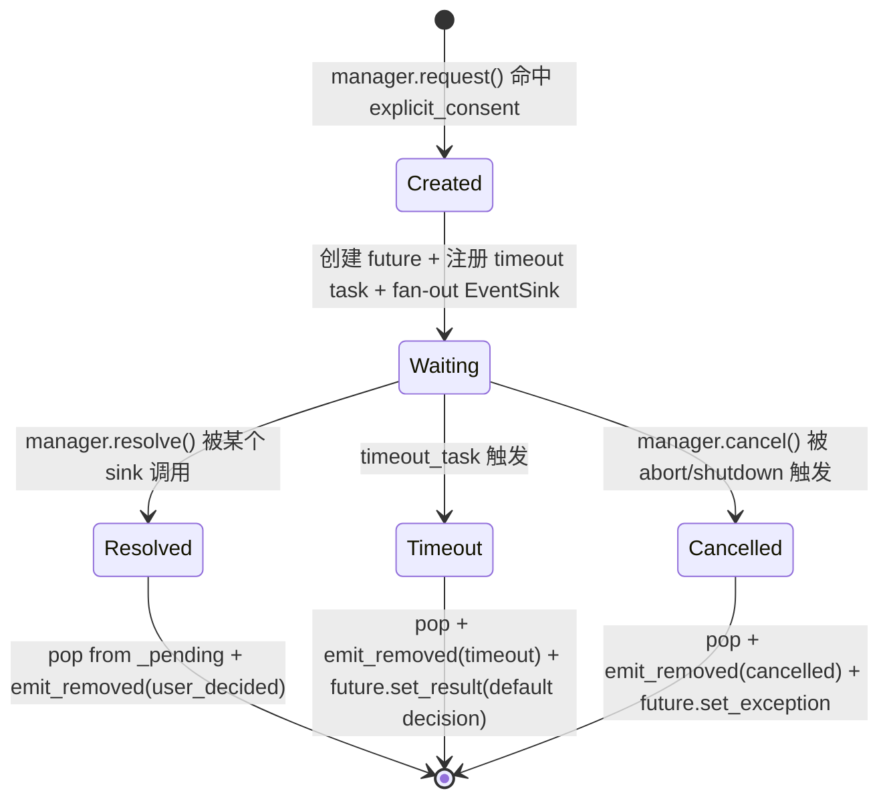
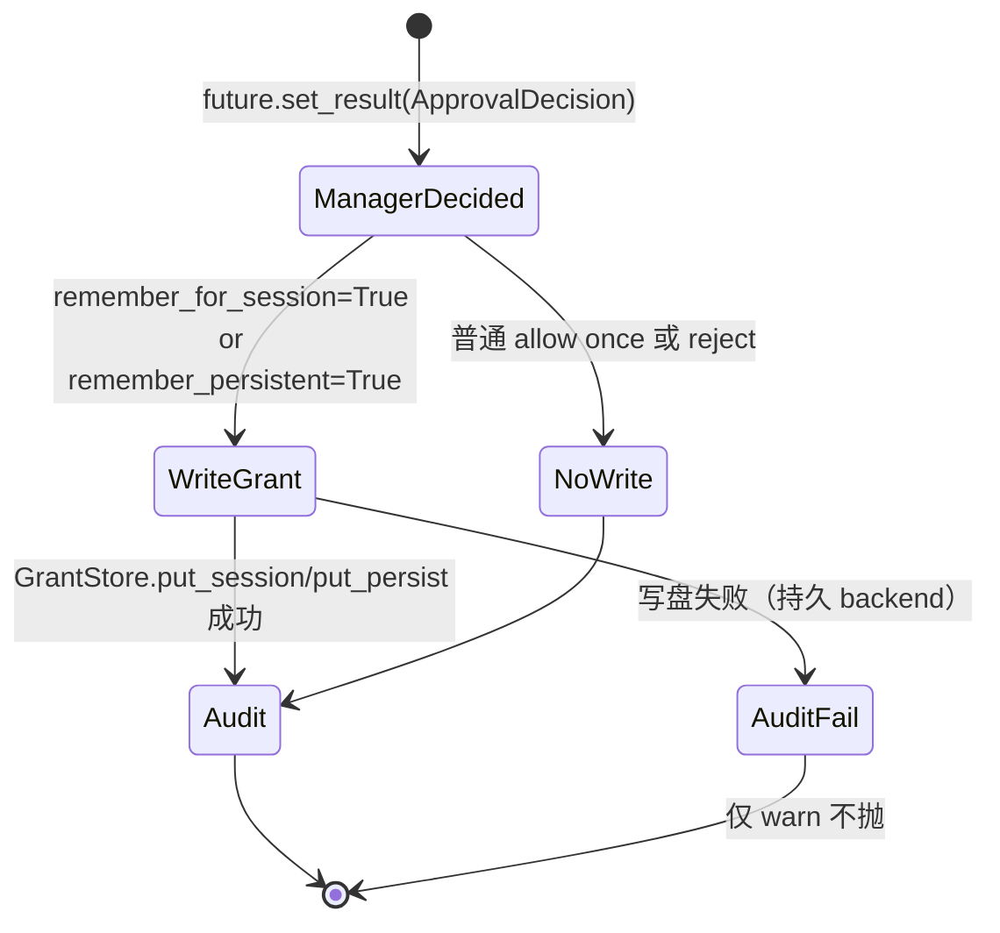
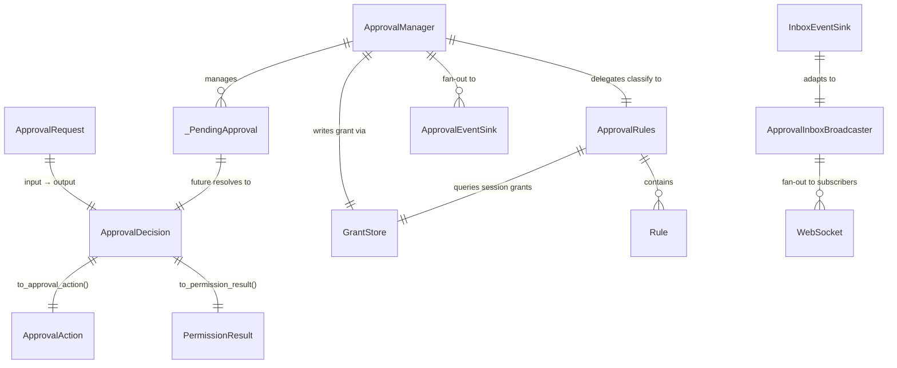

# 20 · 数据模型

> 本文档定义 manager 涉及的核心 DTO / 数据结构 / 状态流转。
>
> ⚠️ 所有示例代码 illustrative；**中文 docstring 强制**（用户硬约束）。

---

## 1. `_PendingApproval`（manager 私有）

manager 内部 pending 队列的元素。**不暴露给外部**，外部只通过 ApprovalDecision 看决策结果。

```python
# src/safety/approval_manager.py 内部

from dataclasses import dataclass, field
import asyncio
import time


@dataclass
class _PendingApproval:
    """manager 内部 pending 审批的全部状态。
    
    生命周期：
    - 创建：manager.request() 走到 explicit_consent 路径时
    - 销毁：future.set_result / cancel / timeout 后从 manager._pending 弹出
    - 不可变字段：request_id / channel / thread_id / cwd / tool_name / tool_input / arrived_at_ms
    - 可变字段：future（被 resolve/cancel 时 set）
    """
    
    # 核心标识
    request_id: str             # UUID-ish；跨通道唯一
    channel: str                # 'claude_code' / 'generic_chat' / 'cron' / 'evolution' / 'cli'
    thread_id: str              # 路由 key；inbox 通道下与 broadcaster.register_resolve_target key 一致
    
    # 审批上下文
    cwd: str                    # 触发审批的工作目录
    tool_name: str              # "Bash" / "Edit" / "Read" / ...
    tool_input: dict            # 工具参数
    metadata: dict              # 通道 specific（policy_hint / SDK request_id / cron task_id / ...）
    
    # 决策上下文
    severity: str               # "standard" / "elevated"（来自 SafetyDecisionEngine ConsentResolver）
    matched_rule: str | None    # 命中的规则 ID（如 "Bash(rm:*)"）；未命中规则为 None
    auto_approve_at_ms: int | None  # 安全路径倒计时到点；非 claude_code 通道为 None
    auto_reject_at_ms: int | None   # 危险路径倒计时到点；非 claude_code 通道为 None
    
    # Future + 时间
    future: asyncio.Future      # 等用户决策
    arrived_at_ms: int = field(default_factory=lambda: int(time.time() * 1000))
    timeout_ms: int | None = None
```

---

## 2. `ApprovalDecision` 统一 DTO

**所有通道审批的统一决策 DTO**。当前项目里已有 `ApprovalDecision` 在 `src/core/contracts.py`，本 spec **不重新发明**，只做以下增量：

### 现状（CLAUDE.md 已记录）

```python
# src/core/contracts.py 现状（不动主结构）
@dataclass
class ApprovalDecision:
    outcome: str             # "allowed" / "rejected"
    metadata: dict           # decision_class / decision_source / matched_rule / stage / ...
```

### v0.5 增量字段

```python
# 阶段 5 增加（不破坏现有字段）
@dataclass
class ApprovalDecision:
    outcome: str
    metadata: dict
    
    # === v0.5 新增 ===
    channel: str | None = None              # 阶段 5 新增；非 None 时表示走 manager 路径
    severity: str | None = None             # 'standard' / 'elevated'
    auto_decision_at_ms: int | None = None  # 倒计时到点（替代 v0.1 的 autoApproveAtMs/autoRejectAtMs；详见 40-protocol-evolution.md）
    auto_decision_kind: str | None = None   # 'auto_approve' / 'auto_reject'
    matched_rule: str | None = None         # 命中的规则 ID
    remember_for_session: bool = False      # 用户选了"本 session 都同意"
    remember_persistent: bool = False       # 用户选了"持久同意"（写 GrantStore.put_persist）
    
    def to_approval_action(self) -> "ApprovalAction":
        """转成现有 ApprovalAction 枚举（兼容 InteractiveApproval / SafetyGatedApproval）。"""
        ...
    
    def to_permission_result(self) -> "PermissionResult":
        """转成 claude_code SDK 用的 PermissionResultAllow / Deny（兼容 ApprovalBridge）。"""
        ...
```

### 三态映射

| ApprovalDecision | ApprovalAction | PermissionResult |
|---|---|---|
| outcome="allowed", remember_for_session=False | ACCEPT_ONCE | Allow |
| outcome="allowed", remember_for_session=True | ACCEPT_FOR_SESSION | Allow + write allow_list |
| outcome="allowed", remember_persistent=True | ACCEPT_PERSIST | Allow + write GrantStore.put_persist |
| outcome="rejected" | REJECT | Deny |

详细映射规则在 [40-protocol-evolution.md](40-protocol-evolution.md)。

---

## 3. `ApprovalRules` 策略容器

```python
# src/safety/approval_rules.py（阶段 1 骨架；阶段 5 完整 schema）

@dataclass
class ApprovalRules:
    """per-channel + per-thread + per-cwd 三层 scope 的规则容器。
    
    阶段 1：仅持空骨架，所有 channel 走 "需要 explicit_consent"（与现状一致）。
    阶段 2-3：claude_code 的 24 规则 / cron auto-allow / evolution auto-allow 迁入。
    阶段 5：完整 schema（per-channel + per-thread + per-cwd 三层覆盖）。
    """
    
    _channel_rules: dict[str, list[Rule]]  # channel → rules
    _cwd_overrides: dict[str, dict[str, list[Rule]]]  # cwd → channel → rules
    _thread_overrides: dict[str, dict[str, list[Rule]]]  # thread → channel → rules（动态加，session 级）
    
    def classify(
        self,
        *,
        channel: str,
        thread_id: str,
        cwd: str,
        tool_name: str,
        tool_input: dict,
    ) -> _RuleDecision:
        """命中规则的初步决策。
        
        命中顺序：thread_overrides → cwd_overrides → channel_rules → default ("需要 explicit_consent")
        每层都 short-circuit，命中即返回。
        
        Returns:
            _RuleDecision 含 is_immediate (是否直接出最终决策，跳过用户) + auto_*_at_ms + matched_rule
        """
        ...
    
    def add_session_grant(self, *, channel: str, thread_id: str, cwd: str, tool_name: str) -> None:
        """用户选了"本 session 都同意"后调用，向 _thread_overrides 加规则。
        
        thread_id 销毁时（thread 退出）自动清；不写盘。
        """
        ...


@dataclass
class Rule:
    """单条规则。"""
    pattern: str               # 工具名 prefix / 通配（如 "Bash(rm:*)"）
    action: str                # 'auto_allow' / 'auto_reject' / 'ask'
    timeout_ms: int | None     # 'ask' 时倒计时（None=不超时）
    severity: str              # 'standard' / 'elevated'


@dataclass
class _RuleDecision:
    is_immediate: bool                  # True = 跳过用户直接决策（auto_allow / auto_reject）
    immediate_outcome: str | None       # 'allowed' / 'rejected'（is_immediate=True 时）
    matched_rule: str | None
    severity: str                       # 'standard' / 'elevated'
    auto_approve_at_ms: int | None      # 'ask' + 倒计时安全路径
    auto_reject_at_ms: int | None       # 'ask' + 倒计时危险路径
    timeout_ms: int | None              # 用户决策的超时阈值
```

详细 rules schema 见 [30-rules-schema.md](30-rules-schema.md)。

---

## 4. GrantStore 统一

### 现状

- **`src/safety/grant_store.py`** `GrantStore`：generic_chat 通道用；持久 grant（scope='session' 或 'persist'）
- **`ApprovalBridge._allow_list: list[str]`**：claude_code 通道用；纯内存 list；重启就丢；ccui 同款

### v0.5 目标

**`GrantStore` 升级为通道统一**，`allow_list` 变成它的 in-memory backend 退化版。

```python
# src/safety/grant_store.py 增量改造（不破坏现有接口）

class GrantStore:
    """跨通道统一持久 grant。
    
    Backend：
    - in_memory（默认）：per-process dict，重启丢；适合 claude_code SDK allow_list 场景
    - sqlite（已有）：file-backed，重启不丢；适合 generic_chat 跨 session
    
    所有通道都通过 GrantStore 写 / 读 grant；不再有"两套"。
    """
    
    def put_session(
        self,
        *,
        channel: str,
        thread_id: str,
        cwd: str,
        tool_name: str,
        scope: str = "session",
    ) -> None:
        """加 grant，scope='session' 时 thread 退出清，scope='persist' 写盘。"""
        ...
    
    def matches(
        self,
        *,
        channel: str,
        thread_id: str,
        cwd: str,
        tool_name: str,
    ) -> bool:
        """查 grant 是否命中。manager 决策前调用。"""
        ...


# 阶段 2 改造 ApprovalBridge：删 _allow_list，改调 GrantStore.put_session(channel='claude_code', scope='session')
# 阶段 2 改造 SafetyDecisionEngine TrustResolver：复用 GrantStore（无改动，已支持）
```

### 数据迁移

**0 历史数据迁移**：
- `_allow_list` 是 per-process 内存，重启就丢，**用户无任何历史 allow_list 持久化数据**
- 阶段 2 直接改 ApprovalBridge 走 GrantStore.put_session(channel='claude_code', scope='session')，老 allow_list 字段删除即可
- 用户体感无差异（重启后 allow_list 本来就是空的）

---

## 5. 状态流转图

### `_PendingApproval` 生命周期



### grant 写入触发点



---

## 6. DTO 关系图



---

## 7. 字段命名 conventions

| 字段名 | 说明 | 例 |
|---|---|---|
| `request_id` | 全局唯一 ID | `"req-uuid-xxxx"` |
| `thread_id` | 通道内 thread 标识 | `"thread-xxx"` (claude_code) / session_id (generic_chat) |
| `channel` | 通道枚举 | `"claude_code"` / `"generic_chat"` / `"cron"` / `"evolution"` / `"cli"` |
| `cwd` | 工作目录绝对路径 | `"/Users/foo/proj"` |
| `tool_name` | 工具名首字母大写 | `"Bash"` / `"Edit"` / `"Read"` |
| `*_at_ms` | 时间戳 ms（绝对时间）| `int(time.time() * 1000)` |
| `*_ms` | 时长 ms（相对）| `30_000` (30 秒) |
| `severity` | 危险等级 | `"standard"` / `"elevated"` |
| `decision_class` | 决策三态分类 | `"hard_block"` / `"silent_allow"` / `"explicit_consent"` |
| `outcome` | 最终结果二态 | `"allowed"` / `"rejected"` |

---

## 下一步阅读

- [30-rules-schema.md](30-rules-schema.md) — rules.yaml schema 完整设计
- [40-protocol-evolution.md](40-protocol-evolution.md) — DTO 与协议帧字段映射
