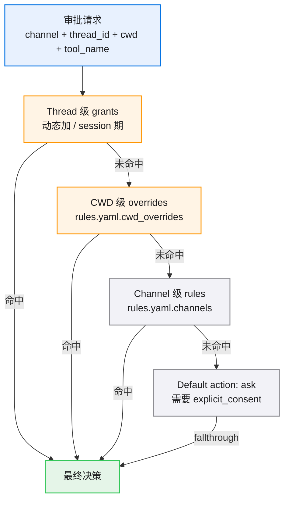
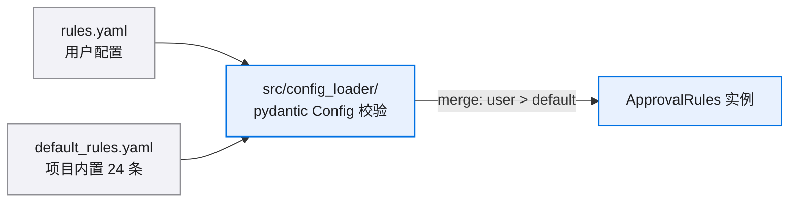

# 30 · rules.yaml Schema 设计

> 本文档定义 v0.5 完整的 rules.yaml schema（per-channel + per-thread + per-cwd 三层 scope）。
>
> **阶段 1-4 不上完整 schema**；仅在 ApprovalRules 内有空骨架。**阶段 5 落地**。
>
> ⚠️ 所有 yaml 示例 illustrative；最终落地的 schema 由 `src/config_loader/` pydantic Config 强类型校验。

---

## 1. 设计目标

| 目标 | 当前现状 | v0.5 目标 |
|---|---|---|
| 跨通道独立配置 | claude_code 用 `src/web/approvals/auto/default_rules.yaml`；generic_chat 无文件规则（走 SafetyDecisionEngine 内置）| 单一 `rules.yaml` 含 `channel:` section 分通道配置 |
| per-cwd scope（项目级覆盖）| ❌ 不支持 | 单 cwd 可覆盖 channel 默认（如某项目把 generic_chat 默认 ask 改成 auto_allow）|
| per-thread session grant | claude_code 走 allow_list；generic_chat 走 GrantStore.put_session | 统一走 GrantStore；rules schema 不写盘 thread 级（动态加）|
| 配置热加载 | 不支持 | v0.5 不上；留 v0.6 |
| 用户友好（不需要懂代码就能配）| 中等 | 加详细注释模板 + `--validate` 命令做 schema 校验 |

---

## 2. 三层 scope 模型



**命中顺序**：thread > cwd > channel > default。每层 short-circuit。

**为什么这个顺序**：
- thread > cwd：用户在某 thread 内点了"本 session 都同意"应覆盖项目默认
- cwd > channel：项目主可以为自己项目放宽 / 收紧（如某项目 generic_chat 默认 auto_allow Read）
- channel > default：通道默认（如 claude_code 24 条 SDK 规则）

---

## 3. Schema 草稿（v0.5 完整版）

```yaml
# rules.yaml schema v0.5
# 由 src/config_loader/ pydantic Config 强类型校验

version: "v0.5"

# === 通道默认规则 ===
channels:
  
  claude_code:
    # claude_code 通道 24 条 SDK 规则（v1+v1.0.1 历史规则迁过来）
    rules:
      - pattern: "Bash(rm:*)"
        action: ask
        severity: elevated
        timeout_ms: 30_000
        comment: "rm 命令必须用户决策；30s 倒计时自动拒绝（fail-closed）"
      
      - pattern: "Bash(git:*)"
        action: ask
        severity: standard
        timeout_ms: 60_000
        comment: "git 命令 60s 倒计时自动通过"
      
      - pattern: "Read"
        action: auto_allow
        comment: "Read 一律放行"
      
      # ... 其余 21 条
    
    # claude_code 通道全局默认（未命中规则时）
    default:
      action: ask
      severity: standard
      timeout_ms: 60_000
  
  generic_chat:
    # generic_chat 通道默认（阶段 1-4 是空 list，行为同当前 SafetyDecisionEngine）
    rules: []
    
    default:
      action: ask
      severity: standard
      timeout_ms: 60_000
  
  cron:
    # cron 通道：trust mode 默认全 auto_allow（cron task 是用户预批准）
    rules: []
    default:
      action: auto_allow
      comment: "cron task 是预批准，默认放行；fail_closed 模式由 scheduler.approval_mode 控制（per-task）"
  
  evolution:
    # evolution reviewer 通道：完全自治，全 auto_allow
    rules: []
    default:
      action: auto_allow
      comment: "evolution reviewer 是 agent 自检，无人干预"
  
  cli:
    # CLI 通道：跟 generic_chat 一致
    rules: []
    default:
      action: ask
      severity: standard
      timeout_ms: 60_000

# === per-cwd 覆盖 ===
cwd_overrides:
  
  - cwd: "/Users/foo/safe-sandbox"
    channels:
      generic_chat:
        rules:
          - pattern: "Bash(*)"
            action: auto_allow
            comment: "在 safe-sandbox 里所有 Bash 都放行（用户主动 opt-in 沙盒）"
        # 不写 default 则继承 channels.generic_chat.default
  
  - cwd: "/Users/foo/critical-prod"
    channels:
      generic_chat:
        default:
          action: ask
          severity: elevated     # 重要项目改 elevated（无倒计时）
        # 不写 rules 则继承 channels.generic_chat.rules
```

---

## 4. Schema 字段详解

### `channels.<channel_name>`

```yaml
channels:
  <channel>:
    rules:                    # list of Rule，按顺序匹配，首个命中即返回
      - pattern: <string>     # 工具名 prefix / 通配
        action: <enum>        # auto_allow / auto_reject / ask
        severity: <enum>      # standard / elevated（仅 action=ask 时有意义）
        timeout_ms: <int>     # ask 时倒计时（None=不超时）
        comment: <string>     # 人类可读说明
    
    default:                  # 未命中 rules 时的兜底
      action: <enum>          # auto_allow / auto_reject / ask
      severity: <enum>
      timeout_ms: <int>
      comment: <string>
```

### `cwd_overrides[].channels.<channel_name>`

与 `channels.<channel_name>` 完全同 schema；用于在特定 cwd 下覆盖。

- 如果 cwd_override 写了 `rules`：完全替换通道默认 rules（不 merge）
- 如果 cwd_override 写了 `default`：覆盖通道默认 default
- 如果 cwd_override 留空字段：继承通道默认

---

## 5. `pattern` 匹配规则

| pattern | 匹配 |
|---|---|
| `"Bash"` | 精确名匹配，仅 `tool_name == "Bash"` |
| `"Bash(rm:*)"` | Bash 前缀匹配（参考现有 `_BASH_PERMISSION_RE`），`tool_input.command` 以 "rm " 开头 |
| `"Bash(*)"` | 所有 Bash 调用 |
| `"Read"` | 所有 Read |
| `"*"` | 所有工具（慎用） |

阶段 5 落地时用现有 `src/web/approvals/auto/matchers.py` 的匹配逻辑（已成熟）。

---

## 6. `severity` 与倒计时

| severity | 倒计时行为 |
|---|---|
| `standard` + `timeout_ms` | 倒计时到点 → **auto_approve**（安全路径）|
| `elevated` + `timeout_ms` | 倒计时到点 → **auto_reject**（危险路径，fail-closed）|
| `standard` + `timeout_ms=null` | 不超时（无限等用户）|
| `elevated` + `timeout_ms=null` | 不超时；用户必须三按钮决策（无倒计时 UX）|

**对应 manager 内部**：
- `auto_approve_at_ms = arrived_at_ms + timeout_ms`（standard + timeout_ms）
- `auto_reject_at_ms = arrived_at_ms + timeout_ms`（elevated + timeout_ms）
- `auto_*_at_ms = None`（severity 与 timeout_ms 任一为 null）

---

## 7. session grant 动态加（thread-level）

session grant **不写 rules.yaml**，而是动态加进 `ApprovalRules._thread_overrides[thread_id][channel]`：

```python
# manager 内部，用户选了"本 session 都同意"后
rules.add_session_grant(
    channel="generic_chat",
    thread_id="thread-xxx",
    cwd="/Users/foo/proj",
    tool_name="Bash",       # 或更精细的 "Bash(npm:*)" pattern
)

# 等价于动态加 Rule:
# Rule(pattern="Bash", action=auto_allow, severity=standard, timeout_ms=None, comment="user session grant")
# 写到 _thread_overrides["thread-xxx"]["generic_chat"].rules 前面
```

**session 销毁**（thread 退出）时清空对应 thread 的 _thread_overrides 项。

**持久 grant**（用户选了"持久同意"）：阶段 5 落地。写 GrantStore.put_persist，下次启动从 GrantStore 加载注入 _cwd_overrides。

---

## 8. 配置加载流程



- 项目内置 `default_rules.yaml` 包含 claude_code 24 条 + 其他通道空 default
- 用户在 `~/.kongming/rules.yaml` 或项目根 `kongming-rules.yaml` 覆盖
- Merge 策略：user 通道覆盖 default 通道（不 merge rules list；要么用 default 全套要么自己写全套）

---

## 9. 与现有 schema 的兼容

### v1（claude_code 通道）

`src/web/approvals/auto/default_rules.yaml` 现有 24 条规则。

**迁移策略**（阶段 5）：
- 把 24 条规则直接 paste 到新 `rules.yaml` 的 `channels.claude_code.rules:` 下
- 旧路径 `src/web/approvals/auto/default_rules.yaml` 删除（或保留兼容 ascii 提示）
- AutoApprovalPolicy 改 thin wrapper，从新 ApprovalRules 读规则

### scheduler approval_mode（per-task）

scheduler 现有 per-task `approval_mode: trust | fail_closed`（详见 `docs/scheduler-approval-task-level-v0.5/`）。

**保留**：scheduler 的 per-task approval_mode 仍优先于 channel rules。具体：
- task.approval_mode = "trust" → ScheduleApprovalProvider (thin wrapper) 不走 manager.request，直接 return allow + audit
- task.approval_mode = "fail_closed" → 走 manager.request，rules 兜底是 ask + 30s elevated 自动拒绝

---

## 10. Schema 校验

阶段 5 落地时：

```bash
# 命令工具：校验 rules.yaml 是否合法
make rules-validate
# 或
./bin/kongming-rules validate
```

校验项：
- yaml 语法
- channels 含 5 个通道（缺失自动补 default）
- pattern 字符串合法
- severity 枚举值正确
- timeout_ms 非负整数
- cwd_overrides 路径展开成绝对路径
- 没有 channel 矛盾配置（同 pattern 在同通道下不能同时配 auto_allow + auto_reject）

---

## 11. Schema 演进策略

| 版本 | 改动 |
|---|---|
| v0.5 (本 spec) | 引入 per-channel + per-cwd 三层 scope |
| v0.6 (未来) | 配置热加载（不重启生效）|
| v0.7 (未来) | 远程规则（多 agent 共享一份 rules）|
| v1.0 (未来) | 规则版本化 + diff 工具 |

**向后兼容**：v0.6+ 引入新字段时保证 v0.5 的 yaml 仍可被解析（pydantic 允许 unknown field 静默忽略 / 严格模式可切换）。

---

## 12. 不在本 schema 范围

- 规则 hot-reload（v0.6）
- 多用户 / 权限分级（v1.0）
- 规则审计（"谁改了 rules.yaml"留 audit log）
- AI 自动生成规则（"agent 自己决定加规则"留 v1.0+）

---

## 下一步阅读

- [20-data-model.md](20-data-model.md) — ApprovalRules / Rule DTO 完整定义
- [50-migration-plan.md](50-migration-plan.md) — 阶段 5 落地 schema 的具体步骤
