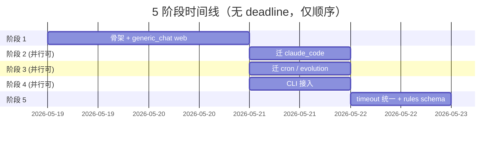

# 50 · 5 阶段迁移路径

> 本文档定义 5 阶段渐进重构的详细路径：每阶段范围 / 改动文件 / 测试矩阵 / 回滚预案 / 双轨期契约。
>
> 每阶段都是**独立 PR 可发布**；阶段间通过双轨期保证不破坏现有功能。

---

## 阶段总览



**关键**：
- 阶段 2 / 3 / 4 **互不阻塞**，可由不同 contributor 并行做（前提是 stage 1 已合）
- 阶段 5 等 2/3/4 全合
- 每阶段独立发布；用户在任意阶段间可暂停

---

## 阶段 1：骨架 + generic_chat web

### 目标
建 ApprovalManager 骨架 + helper + InboxEventSink；接 generic_chat web 通道；其余通道 0 改 0 回归。

### 范围（必做）

| 类型 | 文件 | 说明 |
|---|---|---|
| 新建 | `src/safety/approval_manager.py` | ApprovalManager 单例 + `_PendingApproval` + ApprovalEventSink Protocol + `request/resolve/cancel/_handle_timeout` |
| 新建 | `src/safety/approval_rules.py` | ApprovalRules 空骨架（阶段 1 实际只 default action="ask"，rules=[]）|
| 新建 | `src/safety/inbox_event_sink.py` | InboxEventSink 实现（emit_approval_required / removed → broadcaster） |
| 新建 | `src/safety/inbox_helpers.py` | `to_inbox_payload()` + `emit_remove_safe()` 共享 helper |
| 改 | `src/web/approvals/global_inbox/broadcaster.py` | 加 `register_resolve_target(thread_id, callback) / unregister_resolve_target` 轻 API（~20 行） |
| 改 | `src/web/run.py` L245-246 | generic_chat 装配 prompt_fn 换成 `make_manager_prompt_fn(manager, thread_id)`；manager 单例创建 + InboxEventSink 注入 |
| 改 | `web/src/features/approval-inbox/ApprovalToastCard.tsx` | 按 `item.channel === 'generic_chat'` 隐藏「本 session」按钮（二态映射）|
| 改 | `docs/modules/安全/README.md` | 末尾加 ApprovalManager 段 + spec 链接 |

### 范围（不做）

- 不动 ApprovalBridge / claude_code 任何文件（v2-inbox 0 回归保护）
- 不动 SafetyDecisionEngine / chain 主体
- 不动 cron / evolution / CLI 装配
- 不动 rules.yaml schema（阶段 1 ApprovalRules 是空骨架）
- 不动 GrantStore（仍 generic_chat 用）
- 不动 core/contracts 主体（仅可选加 v0.5 字段，但放到阶段 5 落地协议时一起做）

### 测试矩阵

| 测试集 | 覆盖 | 要求 |
|---|---|---|
| 新增 unit `test_approval_manager.py` | request/resolve/cancel/timeout 单测 | ≥10 测，含并发 / 单例 / mock EventSink |
| 新增 unit `test_inbox_helpers.py` | to_inbox_payload / emit_remove_safe | ≥5 测，含字段映射 / 异常吞掉 |
| 新增 unit `test_inbox_event_sink.py` | InboxEventSink 适配器 | ≥5 测，mock broadcaster |
| 新增 integration `tests/integration/web/test_generic_chat_inbox_e2e.py` | generic_chat → manager → broadcaster → 模拟 ws resolve → manager.resolve | ≥3 测 |
| 新增 frontend `ApprovalToastCard.channel.test.tsx` | channel='generic_chat' 时隐藏第三按钮 | ≥2 测 |
| **回归** v2-inbox 后端 306 测 | 0 改后端 → 应全过 | 必须全过 |
| **回归** v2-inbox 前端 442 测 | Card 改动只加 channel 条件，回归测试不破坏 | 必须全过 |
| **回归** generic_chat CLI / cron / evolution | 不动这些装配 → 现有测试应全过 | 必须全过 |
| `lint-imports` | 9 contracts 不变（不加新白名单）| 必须 KEPT |
| `mypy` | 0 error | 必须 0 error |

### 双轨期契约

阶段 1 完成后，**双轨并存**：
- claude_code 通道走老 ApprovalBridge（v2-inbox 路径，不变）
- generic_chat web 走新 manager（v0.5 路径）
- CLI / cron / evolution 走老路径（不变）

**双轨期契约**：
1. 底层 broadcaster + ws 端点 + 前端 ApprovalToastQueue 100% 共享
2. inbox_helpers.to_inbox_payload 供未来 ApprovalBridge 也调（阶段 2 接入）
3. emit_remove_safe 同上

### 回滚预案

如果阶段 1 上线后发现 generic_chat 浮窗有严重 bug：
- 改 `src/web/run.py` 把 prompt_fn 改回 `adapter.prompt_approval`（一行回滚）
- manager / InboxEventSink / helper 留在 codebase 不动（无副作用，无 import 调用即死代码）
- 等修好再切回

### 估时

| 子任务 | 估时 |
|---|---|
| ApprovalManager + helper + EventSink 设计编码 | 4h |
| broadcaster API + web/run.py 装配 | 2h |
| 后端 unit + integration 测 | 3h |
| 前端 Card 改 + 单测 | 1h |
| v2-inbox 回归验证 | 1h |
| 文档收尾 | 1h |
| **总计** | **12h ≈ 1.5d** |

---

## 阶段 2：迁 claude_code（ApprovalBridge thin wrapper）

### 目标
ApprovalBridge 改 thin wrapper 调 manager；allow_list 迁 GrantStore；24 规则迁进 ApprovalRules（仍空 yaml，阶段 5 才上 schema）。

### 范围

| 类型 | 文件 | 说明 |
|---|---|---|
| 改 | `src/web/integrations/claude_code/approval.py` | ApprovalBridge.can_use_tool 改成调 `manager.request(channel="claude_code", thread_id, ...)`；删 wait_for / payload 构造 / emit_remove 逻辑（已迁到 manager 内）；保留 SDK can_use_tool sync 桥接（asyncio.Future 在 manager 内）|
| 改 | `src/web/integrations/claude_code/approval.py` | 删 `_allow_list`；改成调 `manager._grant_store.put_session(channel="claude_code", scope="session")` |
| 改 | `src/web/approvals/auto/policy.py` AutoApprovalPolicy | 阶段 2 仅做 thin wrapper：classify() 改成调 `manager._rules.classify(channel="claude_code", ...)`；阶段 5 才彻底删 |
| 改 | `src/safety/approval_rules.py` ApprovalRules | 把 AutoApprovalPolicy 的 24 规则在内存中模拟（hardcode 注入）；阶段 5 改成从 rules.yaml 读 |
| 改 | `src/web/integrations/claude_code/route.py` | bridge 装配仍走 build_default_approval；不需要改装配 |
| 删 | `src/web/approvals/auto/default_rules.yaml` | 阶段 5 才删 |

### 测试矩阵

- **回归**：v2-inbox 306 后端 + 442 前端必须全过（**最关键**）
- 新增：unit `test_approval_bridge_thin_wrapper.py` 验证 ApprovalBridge 走 manager 路径
- 新增：unit `test_grant_store_claude_code.py` 验证 allow_list 写 GrantStore in_memory backend
- 新增：integration `test_claude_code_via_manager_e2e.py` 等价性验证（与老路径行为对比）

### 回滚预案

如果阶段 2 上线后 v2-inbox 用户体验有差异：
- ApprovalBridge 改动单文件可 revert
- manager 保留（generic_chat 仍走 manager）
- 等定位问题再切回

### 估时
1 天（重 在测试回归）

---

## 阶段 3：迁 cron / evolution

### 目标
ScheduleApprovalProvider + AutoAllowApproval 改 thin wrapper 走 manager；rules 加 cron / evolution channel 默认 auto_allow。

### 范围

| 类型 | 文件 | 说明 |
|---|---|---|
| 改 | `src/scheduler/runtime_factory.py` ScheduleApprovalProvider | 改 thin wrapper：trust mode 不调 manager 直接 allow（与原行为一致）；fail_closed mode 调 `manager.request(channel="cron", thread_id=cron_task_id, ...)` |
| 改 | `src/tools/approval.py` AutoAllowApproval | thin wrapper：调 `manager.request(channel="evolution", ...)`；manager 内 rules 配 evolution channel auto_allow |
| 改 | `src/safety/approval_rules.py` | hardcode 注入 cron / evolution 通道默认 auto_allow（阶段 5 才上 yaml）|

### 测试矩阵
- 新增 unit `test_schedule_approval_thin_wrapper.py`
- 新增 unit `test_auto_allow_thin_wrapper.py`
- 回归 cron + evolution 现有所有测试必须全过

### 估时
0.5 天

---

## 阶段 4：CLI 接入

### 目标
CLIEventSink 接 manager 输出；CLI adapter 改装走 manager。

### 范围

| 类型 | 文件 | 说明 |
|---|---|---|
| 新建 | `src/safety/cli_event_sink.py` | CLIEventSink 收 manager.emit_approval_required → stdin/tty prompt |
| 改 | `src/cli/main.py` | 装配 manager + CLIEventSink；prompt_fn 改成走 `make_manager_prompt_fn(manager, session_id)` |
| 改 | `src/host/cli_adapter.py`（如有相关）| adapter.prompt_approval 退役或改 thin wrapper |

### 测试矩阵
- 新增 unit `test_cli_event_sink.py`（mock stdin/tty）
- 回归 CLI 现有 e2e 测试必须全过

### 估时
0.5 天

---

## 阶段 5：timeout 统一 + rules schema + 协议帧 v0.5 + 文档收尾

### 目标
散落超时逻辑收到 manager；rules.yaml schema 完整落地；协议帧 v0.5 字段升级；docs/modules/安全 整体重写。

### 范围

| 类型 | 文件 | 说明 |
|---|---|---|
| 改 | `src/safety/approval_manager.py` | `_handle_timeout` 统一逻辑；散在 ApprovalBridge.wait_for / ScheduleApprovalProvider / WebHostAdapter._timeout 的 timeout 全删 |
| 改 | `src/safety/approval_rules.py` | 从 hardcode 改成从 rules.yaml 读；用 pydantic Config 强类型校验 |
| 新建 | `kongming-rules.yaml`（项目根模板）| v0.5 完整 schema 示例 |
| 改 | `src/config_loader/config.py` | 加 ApprovalRulesConfig pydantic 模型 |
| 删 | `src/web/approvals/auto/default_rules.yaml` | 迁到新 `kongming-rules.yaml`；旧路径阶段 5 删 |
| 改 | `src/web/approvals/global_inbox/broadcaster.py` | emit_add payload 加 v0.5 字段（autoDecisionAtMs / autoDecisionKind / severity / supportedActions / matchedRule） |
| 改 | `src/web/thread_status_ws.py` | resolve handler 兼容 v2-inbox（allow + rememberEntry） + v0.5（decisionKind + rememberScope） |
| 改 | `web/src/features/approval-inbox/ApprovalToastCard.tsx` | 按 `supportedActions` 渲染按钮（不再 hardcode channel 条件） |
| 改 | `web/src/features/approval-inbox/types.ts` | 加 v0.5 协议字段 |
| 改 | `docs/modules/安全/README.md` | 重写 manager 章节 + 5 通道流程图（标 manager 接入完成）|
| 改 | `docs/modules/安全/approval-flow-current-state.html` | 重画"目标"视图（manager 统一后 5 通道）|
| 新建 | `bin/kongming-rules` 或 `make rules-validate` | rules.yaml schema 校验工具 |

### 测试矩阵
- 全套回归：claude_code / generic_chat / cron / evolution / CLI 5 通道 + v2-inbox + v0.5 协议
- 新增：unit `test_approval_rules_yaml.py`（rules.yaml 加载 + 校验）
- 新增：integration `test_protocol_v0.5_backward_compat.py`（v2-inbox 老客户端连 v0.5 服务端不崩）

### 估时
0.5 天

---

## 双轨期管理（阶段 1-4）

### 共享底层基础设施

| 基础设施 | 共享 | 双轨期保证 |
|---|---|---|
| ApprovalInboxBroadcaster | 老 ApprovalBridge + 新 InboxEventSink 都调它的 emit_add / emit_remove | broadcaster API 不变 |
| 协议帧 schema | 都用 v2-inbox 4 帧 | 阶段 5 才升 v0.5 |
| 前端 ApprovalToastQueue / Card | 都通过它渲染 | 阶段 1 加 channel 条件渲染；阶段 5 改 supportedActions 驱动 |
| GrantStore | 阶段 1 generic_chat 用；阶段 2 claude_code 也开始用 | 不破坏现有 generic_chat 写 |
| AuditLogger | 全通道都写 | 接口不变 |
| inbox_helpers.to_inbox_payload | 阶段 1 manager 调；阶段 2 ApprovalBridge 也调 | 阶段 1 抽出，阶段 2 ApprovalBridge 改 ~3 行调用 helper |

### 等价性验证

阶段 2 完成时跑等价性测试：

```python
# tests/integration/web/test_claude_code_v0.5_equivalence.py
"""验证 claude_code 通道走 manager 路径与老 ApprovalBridge 路径输出等价。
阶段 2 完成时跑此测试；通过即可发布阶段 2。"""

async def test_old_vs_new_path_equivalent():
    """同样的 input：
    - 老路径：ApprovalBridge (老逻辑) → 输出 PermissionResult
    - 新路径：ApprovalBridge (thin wrapper) → manager → 输出 PermissionResult
    断言两个 PermissionResult 完全等价（outcome / allow_list 副作用 / audit log）。
    """
    ...
```

---

## 风险预案表

详见 [60-risk-and-mitigation.md](60-risk-and-mitigation.md)。

---

## 阶段间发布节奏

| 阶段 | 是否需用户重启 | 是否需文档更新 |
|---|---|---|
| 1 | 是（web restart）| docs/modules/安全 加 manager 段 |
| 2 | 是 | dev-checklist 标 claude_code 已迁 |
| 3 | 是 | 同上 |
| 4 | 是 | 同上 |
| 5 | 是 | docs/modules/安全 整体重写 + 流程图重画 + 协议帧 v0.5 文档发布 |

---

## 下一步阅读

- [60-risk-and-mitigation.md](60-risk-and-mitigation.md) — 风险登记 + mitigation
- [90-task-map.md](90-task-map.md) — 每阶段对应 task 名 + 状态
