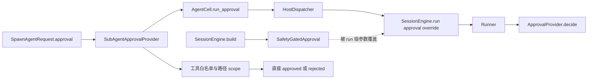
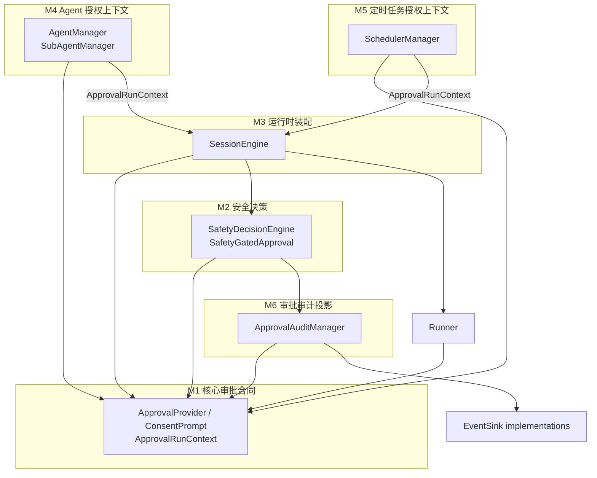
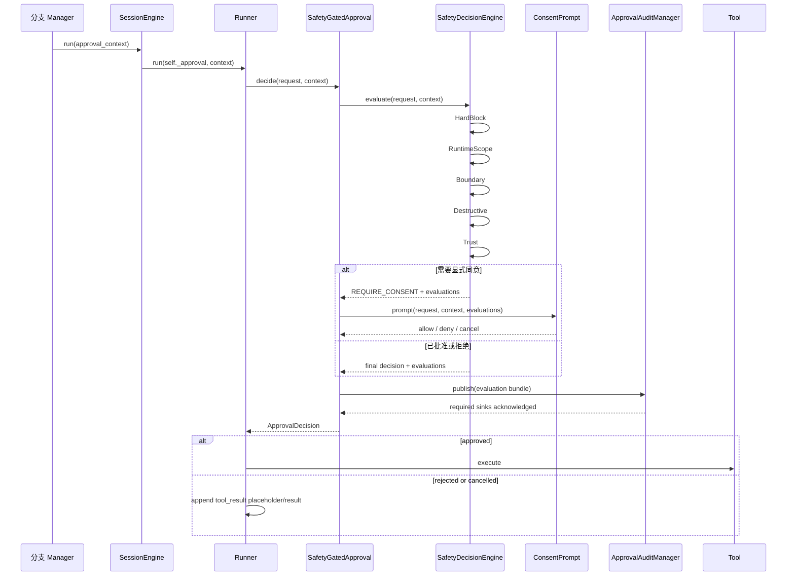
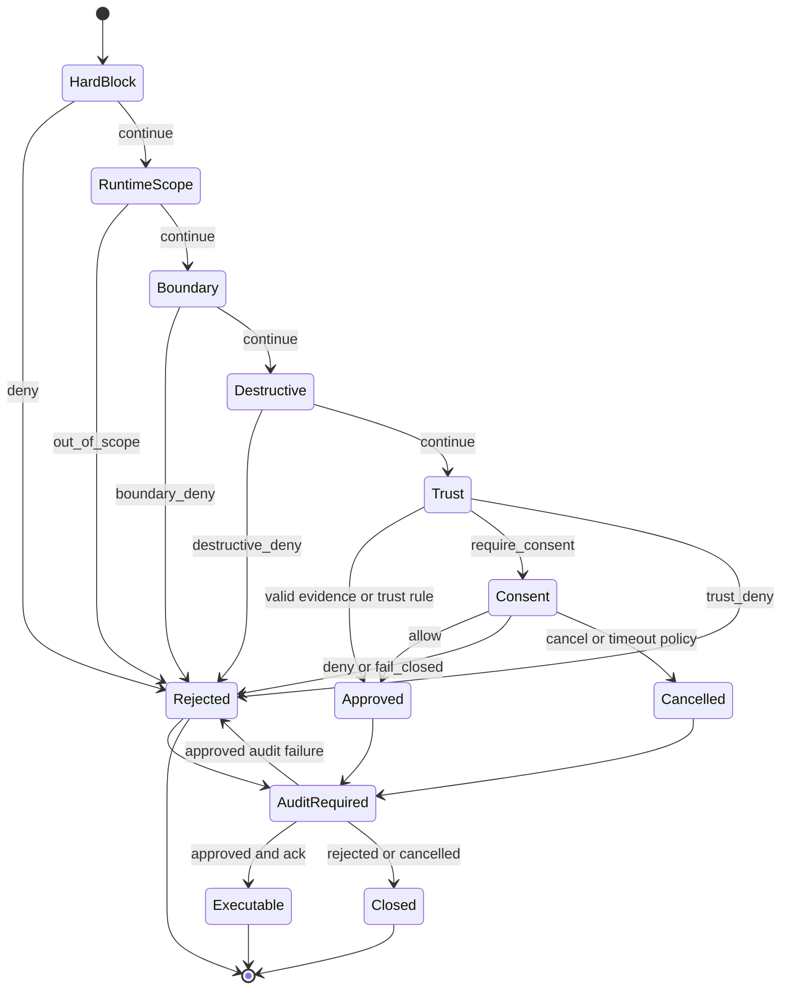
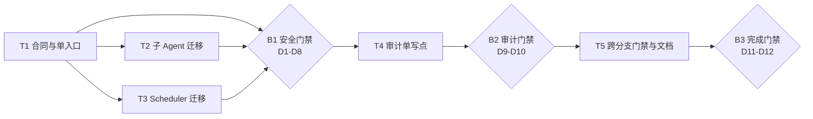

# 审批单入口与分支单调收紧图表

## D1 · 当前 provider 覆盖链

问题点：Runner 的最终决策槽接收了只实现分支 scope 的 provider，全局 `SafetyGatedApproval` 因 run 级 override 离开该次调用链。

## D2 · 目标模块依赖

依赖方向保持 safety 对 application/scheduler 零反向依赖。分支 Manager 只构造核心合同，composition root 把 EventSink 和 consent adapter 注入 safety。

## D3 · 统一决策时序

## D4 · 六阶段状态流

## D5 · 迁移与发布门禁

T1、T2、T3 在开发上可以并行切分，B1 作为不可拆分发布门禁关闭所有生产 provider override。

## 图表与正文映射

| 图表 | 对应正文 |
|---|---|
| D1 | `README.md` 问题定义、`01-goals-and-boundaries.md` 背景 |
| D2 | `02-module-breakdown.md` M1-M6 |
| D3 | `03-core-workflows.md` W1-W6 |
| D4 | `01-goals-and-boundaries.md` G2、`04-data-and-state.md` 枚举 |
| D5 | `05-validation-and-evolution.md` 迁移阶段、`90-task-map.md` 依赖与并行 |
