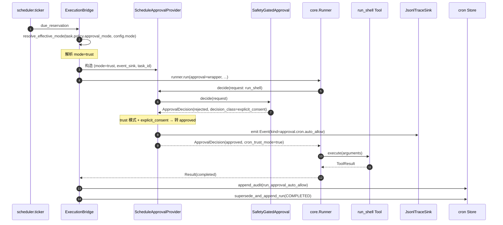
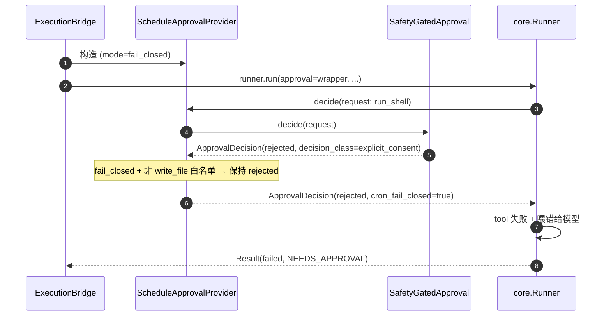
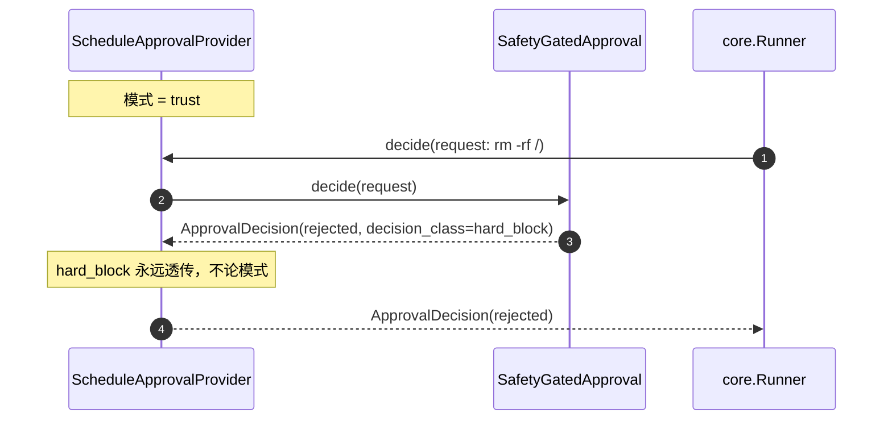
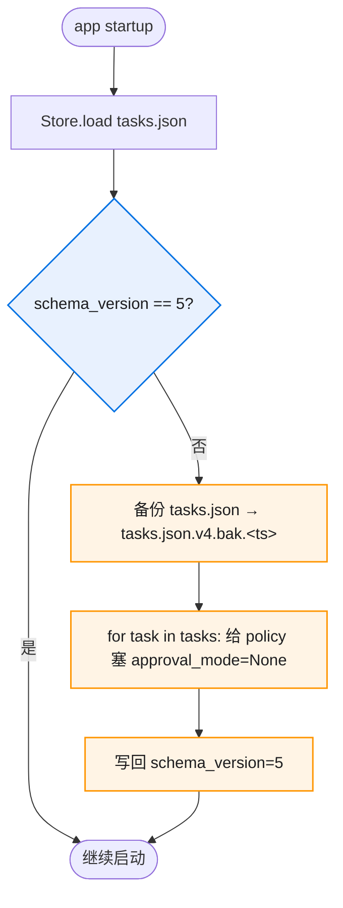

# 核心流程

## 流程 1：cron 触发到工具决策（trust 模式）



**关键节点解读**：

- **第 3 步 `resolve_effective_mode`**：唯一的优先级解析点，task > global > default
- **第 6-7 步 inner 链路不变**：SafetyGatedApproval 仍然走完整决策（HardBlock → Boundary → Trust → Consent），保证规则真源单一
- **第 8 步 trust 转换**：仅对 `explicit_consent` 转 approved；`hard_block` 决不转
- **第 9 步 event emit**：用 `event_sink.emit()` 异步推到所有 sink（JsonlTraceSink 落盘，WS Sink 若存在则广播）
- **第 14 步 audit 行**：bridge 监听到 wrapper 的 trust approved 后写一行 audit；之所以在 bridge 写而非 wrapper 写——audit 真源是 Store（属于 bridge 持有的依赖），wrapper 不应直接持有 Store 引用

## 流程 2：fail_closed 模式回归对照（现状）



**对照点**：fail_closed 模式下整条链路与现状完全一致，新增字段 `mode=fail_closed` 不改变行为——这是 DoD#2 "默认值 fail_closed" 的实现保证。

## 流程 3：hard_block 在 trust 模式下仍然拒绝（安全兜底）



**安全语义**：HardBlock 不可绕过——这是用户拍板时强调的"hard deny 直接拒绝，其他放"的核心实现保证。

## 流程 4：schema v4 → v5 启动迁移



**迁移策略**：
- 老任务的 `policy.approval_mode` 设为 `None` → `resolve_effective_mode` 兜底用全局 `fail_closed` → 行为不变
- 备份文件命名沿用 v0.2/v0.3/v0.4 既有模式（`.bak.<unix_ts>`）
- runs / audits jsonl 文件不迁移（结构不变，只 tasks.json 加字段）

## 流程 5：schedule_tool 创建带 approval_mode 的任务

```
[user] 帮我每天 9 点跑一次司天扫描，需要执行 python 脚本，请用 trust 模式
[agent → schedule_tool]
{
  action: "create",
  name: "司天扫描",
  schedule: "0 9 * * *",
  agent: "default",
  input: "执行 python scripts/sitian_scan.py 并把结果总结成日报",
  approval_mode: "trust"
}
[scheduler] 创建 ScheduledTask，policy.approval_mode=TRUST，落盘
[agent] 已创建任务 task-xyz789，每天 9 点触发，使用 trust 审批模式
```

**字段语义**：
- `approval_mode` 可选，缺省走 `config.scheduler.approval.mode`
- 支持值：`"fail_closed"` / `"trust"`，其他值由 pydantic 校验拒绝
- 在 task list / detail 中显式展示 `approval_mode`，方便用户审计
