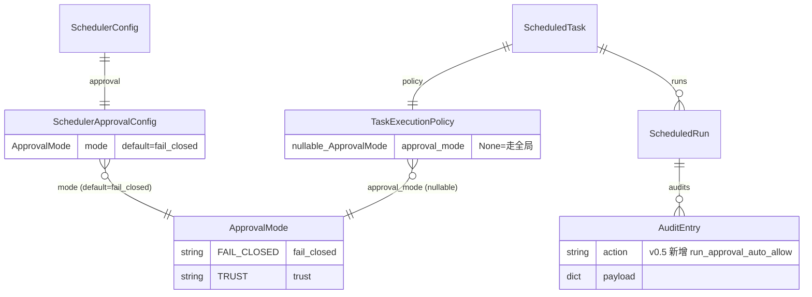
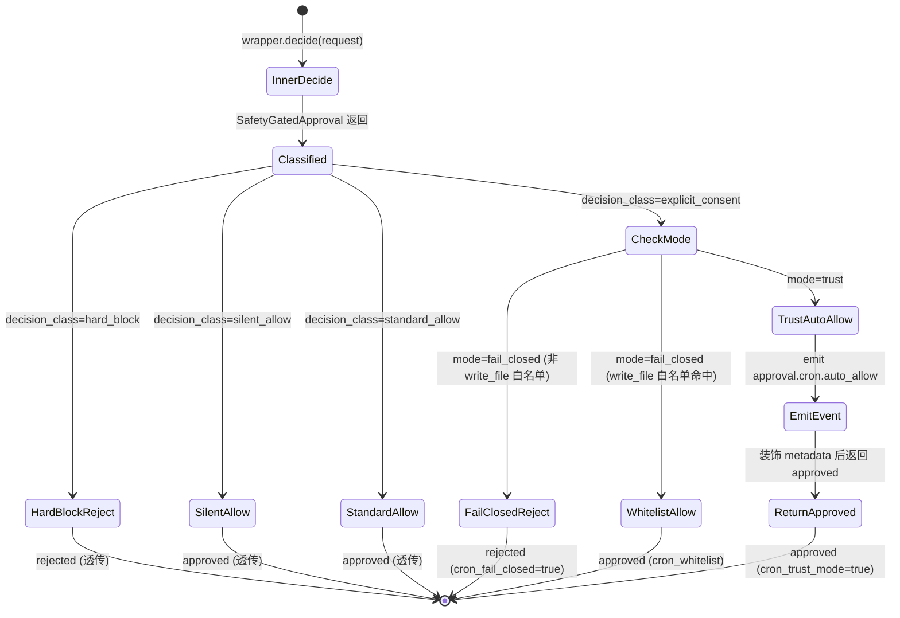

# 数据模型与状态

## 核心实体

### ApprovalMode（新增）

```python
# src/scheduler/domain.py
class ApprovalMode(StrEnum):
    """cron 任务的审批模式（v0.5 新增）。

    - FAIL_CLOSED: 当前行为；命中 explicit_consent → rejected
      （除 SchedulerApprovalConfig.allow_write_file_create_in_cwd 白名单）
    - TRUST: cron 信任模式；hard_block 仍 rejected，
      explicit_consent（standard / elevated）自动 approved，
      silent_allow / standard_allow 透传
    """

    FAIL_CLOSED = "fail_closed"
    TRUST = "trust"
```

字符串值是真源（YAML / JSON 落盘均用字符串）。

### TaskExecutionPolicy.approval_mode（字段扩展）

```python
# src/scheduler/domain.py
@dataclass(frozen=True)
class TaskExecutionPolicy:
    # ...原有字段
    approval_mode: ApprovalMode | None = None
    """v0.5 新增：任务级审批模式。
    None 表示沿用 SchedulerApprovalConfig.mode（全局默认）。
    """
```

- `None` 是显式语义：未声明 → 走全局兜底
- 不用 `ApprovalMode.FAIL_CLOSED` 当默认值——这样无法区分"用户显式设 fail_closed"和"用户没指定"，后续策略调整空间小

### SchedulerApprovalConfig.mode（字段扩展）

```python
# src/config_loader/models.py
class SchedulerApprovalConfig(BaseModel):
    model_config = ConfigDict(extra="forbid")

    mode: Literal["fail_closed", "trust"] = "fail_closed"
    """v0.5 新增：cron 全局默认审批模式。
    任务未声明 approval_mode 时走此值。**v0.5 默认 trust**——cron 即用户预批准
    任务，不应再次审批；严格审批需显式 'fail_closed' opt-in。
    """

    allow_write_file_create_in_cwd: bool = True
    """v0.2 老字段：仅在 mode=fail_closed 下生效。
    trust 模式下 write_file 已经被整体放开，此字段无意义。
    """
```

## 实体关系



## 状态流转

### Approval 决策流（trust 模式）



### Schema 版本流转

```
v0.2 schema_version=2   ── tasks.json 引入 SECONDS / scheduler.enabled
v0.3 schema_version=3   ── tasks.json 加 ScheduleDelivery + ScheduledRun.delivered_at
v0.4 schema_version=4   ── tasks.json 加 ScheduleDelivery.target + preset_id
v0.5 schema_version=5   ── tasks.json 加 TaskExecutionPolicy.approval_mode (本 spec)
```

迁移规则：启动时检测 `schema_version != 5`：
1. 把 `tasks.json` 备份到 `tasks.json.v<n>.bak.<unix_ts>`
2. 遍历 task，给 `policy` 字典塞 `"approval_mode": null`
3. 写回 `schema_version=5`
4. runs / audits jsonl 不动（结构未变）

## 持久化方案

| 数据 | 存储 | 位置 | 备注 |
|------|------|------|------|
| ScheduledTask.policy.approval_mode | JSON 字段 | `.kongming/cron/tasks.json` | v0.5 新增字段 |
| SchedulerApprovalConfig.mode | YAML 字段 | `config/setting.yaml` | v0.5 新增字段 |
| trust auto_allow event | JSONL 行 | `.kongming/trace.jsonl` | 现有 sink 自动写 |
| run_approval_auto_allow audit | JSONL 行 | `.kongming/cron/audit.jsonl` | v0.5 新增 action |

## 共享数据结构

### Event payload（trust 自动放行）

```python
# core.contracts.Event 已存在；本 spec 复用，不新增 Protocol
Event(
    kind="approval.cron.auto_allow",
    payload={
        "task_id": str,
        "run_id": str | None,             # wrapper 持 task_id 但不一定持 run_id；可为空
        "tool_name": str,
        "original_decision_class": str,   # 总是 "explicit_consent"
        "original_decision_source": str,  # "standard" | "elevated"
        "matched_rule": str | None,       # 来自 inner decision metadata
        "reason": str,                    # 原始 inner reason
        "arguments_digest": str,          # "sha256:..." 前缀，arguments 前 200 字 hash
    },
)
```

### AuditEntry payload（run_approval_auto_allow）

```python
{
    "ts": "<ISO8601 UTC>",
    "action": "run_approval_auto_allow",
    "task_id": "<task_id>",
    "actor": "scheduler",
    "payload": {
        "run_id": "<run_id>",
        "tool_name": "<tool_name>",
        "original_decision_class": "explicit_consent",
        "original_decision_source": "standard" | "elevated",
        "matched_rule": "<rule_name>" | None,
    },
}
```

## 配置示例

```yaml
# config/setting.yaml
scheduler:
  enabled: true
  approval:
    mode: "fail_closed"  # 全局默认，建议保留 fail_closed
    allow_write_file_create_in_cwd: true  # 老字段，仅 fail_closed 下生效
```

```yaml
# schedule_tool 创建任务时（LLM 直接调）
action: "create"
name: "司天扫描"
schedule: "0 9 * * *"
agent: "default"
input: "执行 python scripts/sitian_scan.py 并总结结果"
approval_mode: "trust"   # 任务级声明
```

```python
# 落盘后的 tasks.json 片段
{
  "task_id": "task-abc123",
  "name": "司天扫描",
  "policy": {
    "session_mode": "fresh_session",
    "concurrency_policy": "forbid",
    "misfire_policy": "skip",
    "inactivity_timeout_seconds": 600,
    "approval_mode": "trust"   // v0.5 新增；老任务为 null
  },
  ...
}
```
