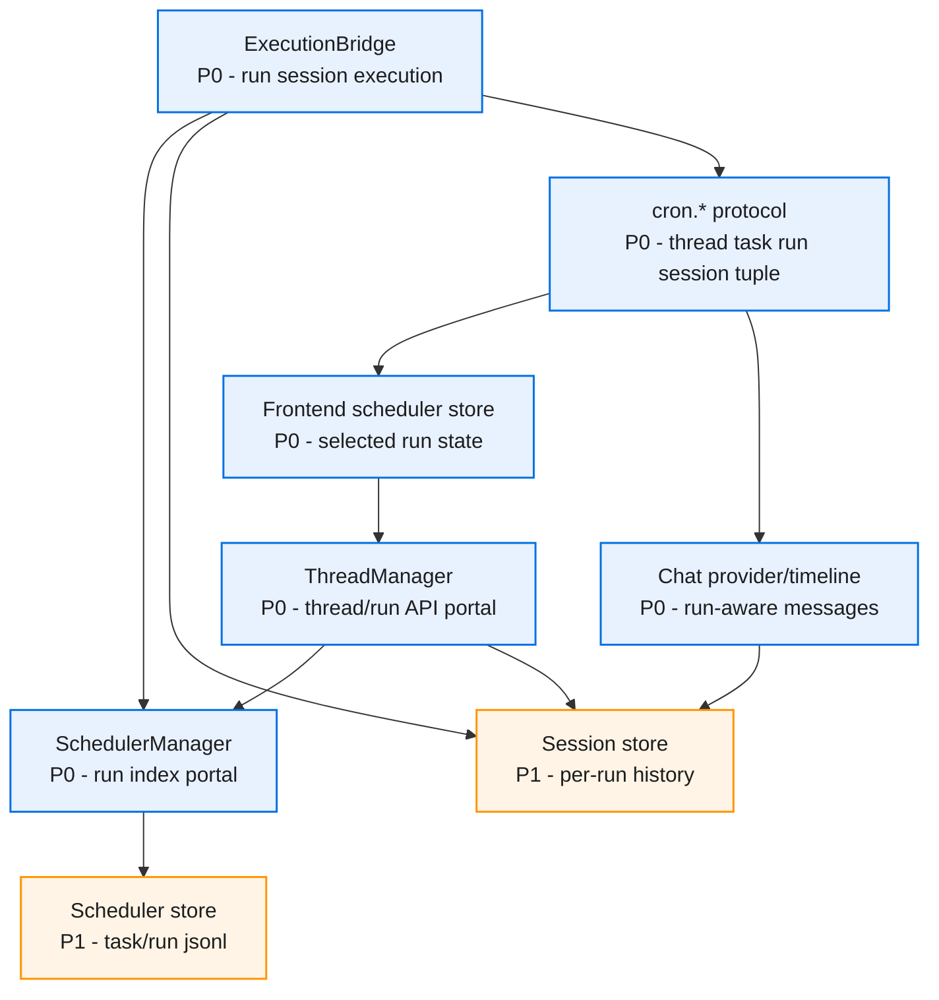
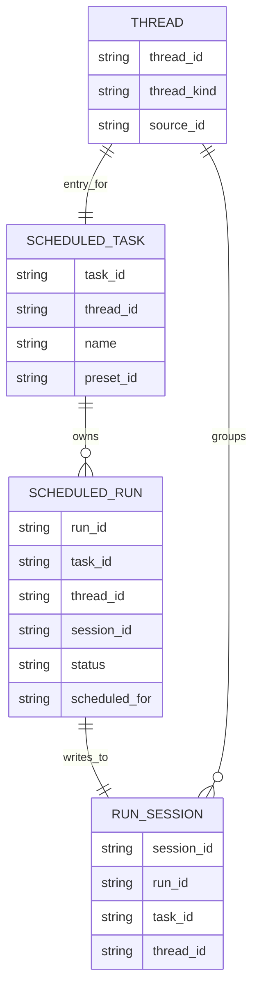
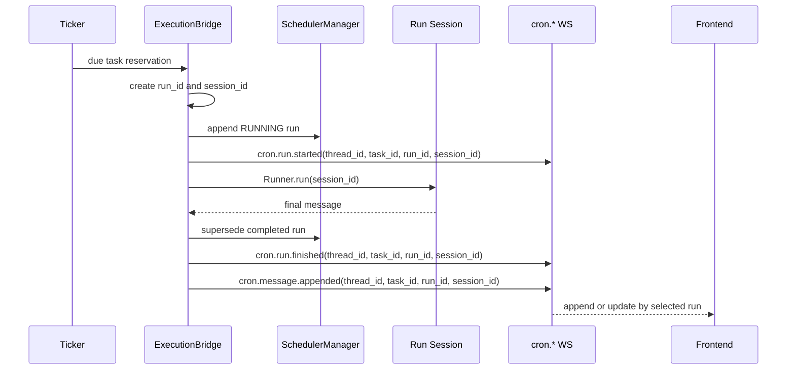
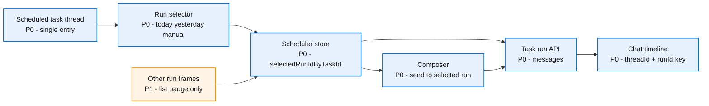

# Cron Run Session History Diagrams

> 建议在支持 Mermaid 缩放的 Markdown 预览器中查看。所有图只描述本 spec 的模块边界、数据关系和主链路。

## 目录

- [总览](#总览)
- [数据关系](#数据关系)
- [执行链路](#执行链路)
- [前端分流](#前端分流)

## 总览

## 数据关系

## 执行链路

## 前端分流

