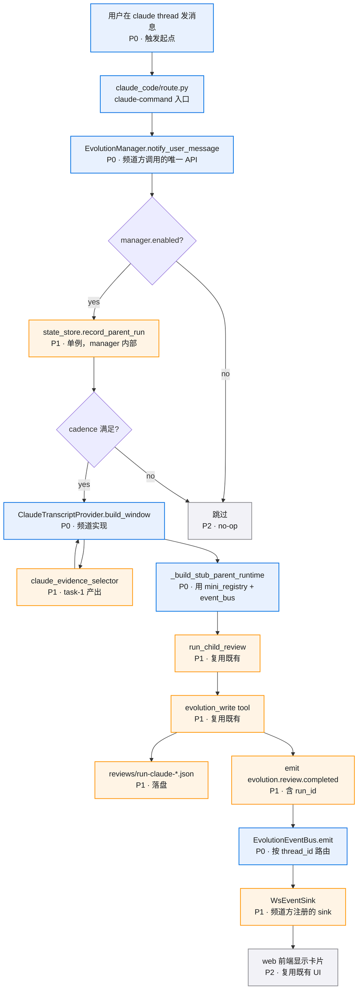
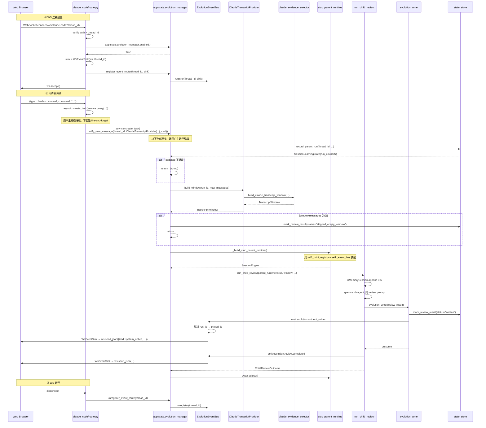
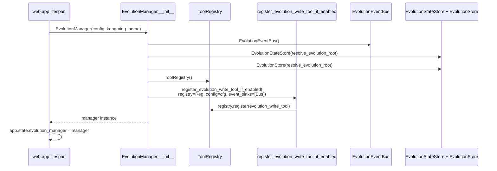
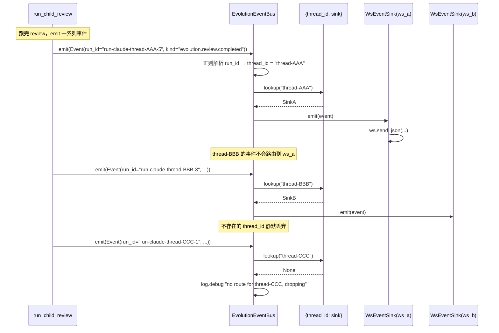
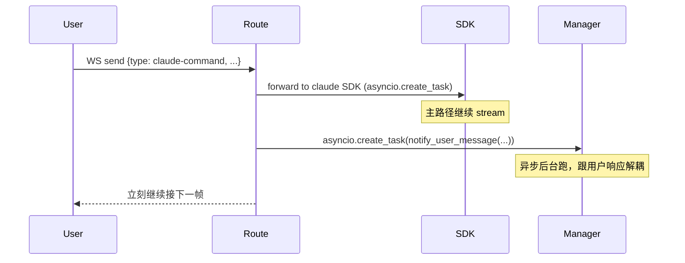
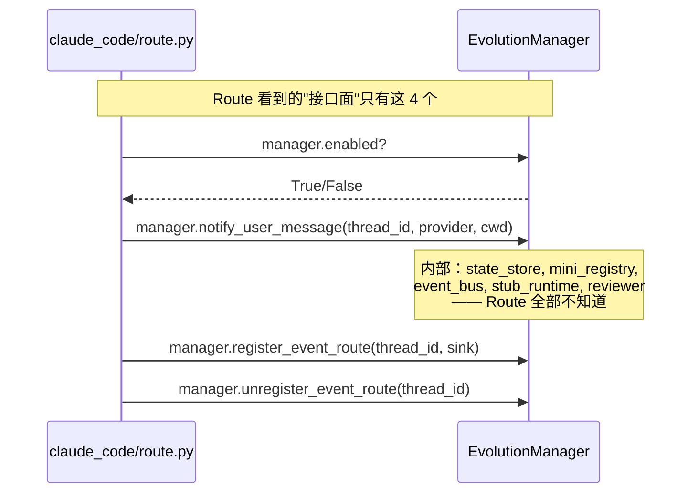
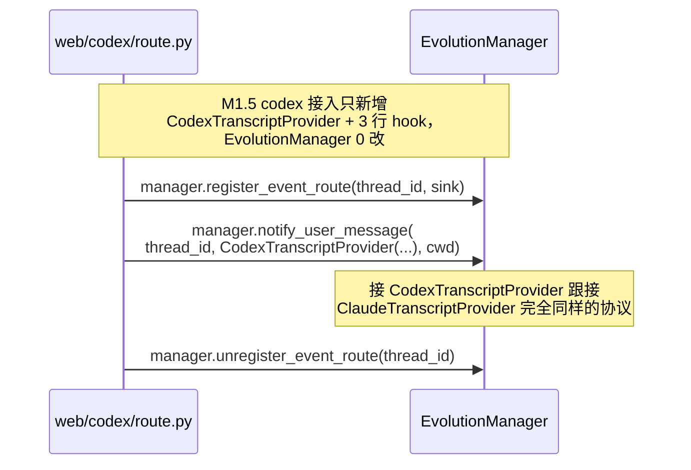

# 核心流程 + 时序

## 主流程：从用户发消息到 nutrient 写盘 + UI 卡片

## 时序图：完整的"连接 → 消息 → 断开"生命周期

## EvolutionManager 内部：mini_registry 装配（启动时一次）

## EvolutionEventBus 路由细节

## 关键设计决策时序还原

### 决策 1：fire-and-forget 不阻塞用户主路径

### 决策 2：频道方零感知 evolution 内部装配

### 决策 3：未来 codex 接入零改 manager

## 错误路径

| 场景 | 行为 |
|------|------|
| `manager.enabled == False` | 所有公开 API no-op，return |
| state_store 失败（IO 错误）| notify_user_message 顶层 except 吞 + log warning，本次跳过 |
| provider.build_window 抛异常 | provider 实现自身吞，但 manager 也加防御性 except 兜底 |
| window.messages 为空 | mark_review_result(status="skipped_empty_window") + return |
| `_build_stub_parent_runtime` 失败 | 顶层 except 吞 + log，本次跳过 |
| reviewer timeout | reviewer_runtime 已有 timeout 处理，manager 透传 outcome |
| evolution_write 失败 | reviewer_runtime 内部已处理（outcome.write_ok=False），manager 不重试 |
| event_bus 路由失败（sink 抛异常）| event_bus 内部吞 + log，不影响其它事件 |
| event_bus 路由不存在的 thread_id | 静默丢弃 + log.debug |

所有 manager 内部异常都吞掉 + log，**绝不冒泡到频道方**。
