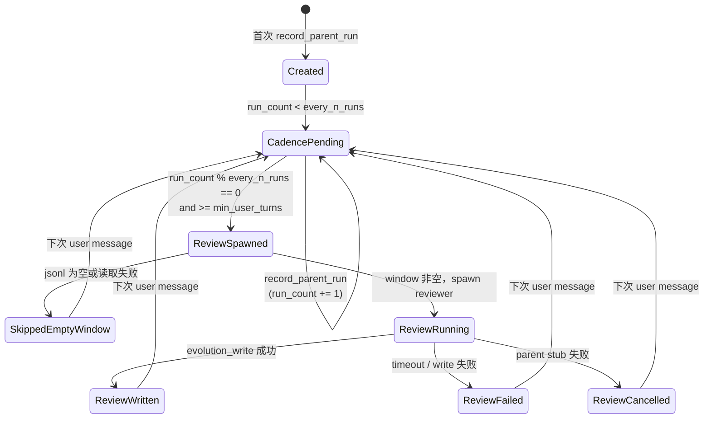

# 核心数据模型 + 状态流转

## 数据流总览

```
~/.claude/projects/<encoded-cwd>/<claude_thread_id>.jsonl
            │ (NormalizedMessage dict[])
            ▼
   jsonl_history.parse_jsonl_history
            │ (过滤 kind=="text" + 倒序截 max_messages)
            ▼
   claude_evidence_selector.build_claude_transcript_window
            │ (TranscriptWindow)
            ▼
   reviewer_runtime.run_child_review (InMemorySession.append × N)
            │ (LLM 调 evolution_write)
            ▼
   .kongming/evolution/reviews/run-claude-<thread_id>-<count>.json
   .kongming/evolution/evolution-nutrients.jsonl  (追加)
   .kongming/evolution/evolution.state.json       (覆盖更新)
```

## 数据模型映射表

### jsonl entry（来自 Claude SDK 落盘）

```json
{
  "type": "user",
  "sessionId": "<claude_thread_id>",
  "uuid": "<entry-uuid>",
  "timestamp": "2026-05-11T08:30:00.123Z",
  "message": {"content": "用户提问内容"}
}
```

### NormalizedMessage dict（jsonl_history 解析结果）

```python
{
    "kind": "text",
    "role": "user",
    "content": "用户提问内容",
    "sessionId": "<claude_thread_id>",
    "id": "<entry-uuid>",
    "timestamp": "2026-05-11T08:30:00.123Z",
    "provider": "claude",
}
```

### TranscriptMessage（evolution 域模型）

```python
TranscriptMessage(
    turn=3,
    role="user",
    content="用户提问内容",
    tool_name=None,  # claude 频道 v0.1 不纳入 tool_use
)
```

### 映射规则

| jsonl kind | role | 是否纳入 v0.1 | 映射到 TranscriptMessage |
|-----------|------|-------------|------------------------|
| text | user | ✅ | turn 递增；role=user；content 原样 |
| text | assistant | ✅ | turn 沿用上一个 user 的 turn；role=assistant；content 原样 |
| thinking | assistant | ❌ v0.1 不纳入 | — |
| tool_use | assistant | ❌ v0.1 不纳入 | — |
| tool_result | user | ❌ v0.1 不纳入 | — |
| session_created | system | ❌ 跳过 | — |

**理由**：v0.1 只看用户和助手的自然对话，让 reviewer 聚焦在"对话内容"层面提炼 nutrient。工具调用和推理细节留给 v0.2 看效果。

## 状态流转

### `evolution.state.json` 中单条 session 状态



### `evolution.state.json` 与 generic_chat / claude 共存

**关键决策**：`sessions` 表 key 用 `thread_id`（== session_id），不加 channel 字段区分。理由：

1. 一个 thread 只可能是一种 backend_kind（claude_code XOR generic_chat XOR codex），运行时不冲突
2. 用户从 generic_chat 切到 claude_code 是不同 thread，session_id 不同 → 状态自然隔离
3. 不改 schema = 零迁移成本

**Sanity check**：

```json
{
  "version": 1,
  "sessions": {
    "thread-abc123def456": {
      "run_count": 5,
      "user_turn_count": 5,
      "last_reviewed_run_id": "run-claude-thread-abc123def456-5",
      "last_review_at_ms": 1731234567890,
      "last_review_status": "written",
      "last_nutrient_id": "evo-nutrient-xxx",
      "last_nutrient_at_ms": 1731234568000
    },
    "thread-def789abc012": {
      "run_count": 10,
      "user_turn_count": 10,
      "last_reviewed_run_id": "run-thread-def789abc012-10",
      "last_review_at_ms": 1731234600000,
      "last_review_status": "written"
    }
  }
}
```

两条记录形式上完全一样，区别只在 `last_reviewed_run_id` 前缀（`run-claude-` vs `run-`）。

## run_id 命名规则

| 频道 | 格式 | 示例 |
|------|------|------|
| generic_chat | `run-{session_id}-{run_index}` | `run-thread-abc123-5` |
| **claude_code** | `run-claude-{thread_id}-{count}` | `run-claude-thread-abc123-5` |
| codex_cli (M1.5) | `run-codex-{thread_id}-{count}` | `run-codex-thread-abc123-5` |

**为什么 generic_chat 没前缀**：保留向后兼容（v0.1.9 已经用了这个格式，老 review 文件命名不变）。
**为什么 claude 加前缀**：跟 generic_chat 区分 + 跟 codex 未来扩展对称。

### ⚠️ 待用户确认

是否要给 generic_chat 也加 `run-native-` 前缀做对称？**默认不加**（保持向后兼容）。

## 文件落盘清单

| 路径 | 内容 | 谁写 |
|------|------|------|
| `.kongming/evolution/reviews/run-claude-<thread_id>-<count>.json` | review record（含 transcript_window.included_turns + result.nutrients[]）| `evolution.store.write_review`（复用）|
| `.kongming/evolution/evolution-nutrients.jsonl` | nutrient 候选队列（追加一行）| `evolution.store.write_review`（复用）|
| `.kongming/evolution/evolution.state.json` | session cadence 状态（覆盖）| `evolution.state_store.record_parent_run` + `mark_review_result`（复用）|

**新文件类型**：无。完全复用 v0.1.9 现有目录结构和文件格式。

## ThreadMetadata 兼容性

**结论**：不动 `ThreadMetadata` schema（保持 v7）。

**原因**：

- `claude_user_turn_count` 不需要落盘到 thread_metadata —— evolution.state.json 已经有 `run_count` 字段承担
- `ThreadMetadata.claude_thread_id` + `ThreadMetadata.cwd` 已经足够定位 jsonl，是 trigger 的输入参数源

## ⚠️ 已知边界

| 边界 | 当前行为 | 后续 |
|------|---------|------|
| claude SDK resume 产生新 jsonl 文件 | v0.1 只读 `ThreadMetadata.claude_thread_id` 对应的那一个 jsonl，不聚合多文件 | M2 / 下个版本看是否需要聚合多 session |
| 同一 thread 短时间高频发消息 | state_store 自带 asyncio.Lock，重复触发最多一次浪费 reviewer | 不做并发保护 |
| reviewer 单次 spawn 耗时 30-40s（v0.1.9 既知）| 不影响用户主路径（fire-and-forget），但占用 LLM quota | M2 看是否需要排队 |
