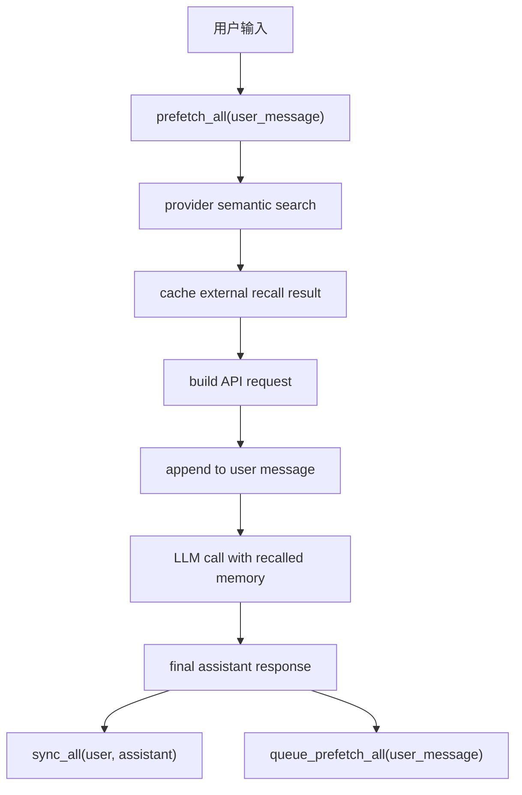

# 模块拆分

## 模块总览

| 模块 | 职责 | 依赖 | 状态 | 备注 |
|---|---|---|---|---|
| Memory Snapshot | 本地长期记忆、冻结快照、memory tool | context、tools、config_loader | 可进入 x-req | v0.1.3 最小入口 |
| Learning Loop | after-run review、nudge、pre-compact flush | SessionEngine、LLMProvider、Session | 方案确认 | 推荐直接 LLM JSON reviewer |
| Skill Store | 本地技能库、索引 prompt、skill view/manage | tools、context、config_loader | 可进入 x-req | 自动创建默认可配置 |
| Error Repair | API/tool/context 错误分类和恢复建议 | executors、core.errors、observability | 可进入 x-req | 先分类与记录，再逐步自动恢复 |
| Checkpoint Safety | 修改前快照、restore、prune | tools、safety、config_loader | 可进入 x-req | file/shell 工具集成 |
| Config / Observability | 配置模型、trace events、学习状态 | config_loader、observability | 可进入 x-req | 支撑灰度和审计 |
| MemoryProvider v0.1.5 | 外部记忆服务接口、prefetch、recall tool、sync | MemoryStore、MemoryManager、provider adapter | 待办 | v0.1.5 承接 |

## 模块详情

### 模块 1：Memory Snapshot

**职责**：提供本地长期记忆文件、冻结 system prompt 快照、受控 memory tool。

**包含范围**：

- `MemoryStore`：读取 `.kongming/memory/MEMORY.md` 和 `.kongming/memory/USER.md`。
- `MemorySnapshot`：启动或会话绑定时生成冻结快照。
- `MemoryPromptSource`：把冻结快照作为 `PromptSource` 注入 `InputAssembler`。
- `MemoryTool`：提供 `add`、`replace`、`remove`、`view`。
- 内容扫描：过滤 prompt injection、secret exfiltration、越权指令。
- 原子写入：写临时文件、替换目标文件、保留失败前内容。

**边界**：

- Memory 保存事实、偏好、环境、坑点。
- Skill 保存流程、脚本、模板、操作规范。
- Session 保存完整历史证据。

**依赖**：

- `context.input_assembler`：注入 memory prompt。
- `tools.registry`：注册 memory tool。
- `config_loader.models`：新增 memory 配置。
- `observability.trace_sink`：记录 memory write event。

**风险与讨论点**：

- 快照粒度选择：进程级冻结实现简单，会话级冻结更贴近长期多会话。
- memory 写入自动化程度：v0.1.3 建议手动 tool + review 自动建议并存。

**task 建议**：

- 建议 task 名：`self-evolution-memory-v0.1.3`
- 是否进入 x-req：是
- 原因：边界清晰、依赖稳定、能独立测试。

### 模块 2：Learning Loop

**职责**：把主任务后的对话经验抽取成 memory / skill / error record，并在压缩前保存关键上下文。

**包含范围**：

- `LearningLoop.before_run()`：在进入 `Runner.run()` 前检查历史长度，触发 pre-compact flush。
- `LearningLoop.after_run()`：主响应完成后按阈值触发 review。
- `LearningReviewer`：调用 LLM 生成结构化 JSON actions。
- `LearningActionApplier`：校验并应用 memory / skill / error 写入。
- 后台任务管理：`asyncio.create_task`、pending tasks、`SessionEngine.aclose()` drain。
- Nudge 计数：按 session 记录 turn 数、review 周期、最近 flush 时间。

**推荐实现方式**：

- 使用直接 LLM JSON reviewer，输出 `memory_actions`、`skill_actions`、`error_notes`。
- Store 层校验 JSON action，再写入文件。
- v0.1.3 避免启动第二个 Runner，降低递归 tool loop 风险。

**依赖**：

- `SessionEngine.run()`：before/after hook 入口。
- `LLMProvider`：复用当前 provider 做 review。
- `Session`：读取当前 session history。
- `MemoryStore`、`SkillStore`：应用学习结果。

**风险与讨论点**：

- 后台 review 可能与进程退出竞争，`aclose()` 需要 flush pending tasks。
- LLM reviewer 输出需要强 schema 校验，失败时写 trace event。
- pre-compact flush 需要避免频繁触发，建议设置 `flush_min_turns` 和 cooldown。

**task 建议**：

- 建议 task 名：`self-evolution-learning-loop-v0.1.3`
- 是否进入 x-req：是
- 原因：核心方案已明确，后台策略需要在需求阶段确定默认值。

### 模块 3：Skill Store

**职责**：提供本地程序性记忆库，支持 skill 自动创建、修补、索引加载和按需查看。

**包含范围**：

- `.kongming/skills/<skill-name>/SKILL.md` 文件布局。
- `SkillStore`：list、view、create、patch、edit、delete。
- `SkillIndexBuilder`：生成轻量索引 prompt。
- `SkillPromptSource`：把索引注入 system prompt。
- `skills_list`、`skill_view`、`skill_manage` 三类工具。
- skill frontmatter 校验：`name`、`description`、`category`、`version`。
- fuzzy patch：匹配失败时返回候选片段。
- 安全扫描和写入回滚。

**边界**：

- Skill 是程序性资产，应该包含步骤、命令、验证、坑点。
- Memory 是短事实资产，应该保持轻量。

**依赖**：

- `tools.registry`：注册 skill tools。
- `context.input_assembler`：注入 skill index。
- `config_loader.models`：新增 skill 配置。
- `observability`：记录 skill create / patch event。

**风险与讨论点**：

- 自动创建 skill 的阈值需要保守，建议默认 `auto_create=false`、`auto_patch=true`。
- skill prompt 索引需要限制体积，按 description 和 category 触发。

**task 建议**：

- 建议 task 名：`self-evolution-skill-store-v0.1.3`
- 是否进入 x-req：是
- 原因：可独立开发，依赖 MemoryStore 的经验分类规则。

### 模块 4：Error Repair

**职责**：统一识别 provider、payload、context、tool 失败原因，给出可记录和可恢复的结构化结果。

**包含范围**：

- `ErrorCategory`：auth、billing、rate_limit、server_error、timeout、context_overflow、payload_too_large、model_not_found、format_error、tool_error、unknown。
- `ClassifiedError`：`retryable`、`should_compact`、`should_fallback`、`should_record_memory`。
- provider 层分类：OpenAI-compatible、Anthropic。
- runner 错误事件增强：trace payload 带 category、retryable、recover_action。
- 初版恢复动作：context overflow 触发 compact retry、payload too large 触发裁剪提示、rate limit 走现有 retry backoff。

**依赖**：

- `executors.llm.*`：捕获 provider API 异常。
- `core.errors`：保留统一 AgentError 形态。
- `observability.trace_sink`：记录分类结果。
- `LearningLoop`：把稳定错误经验写入 memory。

**风险与讨论点**：

- 自动 fallback 涉及多 provider 配置，v0.1.3 建议先做分类与有限恢复。
- provider 原始错误结构差异大，分类规则需要单元测试覆盖。

**task 建议**：

- 建议 task 名：`self-evolution-error-repair-v0.1.3`
- 是否进入 x-req：是
- 原因：现有 provider 已有 retry 配置，分类层可直接增强。

### 模块 5：Checkpoint Safety

**职责**：在文件写入、patch、shell 高风险命令前创建可恢复快照。

**包含范围**：

- `CheckpointManager`：ensure、restore、prune。
- shadow git repo：`.kongming/checkpoints/<worktree-hash>/`。
- file tool 集成：write / patch 前创建 checkpoint。
- shell tool 集成：命令风险分类命中 mutating 时创建 checkpoint。
- restore tool：受审批控制的恢复入口。
- trace events：checkpoint.created、checkpoint.skipped、checkpoint.restored。

**依赖**：

- `tools.file_tools`、`tools.shell_tool`：调用 checkpoint。
- `safety.permission_policy`：restore 和 shell 高风险命令审批。
- `config_loader.models`：checkpoint 配置。

**风险与讨论点**：

- Windows shell 命令风险识别需要单独规则。
- 大目录快照需要限制文件数量和体积。
- restore 是强副作用操作，必须走 approval。

**task 建议**：

- 建议 task 名：`self-evolution-checkpoint-safety-v0.1.3`
- 是否进入 x-req：是
- 原因：工具层边界清晰，测试可用临时目录覆盖。

### 模块 6：Config / Observability

**职责**：把学习能力接入统一配置、trace、测试和架构合约。

**包含范围**：

- `Config.evolution`：memory、skill、learning、checkpoint、error_repair 子配置。
- `config/setting.yaml` 默认值。
- `.env` 覆盖：关键开关和路径。
- trace events：learning.review.start/end、memory.write、skill.write、error.classified、checkpoint.*。
- 架构合约：新增包或新增跨层 import 的 import-linter 规则。
- 单元测试、e2e 测试、文档更新。

**依赖**：

- `config_loader.models`
- `observability.trace_sink`
- `.importlinter`
- `pyproject.toml`

**风险与讨论点**：

- 配置项过多会稀释 v0.1.3 验证重点，建议只开放路径、开关、阈值、后台策略。

**task 建议**：

- 建议 task 名：`self-evolution-config-observability-v0.1.3`
- 是否进入 x-req：是
- 原因：每个功能模块都依赖配置和事件。

### 模块 7：MemoryProvider v0.1.5

**职责**：提供 MemoryStore 之外的外接大脑能力：自动 ingest、语义 prefetch、主动 recall tool、跨会话即时查询和推理合成。

**包含范围**：

- `MemoryProvider` ABC：`initialize`、`prefetch`、`queue_prefetch`、`sync_turn`、`get_tool_schemas`、`handle_tool_call`、`on_memory_write`、`on_pre_compact`、`shutdown`。
- `MemoryManager`：编排 builtin MemoryStore 与一个 external provider。
- `prefetch_all(user_message)`：在模型看到用户消息前，用当前用户消息去外部后端召回相关记忆。
- `<memory-context>` 注入：把召回内容追加到当前 user message 后，并标注“这是召回记忆，属于系统上下文”。
- `sync_all(user, assistant)`：每轮结束后把用户和助手消息同步到外部后端。
- `queue_prefetch_all(user_message)`：回合结束后为下一轮后台预取。
- 主动 recall tool：如 `honcho_search`、`hindsight_recall`，模型按需精确查询历史知识。
- recall mode：`context`、`tools`、`hybrid`。
- provider 插件：Honcho、Hindsight、Mem0、Holographic、ByteRover、OpenViking、RetainDB、SuperMemory 等外部后端。

**MemoryStore 与 MemoryProvider 边界**：

| 能力 | MemoryStore builtin | MemoryProvider external |
|---|---|---|
| 存储 | 本地 Markdown 文件 | 语义向量库、知识图谱、远端记忆服务 |
| 写入 | 模型主动调 memory tool | 系统每轮自动 sync |
| 召回 | system prompt 冻结快照 | prefetch 语义检索自动注入 |
| 查询 | memory tool 查看本地文件 | provider recall tool 按需查询 |
| 推理 | 本地事实记录 | dialectic Q&A、reflect、语义合成 |

**prefetch 流程**：

`<memory-context>` 必须明确标注召回内容是系统记忆上下文，属于历史参考信息，当前用户指令仍以原始 user message 为准。

**依赖**：

- MemoryStore
- LearningLoop
- Session
- LLM run input assembly
- provider plugin config

**风险与讨论点**：

- 自动 prefetch 会改变每轮 user message 的实际输入，需要严格标签隔离。
- 外部服务引入鉴权、网络失败、隐私边界和延迟控制。
- hybrid 模式能力最完整，也需要最强的 prompt 注入和 tool 权限边界。
- v0.1.5 只允许启用一个 external provider，降低路由和冲突复杂度。

**task 建议**：

- 建议 task 名：`self-evolution-memory-provider-v0.1.5`
- 是否进入 x-req：否
- 原因：v0.1.3 先完成 builtin MemoryStore，本模块作为 v0.1.5 独立系统需求进入 x-spec / x-req。
