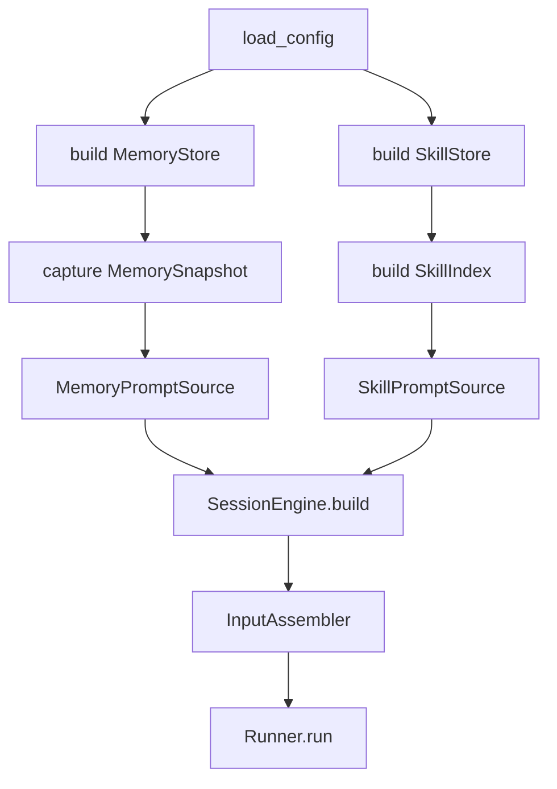
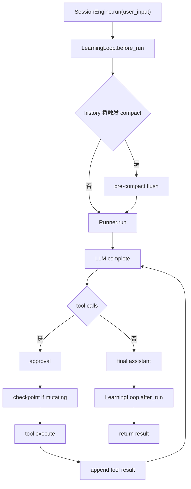
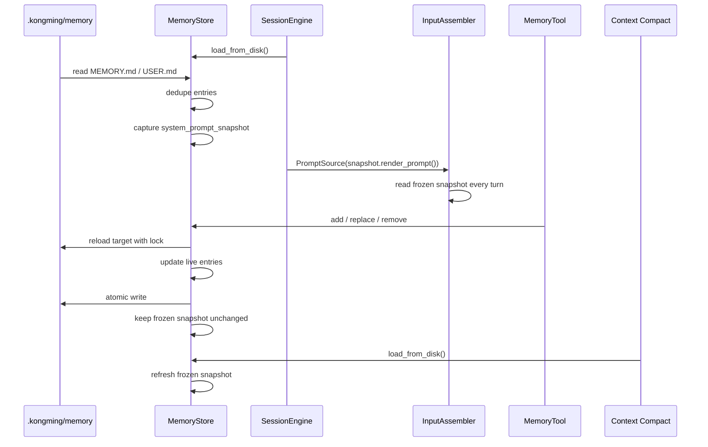
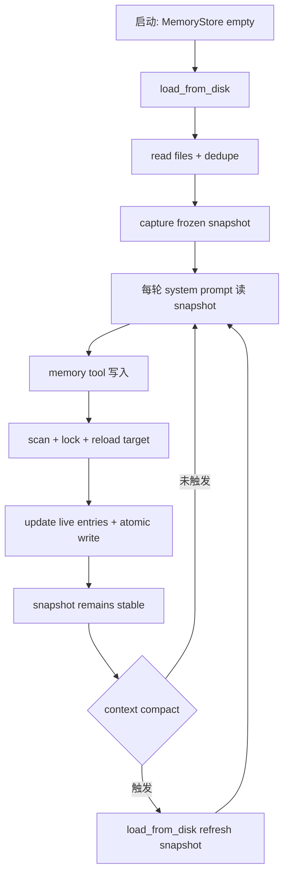
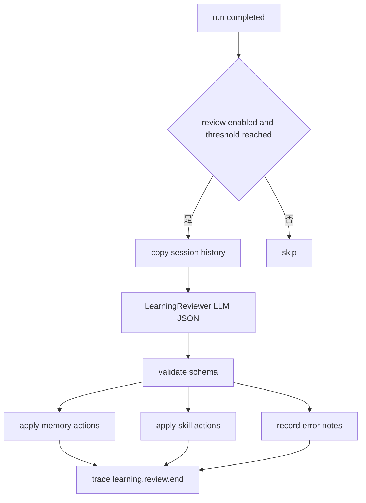
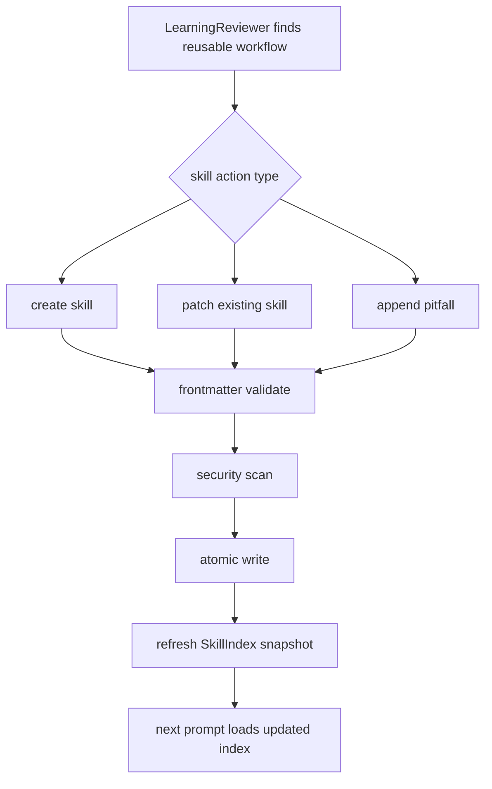
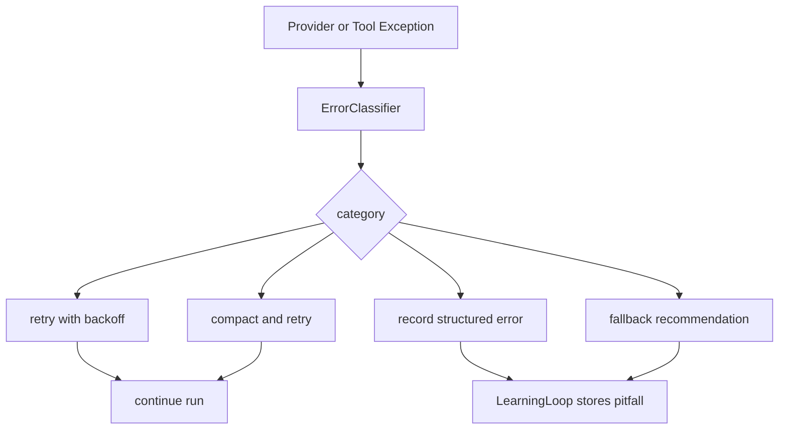
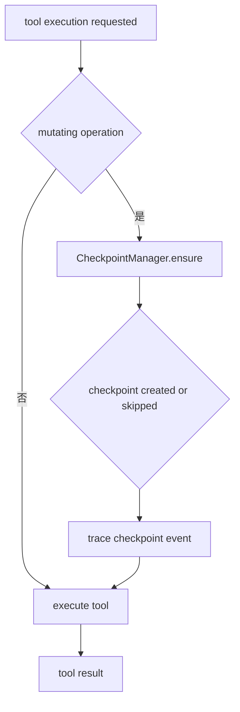

# 核心流程

## 1. 启动与 Prompt 装配



流程说明：

1. 配置加载阶段读取 `evolution.*` 配置。
2. SessionEngine 构建 MemoryStore 和 SkillStore。
3. MemoryStore 捕获冻结快照，SkillStore 构建轻量索引。
4. 两者都以 `PromptSource` 形式交给 `InputAssembler`。
5. Runner 继续只消费 `PromptAssembler`，保持核心运行语义稳定。

## 2. 单轮任务执行



流程说明：

- `LearningLoop.before_run` 在用户输入进入 runner 前执行，适合做 pre-compact flush。
- Runner 内部 turn loop 保持原样。
- 文件写入、patch、shell mutating 命令在 tool 内创建 checkpoint。
- `LearningLoop.after_run` 在主响应完成后执行，默认异步后台 review。

## 3. 冻结 Memory 快照

Hermes 的 Memory Snapshot 是 `MemoryStore` 内部的冻结缓存机制。它的目标是让 system prompt 在普通对话轮次中保持字节级稳定，提升 prefix cache 命中；同时让 memory tool 继续读取和写入最新活态数据。Kongming v0.1.3 应采用同一语义：一份 memory 数据同时拥有“冻结态”和“活态”两个视图。

```text
┌─────────────────────────────────────────────┐
│                 MemoryStore                  │
│                                             │
│  system_prompt_snapshot  ← 冻结态，只读       │
│    memory: rendered MEMORY.md block          │
│    user:   rendered USER.md block            │
│                                             │
│  memory_entries / user_entries ← 活态，可写   │
│    ["条目1", "条目2", ...]                   │
└─────────────────────────────────────────────┘
```

| 时机 | 读取对象 | 写入对象 | 目标 |
|---|---|---|---|
| system prompt 注入 | `system_prompt_snapshot` 冻结态 | 无 | 保持 prompt 稳定，提升 prefix cache 命中 |
| memory tool 返回结果 | `memory_entries` / `user_entries` 活态 | 磁盘 + 活态 | 让工具反馈最新记忆内容 |
| memory tool 写入 | 活态重载后的 entries | 磁盘 + 活态 | 保证多写入入口看到最新文件 |
| 上下文压缩后重建 | 磁盘重新加载 | 刷新冻结态 | prefix cache 已失效，此时同步新记忆成本最低 |



流程说明：

- `MemoryStore` 初始化为空壳，`load_from_disk()` 读取磁盘、去重条目、捕获冻结快照。
- system prompt 每轮读取冻结快照，memory tool 每次读取活态 entries。
- memory tool 的 add / replace / remove 先扫描内容，再加文件锁，重载目标文件，更新活态 entries，最后用临时文件和 replace 原子写入。
- tool 写入只更新磁盘和活态 entries，当前冻结快照保持稳定。
- 上下文压缩后触发 snapshot 刷新，因为压缩已经改变 prompt 前缀，此时重新加载 memory 对 cache 成本最低。
- 后台 review agent 共享同一个 `MemoryStore`，通过 memory tool 保存结果，行为等同普通 tool 写入。

### 3.1 生命周期细节



推荐落地规则：

- `MemoryStore.__init__()` 只设置路径和空状态。
- `load_from_disk()` 是捕获或刷新冻结快照的唯一入口。
- `format_for_system_prompt(target)` 只读冻结快照。
- `memory` tool 的 `view/add/replace/remove` 只读写活态 entries 和磁盘。
- `InputAssembler` 常规 assemble 阶段只消费 frozen prompt source。
- `HistoryCompactor` 或后续 compact hook 完成后，调用 `memory_store.load_from_disk()` 刷新 snapshot。
- v0.1.3 可以先保留刷新 hook 设计，实际接线随 compact flush 任务落地。

## 4. Learning Review



推荐策略：

- reviewer 直接调用 LLM 返回 JSON actions。
- action applier 负责校验、扫描和原子写入。
- review 失败只写 trace event，主任务结果已经返回。
- `SessionEngine.aclose()` drain pending review tasks，减少进程退出丢写。

## 5. Skill 创建与修补



Skill action 触发信号：

- 一次任务中出现 5 次以上有效工具调用。
- 错误被修复，并形成稳定处理路径。
- 用户纠正了流程，且该流程可复用。
- 某个 skill 缺少验证步骤、环境说明或坑点。

## 6. Error Repair



v0.1.3 的恢复策略：

- `context_overflow`：触发 compact retry。
- `payload_too_large`：裁剪 payload 或缩短 tool result 后 retry。
- `rate_limit` / `timeout` / `server_error`：复用现有 retry/backoff。
- `auth` / `billing` / `model_not_found`：结构化记录并返回清晰错误。

## 7. Checkpoint Safety



快照策略：

- file write / patch 操作按目标文件所在 worktree 创建快照。
- shell mutating 命令按 cwd 创建快照。
- 每个 worktree 每轮最多创建一次快照。
- restore tool 作为显式工具，走 approval。

## 8. 推荐落地顺序


这个顺序先建立安全和记录能力，再开启自动学习。Memory、Error、Checkpoint 可以独立验证；Learning Loop 和 Skill Store 会依赖前三者的安全边界。
