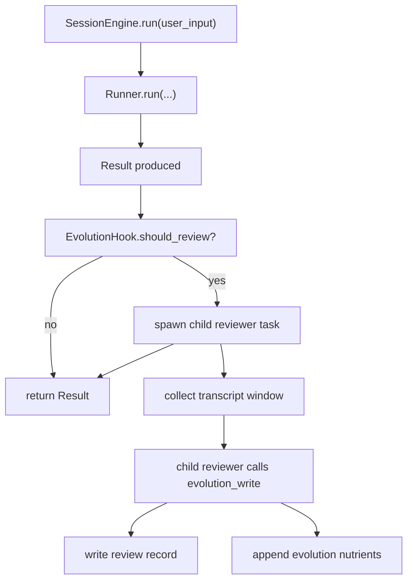
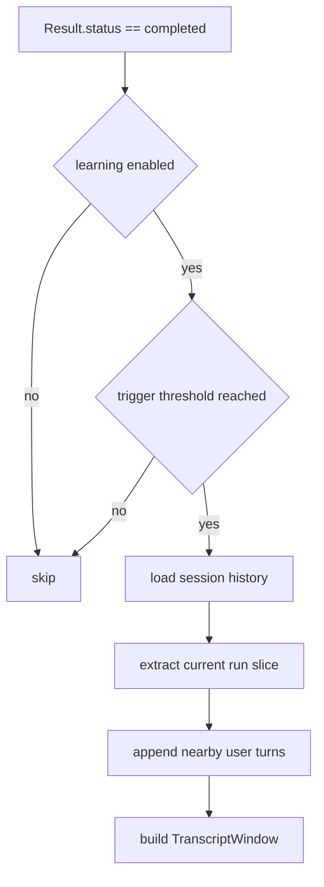
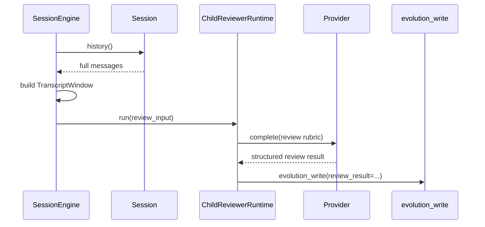
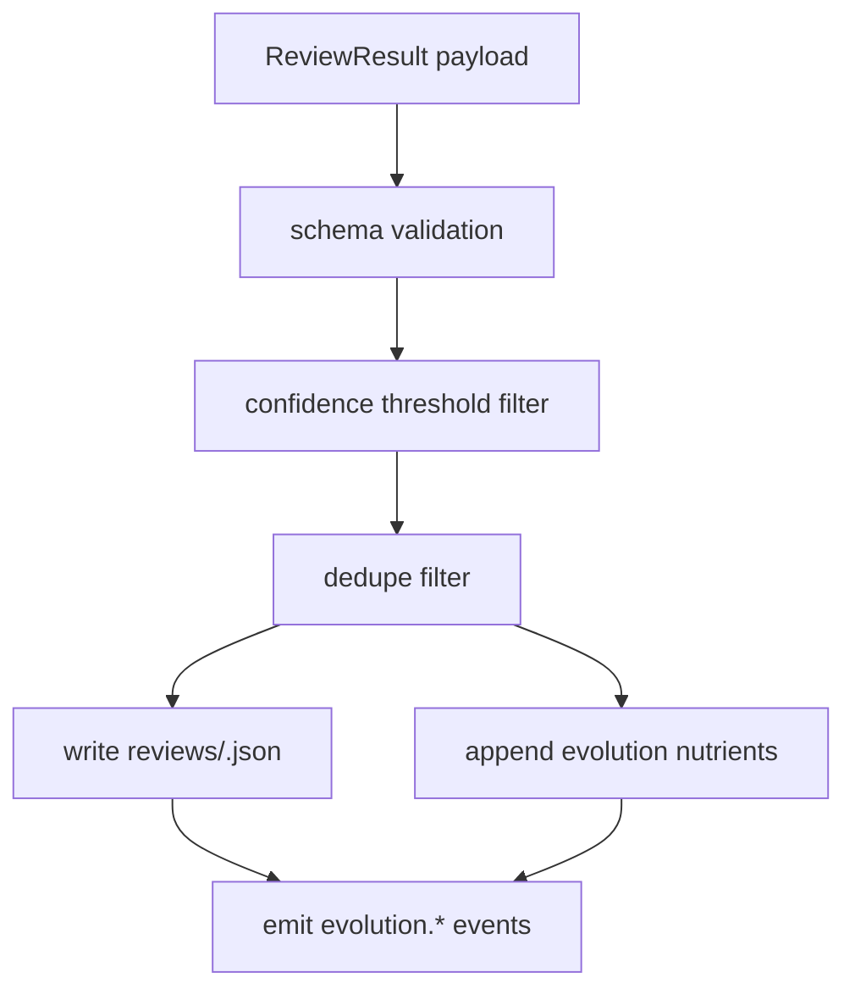
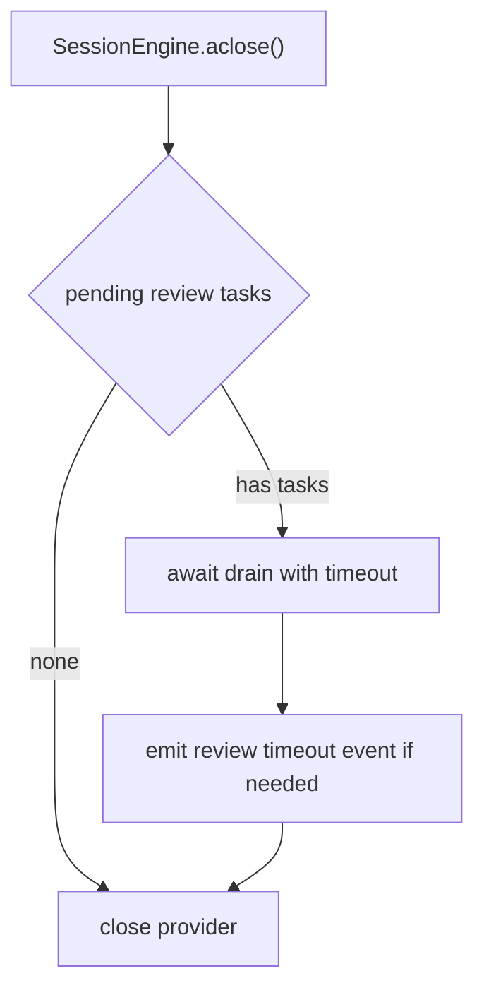

# 核心流程

## 1. 总体执行链

流程说明：

- 主任务结果先返回。
- 学习链作为后台副链运行。
- child reviewer 只消费 transcript window 和 review rubric。
- child reviewer 通过专用工具直接完成持久化。

## 2. Review Trigger 与证据选择

推荐默认触发条件：

- `Result.status == "completed"`。
- 当前 session 至少 3 个 user turn。
- 每 5 次 run 触发一次 review。
- 本次 run 的 tool call 数达到 3 次时立即触发。
- 用户在近 2 轮内给出明确纠正时提升 review 优先级。

证据选择规则：

- 必带当前 user 输入。
- 必带当前最终 assistant 输出。
- 带上本 run 内关键 tool 调用和结果摘要。
- 带上前 1 到 2 个 user turn 作为纠正和偏好来源。
- `evidence_turns` 记录每个结论对应的 turn 编号。

## 3. Child Reviewer 链路

具体创建顺序：

1. parent 从当前 `Session.history()` 构造 `TranscriptWindow`
2. parent 创建独立 `InMemorySession` 作为 review session
3. parent 预写入 transcript window 消息到 review session
4. parent 用 `SessionEngine.build(...)` 构造 reviewer runtime
5. reviewer runtime 用专用 `AgentSpec` 运行一次短对话
6. reviewer runtime 只调用 `evolution_write`
7. reviewer runtime 关闭，主链继续保持原 session

推荐回收顺序：

1. reviewer task 结束
2. `await review_runtime.aclose()`
3. 从 `pending_reviews` 注销 `review_id`
4. 释放 review session 引用
5. 发 `evolution.review.completed/failed/cancelled`

reviewer prompt 应当明确三类输出内容：

- `nutrients`
- `skip_reasons`
- `review_summary`

reviewer 实际落盘方式：

- 构造完整 `ReviewResult`
- 调用一次 `evolution_write`

reviewer prompt 也应当明确三类禁止行为：

- 不做正式 skill 写入。
- 只允许调用 `evolution_write`。
- 不输出证据不足的猜测。

## 4. Evolution Write 链路

应用规则：

- `nutrients` 进入统一养料队列，不进入正式 skill 目录。
- `evolution_write` 是唯一写入口。
- 所有 reviewer 输出先写 review record，再追加外部可见资产。

## 5. Shutdown Drain

这一步是 v0.1.9 的必要补充。当前 `SessionEngine.aclose()` 只关闭 provider client，目标状态增加 review drain 语义。

## 6. v0.1.9 与后续版本的流程分界

| 能力 | v0.1.9 | 后续版本 |
|---|---|---|
| after-run child review | 是 | 持续保留 |
| evolution nutrient queue | 是 | 持续保留 |
| evolution_write tool | 是 | 持续保留 |
| 正式 skill promote | 否 | v0.2 |
| memory promote | 否 | 后续版本 |
| external memory provider | 否 | v0.2+ |
