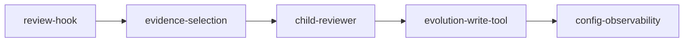

# Task Map

| 模块 | 建议 task 名 | 是否创建 task | 前置依赖 | 当前状态 |
|---|---|---|---|---|
| Evolution Hook | `self-evolution-review-hook-v0.1.9` | 是 | 无 | 可进入 x-req |
| Evidence Selection | `self-evolution-evidence-selection-v0.1.9` | 是 | 无 | 可进入 x-req |
| Child Reviewer Runtime | `self-evolution-child-reviewer-v0.1.9` | 是 | Evolution Hook、Evidence Selection | 可进入 x-req |
| Evolution Write Tool | `self-evolution-evolution-write-tool-v0.1.9` | 是 | Child Reviewer Runtime | 可进入 x-req |
| Learning Config / Observability | `self-evolution-learning-config-observability-v0.1.9` | 是 | 前四项字段确认 | 可进入 x-req |
| Skill Promotion | `self-evolution-skill-promotion-v0.2` | 否 | 进化养料队列稳定 | 方案层 |

## 推荐拆分批次

### 第一批：主链闭环

| Task | 产出 |
|---|---|
| `self-evolution-review-hook-v0.1.9` | `after-run` hook、pending tasks、`aclose()` drain |
| `self-evolution-evidence-selection-v0.1.9` | `TranscriptWindow`、`evidence_turns`、trigger policy |
| `self-evolution-child-reviewer-v0.1.9` | reviewer prompt、child runtime、`evolution_write` tool 绑定 |

### 第二批：资产沉淀

| Task | 产出 |
|---|---|
| `self-evolution-evolution-write-tool-v0.1.9` | review record、进化养料队列、幂等写入 |

### 第三批：产品化收口

| Task | 产出 |
|---|---|
| `self-evolution-learning-config-observability-v0.1.9` | `evolution.learning` 配置、events、tests、文档联动 |

## x-req 入口建议

优先进入 x-req：

1. `self-evolution-review-hook-v0.1.9`
2. `self-evolution-evidence-selection-v0.1.9`
3. `self-evolution-child-reviewer-v0.1.9`
4. `self-evolution-evolution-write-tool-v0.1.9`

保持在方案层：

- `self-evolution-skill-promotion-v0.2`

## 推荐开发顺序

