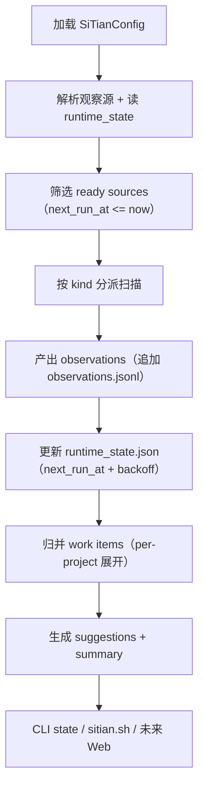
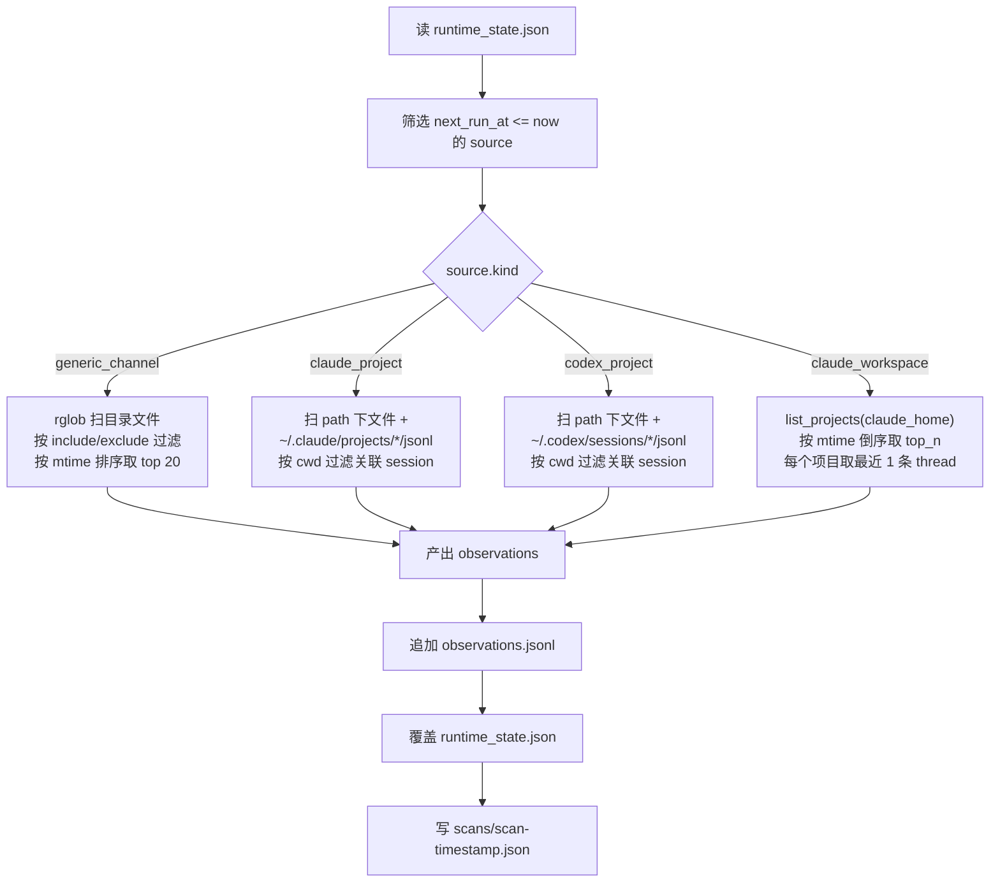
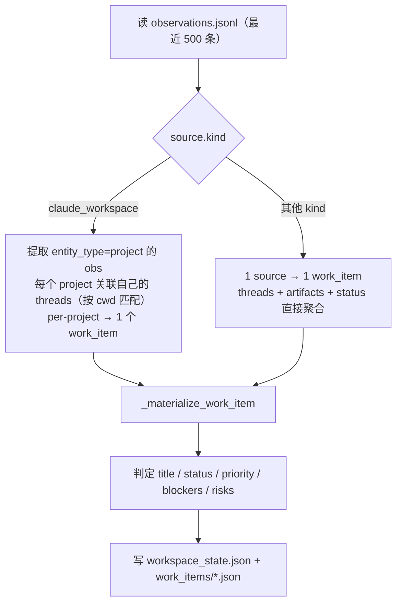

# 核心流程

## 总体流程图



## 流程 1：初始化司天

```text
加载 SiTianConfig（yaml → pydantic 校验）
  ↓
校验观察源配置（source.id 唯一、path 非空、kind 合法）
  ↓
初始化 SiTianRecords 目录（ensure_layout → mkdir + 空 observations.jsonl + 空 workspace_state）
  ↓
写入 config.snapshot.json
  ↓
进入扫描循环（run-once 模式跑一轮；loop 模式持续）
```

- `SiTianConfig` 由 yaml 配置文件提供（`config/sitian.local.yaml`）
- `SiTianRecordsStore` 由 CLI 装配时创建，root_dir 支持 `output_subdir` 子目录路由
- `workspace_state.json` 由首次 `ensure_layout` 创建空壳

## 流程 2：主动扫描一轮



### claude_workspace 扫描细节（v1.1 新增）

```text
_SiTianScanClaudeWorkspace(source):
  │
  ├─ claude_home = _resolve_claude_home_from_path(source.path)
  │    path 填 ~/.claude 或 ~/.claude/projects 都行（末尾是 projects 自动回退父目录）
  │
  ├─ list_projects(claude_home) ← 复用 web.integrations.claude_code.projects_scanner
  │    os.scandir(~/.claude/projects/)
  │    遍历每个子目录：
  │      *.jsonl（跳 agent-*.jsonl）
  │      stat().st_mtime → 修改时间（不读完整内容）
  │      readline() → 首条 type=user 的 message.content 前 40 字 → title
  │      readline() → cwd 字段 → 项目真实路径
  │    按 max(session.mtime) 倒序
  │    返回 ProjectSummary[]
  │
  ├─ projects = projects[:top_n]（默认 10）
  │
  └─ 产出 observations：
       1 条 status   {channelKind, projectCount, topN, latestModifiedAt}
       N 条 project  {rank, displayName, cwd, sessionCount, lastModifiedAt}
       N 条 thread   {threadId, title, cwd, messageCount, lastModifiedAt}
       = 1 + 2N 条（N=10 时 21 条）
```

**I/O 范围**：只读 `stat().st_mtime` + jsonl 首几行。不读完整对话、不调 LLM、不解析 tool_call。10 个项目约 0.2 秒。

### 扫描失败处理

```text
source A 扫描抛异常：
  → failed_sources["A"] = error message
  → runtime_state.retry_backoff_sec = 60（首次）→ 120 → 240...（指数回退）
  → next_run_at = now + max(scan_interval, retry_backoff)
  → status = "error"
  → 不阻塞其他 source，继续扫 B、C...
```

## 流程 3：从 observations 归并 work item



### per-project 展开（claude_workspace 专属）

```text
SiTianMaterializeState 遍历 config.sources：
  if source.kind == "claude_workspace":
    project_obs_list = [obs if entity_type == "project"]
    for each project_obs:
      project_cwd = project_obs.payload["cwd"]
      project_threads = [obs if entity_type == "thread" and cwd == project_cwd]
      work_item = _materialize_work_item(
        id = "claude-workspace:<project_dir_name>",
        title = project_obs.payload["displayName"],  ← 如 "kongming-agent"
        observations = [project_obs] + project_threads,
      )
    → N 个项目 → N 个 work_items

  else:  ← generic_channel / claude_project / codex_project
    1 source → 1 work_item（原行为不变）
```

### work_item 判定逻辑

| 字段 | 判定规则 |
|---|---|
| title | claude_workspace: displayName 优先 → thread title → project_path 末段 |
| status | blockers 非空 → blocked；runtime running → active；thread stale → waiting；有 thread → active；否则 uncertain |
| priority | blocked → high；无 thread → medium；其他 → low |
| blockers | runtime error → 错误消息；fileCount=0 且非 claude_workspace → "目录中没有可观察文件" |
| risks | 无 thread → "缺少线程级进展"；无 artifact 且无 project → "缺少最近产物"；stale → "最近缺少新活动" |

## 流程 4：生成建议

```text
遍历 work_items：
  ↓
每个 work_item 产出一条 recommendation：
  {workItemId, title, priority, status, reason, nextAction}
  ↓
按 (priority_order, status_order) 排序
  ↓
聚合 blockers / risks / pending_approvals
  ↓
写入：
  latest_suggestions.json  ← 全部 recommendations
  latest_summary.md        ← 人类可读摘要（top 5 + blockers + risks）
  latest_analysis.md       ← analyzer 人类可读报告（analyzer 启用时）
```

## 流程 5：读取与展示

```text
kongming-sitian state [--config yaml] [--root-dir path]
  ↓
加载 config → 拼 output_subdir → 定位 store
  ↓
读 runtime_state.json / workspace_state.json / latest_suggestions.json / latest_summary.md / latest_analysis.md
  ↓
返回 JSON（含 rootDir / runtimeStates / workspaceState / latestSuggestions / latestSummary / latestAnalysis）
```

### 入口方式

| 入口 | 命令 | 说明 |
|---|---|---|
| 封装脚本 | `./sitian.sh scan` | 一次扫描 + 打印 state + 打印 summary |
| 封装脚本 | `./sitian.sh state` | 只读当前状态 |
| 封装脚本 | `./sitian.sh loop` | 持续循环（Ctrl+C 退出） |
| CLI 直调 | `uv run kongming-sitian run-once --config ... --root-dir ...` | 跑一轮 |
| CLI 直调 | `uv run kongming-sitian state --root-dir ...` | 读状态 |

### 产物目录结构

```
$SITIAN_ROOT/<output_subdir>/        ← output_subdir 由 yaml 配置（如 "claude"）
├─ config.snapshot.json              ← 最近一次 SiTianConfig 快照（覆盖）
├─ observations.jsonl                ← 每次扫描追加（永不删）
├─ runtime_state.json                ← source 级 next_run_at / backoff（覆盖）
├─ workspace_state.json              ← 归并后全局视图（覆盖）
├─ work_items/<source_id:project>.json ← 每 work_item 一个文件（覆盖）
├─ latest_suggestions.json           ← 排序后建议（覆盖）
├─ latest_summary.md                 ← 规则层人类可读摘要（覆盖）
├─ latest_analysis.md                ← analyzer 人类可读报告（覆盖）
└─ scans/scan-<timestamp>.json       ← 每次扫描元信息（新建，不覆盖）
```
