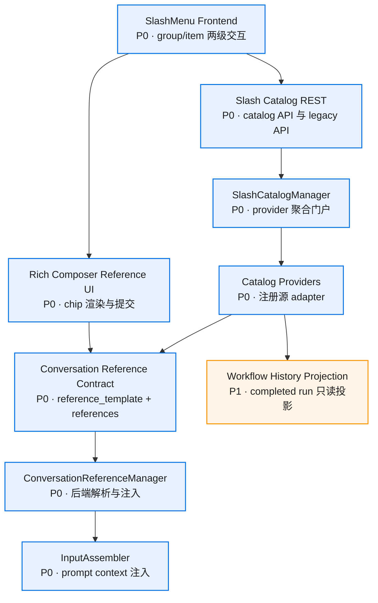
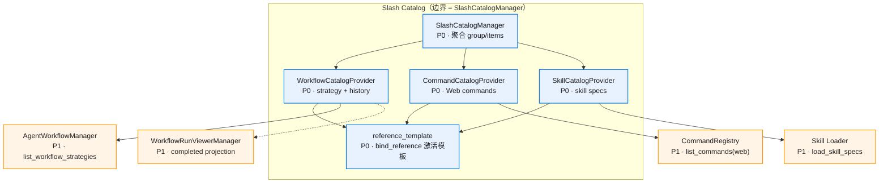
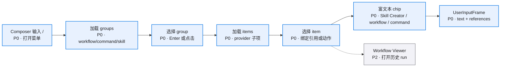
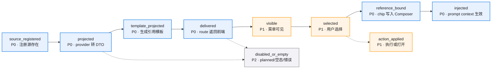
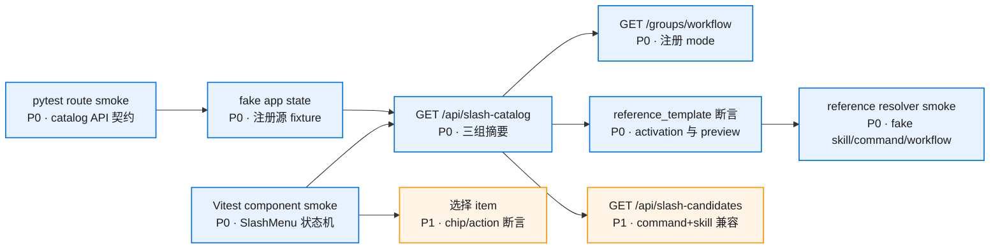
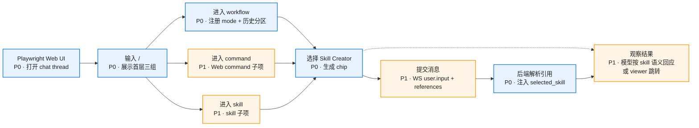

# Slash Menu Catalog v0.1 · 图集

> 本 spec 的唯一图源：所有 mermaid 图集中于此，按模块分节。02/03/04 是文字事实源，本文件是只读视图——增减模块/组件时同步更新对应节。
>
> **查看与缩放**：GitHub 渲染 mermaid 自带缩放/平移控件；VS Code 建议安装 Mermaid Chart（官方）或 Markdown Preview Enhanced 插件以支持缩放。

## 目录

- [总览](#总览)
- [provider 聚合局部图](#provider-聚合局部图)
- [前端交互流程图](#前端交互流程图)
- [conversation reference 注入流程图](#conversation-reference-注入流程图)
- [catalog item 状态流转图](#catalog-item-状态流转图)
- [Smoke 验证流程图](#smoke-验证流程图)
- [E2E 验证流程图](#e2e-验证流程图)

图例：P0 核心/阻塞 · P1 主要/必须 · P2 辅助/可选

## 总览

## provider 聚合局部图

## 前端交互流程图

## conversation reference 注入流程图

```mermaid
flowchart LR
  classDef p0 fill:#E8F1FE,stroke:#0071E3,color:#1D1D1F,stroke-width:1.5px
  classDef p1 fill:#FFF4E5,stroke:#FF9500,color:#1D1D1F,stroke-width:1.5px
  classDef p2 fill:#F2F2F7,stroke:#8E8E93,color:#1D1D1F,stroke-width:1.5px

  Item["SlashCatalogItemDTO<br/>P0 · kind/id/title"]:::p0
  Template["ConversationReferenceTemplate<br/>P0 · activation + preview"]:::p0
  Chip["Composer chip<br/>P0 · @Skill Creator 可视节点"]:::p0
  Frame["UserInputFrame.references<br/>P0 · 提交结构化引用"]:::p0
  Metadata["Message.metadata<br/>P0 · conversation_references"]:::p0
  Resolver["ConversationReferenceManager<br/>P0 · skill/command/workflow resolver"]:::p0
  SkillBody["selected_skill prompt block<br/>P0 · 从 SKILL.md 解析"]:::p0
  ActionHint["command/workflow action hints<br/>P1 · execute/guide/open_viewer"]:::p1
  Assembler["InputAssembler<br/>P0 · 仅注入当前 user turn"]:::p0
  Request["LLMRequest.messages<br/>P0 · 带引用上下文"]:::p0

  Item --> Template
  Template --> Chip
  Chip --> Frame
  Frame --> Metadata
  Metadata --> Resolver
  Resolver --> SkillBody
  Resolver --> ActionHint
  SkillBody --> Assembler
  ActionHint --> Assembler
  Assembler --> Request
```

## catalog item 状态流转图

## Smoke 验证流程图

## E2E 验证流程图

