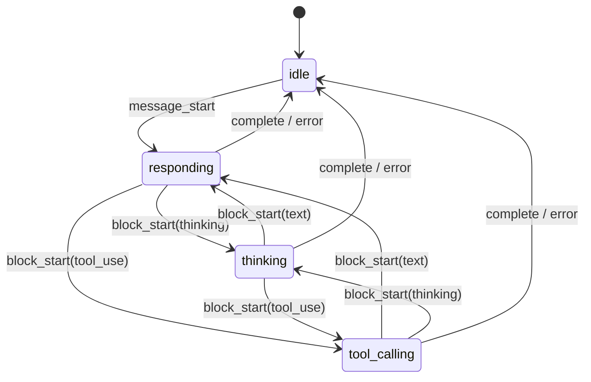

# 数据模型与状态

## 核心实体

本功能不引入持久化实体——所有状态都是瞬态（内存 / WS 帧 / React state）。

### StreamStatusFrame（WS 帧）

```python
# 后端产出（NormalizedMessage dict）
{
    "id": "uuid-v4",
    "sessionId": "session-xxx",
    "timestamp": "2026-05-06T12:00:00Z",
    "provider": "claude",
    "kind": "stream_status",
    "phase": "thinking" | "responding" | "tool_calling",
    "blockIndex": 0,           # content_block_start 时有值
    "toolName": "read_file",   # phase=tool_calling 时有值
    "model": "claude-sonnet-4-5",  # message_start 时有值
}
```

### StreamDeltaFrame 扩展

```python
# 已有字段 + 新增 deltaType
{
    "id": "uuid-v4",
    "sessionId": "session-xxx",
    "timestamp": "2026-05-06T12:00:00Z",
    "provider": "claude",
    "kind": "stream_delta",
    "content": "你好",
    "deltaType": "text",       # 新增：text | thinking | input_json
}
```

## 状态流转

前端 `streamPhase` 的生命周期：

```
idle
  │ 用户发送消息
  ▼
responding          ← message_start 到达
  │
  ├─ content_block_start(thinking) ──→ thinking
  │                                      │ content_block_start(text) ──→ responding
  │                                      │ content_block_stop ──→ (等下一个 block)
  │
  ├─ content_block_start(text) ──→ responding（保持不变）
  │
  ├─ content_block_start(tool_use) ──→ tool_calling
  │                                      │ content_block_stop ──→ (等下一个 block)
  │
  ▼
idle               ← complete / turn.end / error 到达
```



## Normalizer 事件映射表

| SDK StreamEvent | `event.type` | 当前行为 | 新行为 |
|-----------------|--------------|---------|--------|
| `message_start` | `message_start` | 丢弃 | → `stream_status(phase="responding", model=...)` |
| `content_block_start` | `content_block_start` | 丢弃 | → `stream_status(phase=映射, blockIndex=..., toolName?=...)` |
| `content_block_delta(text)` | `content_block_delta` | → `stream_delta` | → `stream_delta` + `deltaType="text"` |
| `content_block_delta(thinking)` | `content_block_delta` | → `stream_delta` | → `stream_delta` + `deltaType="thinking"` |
| `content_block_delta(input_json)` | `content_block_delta` | 丢弃 | → `stream_delta` + `deltaType="input_json"` |
| `content_block_stop` | `content_block_stop` | → `stream_end` | → `stream_end`（不变） |
| `message_delta` | `message_delta` | 丢弃 | 继续丢弃（仅含 stop_reason） |
| `message_stop` | `message_stop` | 丢弃 | 继续丢弃（`ResultMessage` 已覆盖） |

### content_block_start.type → phase 映射

| `content_block.type` | `phase` |
|---------------------|---------|
| `"thinking"` / `"redacted_thinking"` | `"thinking"` |
| `"text"` | `"responding"` |
| `"tool_use"` / `"server_tool_use"` / `"mcp_tool_use"` | `"tool_calling"` |

## 持久化方案

无持久化需求——所有数据均为瞬态 WS 帧 + React 内存状态。

## 共享数据结构

```python
# src/web/app_support/llm_protocol.py 新增
StreamPhase = Literal["responding", "thinking", "tool_calling"]
DeltaType = Literal["text", "thinking", "input_json"]
```

```typescript
// web/src/ 前端对应
type StreamPhase = "responding" | "thinking" | "tool_calling"
type DeltaType = "text" | "thinking" | "input_json"
```
