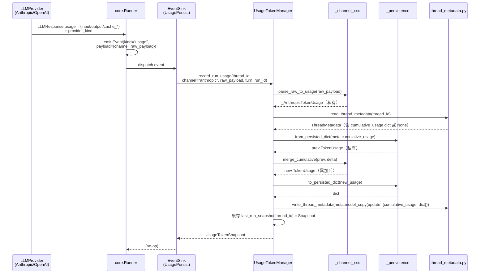
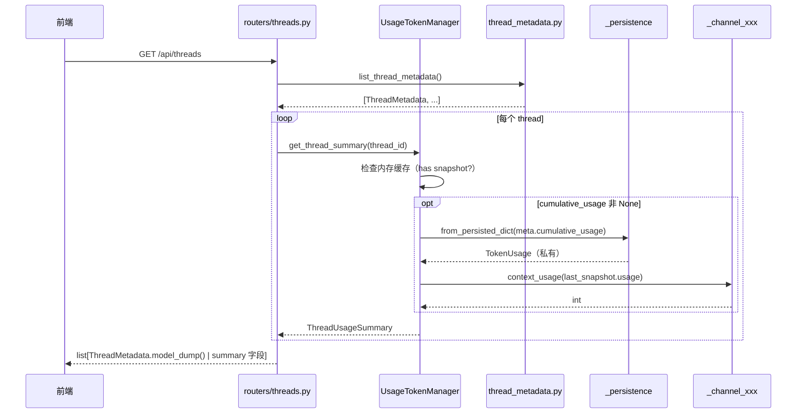
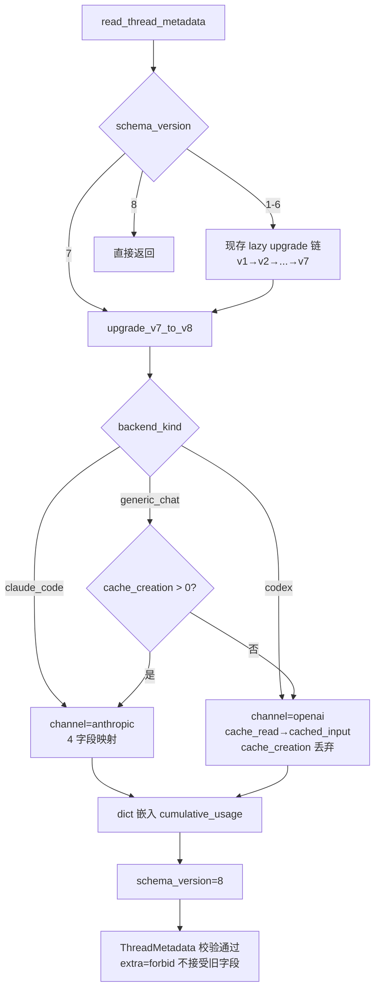
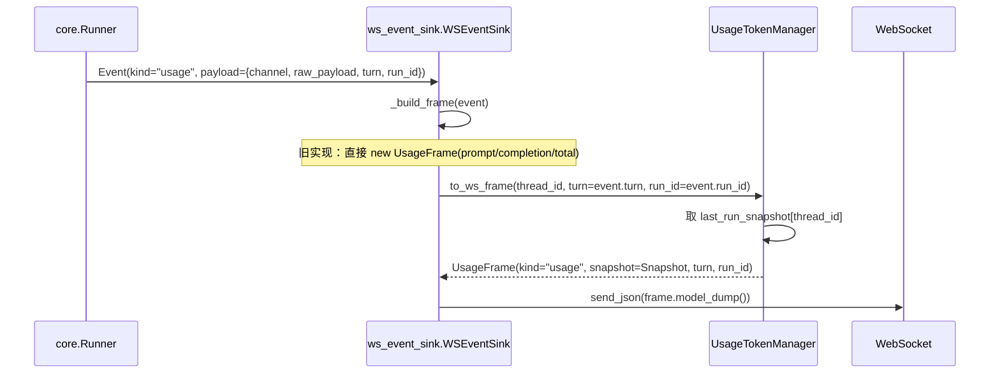
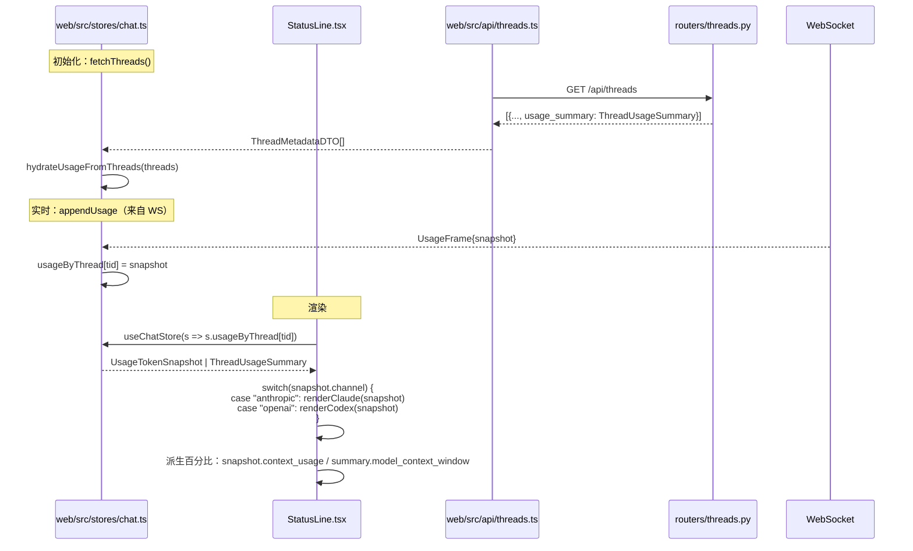

# 核心流程

5 条主链路。所有跨模块交互都经过 `UsageTokenManager`。

## 流程 1：写盘（record_run_usage）

一轮 LLM 调用结束后写入 ThreadMetadata.cumulative_usage。

**关键点**：
- LLMProvider 在 LLMResponse.usage **直接放 SDK 原生字段 + provider_kind**（不再 lossy 归一化）
- runner emit usage event payload 含 `channel` 标识（由 provider_kind 映射：`anthropic` → `anthropic`，`openai_compatible` → `openai`）
- EventSink（重命名后的 UsagePersistSink）唯一职责是调 `manager.record_run_usage`
- manager 内部：parse → 读 prev → merge → 落盘 → 缓存 snapshot

## 流程 2：读取（get_thread_summary）

REST `GET /api/threads` 返 ThreadMetadataDTO 时调。

**关键点**：
- router 不再做 token 字段映射；直接调 `manager.get_thread_summary`
- claude_code 通道**不再调 `parse_transcript_usage` 临时算**（数据已在 ThreadMetadata.cumulative_usage）
- generic_chat / claude_code / codex **统一路径**

## 流程 3：v7→v8 lazy upgrade

读盘时遇到 schema_version=7 自动升级。

**注意**：
- `_migration.upgrade_v7_to_v8` 是纯函数（输入 v7 dict 输出 v8 dict）
- 集成在 `thread_metadata.read_thread_metadata` 现存懒升级链末尾
- 幂等：v8 不再升级
- 旧字段必须 `pop`（不能 setdefault）——否则 `extra="forbid"` 会拒

## 流程 4：WS emit (to_ws_frame)

每轮结束 ws_event_sink 推 UsageFrame。

**关键点**：
- ws_event_sink **不再直接 import / new UsageFrame**；通过 manager 拿
- `record_run_usage` 必须**先于** `to_ws_frame` 调用（保证 last_run_snapshot 已缓存）
- 实际顺序：runner emit `usage` event → 同一个 EventSink 列表里 UsagePersistSink 先跑（写盘 + 缓存 snapshot），然后 WSEventSink 跑（emit UsageFrame）

## 流程 5：前端消费

**关键点**：
- 前端不再有 `cumulativePrompt / cumulativeTotal` 累加逻辑
- `UsageSnapshot` 独立 TS shape 删除；直接持 codegen 产出的 `UsageTokenSnapshot` / `ThreadUsageSummary`
- StatusLine **按 channel 分支**显示，所有数字前缀中文
- `tokenBudget` per-message 路径完全删除；ClaudeCodeView / CodexView 也改消费 UsageFrame

## 调用顺序约束（task 实施时严守）

`record_run_usage` 必须在每轮真实结束**当下**调用（保证 ws_event_sink 拿到的 snapshot 是最新的）。三通道的接入点：

| 通道 | 接入点 | 调用 |
|---|---|---|
| `generic_chat` | `core.Runner` emit `usage` event → `UsagePersistSink` | `manager.record_run_usage(channel=<由 provider_kind 决定>, raw_payload=...)` |
| `claude_code` | `web/claude_code/ws_handler.py` 每轮 message.usage 解析后 | `manager.record_run_usage(channel="anthropic", raw_payload=...)` |
| `codex` | `web/codex/ws_handler.py`（或对应位置）每轮 usage 解析后 | `manager.record_run_usage(channel="openai", raw_payload=...)` |

3 个通道接入点的同步是 task#3 的核心改造。
