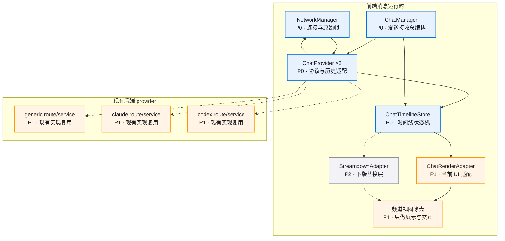

# 模块拆分

## 模块总览

| 模块 | 职责 | 依赖 | 状态 | 备注 |
|------|------|------|------|------|
| `NetworkManager` | 连接、重连、心跳、原始帧收发 | 现有 `web/src/network/manager.ts` | 开发中 | 当前主要服务 Claude，需要继续承接 Generic 与 Codex |
| `ChatManager` | 发送、接收、历史加载、首发创建编排、provider 分发 | `NetworkManager` + `ChatProvider` + 线程 store | 方案确认 | 新增公共入口 |
| `ChatTimelineStore` | turn 合并、tool 聚合、流式 buffer、历史排序 | `ChatManager` 产出的 `ChatEvent` | 方案确认 | 新增公共状态机 |
| `ChatRenderAdapter` | 把时间线状态投影为当前 UI 需要的数据 | `ChatTimelineStore` | 方案确认 | 下一版可替换为 `StreamdownAdapter` |
| `ChatProvider` | provider wire 协议、历史接口、入站帧翻译 | 现有各频道脚本 | 方案确认 | Claude / Codex / Generic 各一份实现 |
| 频道视图薄壳 | 展示、交互、组合 store | `ChatRenderAdapter` + `ChatManager` | 方案确认 | `ClaudeCodeView` / `CodexView` / Generic View 只保留 UI 职责 |

## 现状脚本 → 目标归属

| 现状脚本 | 当前职责 | 目标归属 |
|------|------|------|
| `web/src/network/manager.ts` | Claude 连接管理 | 继续作为公共 `NetworkManager` |
| `web/src/lib/ws.ts` | Generic 原始 socket | 收编进 `NetworkManager` + `GenericChatProvider` |
| `web/src/lib/codex-ws.ts` | Codex 原始 socket | 收编进 `NetworkManager` + `CodexChatProvider` |
| `web/src/hooks/useClaudeCodeWS.ts` | Claude 发送接收编排 | 变成 `ChatManager` 的轻量 hook 包装 |
| `web/src/hooks/useCodexWS.ts` | Codex 发送接收编排 | 变成 `ChatManager` 的轻量 hook 包装 |
| `web/src/hooks/useWS.ts` | Generic 发送接收编排 | 变成 `ChatManager` 的轻量 hook 包装 |
| `web/src/components/ClaudeCodeView.tsx` | Claude 视图 + 业务逻辑 | 只保留 UI 展示和交互绑定 |
| `web/src/components/CodexView.tsx` | Codex 视图 + 业务逻辑 | 只保留 UI 展示和交互绑定 |
| `src/web/integrations/claude_code/jsonl_history.py` | Claude 历史解析 | 继续保留 provider 后端实现 |
| `src/web/integrations/codex/jsonl_history.py` | Codex 历史解析 | 继续保留 provider 后端实现 |

## 模块详情

### 模块 1：`NetworkManager`

**职责**：统一管理连接生命周期、原始帧发送与订阅、重连与心跳。

**包含范围**：
- `connect` / `disconnect` / `reconnect`
- channel 级 socket 句柄管理
- 原始入站帧分发给上层
- 心跳和连接状态聚合

**不包含范围**：
- 聊天消息语义
- 历史加载
- turn/tool 合并
- UI item 组装

**依赖**：浏览器 `WebSocket`、现有 `web/src/network/heartbeat.ts`

**复用/新建**：复用已有 `web/src/network/manager.ts`，继续扩容为多频道公共层

**数据结构/接口**：

```typescript
export interface RawFrameEnvelope {
  // 连接唯一标识，便于多频道并发连接区分
  connectionId: string;
  // 频道类型，便于上层按 provider 路由
  channel: "generic" | "claude" | "codex";
  // 原始帧载荷，NetworkManager 不解释业务语义
  frame: unknown;
  // 浏览器收到该帧的毫秒时间戳；后续事件模型继续沿用 number。
  receivedAt: number;
}

export interface NetworkHandle {
  // 当前连接 id，对应内部 socket 池主键
  connectionId: string;
  // 发送原始帧，业务层自行决定帧结构
  send(frame: unknown): void;
  // 主动关闭连接
  close(): void;
}
```

**风险等级**：中
**风险说明**：Codex 和 Generic 仍有独立 socket 实现，接入顺序要避免影响现有稳定连接。

**task 建议**：
- 建议 task 名：`network-manager-multi-channel`
- 对应 DoD：`ChatManager` 统一对外能力
- 是否进入 x-req：否
- 原因：已有 `web-network-layer-v0.1` 文档，应作为后续并行输入条件

### 模块 2：`ChatManager`

**职责**：对外统一暴露发送、接收、历史加载、首发创建、打断和状态查询能力。

**包含范围**：
- `sendMessage`
- `loadHistory`
- `interrupt`
- `checkSessionStatus`
- `ingestFrame`
- pending 新会话在首次发送时创建 thread
- 把 `common + provider` 输入交给 provider 层翻译

**不包含范围**：
- 底层 socket 生命周期
- 消息时间线排序细节
- 具体 UI 渲染

**依赖**：`NetworkManager`、线程 store、`ChatProvider`、`ChatTimelineStore`

**复用/新建**：全新开发

**数据结构/接口**：

```typescript
export interface ChatManagerApi {
  // 发送一条用户消息，内部负责首次创建和 provider 分发
  sendMessage(request: SendRequest): Promise<void>;
  // 加载当前 thread 的历史消息
  loadHistory(request: HistoryLoadRequest): Promise<void>;
  // 把 NetworkManager 收到的原始帧灌入聊天状态机
  ingestFrame(envelope: RawFrameEnvelope): void;
  // 打断当前会话执行
  interrupt(request: InterruptRequest): Promise<void>;
  // 查询 provider 会话状态。Generic 固定返回“无 provider session”的稳定结果，
  // Claude / Codex 返回真实 session 活跃态。
  checkSessionStatus(request: SessionStatusRequest): Promise<SessionStatus>;
}
```

**风险等级**：高
**风险说明**：首发创建、重连恢复、历史与实时并行合并都集中在这一层，适合先做 PoC。

**三频道能力对照**：

| provider | `interrupt` | `checkSessionStatus` |
|----------|-------------|----------------------|
| `generic` | 复用现有 thread WS `{"frame_type":"interrupt"}` | 固定返回 `{ active: false, message: "generic channel has no provider session" }` |
| `claude` | 复用现有 `abort-session` / SDK interrupt 链路 | 返回 Claude session 活跃态 |
| `codex` | 复用现有 `abort-session` 链路 | 返回 Codex session 活跃态 |

**task 建议**：
- 建议 task 名：`chat-manager-runtime`
- 对应 DoD：`ChatManager` 统一对外能力、创建时机与现有协议兼容
- 是否进入 x-req：是
- 原因：输入输出边界已经稳定

### 模块 3：`ChatTimelineStore`

**职责**：统一维护消息时间线状态机。

**包含范围**：
- user / assistant / tool / status 事件归并
- 流式文本 buffer
- turn 级状态与排序
- 历史消息与实时消息去重合并

**不包含范围**：
- provider wire frame 解析
- UI 展示结构

**依赖**：`ChatEvent`

**复用/新建**：全新开发

**数据结构/接口**：

```typescript
export interface ChatTimelineStore {
  // 历史批量灌入
  applyHistory(batch: ChatHistoryBatch): void;
  // 实时事件灌入
  applyEvent(event: ChatEvent): void;
  // 读取当前稳定时间线
  snapshot(): ChatTimelineState;
  // 清理指定 thread 的临时流式状态
  resetThread(threadId: string): void;
}
```

**风险等级**：中
**风险说明**：一旦事件模型定义清楚，状态机实现风险可控。

**task 建议**：
- 建议 task 名：`chat-timeline-store`
- 对应 DoD：历史与流式统一时间线
- 是否进入 x-req：是
- 原因：依赖项明确

### 模块 4：`ChatRenderAdapter`

**职责**：把 `ChatTimelineState` 映射成当前 React 视图可消费的数据。

**包含范围**：
- 时间线到 UI item 的投影
- delta 文本、tool 输出、状态条目的渲染预处理
- 当前 UI 组件要求的字段适配

**不包含范围**：
- `markdown` / `Streamdown` 具体渲染实现
- 底层状态机

**依赖**：`ChatTimelineStore`

**复用/新建**：全新开发

**数据结构/接口**：

```typescript
export interface ChatRenderAdapter {
  // 把通用时间线状态转为当前页面所需的 UI 数据
  toViewModel(state: ChatTimelineState): ChatViewModel;
}

export interface ChatViewModel {
  // 页面顺序展示的消息与状态项
  items: ChatViewItem[];
  // 当前是否仍处于流式输出阶段
  isStreaming: boolean;
  // 是否已经加载完历史
  historyLoaded: boolean;
}
```

**风险等级**：低
**风险说明**：这一层是纯投影，适合为下版 `Streamdown` 预留接口。

**task 建议**：
- 建议 task 名：`chat-render-adapter`
- 对应 DoD：视图只消费 adapter 输出
- 是否进入 x-req：是
- 原因：边界清晰，依赖稳定

### 模块 5：`ChatProvider`

**职责**：保留 provider 独有协议和历史接口，把差异封装在频道侧。

**包含范围**：
- 发送帧构造
- 历史加载接口
- 入站原始帧到 `ChatEvent` 的翻译
- provider 独有命令，例如 session status、interrupt

**不包含范围**：
- 公共输入结构定义
- 时间线合并
- 页面渲染

**依赖**：各频道现有前后端协议

**复用/新建**：新增公共接口，分别落 `ClaudeChatProvider`、`CodexChatProvider`、`GenericChatProvider`

**数据结构/接口**：

```typescript
export interface ChatProvider {
  // 当前 provider 标识
  readonly provider: "generic" | "claude" | "codex";
  // 把公共发送请求翻译为 provider 自己的 wire 协议
  send(handle: NetworkHandle, request: SendRequest): Promise<void>;
  // 加载 provider 历史
  loadHistory(request: HistoryLoadRequest): Promise<ChatHistoryBatch>;
  // 处理原始入站帧，翻译为通用事件列表
  mapInboundFrame(envelope: RawFrameEnvelope): ChatEvent[];
  // 打断当前 provider 会话
  interrupt(request: InterruptRequest): Promise<void>;
  // 查询 provider session 状态。Generic 也实现该方法，但返回固定的“无 session”结果。
  checkSessionStatus(
    request: SessionStatusRequest,
  ): Promise<SessionStatus>;
}
```

**风险等级**：中
**风险说明**：Codex 与 Claude 协议差异大，首轮需要靠 contract test 固定行为。

**task 建议**：
- 建议 task 名：`chat-provider-contract`
- 对应 DoD：`common + provider` 发送结构稳定、`ChatManager` 统一对外能力
- 是否进入 x-req：是
- 原因：对外接口已经清楚

## 目标脚本清单

### 新建

- `web/src/chat/types.ts`
- `web/src/chat/ChatManager.ts`
- `web/src/chat/ChatTimelineStore.ts`
- `web/src/chat/ChatRenderAdapter.ts`
- `web/src/chat/providers/ClaudeChatProvider.ts`
- `web/src/chat/providers/CodexChatProvider.ts`
- `web/src/chat/providers/GenericChatProvider.ts`

### 薄化现有脚本

- `web/src/components/ClaudeCodeView.tsx`
- `web/src/components/CodexView.tsx`
- `web/src/hooks/useClaudeCodeWS.ts`
- `web/src/hooks/useCodexWS.ts`
- `web/src/hooks/useWS.ts`

## 依赖图


