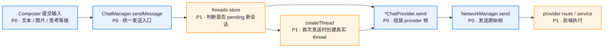
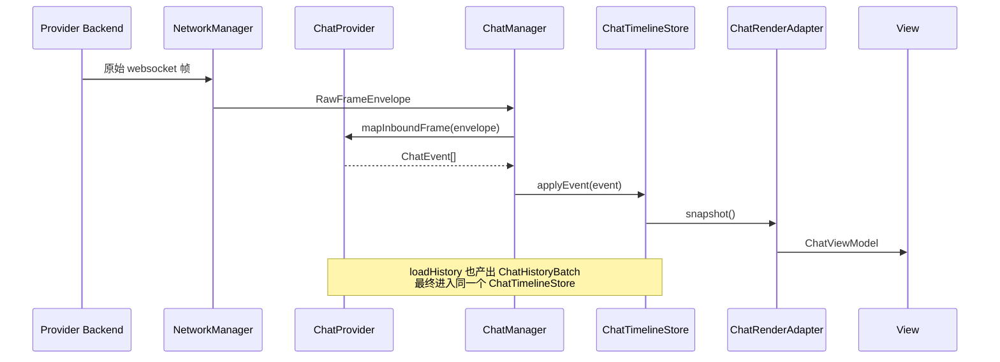
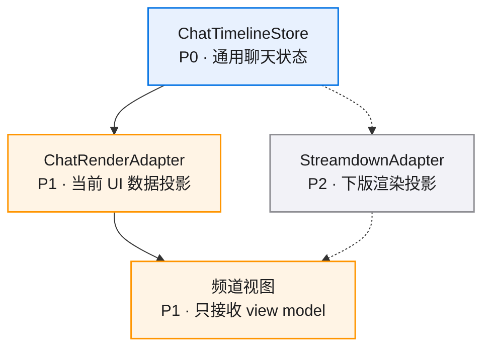

# 核心流程

## 流程 1：首发发送与后续发送共用同一入口

这个流程把“新建会话按钮进入 pending”和“首条消息发送时创建真实 thread”收口到 `ChatManager`。视图层不再自己判断创建时机，provider 层也不再感知前端 pending 状态。

## 流程 2：实时接收与历史回放走统一事件模型

这个流程固定了一个核心原则：历史和实时都变成 `ChatEvent` 或 `ChatHistoryBatch` 后再进入状态机。provider 负责翻译差异，`ChatTimelineStore` 负责语义聚合。

## 流程 3：下版切换 Streamdown 的替换边界

当前版本的重点是把替换面做干净。`Streamdown` 接入时，核心改动集中在 adapter 与视图组件，发送、接收、历史合并和状态机保持稳定。
