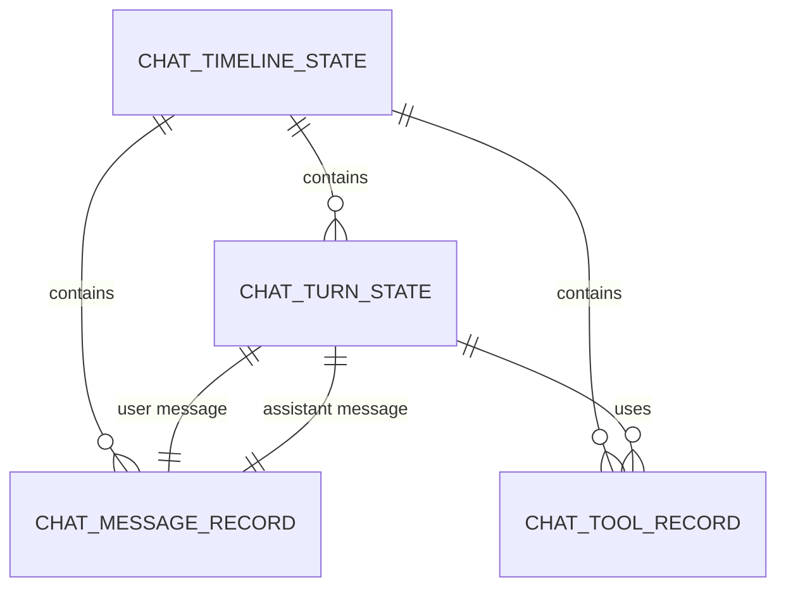
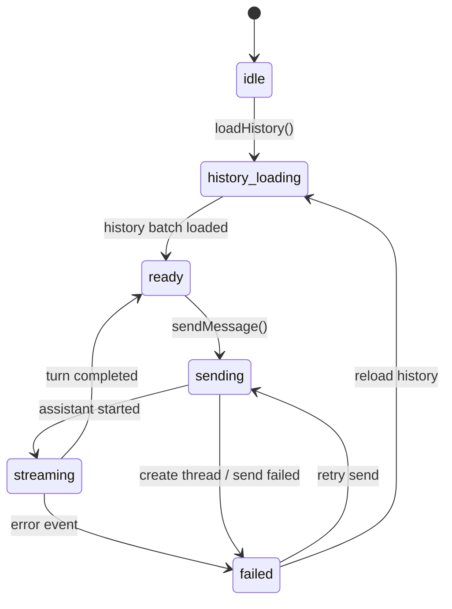

# 数据模型与状态

## 核心实体

下面的数据结构按“公用输入 + provider 扩展 + 通用事件 + 通用时间线”四层定义，字段都保留中文说明，方便后续实现时直接落类型文件。

```typescript
export type ChatProviderKind = "generic" | "claude" | "codex";

import type { UserInputAttachment } from "@/protocol";
import type { ReasoningEffort as ComposerReasoningEffort } from "@/components/Composer";

// 复用现有定义。后续如果抽到 `web/src/chat/types.ts`，应迁移既有定义并由
// `Composer` / `ChatManager` / provider 共同 import，而不是新增第二份字面量 union。
export type ReasoningEffort = ComposerReasoningEffort;

export interface CommonSendInput {
  // 用户输入的主文本
  text: string;
  // 用户附带的已上传附件，直接复用现有协议真源。
  // 本地上传临时态如 `localPath` / `File` / 进度条等属于 UI-only 数据，
  // 需要时另起 `DraftAttachment` 之类的名字，不占用 `UserInputAttachment`。
  attachments?: UserInputAttachment[];
  // 思考等级，属于跨频道公共能力
  reasoningEffort?: ReasoningEffort | null;
  // 当前工作目录，便于 provider 侧执行或 resume
  cwd?: string | null;
  // 预留的扩展元数据，例如来源端、实验开关
  metadata?: Record<string, unknown> | null;
}

export interface ClaudeSendOptions {
  // provider 固定值，便于联合类型分发
  provider: "claude";
  // 所属线程 id
  threadId: string;
  // 已存在的 claude session id，resume 时携带
  sessionId?: string | null;
  // 是否请求 resume 现有会话
  resume?: boolean;
  // 可选模型名，当前先保留扩展位
  model?: string | null;
}

export interface CodexSendOptions {
  // provider 固定值
  provider: "codex";
  // 所属线程 id
  threadId: string;
  // 已存在的 codex session id，resume 时携带
  sessionId?: string | null;
  // 是否 resume
  resume?: boolean;
  // 权限模式，映射 codex 的审批策略
  permissionMode?: "default" | "acceptEdits" | "bypassPermissions";
  // 可选模型名
  model?: string | null;
}

export interface GenericSendOptions {
  // provider 固定值
  provider: "generic";
  // 所属线程 id
  threadId: string;
}

export type ProviderSendOptions =
  | ClaudeSendOptions
  | CodexSendOptions
  | GenericSendOptions;

export interface SendRequest {
  // 公共输入层，所有频道共享
  common: CommonSendInput;
  // provider 独有配置层，按联合类型分发
  provider: ProviderSendOptions;
}

export interface HistoryLoadRequest {
  // 当前线程 id
  threadId: string;
  // 频道类型
  provider: ChatProviderKind;
  // 是否包含工具类消息
  includeTools?: boolean;
  // 历史条数上限
  maxMessages?: number;
}

export interface InterruptRequest {
  // 当前线程 id
  threadId: string;
  // 频道类型
  provider: ChatProviderKind;
  // provider 的 session id，存在时更精准
  sessionId?: string | null;
}

export interface SessionStatusRequest {
  // 当前线程 id
  threadId: string;
  // 频道类型
  provider: ChatProviderKind;
}

export interface SessionStatus {
  // provider 当前是否有活跃会话
  active: boolean;
  // provider 返回的真实 session id
  sessionId?: string | null;
  // 给界面展示的补充说明
  message?: string | null;
}

export type ChatEventKind =
  | "history_batch_loaded"
  | "user_message"
  | "assistant_message_started"
  | "assistant_message_delta"
  | "assistant_message_completed"
  | "tool_call_started"
  | "tool_call_delta"
  | "tool_call_completed"
  | "status"
  | "error"
  | "turn_completed";

export interface ChatEvent {
  // 通用事件类型
  kind: ChatEventKind;
  // 来源 provider
  provider: ChatProviderKind;
  // 当前线程 id
  threadId: string;
  // 当前 turn id，用于把同一轮 user / assistant / tool 归并
  turnId: string;
  // 当前消息 id，文本和状态消息都可用
  messageId?: string;
  // 当前工具调用 id，仅工具事件使用
  toolCallId?: string;
  // 事件创建时间，统一用毫秒时间戳。
  // `RawFrameEnvelope.receivedAt`、wire `timestamp_ms`、前端 store `timestampMs`
  // 都保持同一数值语义，中途不做 number -> string 转换。
  createdAt: number;
  // 事件正文，结构由 kind 决定
  payload: Record<string, unknown>;
}

export interface ChatHistoryBatch {
  // 历史所属线程
  threadId: string;
  // 历史来源 provider
  provider: ChatProviderKind;
  // 已按时间排好序的事件列表
  events: ChatEvent[];
  // 后端是否还有更多历史
  hasMore: boolean;
}

export type ChatMessageRole = "user" | "assistant" | "system" | "tool";

export interface ChatMessageRecord {
  // 时间线消息主键
  id: string;
  // 所属线程
  threadId: string;
  // 所属 turn
  turnId: string;
  // 消息角色
  role: ChatMessageRole;
  // provider 来源
  provider: ChatProviderKind;
  // 展示内容分片，允许文本、附件、工具摘要并存
  parts: ChatMessagePart[];
  // 当前消息状态，流式阶段会持续更新
  status: "pending" | "streaming" | "completed" | "failed";
  // 创建时间（ms）
  createdAt: number;
  // 最近更新时间（ms）
  updatedAt: number;
}

export type ChatMessagePart =
  | {
      // 文本片段
      type: "text";
      // 已归并的文本内容
      text: string;
    }
  | {
      // 附件片段
      type: "attachment";
      // 附件内容
      attachment: UserInputAttachment;
    }
  | {
      // 工具摘要片段
      type: "tool-summary";
      // 工具名称
      toolName: string;
      // 工具结果摘要
      summary: string;
    };

export interface ChatToolRecord {
  // 工具调用主键
  id: string;
  // 所属线程
  threadId: string;
  // 所属 turn
  turnId: string;
  // 工具名
  toolName: string;
  // 工具状态
  status: "running" | "completed" | "failed";
  // 已累计的输入文本
  inputText: string;
  // 已累计的输出文本
  outputText: string;
  // 开始时间（ms）
  startedAt: number;
  // 结束时间（ms）
  finishedAt?: number | null;
}

export interface ChatTurnState {
  // turn 主键
  id: string;
  // 所属线程
  threadId: string;
  // provider 来源
  provider: ChatProviderKind;
  // 当前轮次阶段
  phase: "ready" | "sending" | "streaming" | "completed" | "failed";
  // 用户消息 id
  userMessageId?: string | null;
  // 助手消息 id
  assistantMessageId?: string | null;
  // 工具调用顺序列表
  toolCallIds: string[];
}

export interface ChatTimelineState {
  // 当前线程 id
  threadId: string;
  // 是否已经完成历史首屏加载
  historyLoaded: boolean;
  // 时间线展示顺序
  orderedMessageIds: string[];
  // 消息字典
  messagesById: Record<string, ChatMessageRecord>;
  // 工具调用字典
  toolsById: Record<string, ChatToolRecord>;
  // turn 字典
  turnsById: Record<string, ChatTurnState>;
  // 当前是否有流式消息进行中
  activeStreamingTurnId?: string | null;
}
```

## 实体关系



`ChatTimelineState` 是前端运行时唯一事实源。`ChatProvider` 只生产事件，`ChatRenderAdapter` 只消费状态，避免 provider 直接操作 UI 数据。

## 状态流转



这个状态机覆盖首次进入页面、发送消息、收到流式输出、失败重试四个主场景。`pending` 新会话的真实 thread 创建属于 `sending` 阶段的前置动作。

## 持久化方案

| 数据 | 存储方式 | 位置 | 备注 |
|------|---------|------|------|
| 线程元数据 | 文件持久化 | `.kongming/web/threads/*/metadata.json` | 继续沿用现有 thread 管理 |
| provider 原始历史 | provider 自己维护 | Claude / Codex JSONL 等 | 前端通过 provider history 接口读取 |
| `ChatTimelineState` | 内存 | 浏览器运行时 | 刷新后可由历史批量重建 |
| 流式中间 buffer | 内存 | `ChatTimelineStore` | 只在当前页面会话期存在 |

## 共享数据结构

```typescript
export interface ChatViewItem {
  // 页面条目主键
  id: string;
  // 页面条目类型，当前视图与 Streamdown 都消费这个层级
  kind: "message" | "tool" | "status";
  // 展示角色
  role?: ChatMessageRole;
  // 展示文本
  text?: string;
  // 关联附件
  attachments?: UserInputAttachment[];
  // 工具状态
  toolStatus?: "running" | "completed" | "failed";
}

export interface ChatViewModel {
  // 最终渲染顺序
  items: ChatViewItem[];
  // 当前是否仍有流式消息
  isStreaming: boolean;
  // 历史是否已加载完成
  historyLoaded: boolean;
}
```

`ChatViewModel` 是当前版本的渲染边界。下一版如果改成 `Streamdown`，优先替换 `ChatRenderAdapter -> StreamdownAdapter` 这一层，`SendRequest`、`ChatEvent`、`ChatTimelineState` 都保持稳定。
