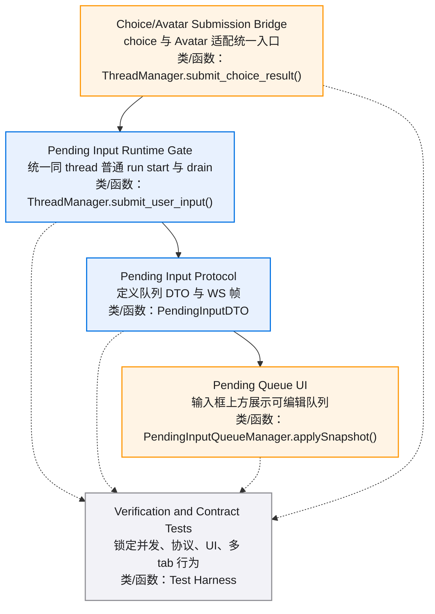
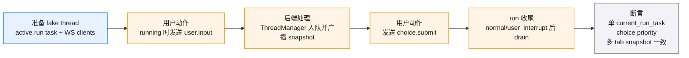
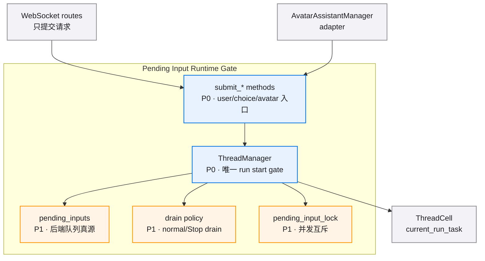
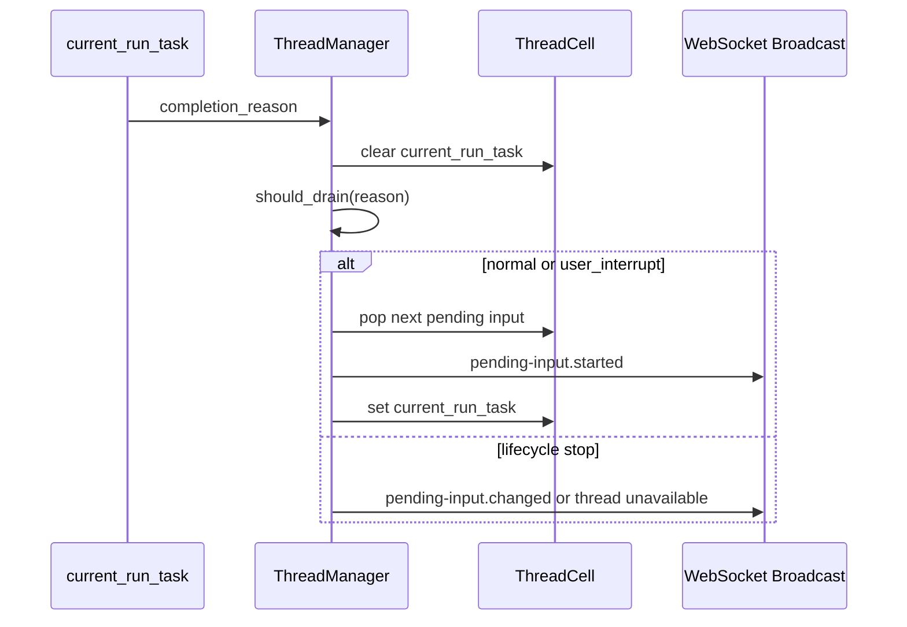
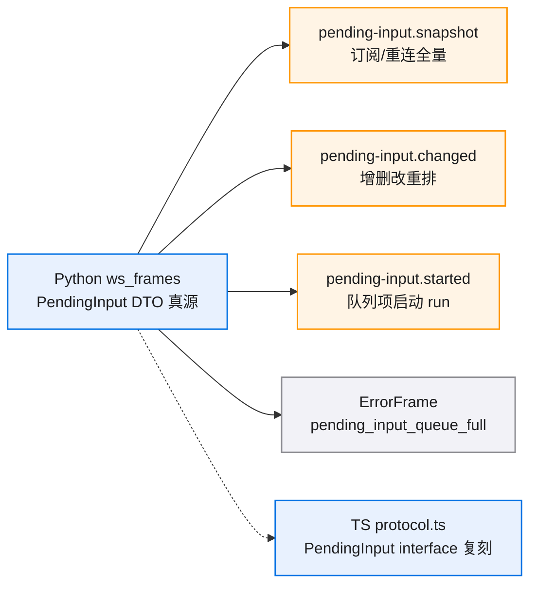
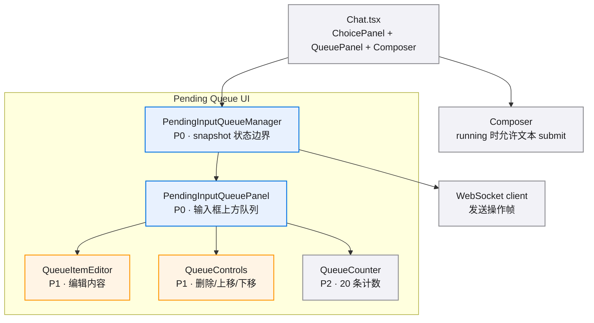
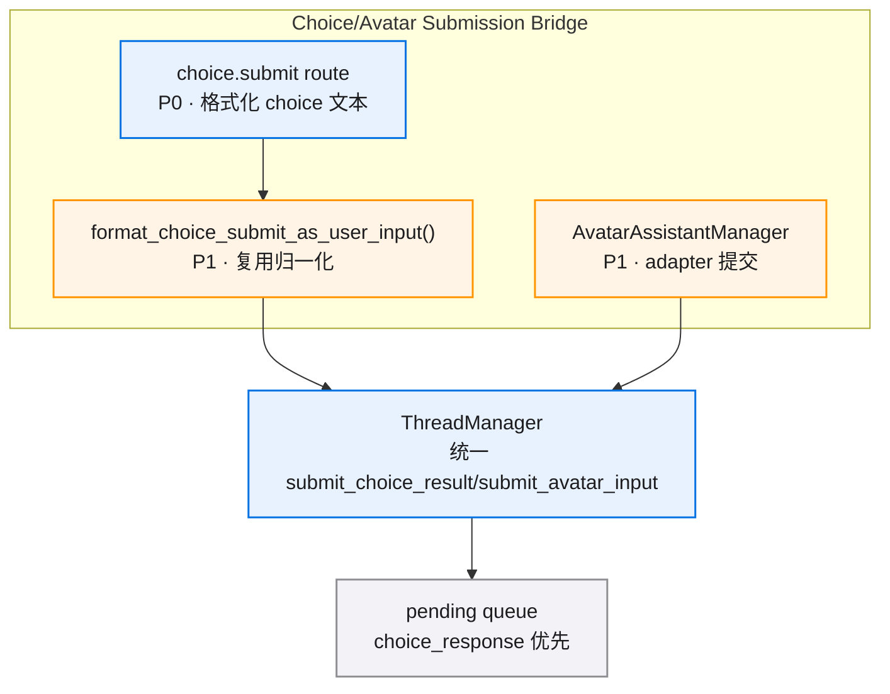
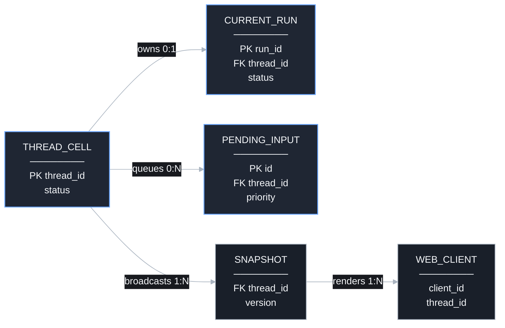
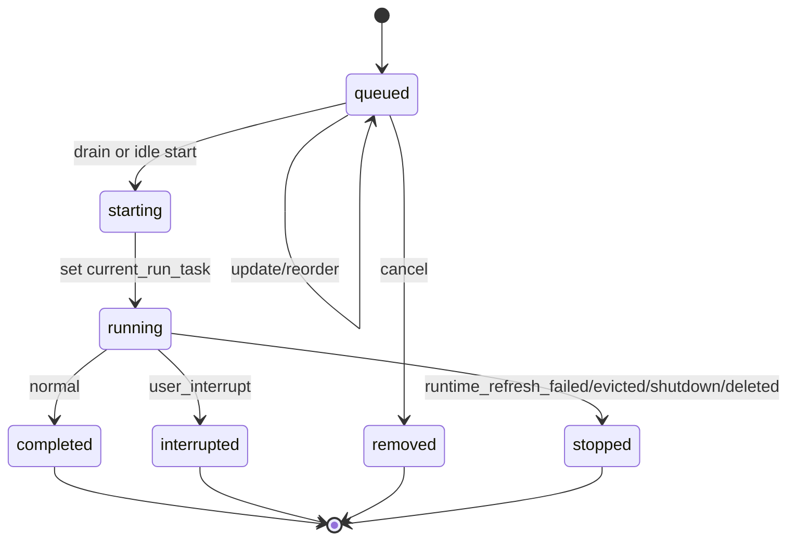
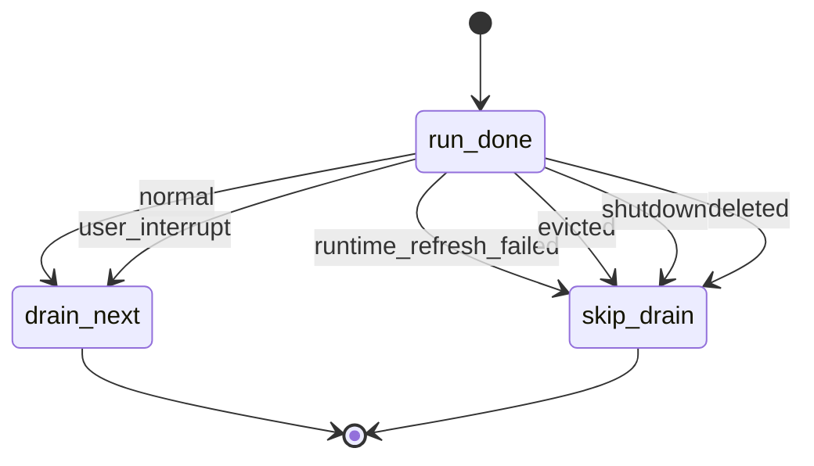

# pending-input-queue-v0.1 · 图集

> 本 spec 的唯一图源：所有 mermaid 图集中于此，按模块分节。02/03/04 是文字事实源，本文件是只读视图，增减模块或组件时同步更新对应节。
>
> **查看与缩放**：GitHub 渲染 mermaid 自带缩放/平移控件；VS Code 建议安装 Mermaid Chart（官方）或 Markdown Preview Enhanced 插件以支持缩放。

## 目录

- [总览](./diagrams.md#总览)
- [E2E 测试链路](./diagrams.md#e2e-测试链路)
- [Runtime Gate](./diagrams.md#runtime-gate)
- [Protocol](./diagrams.md#protocol)
- [Queue UI](./diagrams.md#queue-ui)
- [Choice/Avatar Bridge](./diagrams.md#choiceavatar-bridge)
- [数据关系/状态流转](./diagrams.md#数据关系状态流转)

## 总览

## E2E 测试链路

## Runtime Gate

### 组件依赖

### Run 完成后 drain

## Protocol

### Frame 流向

## Queue UI

### 组件依赖

## Choice/Avatar Bridge

## 数据关系/状态流转

### 数据关系

### 队列项状态

### Drain Policy

