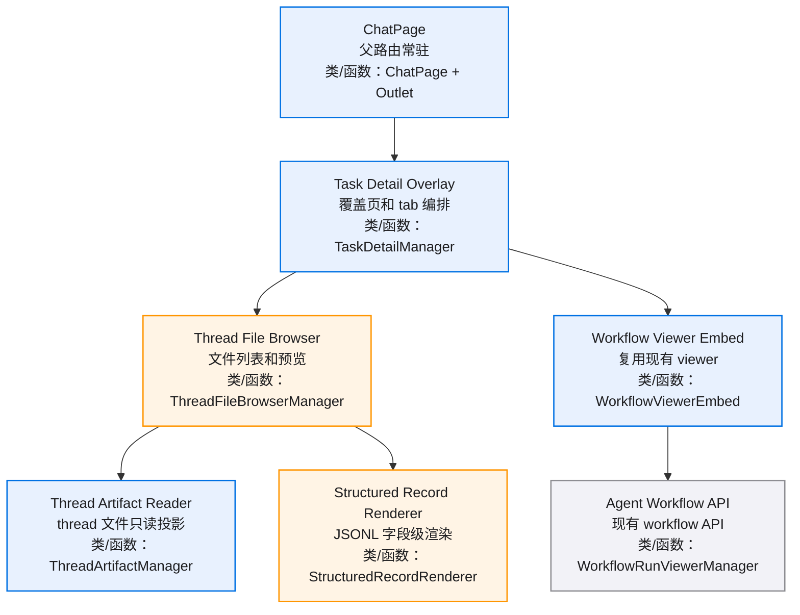
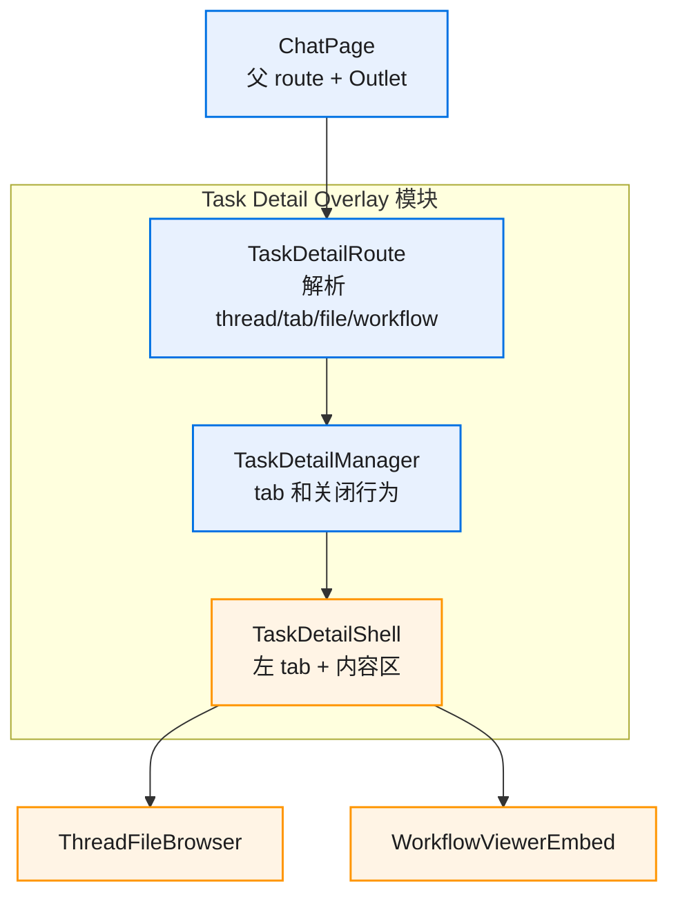
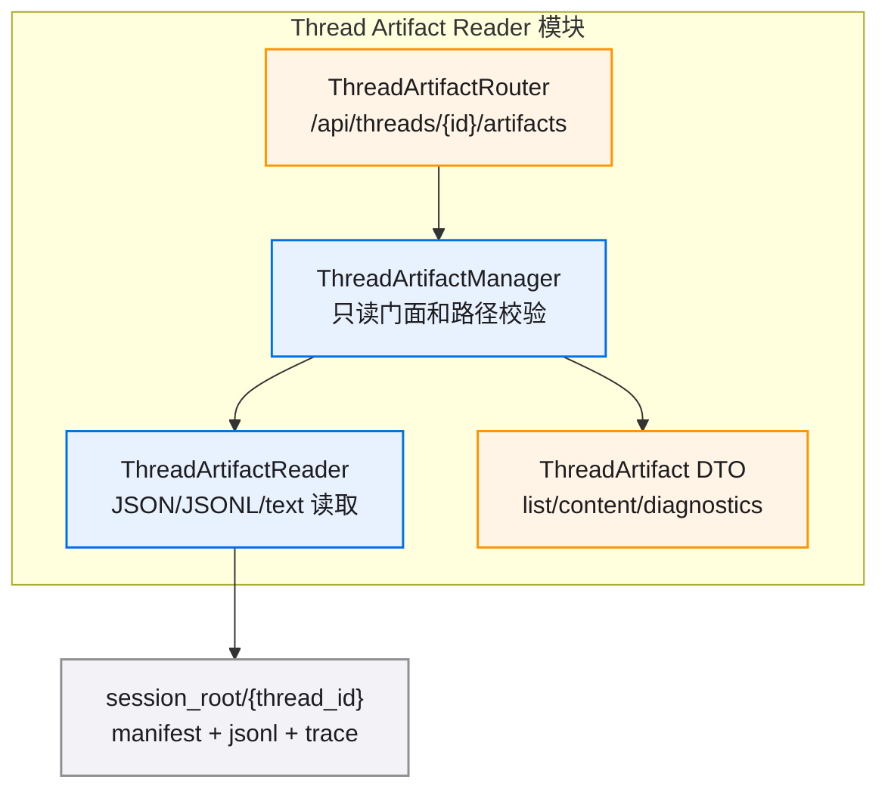
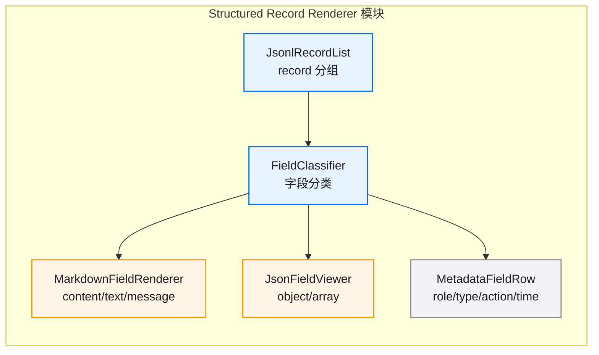
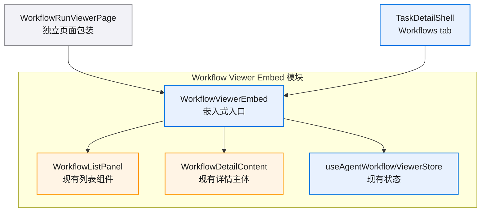

# Task Detail Overlay v0.1 图集

> 查看建议：GitHub / VS Code Mermaid 预览支持缩放。单图保持小节点数，细节分到模块节。

## 目录

- [总览](#总览)
- [E2E 测试链路](#e2e-测试链路)
- [Task Detail Overlay](#task-detail-overlay)
- [Thread Artifact Reader](#thread-artifact-reader)
- [Structured Record Renderer](#structured-record-renderer)
- [Workflow Viewer Embed](#workflow-viewer-embed)

## 总览

## E2E 测试链路

```mermaid
flowchart LR
  FIXTURE["准备 file session fixture<br/>manifest/jsonl/trace/workflow"]:::p1
  CHAT["打开 /chat/{threadId}<br/>ChatPage 已挂载"]:::p0
  OPEN["点击任务详情<br/>进入 child route"]:::p0
  FILE["选择 thread jsonl<br/>右侧字段级渲染"]:::p1
  WF["点击 Workflows<br/>复用 workflow viewer"]:::p0
  CLOSE["关闭覆盖页<br/>回到 Chat"]:::p1
  ASSERT["断言<br/>Chat DOM 保留 + 内容正确"]:::p0

  FIXTURE --> CHAT --> OPEN --> FILE --> WF --> CLOSE --> ASSERT

  classDef p0 fill:#E8F1FE,stroke:#0071E3,color:#1D1D1F,stroke-width:1.5px
  classDef p1 fill:#FFF4E5,stroke:#FF9500,color:#1D1D1F,stroke-width:1.5px
  classDef p2 fill:#F2F2F7,stroke:#8E8E93,color:#1D1D1F,stroke-width:1.5px
```

## Task Detail Overlay

## Thread Artifact Reader

## Structured Record Renderer

## Workflow Viewer Embed

