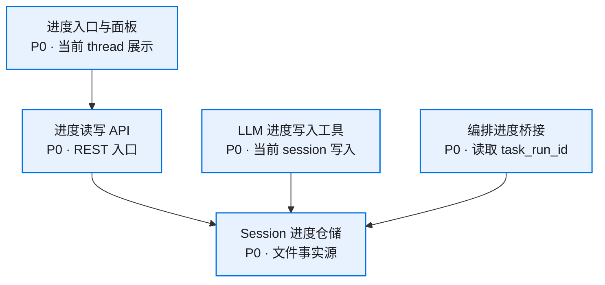
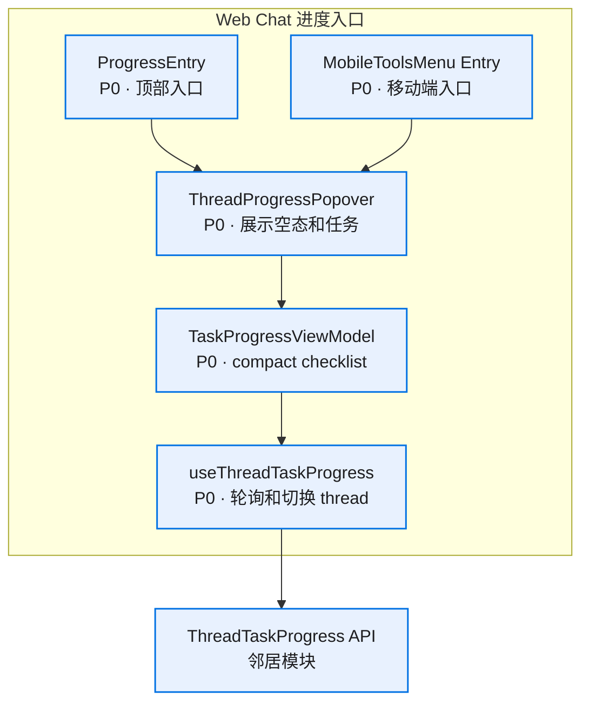
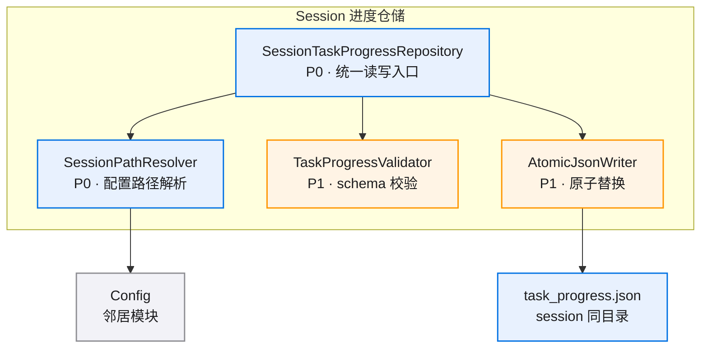
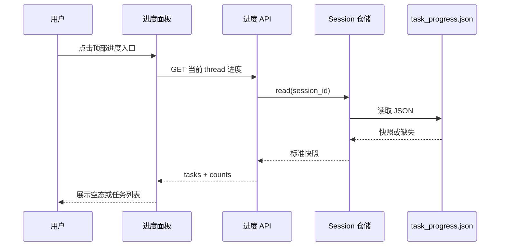
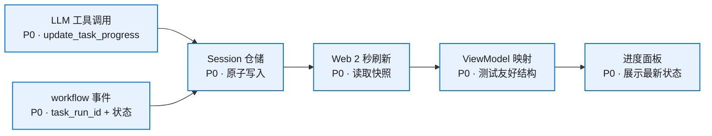
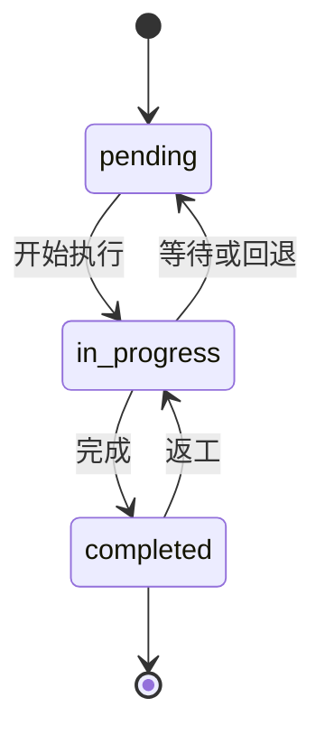

# thread-task-progress-v0.1 · 图集

> 本 spec 的唯一图源：所有 mermaid 图集中于此，按模块分节。02/03/04 是文字事实源，本文件是只读视图——增减模块/组件时同步更新对应节。
>
> **查看与缩放**：GitHub 渲染 mermaid 自带缩放/平移控件；VS Code 建议安装 Mermaid Chart（官方）或 Markdown Preview Enhanced 插件以支持缩放。

## 目录

- [总览](#总览)
- [Web Chat 进度入口](#web-chat-进度入口)
- [Session 进度仓储](#session-进度仓储)
- [核心流程](#核心流程)
- [状态流转](#状态流转)

图例：P0 核心/阻塞 · P1 主要/必须 · P2 辅助/可选

## 总览

## Web Chat 进度入口

### 组件依赖

## Session 进度仓储

### 组件依赖

## 核心流程

### 查看与刷新

### 写入与展示

## 状态流转

