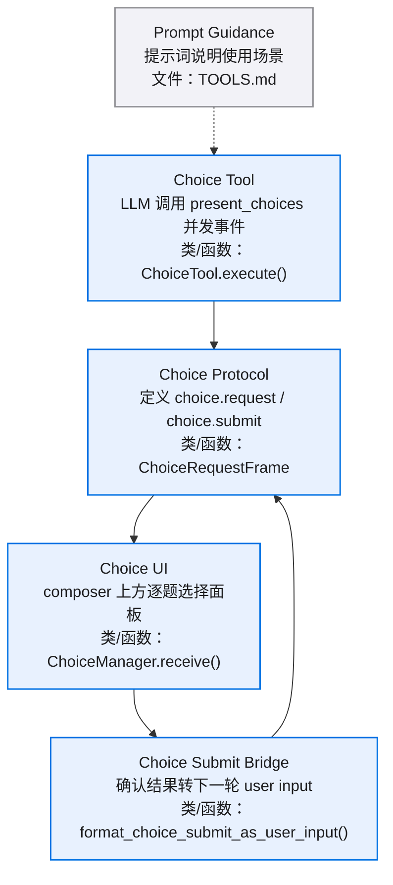
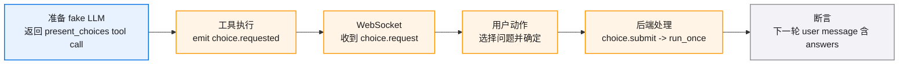
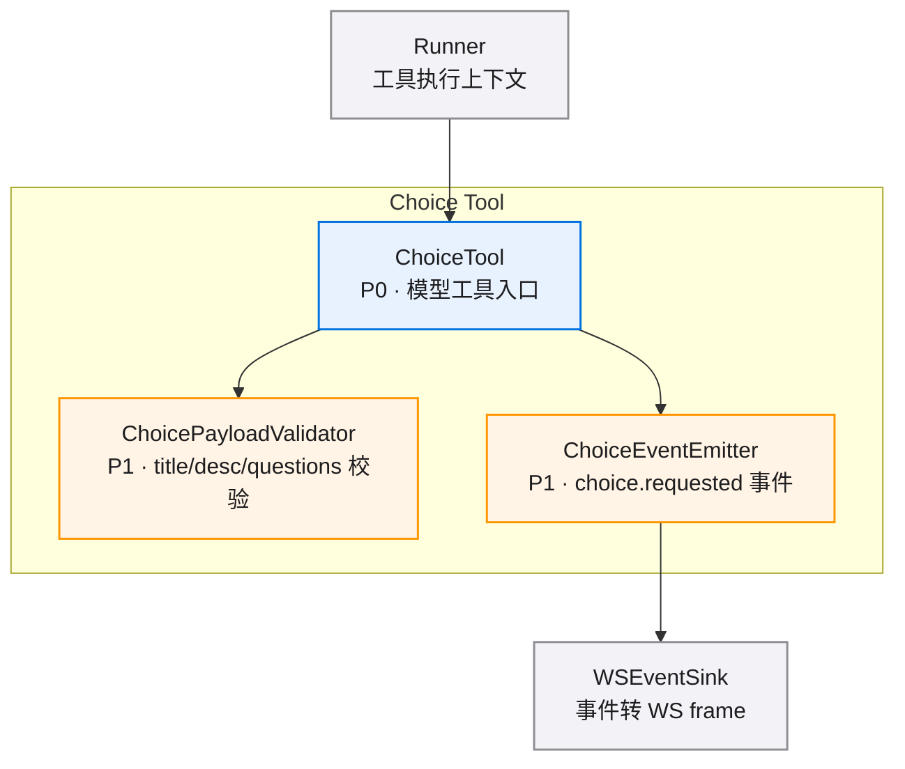
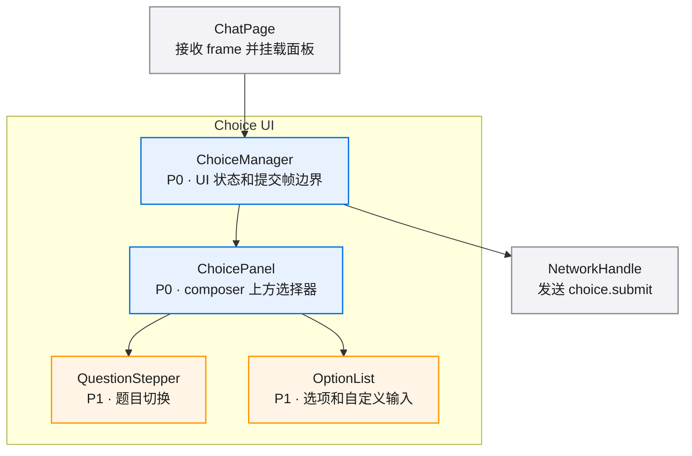
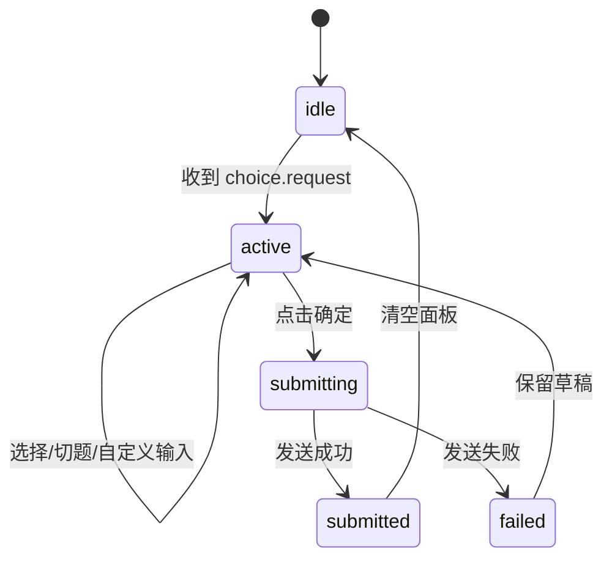
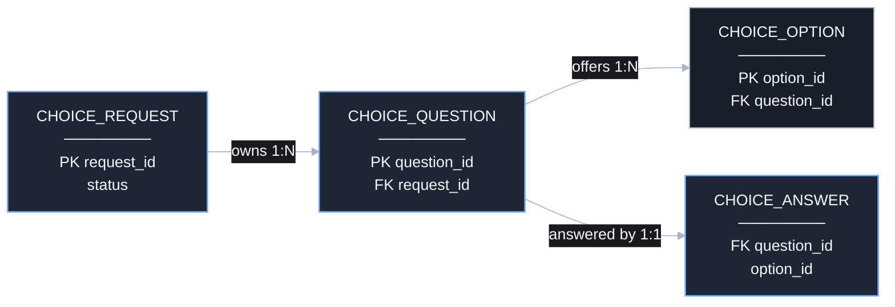
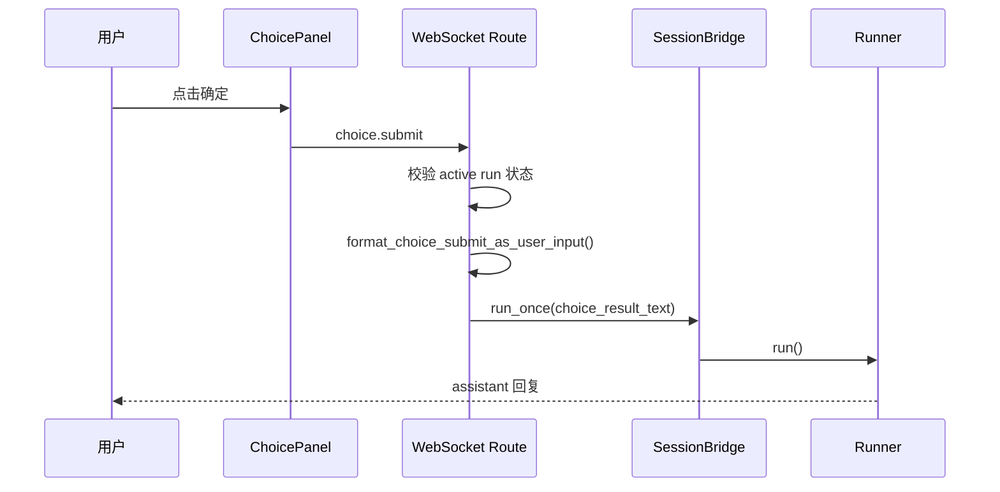

# user-choice-tool-v0.1 · 图集

> 本 spec 的唯一图源：所有 mermaid 图集中于此，按模块分节。02/03/04 是文字事实源，本文件是只读视图，增减模块或组件时同步更新对应节。
>
> **查看与缩放**：GitHub 渲染 mermaid 自带缩放/平移控件；VS Code 建议安装 Mermaid Chart（官方）或 Markdown Preview Enhanced 插件以支持缩放。

## 目录

- [总览](./diagrams.md#总览)
- [E2E 测试链路](./diagrams.md#e2e-测试链路)
- [Choice Tool](./diagrams.md#choice-tool)
- [Choice UI](./diagrams.md#choice-ui)
- [Submit Bridge](./diagrams.md#submit-bridge)

## 总览

## E2E 测试链路

## Choice Tool

## Choice UI

### 状态流转

### 数据关系

## Submit Bridge

