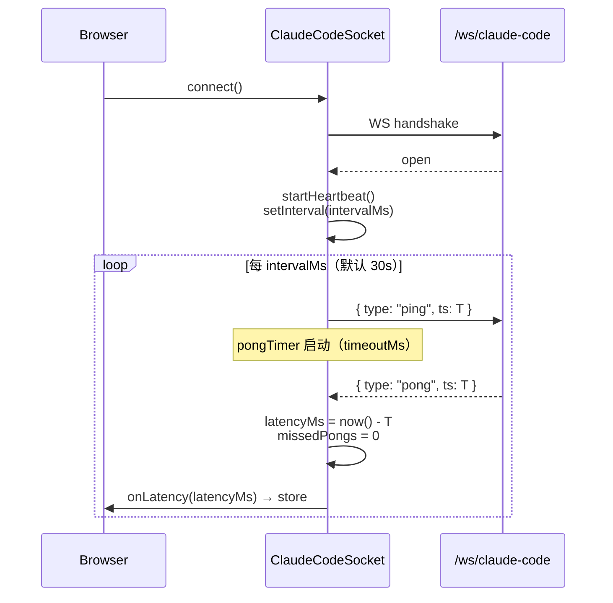
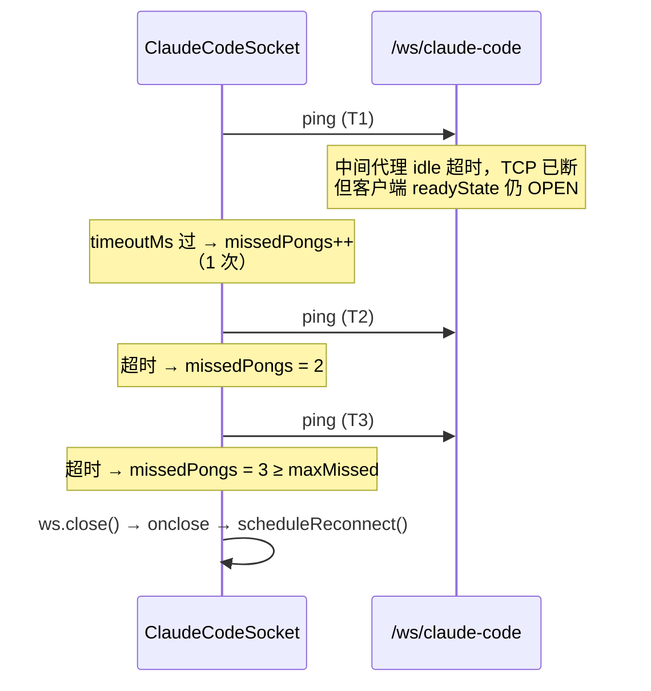
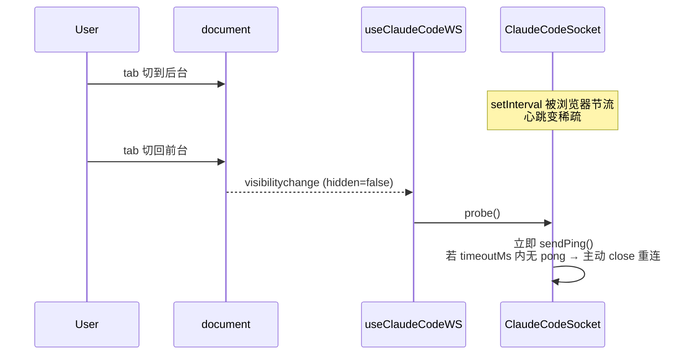
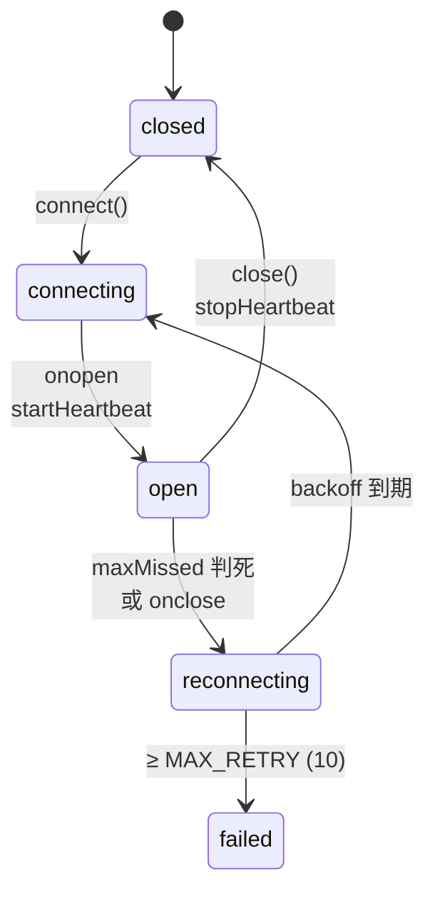

# 03 Core Workflows

## 协议帧（前后端真源）

```ts
// 客户端 → 服务端
{ type: "ping", ts: number }   // ts = Date.now()

// 服务端 → 客户端
{ type: "pong", ts: number }   // ts 直接 echo 回 client 的 ts，client 用来算 RTT
```

字段名一律 `type`（**不**用 `kind`），跟 `claude-command` / `abort-session` / `check-session-status` 风格一致。`ts` 是毫秒整数，echo 模型让客户端独立算 RTT，无需服务端时钟同步。

## 稳态心跳



## 半开判死



判死时间上限 = `intervalMs * maxMissed + timeoutMs`（默认 30s × 3 + 10s ≈ **100 秒**）。可以接受 —— 比 OS TCP keepalive 默认 2h 快 70 倍。

## 后台 tab 兜底（visibilitychange）

**为什么必须有**：Chrome 后台 tab 把 `setInterval` 节流到 ≥ 1min/次，定时 ping 失效。



`ClaudeCodeSocket.probe()` 是公开方法：

```ts
/** 立即发一次 ping 探测连接是否真活；用于 visibilitychange 兜底 */
probe(): void {
  if (this.state === "open") this.sendPing();
}
```

## 状态机（含 latency 上报）



每次 `handlePong` 后通过 `onLatency` 回调把 RTT 抛给 `useClaudeCodeWS`，hook 调 `setClaudeWs(state, latencyMs)` 把真值写进 store —— 替换当前硬编码的 `null`。

## 不在 v0.1 范围

reconnect 成功后**怎么续接活跃 run** / **怎么 backfill 历史消息** —— 推到 v0.2。v0.1 重连只做"连上"，不做"接回"。
