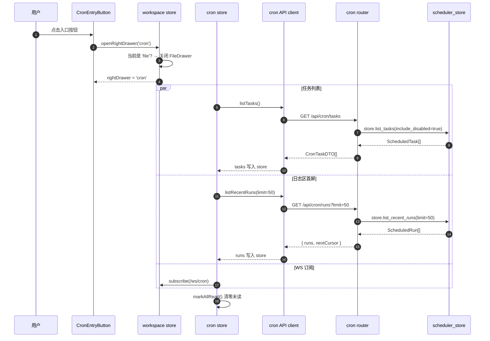
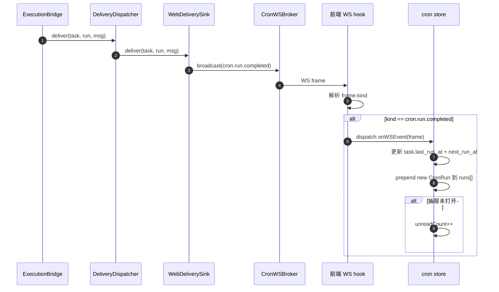
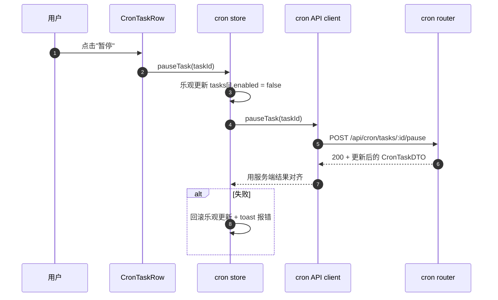
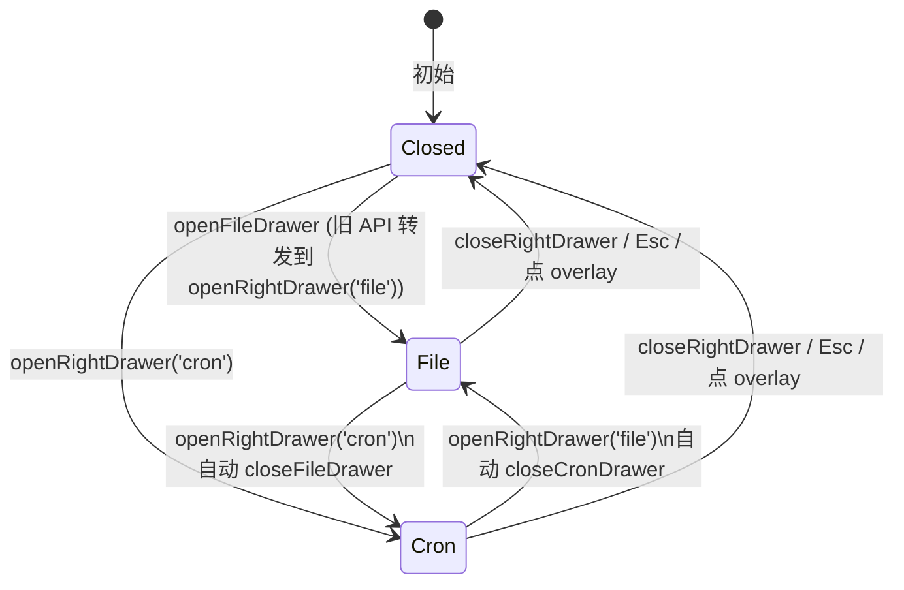
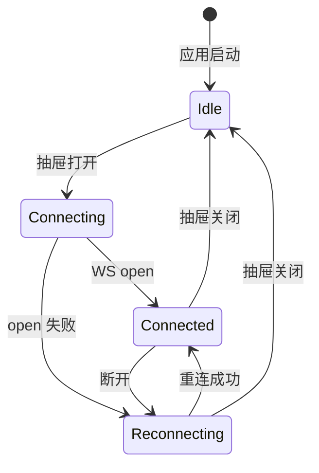
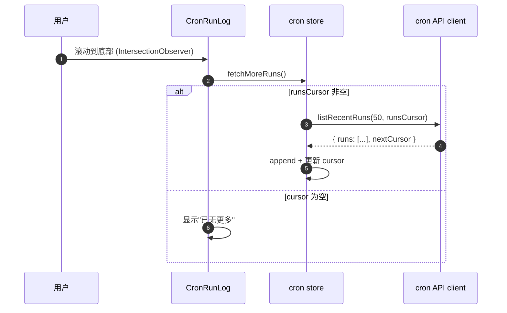

# 核心流程

## 1. 首次打开抽屉

**关键点**：
- 任务列表 + 日志首屏 + WS 订阅**并行**触发（`Promise.all`），不串行等待
- 抽屉打开时立刻 `markAllRead`（红点的语义是"未看过"，看的瞬间清零）

---

## 2. 实时推送：cron 跑完了

**关键点**：
- `next_run_at` 重新计算：recurring 任务（CRON/INTERVAL/SECONDS）在每次完成后变成"下一次"——前端不算，依赖后端在 `supersede_and_append_run` 里更新 task；前端拿到推送后**主动 refetch 单个 task**或者推送 frame 里**一并带上**新的 `next_run_at`
- 推荐让推送 frame 增加 `next_run_at` 字段，避免前端 N+1（这是对 `cron.run.completed` 事件 schema 的小扩展，需在 T1/T2 task 里同步落地）

---

## 3. 操作回流：暂停 / 恢复 / 删除 / 立即触发

**关键点**：
- **乐观更新**：UI 立即响应，背后异步同步；失败回滚
- 删除前必须 confirm dialog（误触代价高）
- 立即触发：UI 显示"触发中…" loading；返回后把新生成的 run prepend 到日志

---

## 4. 抽屉互斥协调

**关键点**：
- 真源是 `workspace.rightDrawer: 'file' | 'cron' | null` 单字段
- `openRightDrawer(kind)` 是设值动作，旧 API 转发
- 关闭抽屉走 Radix Dialog 自带 `onOpenChange(false)`，转发到 `closeRightDrawer()`

---

## 5. WS 生命周期

**关键点**：
- WS 仅在抽屉打开时占用连接（节省服务端资源）
- 关抽屉的瞬间断开 WS；下次打开重连
- 重连：复用现有 `connection.ts` 指数退避（1s → 2s → 4s → 8s 上限 30s）

---

## 6. 滚动加载日志

**关键点**：
- IntersectionObserver 监听底部 sentinel 元素
- `runsCursor=null` 表示无更多
- 防抖：拉取期间不重复触发
