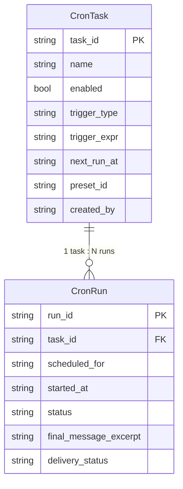

# 数据模型与状态

## 核心实体

跨语言 schema（Python pydantic ↔ TypeScript interface 必须字段名一致；Python docstring 是真源，详见根 CLAUDE.md "Python ↔ TS 协议必须同步"）。

### CronTaskDTO（任务）

```typescript
// web/src/api/cron.ts
export interface CronTask {
  task_id: string;                      // 主键，"task-<12hex>"
  name: string;                         // 用户起的名字
  enabled: boolean;                     // false = 暂停
  state: 'SCHEDULED' | 'PAUSED' | 'COMPLETED' | 'CANCELLED';
  trigger_type: 'CRON' | 'INTERVAL' | 'SECONDS' | 'ONCE';
  trigger_expr: string;                 // 用户原始表达式（cron 字符串 / "5m" / "30s" / ISO timestamp）
  next_run_at: string | null;           // ISO timestamp；null 表示已结束
  last_run_at: string | null;           // ISO timestamp；null 表示从未跑过
  preset_id: string;                    // LLM preset 标识
  created_by: string;                   // "agent:<thread_id>"，前端可反查所属 thread
}
```

### CronRunDTO（一次运行）

```typescript
export interface CronRun {
  run_id: string;
  task_id: string;
  task_name: string;                    // 冗余，避免日志区 N+1
  scheduled_for: string;                // 计划触发时间
  started_at: string | null;            // 实际开始
  finished_at: string | null;           // 实际结束
  status: RunStatus;
  final_message_excerpt: string | null; // 截断到 _FINAL_MESSAGE_EXCERPT_LIMIT
  delivery_status: DeliveryStatus;
  delivery_error: string | null;
}

export type RunStatus =
  | 'PENDING' | 'RUNNING' | 'COMPLETED' | 'FAILED' | 'SILENT' | 'SUPERSEDED';

export type DeliveryStatus =
  | 'PENDING' | 'DELIVERED' | 'FAILED' | 'SKIPPED';
```

### WS Frame（cron.run.completed）

后端 `WebDeliverySink.broadcast` 已有的 frame，**建议增加 `next_run_at` 字段**（避免前端 N+1）：

```typescript
export interface CronRunCompletedFrame {
  kind: 'cron.run.completed';
  task_id: string;
  task_name: string;
  run_id: string;
  final_message: string;
  delivered_at_iso: string | null;
  scheduled_for: string;
  delivery_target: string | null;
  // 新增（建议）
  next_run_at: string | null;           // recurring 任务下一次时间；ONCE 完成后为 null
  status: RunStatus;                    // 让前端不必再查
}
```

> 这个扩展属于 cron 主模块的小改动，在 T1 task 里完成。

---

## 实体关系



---

## 前端 store 形状

```typescript
// web/src/stores/cron.ts
interface CronStoreState {
  // 任务（按 trigger_type + enabled 分组在 selector 里做）
  tasks: CronTask[];
  tasksLoading: boolean;
  tasksError: string | null;

  // 运行日志（全局倒序）
  runs: CronRun[];
  runsCursor: string | null;            // null 表示无更多
  runsLoading: boolean;
  runsError: string | null;

  // 红点（会话内未读）
  unreadCount: number;

  // WS 生命周期
  wsState: 'idle' | 'connecting' | 'connected' | 'reconnecting';
  wsBackoffMs: number;                  // 重连退避

  // 单任务展开摘要缓存（点击行时按需 fetch）
  expandedTaskId: string | null;
  expandedRun: CronRun | null;          // 该 task 最近一次 run

  // === actions ===
  fetchTasks: () => Promise<void>;
  fetchInitialRuns: () => Promise<void>;
  fetchMoreRuns: () => Promise<void>;
  expandTask: (taskId: string) => Promise<void>;
  collapseTask: () => void;
  pauseTask: (taskId: string) => Promise<void>;
  resumeTask: (taskId: string) => Promise<void>;
  deleteTask: (taskId: string) => Promise<void>;
  runNow: (taskId: string) => Promise<void>;
  markAllRead: () => void;
  onWSEvent: (frame: CronRunCompletedFrame) => void;
  startWS: () => void;
  stopWS: () => void;
}
```

### Selector：任务分组

```typescript
export const selectGroupedTasks = (state: CronStoreState) => {
  const today = new Date();
  const dayStart = startOfLocalDay(today);
  const dayEnd = endOfLocalDay(today);

  const recurring: CronTask[] = [];
  const todayOnce: CronTask[] = [];

  for (const t of state.tasks) {
    if (['CRON', 'INTERVAL', 'SECONDS'].includes(t.trigger_type)) {
      recurring.push(t);
    } else if (t.trigger_type === 'ONCE') {
      const at = t.next_run_at ? new Date(t.next_run_at) : null;
      if (at && at >= dayStart && at <= dayEnd) {
        todayOnce.push(t);
      }
      // 历史 ONCE 不进列表（只在日志区出现）
    }
  }

  // 排序：next_run_at 升序（最近要触发的在前）
  recurring.sort(byNextRunAt);
  todayOnce.sort(byNextRunAt);

  return { recurring, todayOnce };
};
```

> 暂停（`!enabled`）的任务**仍然在所属分组里**显示，靠 row 自身置灰；不抽出独立分组。

---

## 状态映射（4 类图标 vs 后端 6 类 RunStatus）

| 后端 RunStatus | 前端图标 | 颜色 | 含义 |
|---------------|---------|------|------|
| `PENDING` | ⏳ | 灰 | 还没触发（next_run_at 在未来） |
| `RUNNING` | 🔄 | 蓝 | 跑中 |
| `COMPLETED` | ✅ | 绿 | 跑完 + 投递成功 |
| `SILENT` | ✅ | 绿 | 跑完 + 主动选择不投递（用户视角等同成功） |
| `FAILED` | ❌ | 红 | 失败 |
| `SUPERSEDED` | ❌ | 灰 | 被新 run 取代（罕见，用户当作失败处理） |

**任务行图标取值规则**：
- 显示**最近一次** run 的状态（`task.last_run_at` 对应那个）
- 从未跑过（`last_run_at=null`）→ ⏳

> 用户视角说："如果是每天任务，X 就代表昨天失败，也可能今天还没触发，这没关系"。
> 落地：今天每日任务 hasn't 跑 + 上次失败 → 显示 ❌（语义模糊但用户接受）。

---

## 持久化方案

| 数据 | 存储 | 位置 | 备注 |
|------|------|------|------|
| 任务定义 | 后端文件 | `<scheduler.home>/tasks/<task_id>.json` | 已有 |
| 任务运行 | 后端文件 | `<scheduler.home>/runs/<task_id>/<run_id>.json` | 已有 |
| 前端 tasks/runs 缓存 | 内存（zustand） | 运行时 | 关闭抽屉不清，应用刷新清 |
| 未读计数 | 内存（zustand） | 运行时 | **不持久化**——关闭浏览器/刷新页面归零 |
| WS 连接 | 浏览器内存 | 抽屉打开期间 | 关抽屉断开 |

---

## 共享数据结构

跨模块共用类型放 `web/src/api/cron.ts`，单一真源：

```typescript
// 枚举跟后端 src/scheduler/domain.py 严格对齐
export type TriggerType = 'CRON' | 'INTERVAL' | 'SECONDS' | 'ONCE';
export type TaskState = 'SCHEDULED' | 'PAUSED' | 'COMPLETED' | 'CANCELLED';
export type RunStatus = 'PENDING' | 'RUNNING' | 'COMPLETED' | 'FAILED' | 'SILENT' | 'SUPERSEDED';
export type DeliveryStatus = 'PENDING' | 'DELIVERED' | 'FAILED' | 'SKIPPED';
export type DeliveryChannel = 'web' | 'cli';
```

> 后端枚举值大小写：Python `StrEnum` 用小写 `"web"` / `"cli"`、状态用大写 `"COMPLETED"`。前端必须严格按后端字面值，不另作转换。
