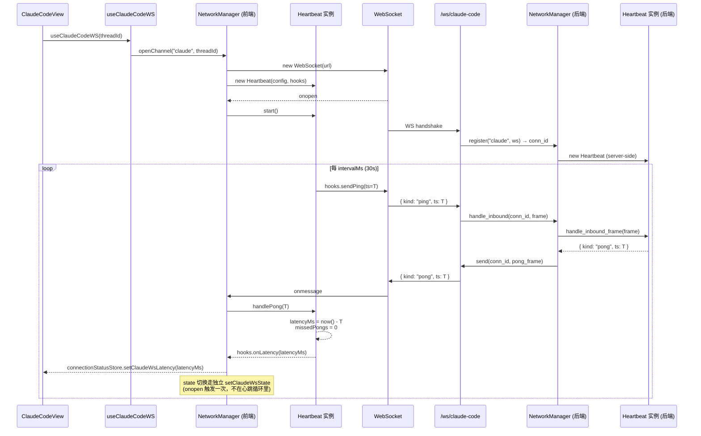
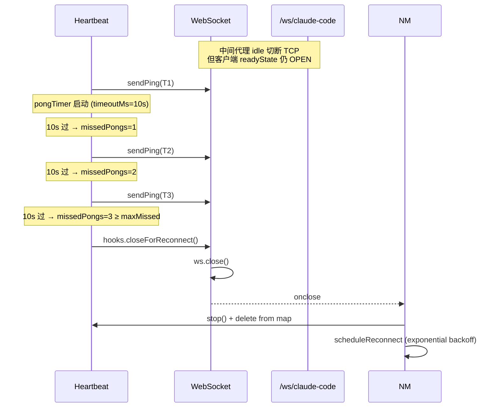
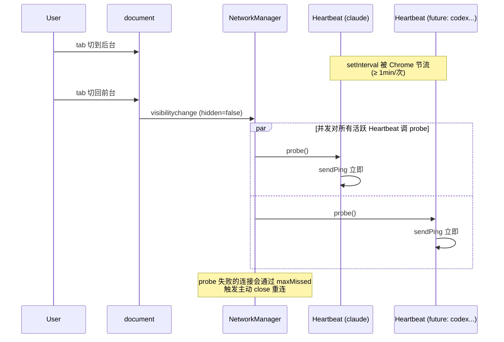
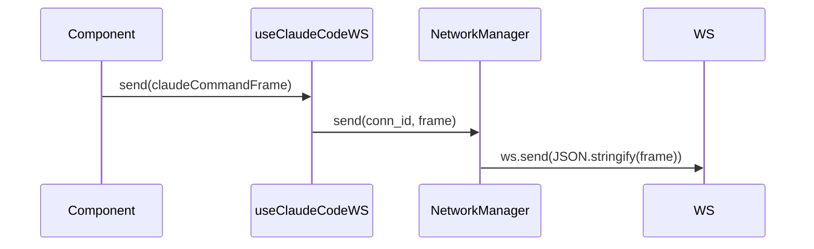

# 03 Core Workflows

## 协议帧（v0.1 在 Claude 频道引入 `kind` 维度做心跳判别）

```ts
// 客户端 → 服务端
{ kind: "ping", ts: number }   // ts = Date.now()

// 服务端 → 客户端
{ kind: "pong", ts: number }   // 原样 echo client 的 ts
```

### Claude 频道判别字段：v0.1 双轨共存（业务 `type` + 心跳 `kind`）

Claude 频道现有 `ClaudeCodeC2SFrame` 联合用 `type` 字段判别（`claude-command` / `abort-session` / `check-session-status` 等 6 个 type，**没有** ping 分支）；后端 `claude_code/route.py::_dispatch` 也只识别这 6 个 type，**不识别 ping**。

v0.1 选择**双轨共存**而非把 ping 塞进 type 联合，原因如下：

| 选项 | 形态 | 取舍 |
| --- | --- | --- |
| **X（v0.1 采用）** | 心跳帧 `{ kind: "ping", ts }`，业务帧仍走 `type`；前端先按 `"kind" in frame` 走心跳，否则按 `type` 走业务路由；后端复用 `PingFrame.kind` / `PongFrame.kind` 既有 schema | ✅ 心跳层跨频道一致（generic / thread-status 全用 `kind`）<br>✅ 不动业务帧 union，零回归风险<br>⚠️ Claude 频道判别字段双轨；v0.2 C 阶段统一为 `frameType` 后双轨自动消失 |
| Y（不采用） | 把 ping 加入 ClaudeCodeC2SFrame 联合：`{ type: "ping", ts }` | ❌ Claude 频道自定义 ping schema 跟 generic 不一致<br>❌ v0.2 接其他频道时心跳层要按 channel 分支处理判别字段<br>❌ 后端要为 Claude 单独定义 ClaudePingFrame |

### 复用现状

- 后端 `src/web/protocol/ws_frames.py::PingFrame.kind: Literal["ping"]` / `PongFrame.kind: Literal["pong"]` **直接复用**，network 层不重新定义
- 前端 v0.1 在 `web/src/network/tools.ts` 加 `buildPingFrame(ts)` / `isHeartbeatFrame(raw)` —— 后者按 `"kind" in raw && (raw.kind === "ping" || raw.kind === "pong")` narrowing
- 后端 `claude_code/route.py::_dispatch` 必须**新增** `kind == "ping"` 分支（通过 `network_manager.handle_inbound`），见 dev-checklist 7.1-7.2
- 字段名 v0.1 仍 `kind`，v0.2 C 阶段批量改 `frameType` 把 type/kind 双轨合并为单轨

## 工作流 1：Claude 频道建连 + 稳态心跳



## 工作流 2：半开连接判死（中间代理 idle 切了 TCP）



**判死时间上限** = `intervalMs × maxMissed + timeoutMs` = `30 × 3 + 10` = **100 秒**

## 工作流 3：visibilitychange 兜底（用户切回前台立即探测）



**v0.1 实际只有 1 个 Heartbeat 实例（claude）**，但 NetworkManager 用 `for...of heartbeats.values()` 循环 probe，**天然支持 v0.2 多连接扩展**——不需要重写。

## 工作流 4：多 Heartbeat 实例并发（多频道接入后场景预演）

v0.2 时同一个浏览器 tab 可能同时有 3-6 个 WS 连接（generic + claude + thread-status + codex + scheduler + workspace-shell），每个连接独立心跳：

```
NetworkManager.heartbeats: Map<conn_id, Heartbeat>
  ├─ conn_id="claude:thread-abc"        → Heartbeat A
  ├─ conn_id="generic:thread-xyz"       → Heartbeat B
  ├─ conn_id="thread-status:global"     → Heartbeat C
  ├─ conn_id="codex:thread-def"         → Heartbeat D
  ├─ conn_id="scheduler:global"         → Heartbeat E
  └─ conn_id="workspace-shell:sid-1"    → Heartbeat F
```

每个 Heartbeat 内部独立的 timer / missedPongs / latencyMs，互不污染。v0.1 用单测验证两个 Heartbeat 实例并存且独立工作（其中一个被打挂不影响另一个）。

## 工作流 5：客户端发送业务帧（非心跳）

业务侧（如 `ClaudeCodeView` 调 `socket.send(claudeCommand)`）：



**铁律**：业务组件不直接拿到 `WebSocket` 引用，只通过 hook → NetworkManager 间接调。这样：
- 心跳、重连、状态聚合都不需要业务侧关心
- 未来切换底层传输（如换 SSE / WebTransport）只动 NetworkManager 一处

## 不在 v0.1 范围

- **断线重连后续接活跃 SDK run**（`check-session-status` + `replace_writer`）→ v0.2 另立 spec `web-claude-session-resume-v0.2`
- **`claude_history` backfill 断线期间内容** → 同上
- **跨 channel broadcast**（NetworkManager.broadcast(channel, frame)） → v0.2 B2 收编旧 broadcaster 时一起做
