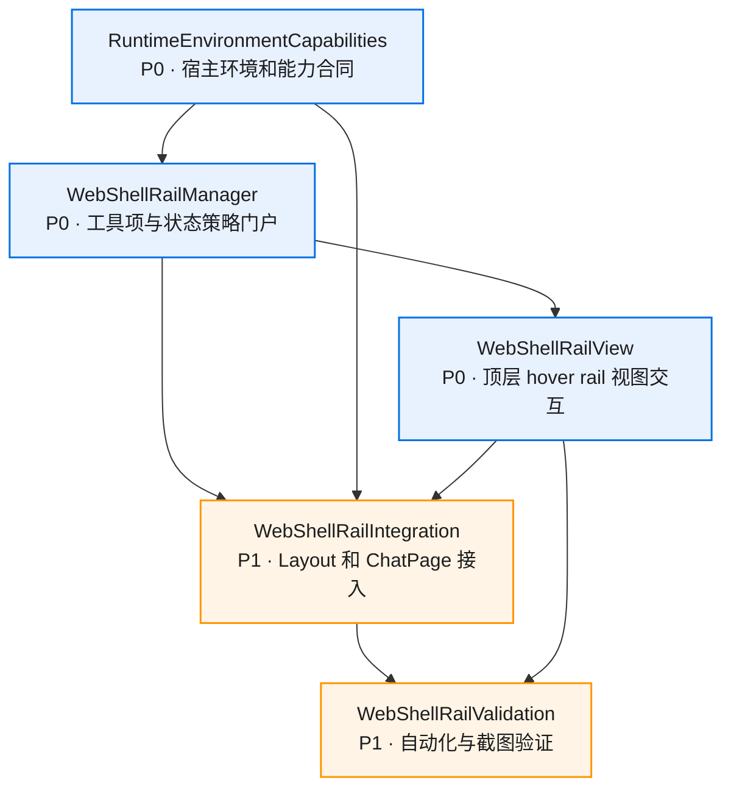
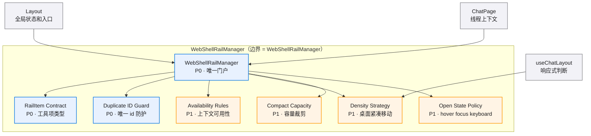
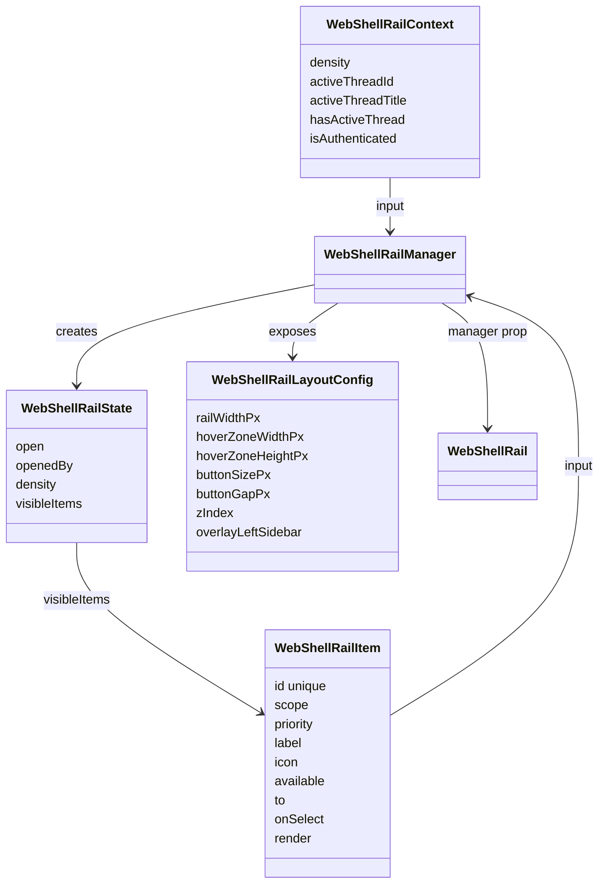
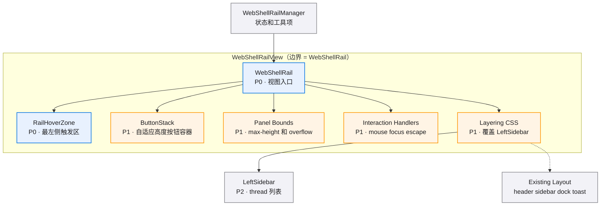
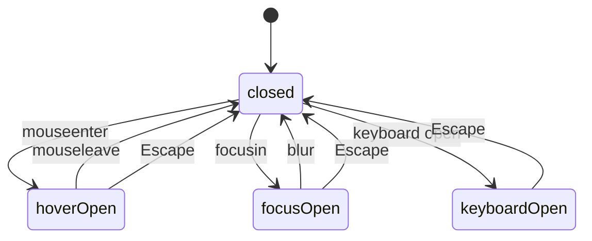
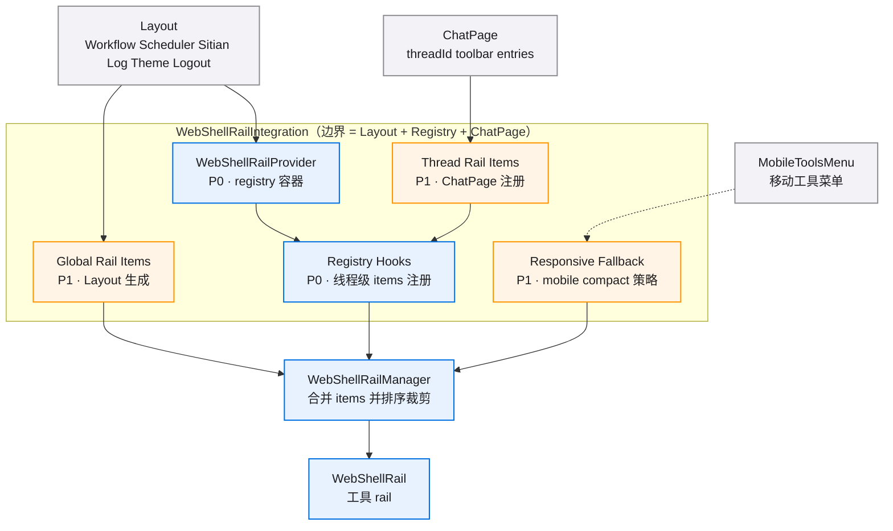
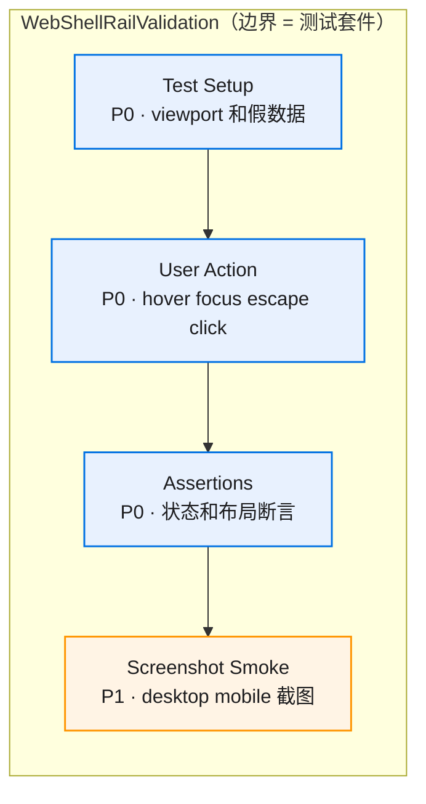
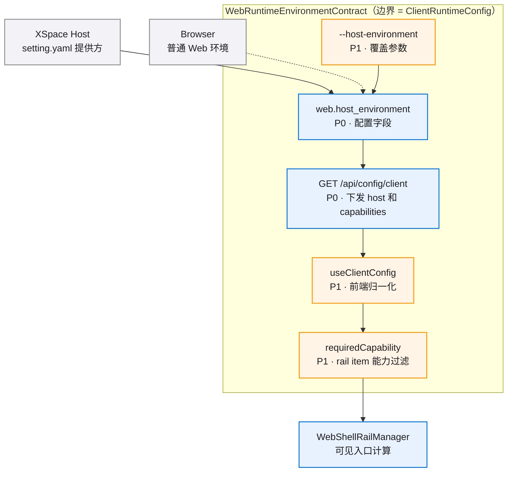

# left-hover-rail-v0.1 · 图集

> 本 spec 的唯一图源：所有 mermaid 图集中于此，按模块分节。02/04 是文字事实源，本文件是只读视图；增减模块/组件时同步更新对应节。
>
> **查看与缩放**：GitHub 渲染 mermaid 自带缩放/平移控件；VS Code 建议安装 Mermaid Chart（官方）或 Markdown Preview Enhanced 插件以支持缩放。

## 目录

- [总览](#总览)
- [WebShellRailManager](#webshellrailmanager)
- [WebShellRailView](#webshellrailview)
- [WebShellRailIntegration](#webshellrailintegration)
- [WebShellRailValidation](#webshellrailvalidation)
- [RuntimeEnvironmentCapabilities](#runtimeenvironmentcapabilities)

图例：P0 核心/阻塞 · P1 主要/必须 · P2 辅助/可选

## 总览

## WebShellRailManager

### 组件依赖

### 数据关系

## WebShellRailView

### 组件依赖

### 状态流转

## WebShellRailIntegration

### 接入关系

## WebShellRailValidation

### E2E 测试链路

## RuntimeEnvironmentCapabilities

### 配置与能力流

