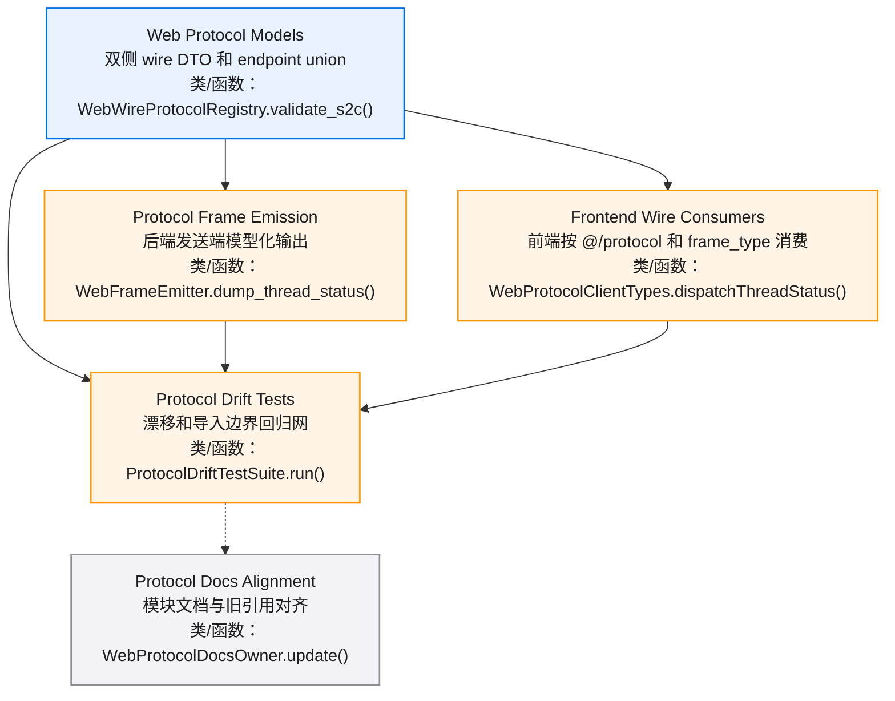
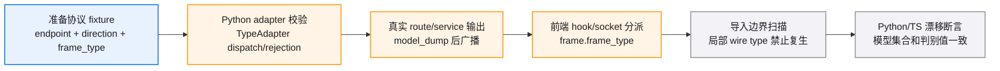
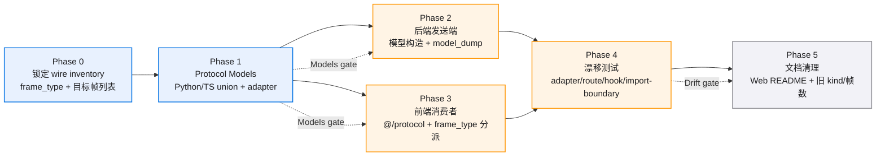
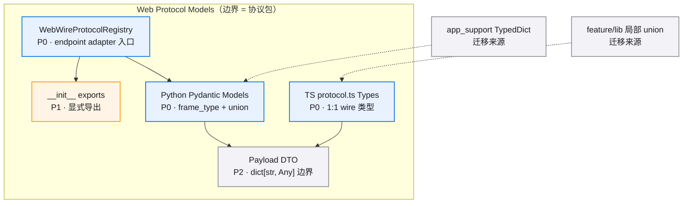
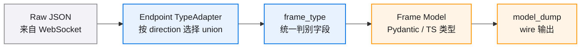
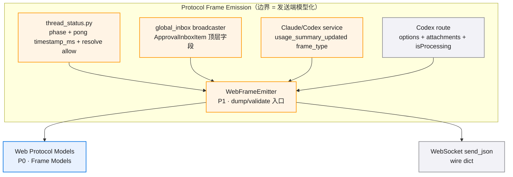
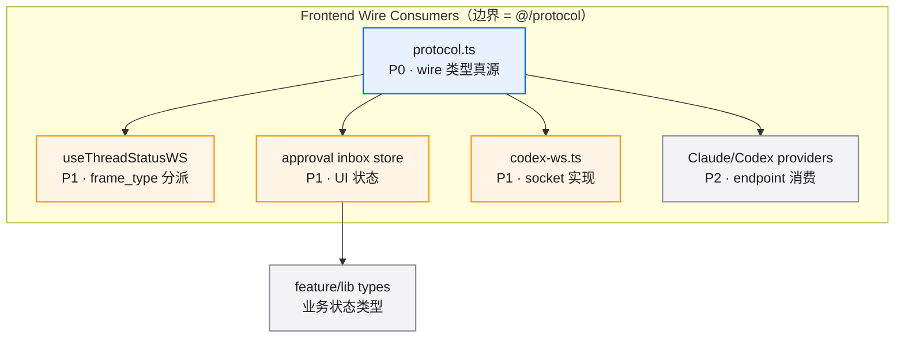
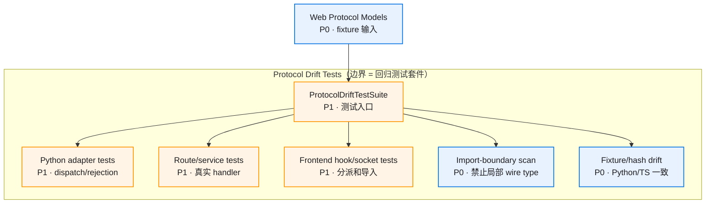
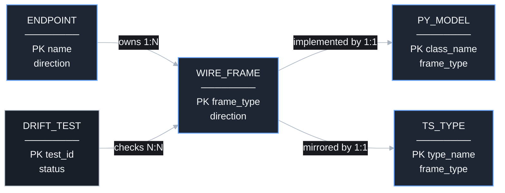

# web-wire-protocol-unification-v0.1 · 图集

> 本 spec 的唯一图源：所有 mermaid 图集中于此，按模块分节。02/04 是文字事实源，本文件是只读视图，增减模块/组件时同步更新对应节。
>
> **查看与缩放**：GitHub 渲染 mermaid 自带缩放/平移控件；VS Code 建议安装 Mermaid Chart（官方）或 Markdown Preview Enhanced 插件以支持缩放。

## 目录

- [总览](./diagrams.md#总览)
- [E2E 测试链路](./diagrams.md#e2e-测试链路)
- [修复主流程](./diagrams.md#修复主流程)
- [Web Protocol Models](./diagrams.md#web-protocol-models)
- [Protocol Frame Emission](./diagrams.md#protocol-frame-emission)
- [Frontend Wire Consumers](./diagrams.md#frontend-wire-consumers)
- [Protocol Drift Tests](./diagrams.md#protocol-drift-tests)
- [协议数据关系](./diagrams.md#协议数据关系)

图例：P0 蓝色表示核心/阻塞性，P1 橙色表示主要/必须完成，P2 灰色表示辅助/可选。

## 总览

## E2E 测试链路

## 修复主流程

## Web Protocol Models

### 组件依赖

### 判别规则

## Protocol Frame Emission

## Frontend Wire Consumers

## Protocol Drift Tests

## 协议数据关系

