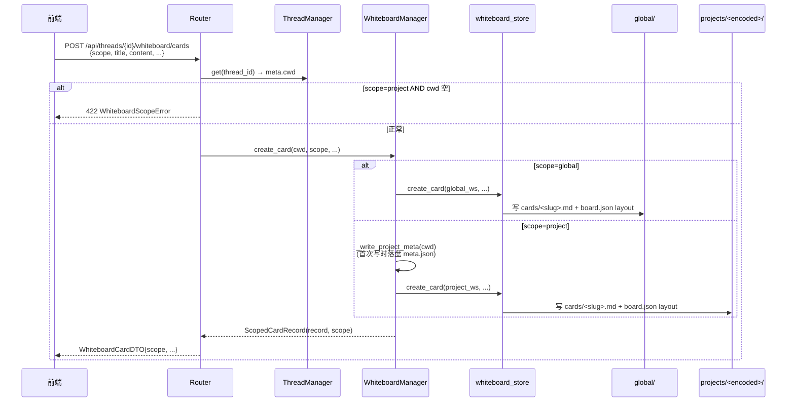
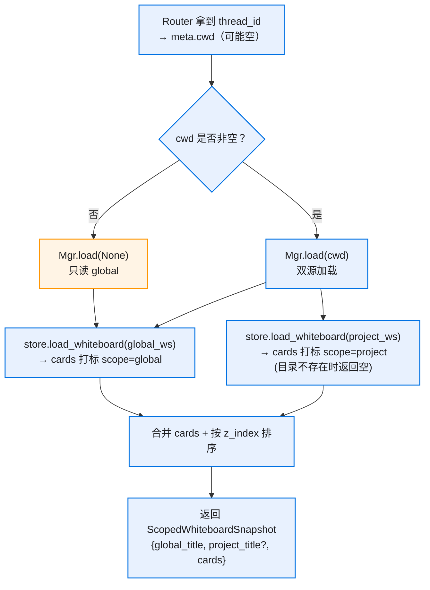
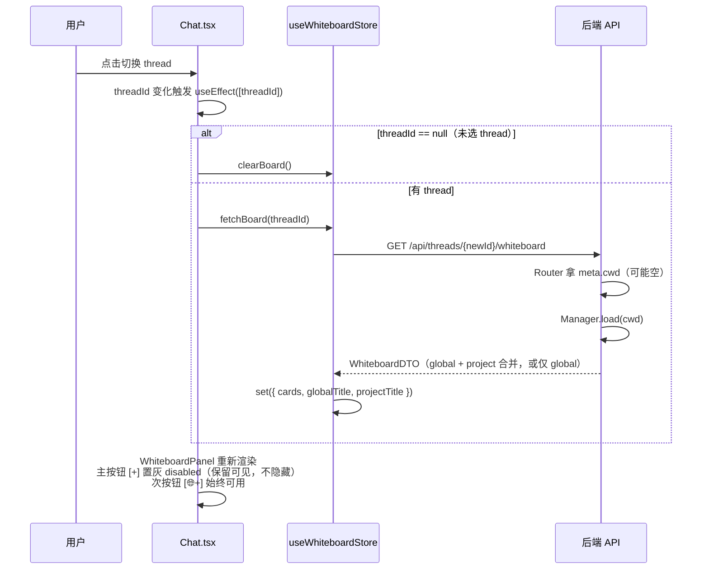
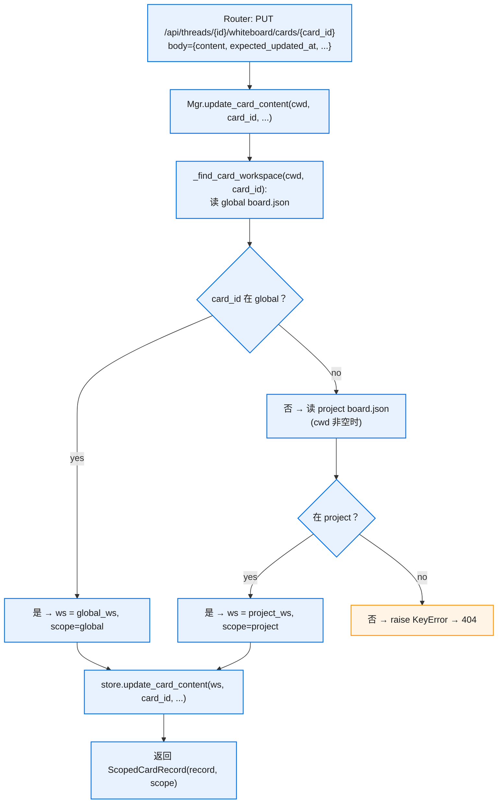
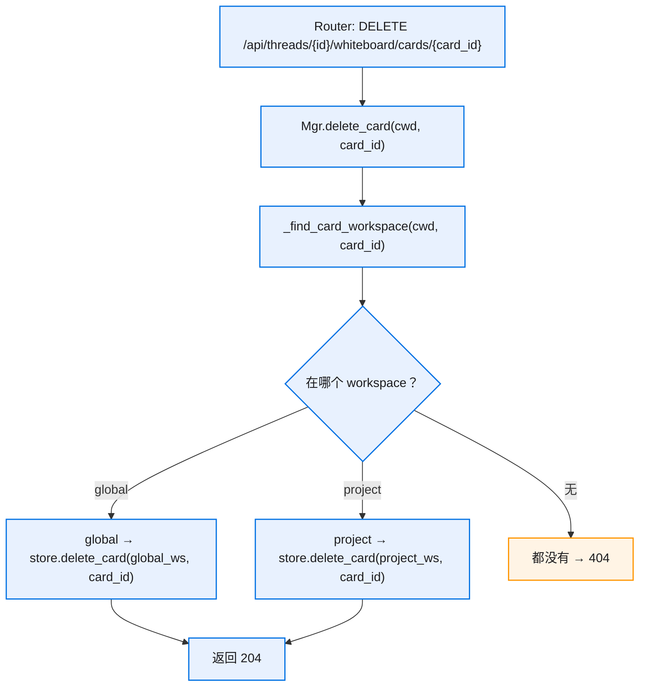

# 核心流程

> 所有流程的 cwd 来源都是 `request.app.state.thread_manager.get(thread_id).cwd`，可能为空字符串。
> "global workspace" = `<kongming_home>/whiteboard/global/`
> "project workspace" = `<kongming_home>/whiteboard/projects/<encode_project_dir(cwd)>/`

## 1. 创建卡片（scope 路由）

**关键点**：

- scope 决定 store 的 workspace 参数，store 无感
- global / project 各自的 board.json 各管各的 layout
- 内容文件 + layout 条目在同一个 `_workspace_lock` 内原子写入（复用现有 store 实现）
- project workspace 首次创建时落盘 `meta.json` 备份原 cwd（仅调试/迁移用）

## 2. 加载白板（双源合并 + cwd 空降级）

**关键点**：

- cwd 空 → 不走 project 分支，`project_title` 字段为 `None`（前端据此 disable 主按钮）
- cwd 非空 + project 目录不存在（用户尚未创建任何 project 卡片）→ Manager 取默认标题 `DEFAULT_WHITEBOARD_TITLE`，`project_title="Whiteboard"`——**必须非 None**，否则前端按钮会被锁死，永远无法点出首张 project 卡（chicken-and-egg）
- scope 标记由 Manager 在合并阶段打到 `ScopedCardRecord` 上，store 不参与
- 排序键统一 `z_index`：global / project 卡片混排，按 z_index 顺序渲染

## 3. 切换 Thread（前端重载）

**关键点**：

- `useEffect` 依赖 `[threadId]`，切换自动触发
- thread 未选 → `clearBoard()` 不调 API
- `projectTitle == null` → 主按钮 `[+]` **置灰 disabled 但保留可见**（不做 `display: none` / `visibility: hidden`），按钮位置稳定，用户视觉一致；次按钮 `[🌐+]` 照常可点
- 切换 thread 后 z_index 排序混合 global + 新项目卡片

## 4. 更新卡片内容（自动定位）

**关键点**：

- 前端**不**传 scope，Manager 自动查
- 先查 global 再查 project，顺序固定（避免 id 在两边都意外存在时行为歧义）
- 若 cwd 空 → 只查 global，project 分支跳过 → 没命中直接 404
- `expected_updated_at` 冲突检测照常工作（store 层原逻辑）

## 5. 删除卡片

**关键点**：

- store 的 `delete_card` 原子操作：删内容文件 + 从对应 board.json 移除 layout 条目（已有行为）
- 不需要跨 workspace 协调；锁粒度本来就是 workspace 级
- global 卡片被删后，任何项目下次加载都自动看不到，无需额外清理
