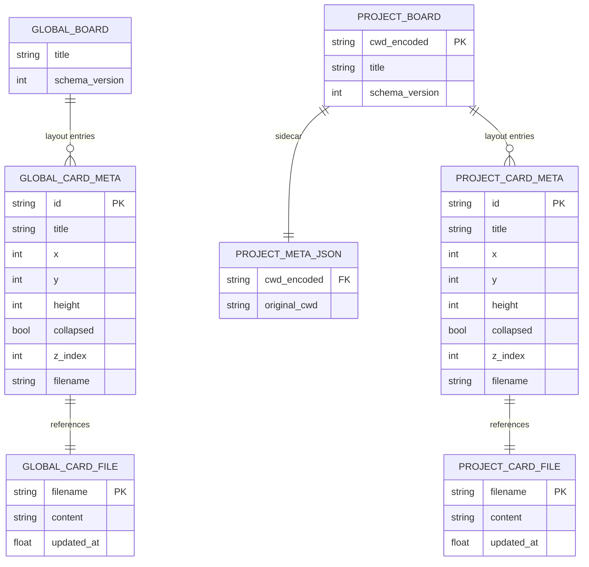

# 数据模型与状态

## 持久化目录结构

```
<kongming_home>/whiteboard/        ← 白板根目录（唯一真源）
├── global/                        ← 全局作用域
│   ├── board.json                 ← 全局 layout（所有项目共享）
│   └── cards/
│       └── <slug>-<hex12>.md      ← 全局卡片内容
└── projects/                      ← 项目作用域容器
    └── <encode_project_dir(cwd)>/  ← 单个项目子目录（格式：<basename-slug>-<sha256[:8]>）
        ├── meta.json              ← 备份原始 cwd（hash 输入，不可逆）
        ├── board.json             ← 该项目 layout
        └── cards/
            └── <slug>-<hex12>.md  ← 该项目卡片内容
```

**`encode_project_dir` 规则**（定义在 `src/web/whiteboard/manager.py`，**whiteboard 自有**，不复用 Claude SDK 的 `encode_project_dir`）：

```python
def encode_project_dir(cwd: str) -> str:
    """格式：<basename-slug>-<sha256[:8]>"""
    basename = Path(cwd).name.lower()
    slug = re.sub(r"[^a-z0-9-]+", "-", basename).strip("-") or "project"
    digest = hashlib.sha256(cwd.encode("utf-8")).hexdigest()[:8]
    return f"{slug}-{digest}"
```

设计要点：

- **basename-slug**：保留 cwd 末段的可读性（`/Users/kid/proj/kongming-agent` → `kongming-agent`）；非 ASCII 路径退化为 `project`
- **sha256[:8]**：hash 空间 2^32，本地工具够用，且**同 basename 不同路径不会撞**（如 `/a/proj` vs `/b/proj` 算出不同 hash）
- **不可逆**：从目录名反推不出原 cwd，project 子目录内放 `meta.json` 作反查：

```json
{
  "cwd": "/Users/kid/proj/kongming-agent"
}
```

`meta.json` 仅用于调试 / 用户手动迁移，**不参与运行时逻辑**。

## 核心实体

### `WhiteboardCardMeta`（board.json layout 条目，**保持不变**）

```python
class WhiteboardCardMeta(BaseModel):
    """单张卡片在 board.json 里的元数据。本次改造零字段变更。"""

    model_config = ConfigDict(frozen=True, extra="forbid")

    id: Annotated[str, Field(pattern=_CARD_ID_RE)]
    title: Annotated[str, Field(min_length=1, max_length=200)]
    category: Annotated[str, Field(max_length=100)] = ""
    x: Annotated[int, Field(ge=0)] = DEFAULT_CARD_X
    y: Annotated[int, Field(ge=0)] = DEFAULT_CARD_Y
    height: Annotated[int, Field(ge=120, le=4000)] = DEFAULT_CARD_HEIGHT
    collapsed: bool = False
    z_index: Annotated[int, Field(ge=0)] = 0
    filename: Annotated[str, Field(pattern=_FILENAME_RE)]
```

> **scope 不写到这里**。scope 由"卡片所在的 board.json 在 global/ 还是 projects/<...>/"决定，运行时由 Manager 标记。

### `WhiteboardMeta`（board.json 根对象，**保持不变**）

```python
class WhiteboardMeta(BaseModel):
    """白板根元数据。本次改造零字段变更。"""

    model_config = ConfigDict(frozen=True, extra="forbid")

    title: str = DEFAULT_WHITEBOARD_TITLE
    cards: list[WhiteboardCardMeta] = Field(default_factory=list)
    schema_version: Literal[1] = 1
```

global 的 `title` 默认 `"Whiteboard"`，project 的 `title` 默认 `"Whiteboard"`；用户在前端可分别重命名（写入各自 board.json）。

### `WhiteboardCardRecord`（store 完整快照，**保持不变**）

```python
class WhiteboardCardRecord(BaseModel):
    """单张卡片完整快照（store 层）。scope 不在这里。"""
    # 与 v0.1 完全相同，无变更
```

### `ScopedCardRecord`（Manager 输出，**新增**）

```python
class ScopedCardRecord(BaseModel):
    """Manager 输出的卡片记录，包装 store record + 运行时 scope 标记。"""

    model_config = ConfigDict(frozen=True, extra="forbid")

    record: WhiteboardCardRecord
    scope: Literal["project", "global"]
```

### `ScopedWhiteboardSnapshot`（Manager 输出，**新增**）

```python
class ScopedWhiteboardSnapshot(BaseModel):
    """Manager load 合并快照。"""

    model_config = ConfigDict(frozen=True, extra="forbid")

    global_title: str               # global board.json 的 title
    project_title: str | None       # 仅 cwd 空时为 None；cwd 非空但目录不存在时取默认 "Whiteboard"
    cards: list[ScopedCardRecord]   # 已按 z_index 排序
```

### REST DTO（router 输出，**修改**）

```python
class WhiteboardCardDTO(BaseModel):
    scope: Literal["project", "global"]  # 新增
    id: str
    title: str
    category: str
    x: int
    y: int
    height: int
    collapsed: bool
    z_index: int
    filename: str
    content: str
    updated_at: float


class WhiteboardDTO(BaseModel):
    global_title: str               # 新增（替代原 title）
    project_title: str | None       # 新增
    cards: list[WhiteboardCardDTO]
    schema_version: Literal[1] = 1
```

`UpdateWhiteboardLayoutRequest` 加 `scope: Literal["project", "global"]`。

`CreateWhiteboardCardRequest` 加 `scope: Literal["project", "global"]`（必填，前端必须显式选择）。

## 实体关系



**关键关系**：

- global board.json 独立一份，对所有项目可见
- 每个 project 子目录有独立 board.json，按 `encode_project_dir(cwd)` 区分
- 同一张卡片 `id` 只可能存在于一个 board.json（global 或某个 project）
- `meta.json` 是 project 子目录的 sidecar，主流程不读

## 状态流转

```
created(scope=project|global) → updated(content/title/category) → deleted
```

scope 一旦决定就不能改（卡片创建后存到对应 workspace 即固化）。后续若做 "scope 提升/降级"，需要新增 `move_card` 操作：删旧位置 + 在新位置重建。

## 持久化方案总览

| 数据 | 路径 | 备注 |
|------|------|------|
| global 白板 layout | `<root>/global/board.json` | 所有项目共享，title 全局唯一 |
| global 卡片内容 | `<root>/global/cards/<slug>-<hex>.md` | |
| project 白板 layout | `<root>/projects/<encoded>/board.json` | 每项目独立 |
| project 卡片内容 | `<root>/projects/<encoded>/cards/<slug>-<hex>.md` | |
| project 原始 cwd | `<root>/projects/<encoded>/meta.json` | sidecar，仅调试/迁移 |

`<root>` = `<kongming_home>/whiteboard/`，`<encoded>` = `encode_project_dir(cwd)`。

## 共享数据结构（前后端）

```python
# Python
CardScope = Literal["project", "global"]
```

```typescript
// TypeScript
export type CardScope = "project" | "global";
```

## 前端 scope 视觉差异（CSS variable）

仅 global 卡片有视觉差异——1px 差异色边框。project 卡片完全不动。

在 `web/src/styles/globals.css` 增加一对 CSS variable，跟随 light/dark 主题自动切换：

```css
:root {
  --whiteboard-scope-global-border: 217 91% 72%;  /* 亮色：淡蓝 #94BDF6 */
}

.dark {
  --whiteboard-scope-global-border: 217 50% 50%;  /* 暗色：降饱和蓝 #4076BF */
}
```

`WhiteboardCard.tsx` 渲染：

```tsx
const borderStyle = scope === 'global'
  ? { borderColor: 'hsl(var(--whiteboard-scope-global-border))' }
  : undefined;
// 1px border 宽度沿用现有 border 类，不变
```

设计约束：
- 不加 🌐 角标、不加 hairline、不加 cwd 文本徽章
- 边框是**唯一**视觉差异
- 跟随主题自动切换（CSS variable 体系已就位，零额外逻辑）

## 旧 schema 兼容性

- `board.json` 文件 schema 没有任何变化（`schema_version` 仍为 `1`，字段集合不变）
- 旧 `<cwd>/whiteboard/` 数据用户自行 `mv` 到新位置（见 `01-goals-and-boundaries.md` 旧数据处理章节）
- 新版**不读** `<cwd>/whiteboard/`，旧目录留着也无影响
