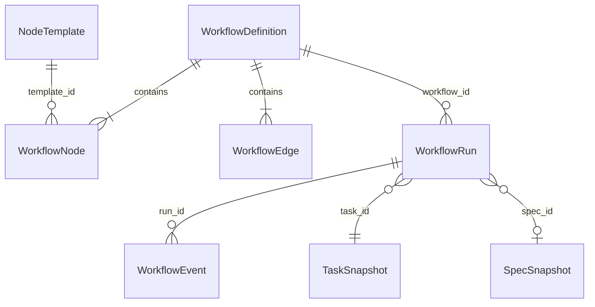
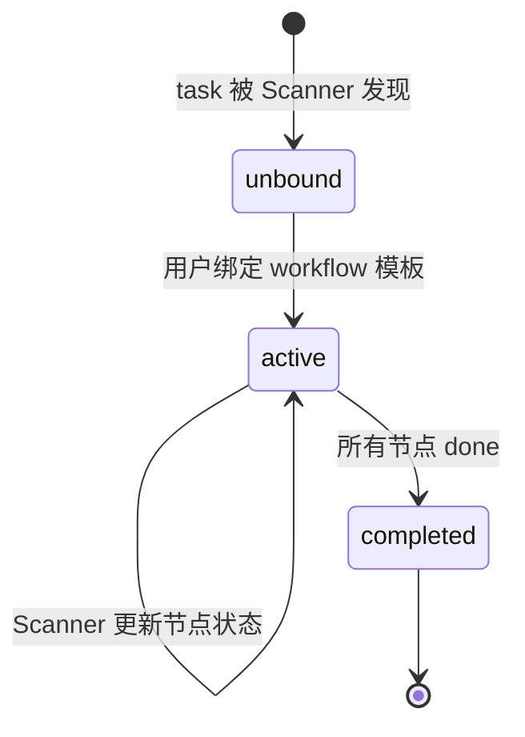

# 数据模型与状态

## 核心实体

### NodeTemplate（节点模板）

节点类型的元数据，描述一种能力单元。系统内置，不可由用户创建（v1）。

```python
@dataclass(frozen=True)
class NodeTemplate:
    id: str                    # "x-spec" | "x-req" | "x-dev" | "x-verify" | "x-qa-gate" | "x-fix"
    name: str                  # "Spec 规划" | "需求拆解" | ...
    category: str              # "analysis" | "planning" | "execution" | "gate" | "repair"
    detection_file: str | None # glob pattern，Scanner 用来判断阶段是否跑过
                               # 如 "01-goals-and-boundaries.md"、"dev-report.md"
                               # "reports/verify/verify-report-*.md"
```

v1 内置 6 个 NodeTemplate：

| id | name | category | detection_file |
|----|------|----------|---------------|
| x-spec | Spec 规划 | analysis | `01-goals-and-boundaries.md`（在 docs 目录下检测） |
| x-req | 需求拆解 | planning | `dev-checklist.md` |
| x-dev | 开发执行 | execution | `dev-report.md` |
| x-verify | 事实验证 | gate | `reports/verify/verify-report-*.md` |
| x-qa-gate | 质量门禁 | gate | `reports/qa-gate/qa-gate-report-*.md` |
| x-fix | 修复 | repair | `reports/fix/fix-*.md` |

### WorkflowDefinition（工作流定义）

流程模板，定义节点顺序和连接关系。

```python
@dataclass
class WorkflowDefinition:
    id: str                    # uuid
    name: str                  # "Full Pipeline" | "Quick Dev"
    description: str
    nodes: list[WorkflowNode]
    edges: list[WorkflowEdge]
    is_preset: bool            # 预置模板不可删除
    created_at: str            # ISO8601
```

```python
@dataclass
class WorkflowNode:
    id: str                    # 节点实例 id（同一模板可出现多次）
    template_id: str           # 引用 NodeTemplate.id
    position: int              # 线性排序位置（v1 不需要 x/y）

@dataclass
class WorkflowEdge:
    id: str
    from_node_id: str
    to_node_id: str
    trigger: str               # "on_completed" | "on_failed"
```

### WorkflowRun（工作流运行实例）

一个 task 绑定一个 workflow 模板后的运行实例。

```python
@dataclass
class WorkflowRun:
    id: str                    # uuid
    workflow_id: str            # 引用 WorkflowDefinition.id
    task_id: str                # dev-pipeline/tasks/<task_id> 目录名
    spec_id: str | None         # 关联的 spec（从 Scanner 解析）
    node_states: dict[str, str] # node_id → "done" | "not_started"
    created_at: str
    updated_at: str
```

### WorkflowEvent（工作流事件）

节点状态变更的追加日志。

```python
@dataclass
class WorkflowEvent:
    event_id: str              # "{timestamp}-{8hex}"
    run_id: str
    node_id: str
    old_status: str            # "not_started" | "done"
    new_status: str
    source: str                # "scanner" | "manual"
    timestamp: str             # ISO8601
```

## 实体关系



关系说明：
- 1 个 NodeTemplate 可被多个 WorkflowNode 引用（同一模板可出现在不同 workflow 中）
- 1 个 WorkflowDefinition 包含多个 Node 和 Edge
- 1 个 WorkflowRun 绑定 1 个 task + 1 个 workflow
- 1 个 task 只能有 1 个活跃的 WorkflowRun（唯一约束）
- WorkflowEvent 是 run 级别的追加日志

## 状态流转

### WorkflowRun 生命周期



- **unbound**：task 存在但未绑定 workflow（看板上显示"分配模板"）
- **active**：已绑定，Scanner 持续更新节点状态
- **completed**：所有节点都标记为 done

### 节点状态（v1 极简）

```
not_started → done
```

v1 只有两种状态。v2 扩展为 `not_started → running → done / failed`。

## 持久化方案

| 数据 | 存储方式 | 位置 | 备注 |
|------|---------|------|------|
| NodeTemplate | 代码内置 | `src/web/workflow/templates.py` | v1 硬编码，v2 可配置化 |
| WorkflowDefinition | JSON 文件 | `.kongming/workflows/definitions.json` | schema_version 管理 |
| WorkflowRun | JSON 文件 | `.kongming/workflows/runs.json` | Scanner 每轮扫描后更新 |
| WorkflowEvent | JSONL 追加 | `.kongming/workflows/events.jsonl` | 只追加不修改，参考 cron audits |
| ScanResult | 内存 | 运行时 | 每轮扫描覆盖，不持久化 |

JSON 文件格式统一：
```json
{
  "schema_version": 1,
  "updated_at": "2026-05-09T10:00:00+08:00",
  "definitions": [...]
}
```

原子写入：先写 `.tmp` 再 `os.replace()`，参考 `src/scheduler/store.py` 模式。

## 共享数据结构

Scanner 和 Workflow Core 共享的类型：

```python
class StageStatus(str, Enum):
    DONE = "done"
    NOT_STARTED = "not_started"

@dataclass
class SpecSnapshot:
    spec_id: str          # 相对路径，如 "workflow-dashboard"
    name: str             # README.md 标题
    path: str             # 绝对路径

@dataclass
class TaskSnapshot:
    task_id: str          # 目录名
    name: str             # README.md 标题
    path: str             # 绝对路径
    spec_ref: str | None  # 关联的 spec_id
    stages: dict[str, StageStatus]
```
