# Pet/Sidebar Web 迁移 · 图集

> 本 spec 的唯一图源：所有 mermaid 图集中于此，按模块分节。02/03/04 是文字事实源，本文件是只读视图——增减模块/组件时同步更新对应节。
>
> **查看与缩放**：GitHub 渲染 mermaid 自带缩放/平移控件；VS Code 建议安装 Mermaid Chart（官方）或 Markdown Preview Enhanced 插件以支持缩放。

## 目录

- [总览](#总览)
- [HostSurfaceManager](#hostsurfacemanager)
- [AvatarWebRuntimeManager](#avatarwebruntimemanager)
- [AvatarMessageClientManager](#avatarmessageclientmanager)
- [AvatarProfileBackend](#avatarprofilebackend)
- [RailSurfaceManager](#railsurfacemanager)
- [PetSettingsManager](#petsettingsmanager)
- [XSpaceNativeBridge](#xspacenativebridge)

图例：P0 核心/阻塞 · P1 主要/必须 · P2 辅助/可选

## 总览

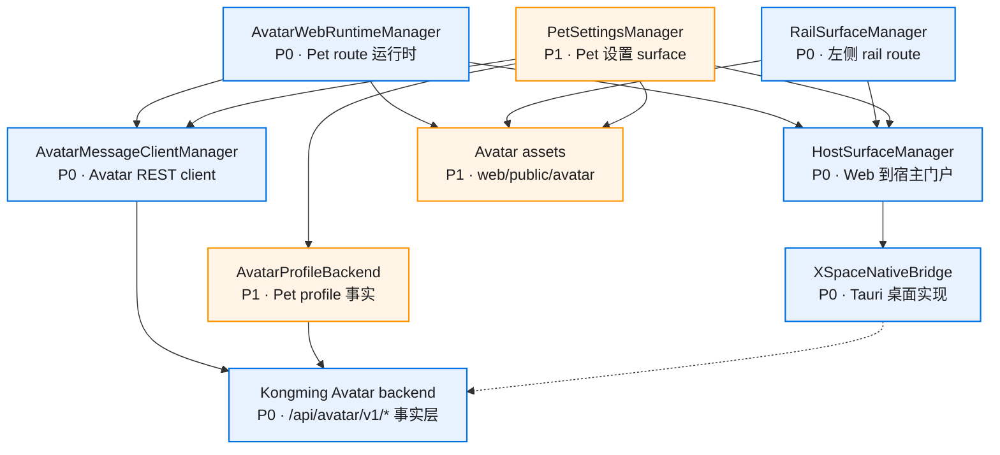

## HostSurfaceManager

### 组件依赖

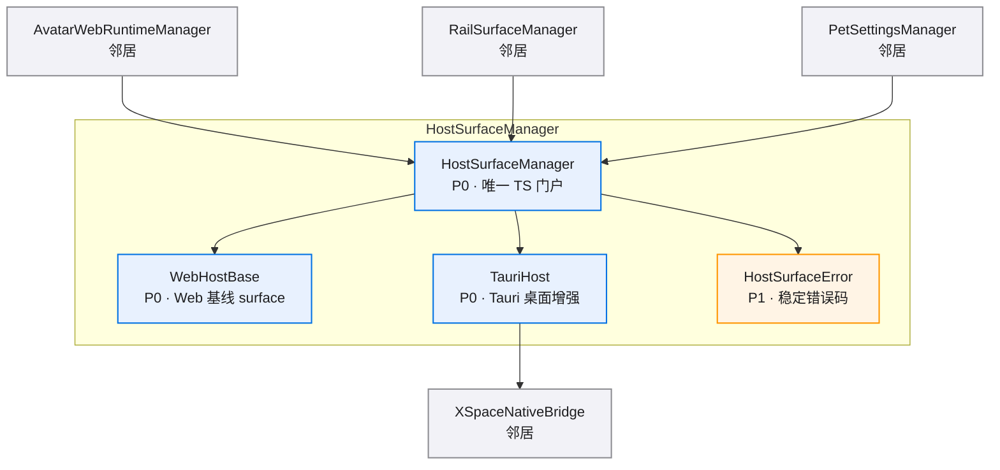

### Surface 生命周期

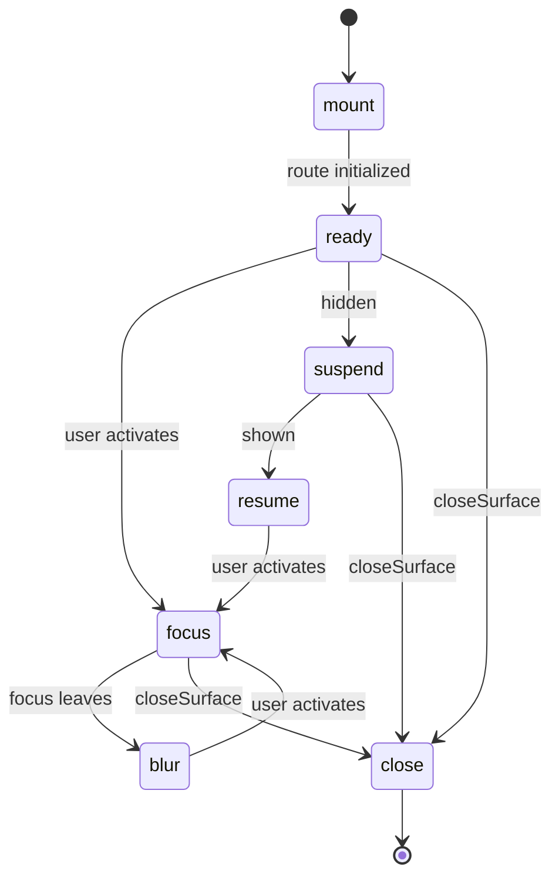

## AvatarWebRuntimeManager

### 组件依赖

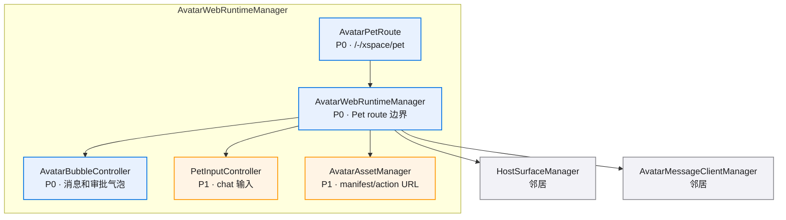

### Pet 消息流程

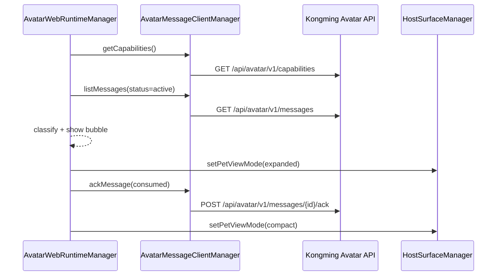

## AvatarMessageClientManager

### 组件依赖

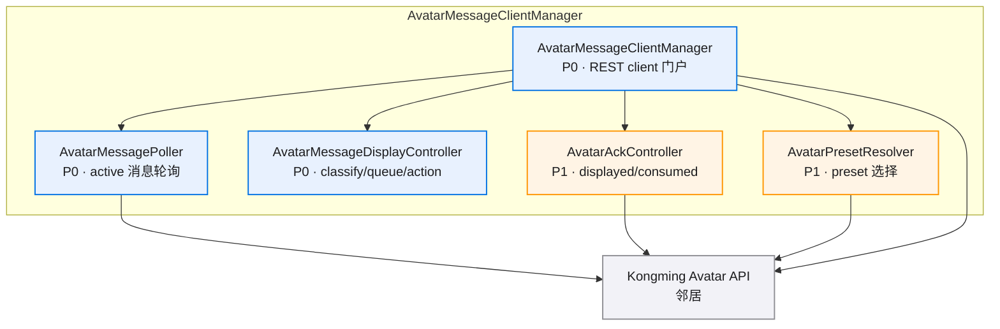

## AvatarProfileBackend

### 组件依赖

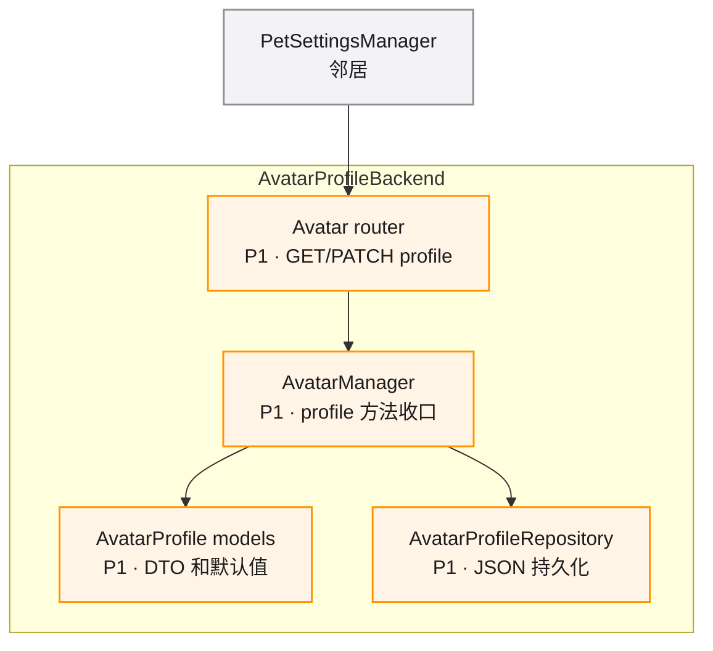

## RailSurfaceManager

### 组件依赖

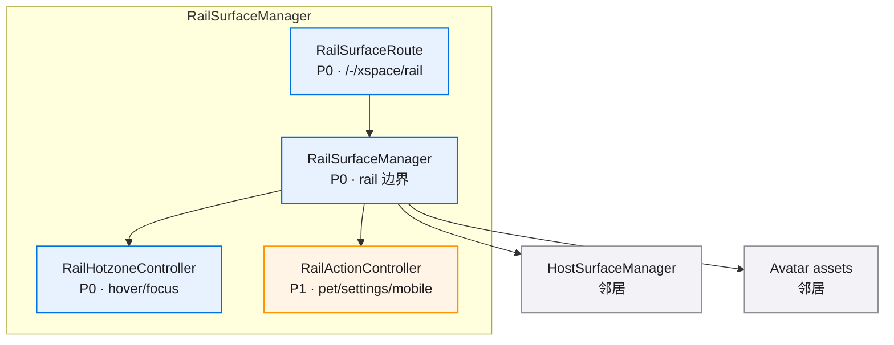

### Rail 打开设置流程

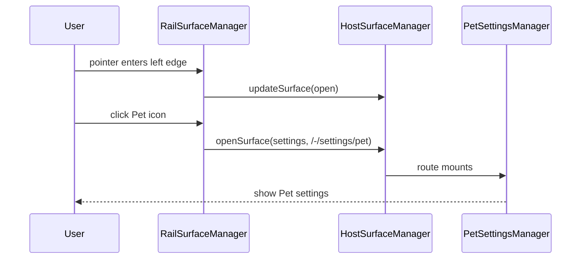

## PetSettingsManager

### 组件依赖

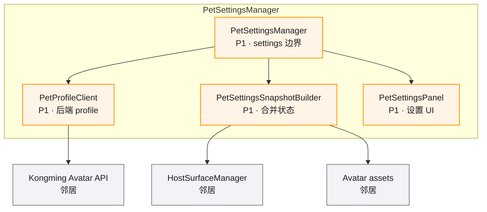

## XSpaceNativeBridge

### Command Mapping

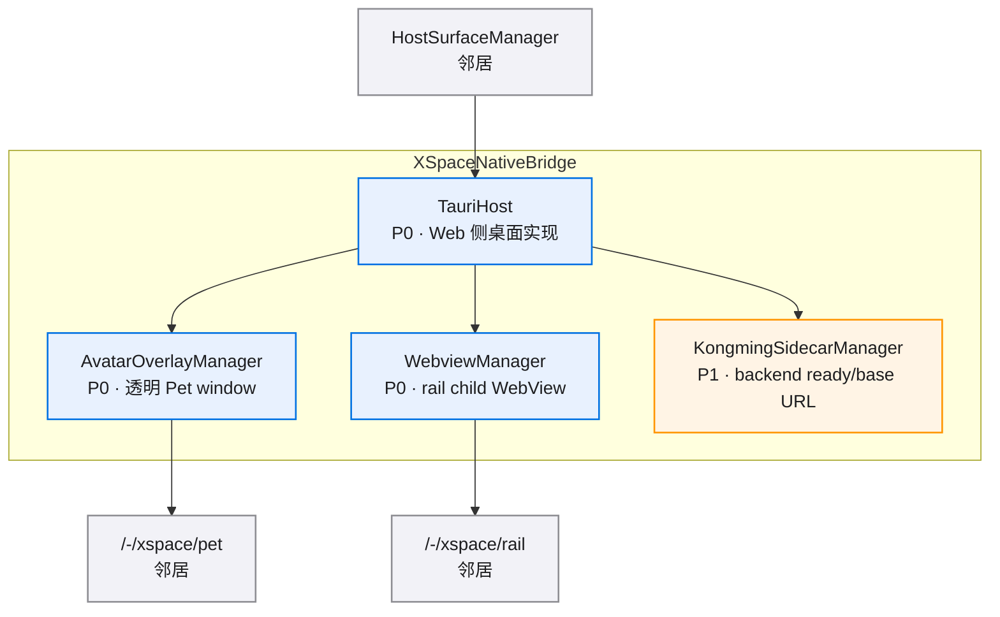

### Pet host 状态流转

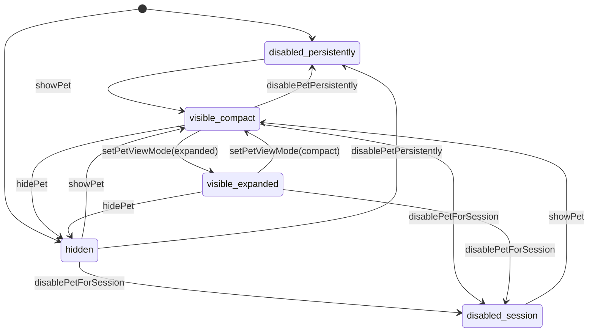
