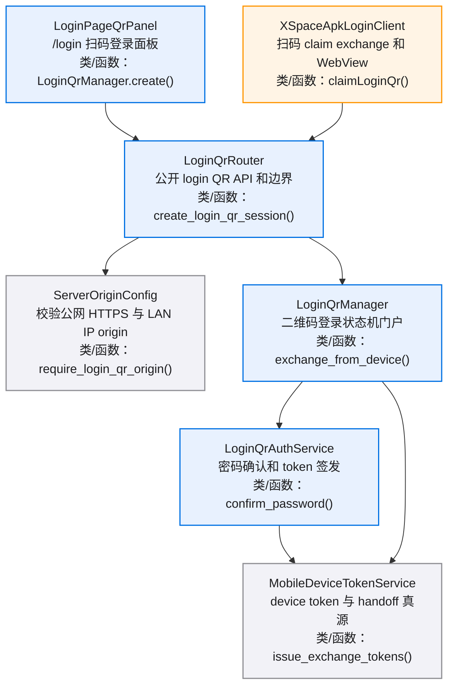
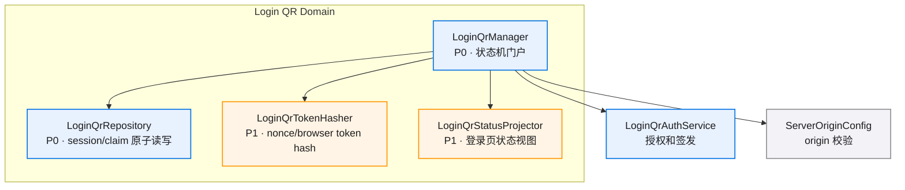
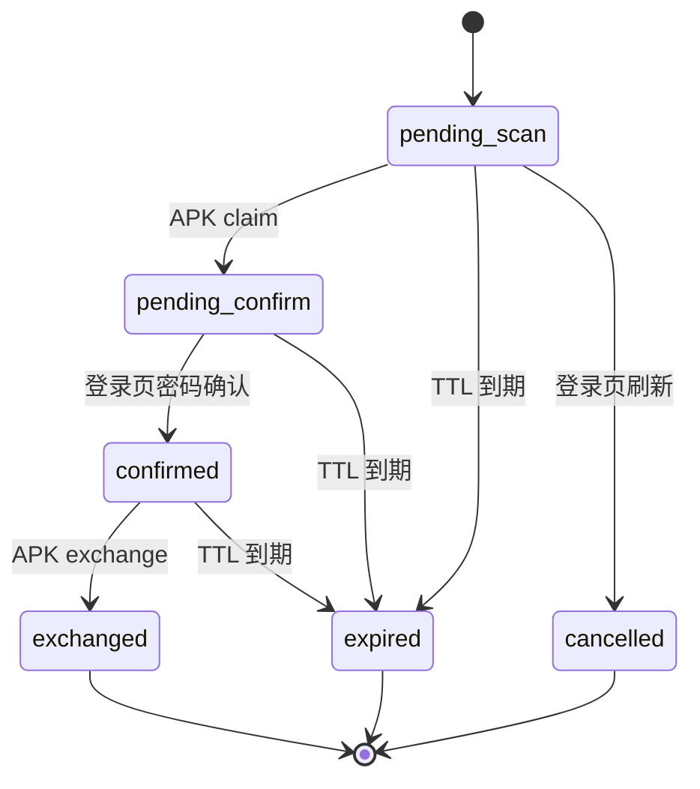
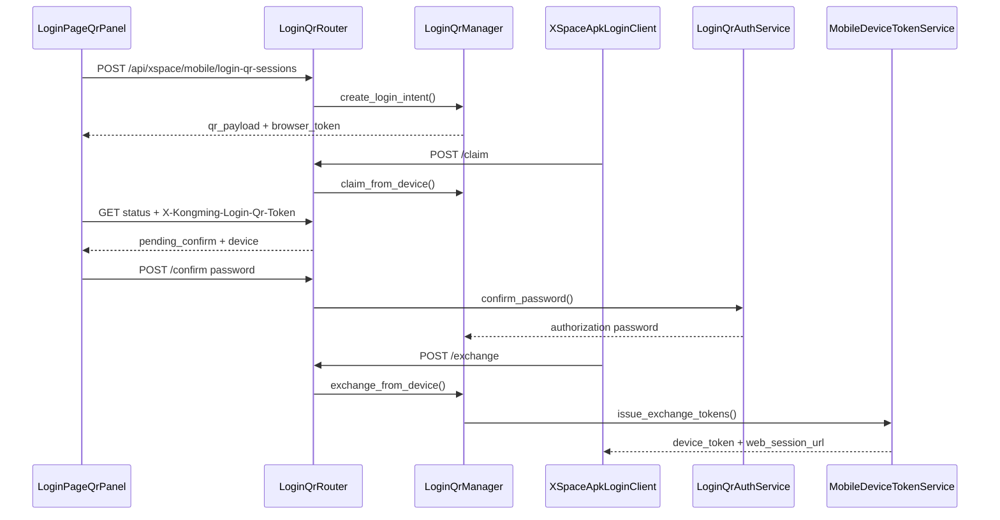
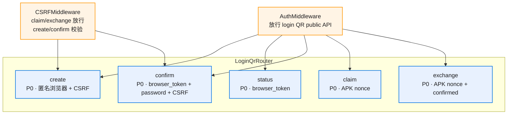
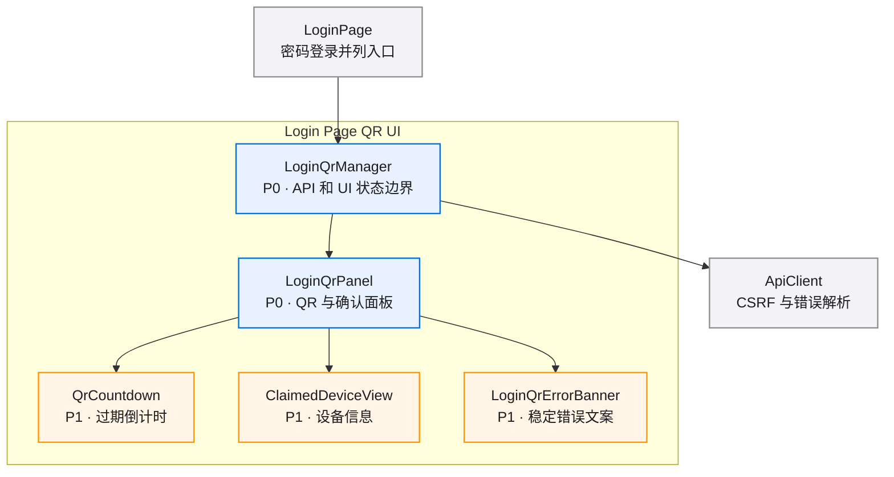
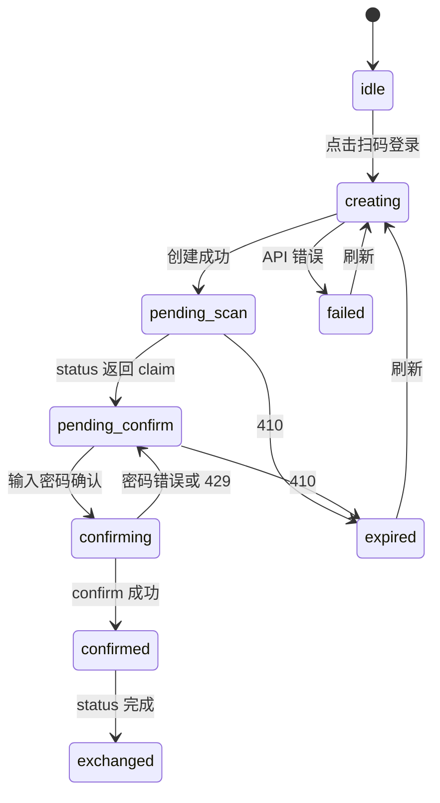
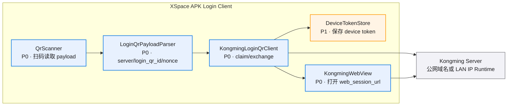

# public-qr-login-v0.1 · 图集

> 本 spec 的唯一图源：所有 mermaid 图集中于此，按模块分节。02/03/04 是文字事实源，本文件是只读视图，增减模块或组件时同步更新对应节。
>
> **查看与缩放**：GitHub 渲染 mermaid 自带缩放/平移控件；VS Code 建议安装 Mermaid Chart（官方）或 Markdown Preview Enhanced 插件以支持缩放。

## 目录

- [总览](./diagrams.md#总览)
- [E2E 测试链路](./diagrams.md#e2e-测试链路)
- [LoginQrManager](./diagrams.md#loginqrmanager)
- [LoginQrRouter](./diagrams.md#loginqrrouter)
- [LoginPageQrPanel](./diagrams.md#loginpageqrpanel)
- [XSpaceApkLoginClient](./diagrams.md#xspaceapkloginclient)
- [数据关系](./diagrams.md#数据关系)

图例：P0 为核心能力，P1 为主要能力，P2 为辅助能力。

## 总览

## E2E 测试链路

```mermaid
flowchart LR
  classDef setup fill:#E8F1FE,stroke:#0071E3,color:#1D1D1F,stroke-width:1.5px
  classDef action fill:#FFF4E5,stroke:#FF9500,color:#1D1D1F,stroke-width:1.5px
  classDef assert fill:#F2F2F7,stroke:#8E8E93,color:#1D1D1F,stroke-width:1.5px

  Seed["准备测试数据<br/>seed password<br/>server_origin=public 或 lan"]:::setup
  Create["登录页动作<br/>POST login-qr-sessions"]:::action
  Claim["fake APK<br/>claim login_qr_id + nonce"]:::action
  Confirm["登录页确认<br/>password + browser_token"]:::action
  Exchange["fake APK<br/>exchange 获取 token 和 URL"]:::action
  Consume["WebView<br/>GET web_session_url"]:::action
  Assert["断言<br/>Set-Cookie kongming_session<br/>origin mode 正确"]:::assert

  Seed --> Create --> Claim --> Confirm --> Exchange --> Consume --> Assert
```

## LoginQrManager

### 组件依赖

### 状态流转

## LoginQrRouter

### 主链路时序

### Auth/CSRF 边界

## LoginPageQrPanel

### 组件依赖

### UI 状态

## XSpaceApkLoginClient

## 数据关系

```mermaid
%%{init: {"theme": "base", "themeVariables": {"background": "#181A1F", "primaryColor": "#242933", "primaryTextColor": "#F5F7FA", "primaryBorderColor": "#6BA7FF", "lineColor": "#AAB4C0", "textColor": "#F5F7FA", "edgeLabelBackground": "#181A1F"}}}%%
flowchart LR
  classDef entity fill:#1F2633,stroke:#6BA7FF,color:#F5F7FA,stroke-width:1.5px
  classDef supporting fill:#191F29,stroke:#AAB4C0,color:#F5F7FA,stroke-width:1.2px

  SESSION["LOGIN_QR_SESSION<br/>────────<br/>PK login_qr_id<br/>status"]:::entity
  ORIGIN["LOGIN_QR_ORIGIN<br/>────────<br/>mode<br/>host"]:::supporting
  CLAIM["LOGIN_QR_CLAIM<br/>────────<br/>PK claim_id<br/>FK login_qr_id"]:::entity
  DEVICE["MOBILE_DEVICE<br/>────────<br/>PK device_id<br/>token_hash"]:::supporting
  HANDOFF["HANDOFF_TOKEN<br/>────────<br/>PK handoff_id<br/>FK device_id"]:::supporting
  COOKIE["KONGMING_SESSION<br/>────────<br/>user_id<br/>iat"]:::supporting

  ORIGIN -->|configures 1:N| SESSION
  SESSION -->|has 0:1| CLAIM
  CLAIM -->|authorizes 1:1| DEVICE
  DEVICE -->|issues 1:N| HANDOFF
  HANDOFF -->|consumes 1:1| COOKIE
```

