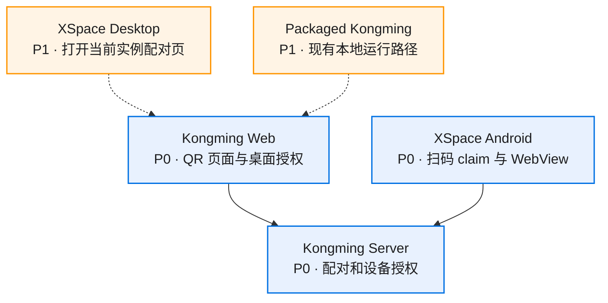
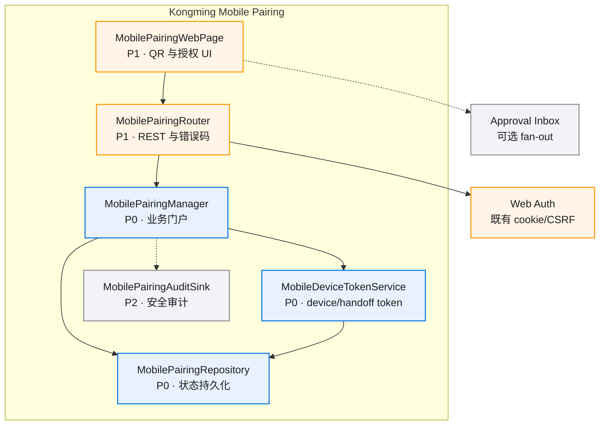
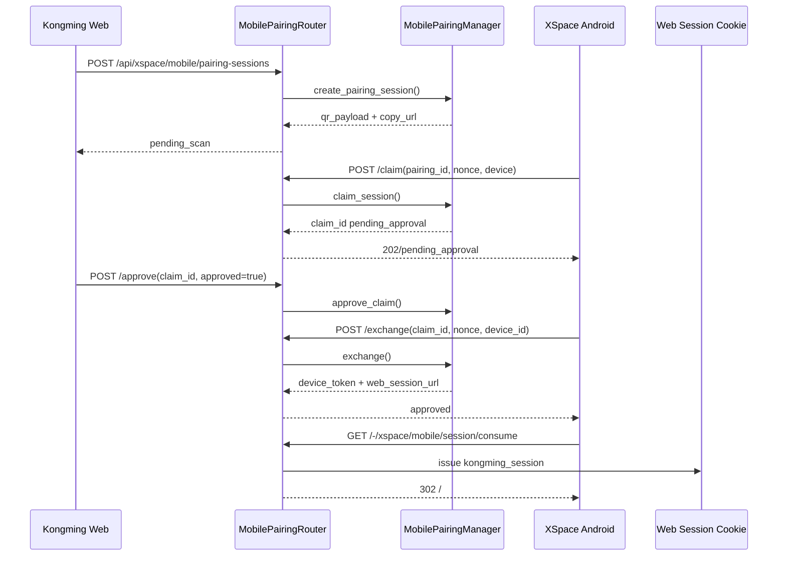
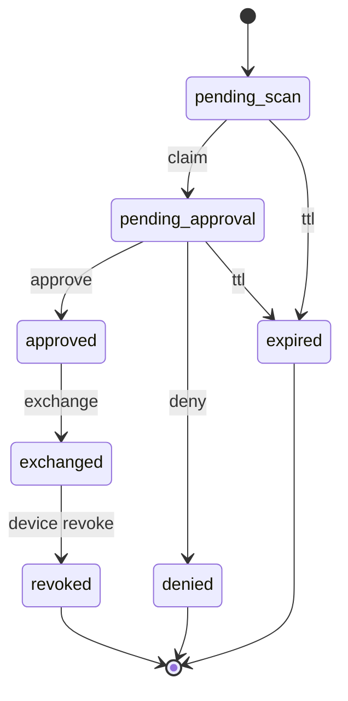
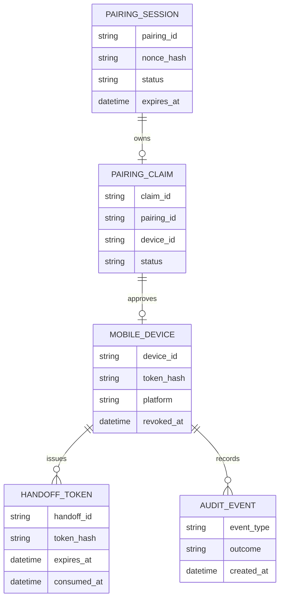

# XSpace Android 远程扫码配对 · 图集

> 本 spec 的唯一图源：所有 mermaid 图集中于此，按模块分节。02/03/04 是文字事实源，本文件是只读视图，增减模块/组件时同步更新对应节。
>
> **查看与缩放**：GitHub 渲染 mermaid 自带缩放/平移控件；VS Code 建议安装 Mermaid Chart（官方）或 Markdown Preview Enhanced 插件以支持缩放。

## 目录

- [总览](#总览)
- [Kongming Mobile Pairing](#kongming-mobile-pairing)
- [P0 时序](#p0-时序)
- [状态流转](#状态流转)
- [数据模型](#数据模型)

图例：P0 核心/阻塞 · P1 主要/必须 · P2 辅助/可选

## 总览

## Kongming Mobile Pairing

### 组件依赖

## P0 时序

## 状态流转

## 数据模型

